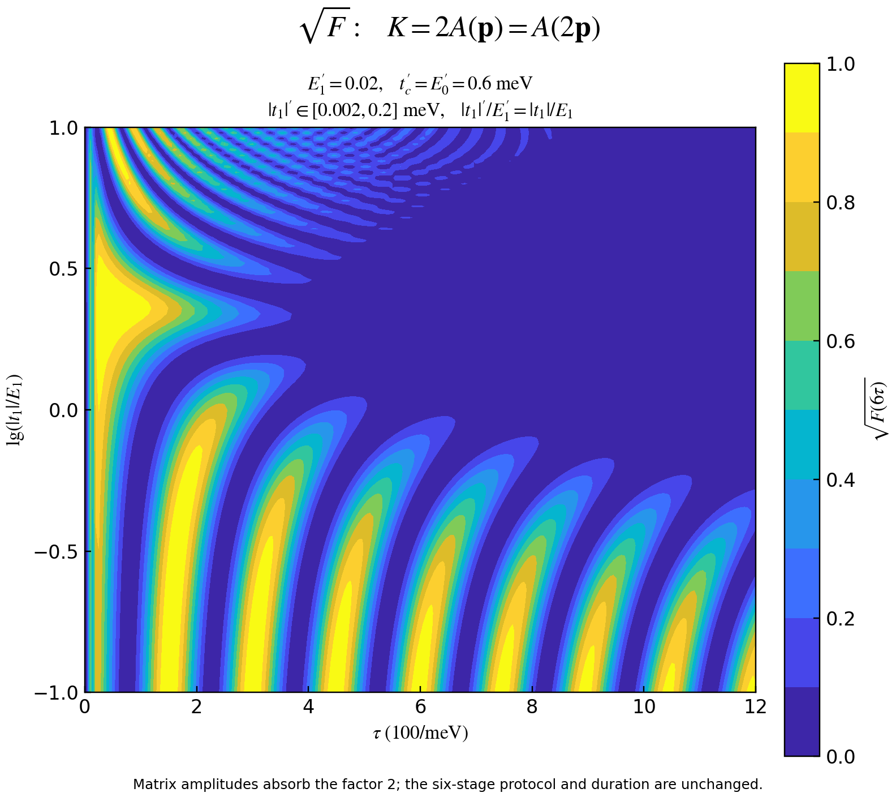
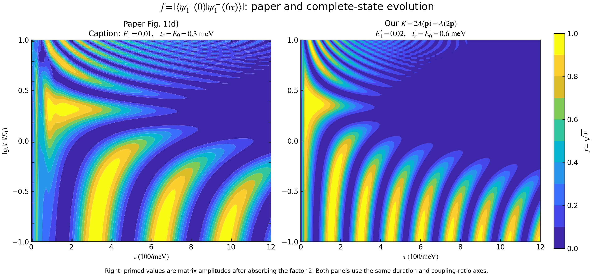
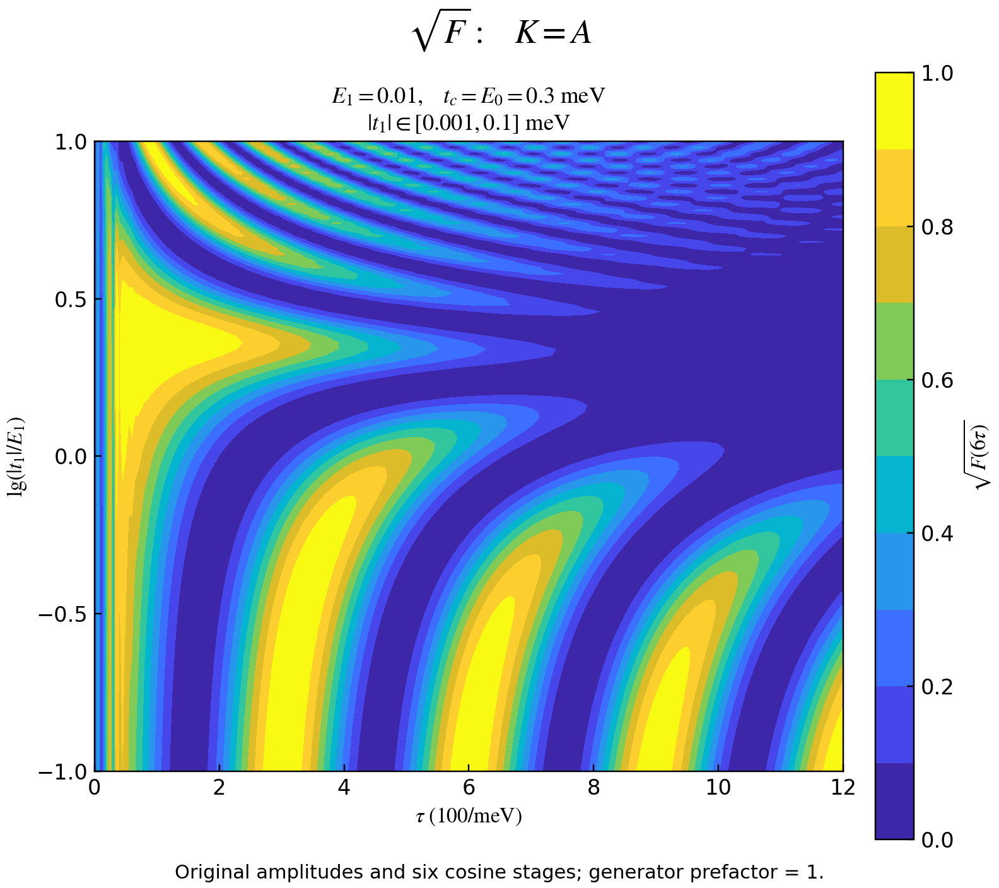

# 将归一化因子 2 吸收到参数中的 √F 图

按本次确认的约定，将五维生成元中的因子 2 吸收到所有能量幅度中：

\[
\boxed{K=2A(E_1,\eta,t_c,E_0)
=A(2E_1,2\eta,2t_c,2E_0),\qquad \eta=|t_1|.}
\]

右边的 \(A\) 按原矩阵形式直接使用加倍的参数；它的外面不再额外乘 2。因此这与此前的 \(K=2A\) 是同一个生成元，而不是 \(4A\)。

| 量 | 原始幅度 | 吸收因子 2 后的矩阵输入 |
|---|---:|---:|
| \(E_1\) | 0.01 meV | 0.02 meV |
| \(\eta\) | 0.001–0.1 meV | 0.002–0.2 meV |
| \(t_c\)，同时决定 \(t_2,t_3\) 包络幅度 | 0.3 meV | 0.6 meV |
| \(E_0\)，决定 \(E_d\) 包络幅度 | 0.3 meV | 0.6 meV |

撇号表示吸收归一化因子后的矩阵输入，论文图注的物理 \(E_1\) 仍为 0.01 meV。时间 \(\tau\)、六段余弦门控的归一化形状、总时长 \(6\tau\)、积分容差和最大局部步长均沿用原设定。

所有能量幅度同时乘 2，所以 \(\eta'/E_1'=\eta/E_1\)。横轴为 \(\tau/(100/\mathrm{meV})\in[0,12]\)，纵轴为 \(\lg(\eta/E_1)\in[-1,1]\)，色标为论文定义的重叠模长 \(f=\sqrt F\)，采用原 PDF 的十档颜色。

## 单独的 √F 图



[可导出 PDF](sqrtF_K2A_doubled_matrix_parameters.pdf)。

这里复用已保存的完整状态参数网格，因为两种写法在每个时刻的生成元严格相同。归一化因子的这种改写不会移动原有的峰，也不会消除此前与论文图像之间的差异。

## 与论文原图并排比较



左图直接使用论文原 PDF 的热图裁剪，并按原坐标范围定位；右图来自完整十分量状态方程。两图使用相同的坐标范围和 0–1 色标。原论文图只提供色档信息，不等于作者原始数组。

[对照图 PDF](paper_vs_K2A_sqrtF.pdf)。弱耦合区仍可见论文亮带间距约 325，而当前模型约 150，时间单位均为 \(1/\mathrm{meV}\)。详细比较及取样限制见 [统一分析文档](../../pde_analysis_and_results.md#paper-comparison)。

## 等价性核对与复现

分别在 \((\tau,\eta/E_1)=(100,0.1),(300,1),(1000,10)\) 处，用独立波函数程序输入 \(E_1'=0.02,t_c'=E_0'=0.6,\eta'=0.02(\eta/E_1)\)，并将生成元外部因子设为 1，再与原 \(K=2A\) 网格比较。具体状态、保真度和模长差异保存在 [verification.json](verification.json)。这项数值核对对应两种矩阵写法，代数等价性由 \(A\) 对全部能量幅度的线性性保证。

原始数组：[endpoint_map.npz](../state_evolution/endpoint_map.npz)。程序：[plot_normalization_comparison.py](../plot_normalization_comparison.py)。运行：

```sh
.venv/bin/python -B fixed_protocol_pde/plot_normalization_comparison.py
```

## K=A：使用原始幅度的归一化对照

本次采用

\[
\boxed{K=A(E_1,\eta,t_c,E_0),\qquad
E_1=0.01,\quad t_c=E_0=0.3,\quad\eta\in[0.001,0.1]\ \mathrm{meV}.}
\]

相对于原 \(K=2A\)，只将生成元外部系数改为 1；六段余弦门控、段时长范围、耦合比范围及积分设置保持原设定。本节是矩阵归一化的对照计算，原始哈密顿量导出 \(K=2A\) 的推导仍见统一分析文档。



[单图 PDF](sqrtF_KA_original_parameters.pdf)。


[三图对照 PDF](paper_vs_K2A_vs_KA_sqrtF.pdf)。从左到右为论文原图、原 \(K=2A\) 结果、当前 \(K=A\) 试验，均使用相同坐标范围和论文的 0–1 重叠模长色标。

### 峰位为什么向较长时长移动

全局归一化时间为 \(\zeta=t/\tau\)，当前方程是

\[
\partial_\zeta\mathcal B_A=[\tau A,\mathcal B_A].
\]

原 \(K=2A\) 方程取段时长 \(\tau/2\) 时，同样得到 \([2(\tau/2)A,\mathcal B]\)。初态和归一化门控相同，解的唯一性给出

\[
\boxed{\mathcal B_A(\zeta;\tau)=\mathcal B_{2A}(\zeta;\tau/2),\qquad
f_{A,\rm end}(\tau)=f_{2A,\rm end}(\tau/2).}
\]

因此对应峰的时长坐标和间距变成原来的两倍，峰高相同。这是生成元整体缩放的精确结果；在同一个固定 \(\tau\) 上，两种归一化的保真度通常不同。

以 \(\eta/E_1=0.1\) 切片的已细化代表性峰为例：

| 原 K=2A 峰时长 | K=A 峰时长 | 对应的 \(f_\star\) |
|---:|---:|---:|
| 150.428246 | 300.856491 | 0.999376 |
| 299.859299 | 599.718598 | 0.993899 |
| 448.570128 | 897.140255 | 0.984696 |

时长单位为 \(1/\mathrm{meV}\)。新峰位置由精确缩放关系获得，前两指定峰的间距从 149.431053 变为 298.862107。相比论文近邻弱耦合切片约 325 的亮带间距，这一缩放使主要条带更接近，但后续峰仍逐渐提前，尚未完全对齐。论文色档不是精确峰顶数据，具体取样范围见 [论文对齐分析](../paper_alignment.md)。

### 计算与核对

输出网格沿用 101 个耦合对数值、241 个时长值，\(\Delta\tau=5/\mathrm{meV}\)。积分器及其设置沿用 DOP853、rtol \(2\times10^{-11}\)、atol \(2\times10^{-13}\)、最大局部归一化步长 0.025。

\(\tau=0,10,20,\ldots,1200\) 的节点直接使用原 \(K=2A\) 数组在 \(\tau/2\) 的精确对应节点，不作插值。其余 \(\tau=5,15,25,\ldots,1195\) 的节点用完整十分量方程和 \(K=A\) 重新积分。

独立复波函数核对取 \((\tau,\eta/E_1)=(105,0.1),(300,1),(995,10)\)，覆盖新积分节点和精确缩放节点；同时检查整个网格的状态约束和保真度范围。结果见 [verification_KA.json](verification_KA.json)，全部状态与保真度数据见 [endpoint_map_KA.npz](endpoint_map_KA.npz)。

程序：[plot_generator_A.py](../plot_generator_A.py)。重新计算或使用已有数组绘图：

```sh
.venv/bin/python -B fixed_protocol_pde/plot_generator_A.py
.venv/bin/python -B fixed_protocol_pde/plot_generator_A.py --replot
```
