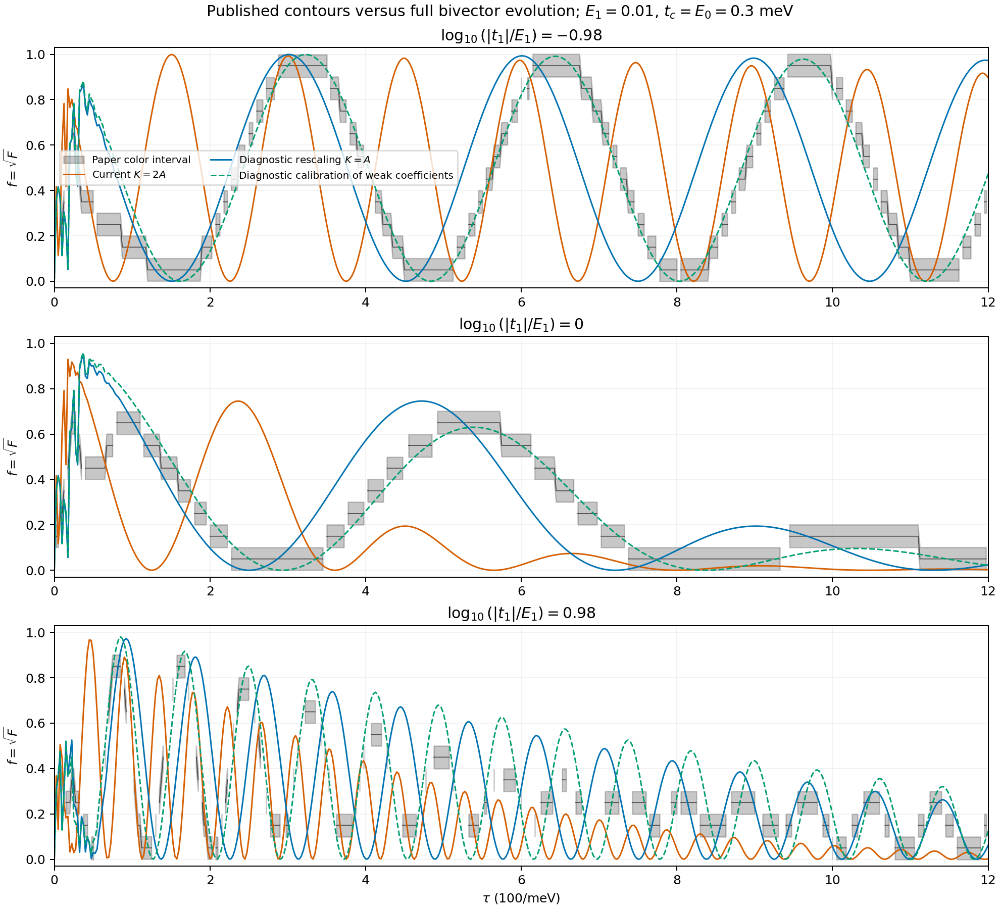

# 完整几何状态与论文 Fig. 1(d) 的定量核对

本次统一采用图注的 \(E_1=0.01\,\mathrm{meV}\)。正文的 \(0.001\) 按用户确认的笔误处理，不作为候选参数。结论是：完整 \(\mathcal B\) 方程与同一生成元下的波函数演化一致，但在既定门控、\(t_c=E_0=0.3\,\mathrm{meV}\) 和两轮六段协议下，当前 \(K=2A\) 尚未定量复现论文图。生成元整体减半能改善条带数量和间距，仍留下累计相位与高度差异，不能直接作为模型修正。

后续 [有效哈密顿量独立核对](effective_hamiltonian_audit.md) 已完成：原始算符、文档的四元数矩阵及普通费米子 BdG 矩阵均严格给出 \(K=2A\)。因此下文的 \(K=A\) 和经验系数只保留为诊断试验，不是所写哈密顿量的另一种等价实现。`model.md` 的三个矩阵表头标签已修正；当前 PDE 的实际系数一直正确。

## 1. 比较的对象与固定设置

沿用 [显式方程](explicit_parameter_equations.md)，记

\[
A=E_1L_{12}+|t_1|gL_{1b}-pL_{2a}+rL_{3a}+e_dL_{ab},
\qquad \partial_t\mathcal B=[2A,\mathcal B].
\]

没有采用小 \(E_1\tau\) 或小 \(|t_1|\tau\) 展开，也没有在主要比较中使用慢模投影。由完整状态读取

\[
F=\frac{d^2-d}{2}+\frac14\sum_{j=1}^3(x_j^2+y_j^2),
\qquad f=\sqrt F.
\]

与论文色标比较的是重叠模长 \(f\)。它与我们记作 \(F\) 的平方保真度有明确的开方关系。

推导仍保留 \(\tau\) 的符号；本次图像核对才选择数值切面：

| 项目 | 取值 |
|---|---|
| \(E_1\) | \(0.01\,\mathrm{meV}\) |
| \(t_c,E_0\) | 都为 \(0.3\,\mathrm{meV}\) |
| 可控时长扫描 | \(0\le\tau\le1200/\mathrm{meV}\) |
| 不可控耦合扫描 | \(-1\le\log_{10}(|t_1|/E_1)\le1\) |
| 总时间 | \(6\tau\)，两次交换 |
| 门控 | 既定余弦包络，逐段连续交接 |
| 积分器 | DOP853，rtol \(2\times10^{-11}\)，atol \(2\times10^{-13}\)，最大局部归一化步长 0.025 |

候选比较只改变显式列出的矩阵系数，不修改门控或可控幅度。程序默认仍为 \(K=2A\)。

## 2. 从原 PDF 取得什么数据

[论文原文](../arts/prb111.pdf)第 2 页的 Fig. 1(d) 是十档填色的矢量等高图。本次提取其十组多边形，并按坐标轴映射到 \((\tau,\log_{10}(|t_1|/E_1))\)。保留了 [原始色带 SVG](paper_alignment/paper_contours.svg) 和 [原图裁剪](paper_alignment/paper_heatmap.png)。

按色标将十档解释为等宽的 \(f\) 区间 \([0,0.1],\ldots,[0.9,1]\)。这是图像数字化采用的分档假设；所得是保真度区间，不是作者的原始数组，更不能精确恢复某个峰的最高值。RGB 与色带调色板相距超过 10 的像素被排除，以减少文字、边框与抗锯齿影响。

粗网格为 25 个时长、17 个耦合对数点，其中 373 点通过像素筛选。令 \(m_i\) 为对应色带中值，同时报告

\[
\epsilon_{\rm mid}=\sqrt{\frac1N\sum_i(f_i-m_i)^2},\qquad
\epsilon_{\rm out}=\sqrt{\frac1N\sum_i\max(|f_i-m_i|-0.05,0)^2}.
\]

前者包含色带自身的量化影响；后者测量预测超出该色带的距离。它们是选定像素的比较指标，不是全域误差界。

## 3. 系数约定的候选检验

在 \(\{\gamma_i,\gamma_j\}=2\delta_{ij}\)、\(H=i\sum_{i<j}a_{ij}\gamma_i\gamma_j\) 的当前约定下，

\[
[\gamma_i\gamma_j,\gamma_k]
=2(\delta_{jk}\gamma_i-\delta_{ik}\gamma_j),
\]

给出 Majorana 向量生成元 \(K=2A\)。因此因子 2 有代数依据。论文实际数值程序如何把标注能量装入其波函数矩阵，不能仅凭图像反推为已知事实。

下表在同一组 373 点上比较；所有系数缩放都是诊断候选：

| 候选 | \(\epsilon_{\rm mid}\) | \(\epsilon_{\rm out}\) |
|---|---:|---:|
| 当前 \(K=2A\) | 0.3545 | 0.3202 |
| 整体改为 \(K=A\) | 0.2335 | 0.1986 |
| 保持 \(K=2A\)，仅两个弱耦合系数减半 | 0.2416 | 0.2058 |
| 保持 \(K=2A\)，仅 \(E_1\) 系数减半 | 0.2759 | 0.2417 |
| 保持 \(K=2A\)，仅 \(|t_1|\) 系数减半 | 0.3706 | 0.3355 |

整体减半有明显改善，但超出色带的误差仍然很大。它不足以证明论文使用 \(K=A\)，也不足以把剩余差异全部归因于归一化。

## 4. 直接比较亮带位置与间距

取 \(\log_{10}(|t_1|/E_1)=-0.98\)，即 \(|t_1|/E_1\simeq0.104713\)，避开底部坐标轴。图像沿该切片每 \(2.5/\mathrm{meV}\) 采样。\(\tau\ge100/\mathrm{meV}\) 后，论文的前三条最高色档区间及模型前三个显著峰为：

| 序号 | 论文 \(f\in[0.9,1]\) 的亮带区间 | 当前 \(K=2A\) 峰位置 | 候选 \(K=A\) 峰位置 |
|---|---|---:|---:|
| 1 | \([287.5,350]\) | 150.0 | 302.5 |
| 2 | \([615,675]\) | 300.0 | 600.0 |
| 3 | \([942.5,997.5]\) | 450.0 | 897.5 |

时长单位为 \(1/\mathrm{meV}\)。模型数字是间隔 2.5 的网格峰估计；显著峰由 prominence 至少 0.3 筛选，不统计所有短时微弱振荡。论文数字是亮带范围，不能当作精确驻点。三条亮带的中点为 318.75、645、970；中点间距约为 326.25、325，但中点也不必就是峰顶。

当前模型在同一窗口内多次往返目标，峰间距约 150。整体减半后的前三峰高度约为 0.9992、0.9932、0.9830，间距约 300。其第一峰落入论文第一亮带，后两峰依次提前，呈现累计相位偏差。这比仅凭热图相似程度更具体。

完整切片比较如下。灰带表示论文的颜色区间，橙线是当前模型，蓝线是整体减半候选，绿虚线是下节的经验校准。



[可导出 PDF](paper_alignment/alignment_slices.pdf)。

## 5. 图像插值能否解释偏移

矢量多边形中反复出现的坐标间隔提示原图可能采用 100 个时长节点、101 个耦合对数节点。这里只把它作为网格假设：在三个对数切片 \(-0.98,0,0.98\) 上，重新计算 100 个均匀时长节点的完整状态，并作线性插值。该检查没有恢复作者原始数据，也没有确定其等高线算法。

在低耦合切片、\(\tau\ge100\) 的有效采样点上，整体减半候选的插值影响 RMS 为 0.00207，最大为 0.00404。三个切片合计，中值误差只从 0.2626 降至 0.2597；这里的采样集与第 3 节不同，不能将两节的数值直接混用。强耦合切片的插值影响更大，但这项网格检查不能解释低耦合区的累计亮带偏移。

## 6. 经验校准提供的诊断

为判断剩余差异的规模，在 \(K=A\) 候选下额外拟合两个弱耦合的矩阵系数乘子。标注的 \(E_1\) 仍为 0.01；校准采用

\[
A_{\rm diag}=0.938264\,E_1L_{12}
+1.050848\,|t_1|gL_{1b}
-pL_{2a}+rL_{3a}+e_dL_{ab}.
\]

这不是重新确定物理 \(E_1\)，也不是从哈密顿量推出的系数。它只检验这种数值对应能否接近原图。\(t_c,E_0\)、门控和协议都未参与拟合。

仅使用 \(\tau\ge60\) 的有效粗网格点，并按交错位置划分为训练 177 点、保留检验 181 点：

| 样本集 | \(\epsilon_{\rm mid}\) | \(\epsilon_{\rm out}\) | 落入论文色带的比例 |
|---|---:|---:|---:|
| 拟合样本 | 0.08093 | 0.05745 | 70.6% |
| 保留样本 | 0.08765 | 0.06390 | 68.5% |

保留样本未参加拟合，但交错像素仍然相关，不能当作独立物理实验。校准后的低耦合条带明显接近原图，中等耦合峰高和强耦合区仍有差异。因此绿线是诊断结果，不能称作论文图的严格复现或当前模型的预测。

## 7. 对几何框架本身的核对与下一步

对当前生成元、整体减半候选和诊断校准，分别在 \(\tau=300\)、标注 \(|t_1|/E_1=1\) 处求解独立复波函数及其一、二阶时长响应。三组中，\(\mathcal B\) 分量的最大差异为 \(9.70\times10^{-12}\)，\(F\)、\(F_\tau\)、\(F_{\tau\tau}\) 的最大差异均小于 \(4.3\times10^{-15}\)。该核对验证的是给定生成元下的表示转换与响应计算，不能单独验证论文使用了哪种矩阵约定。

当前已经确认：原始有效哈密顿量到单粒子矩阵的对应、波函数到几何状态的转换，以及当前分段 PDE 的系数和传递，均通过独立核对。采用图注的 0.01 后，所写模型的亮带仍与原图不一致；简单整体缩放及所检验的网格插值都不足以消除差异。所写模型的矩阵已在 [独立核对文档](effective_hamiltonian_audit.md) 中明确列出；尚未确定的是作者实际数值作图与这套模型和协议之间的对应，不能把经验乘子当作唯一解释。

对当前明确的 \(K=2A\) 模型，参数 PDE 及 [峰分支方程](peak_structure.md) 仍可直接研究 \(E_1,|t_1|\) 如何移动峰、改变高度和几何偏差；这些结果的有效性与是否复现论文像素是两个需要分别核对的问题。

实现：[align_paper_fig1d.py](align_paper_fig1d.py)。完整指标：[alignment.json](paper_alignment/alignment.json)；数值数组：[alignment.npz](paper_alignment/alignment.npz)。重新计算：

```sh
.venv/bin/python -B fixed_protocol_pde/align_paper_fig1d.py
```
