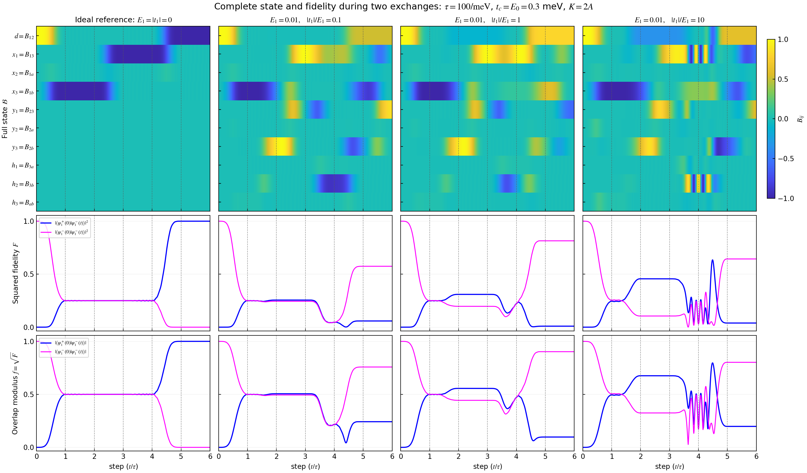
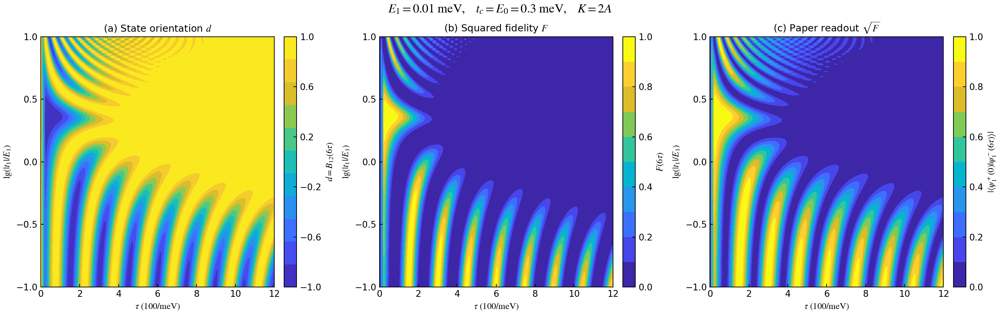
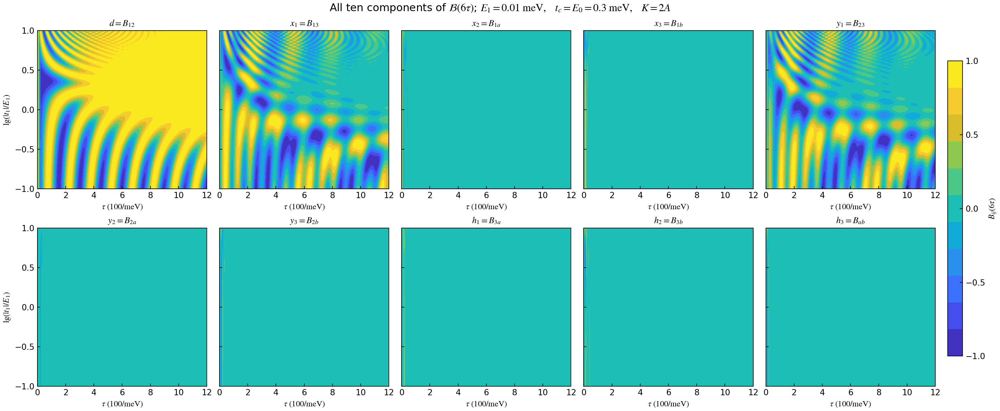
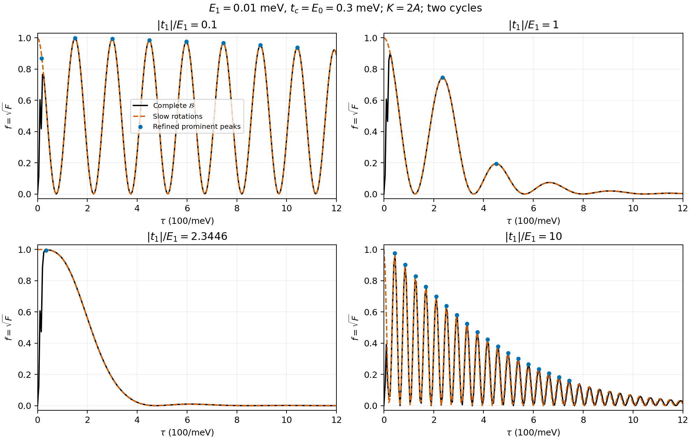
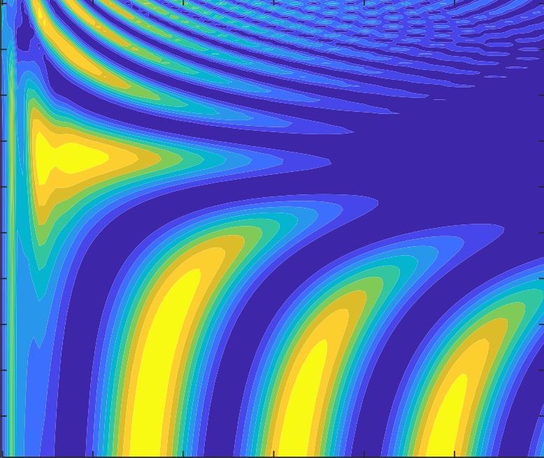

# 固定编织协议下的几何状态 PDE、保真度与结果图像分析

本文集中整理当前模型的完整状态方程、两个不可控参数的响应方程、六段初值与接口、保真度的几何表达，以及已生成图像中峰的位置、间距和高度。推导保留可控时长 \(\tau\) 的符号；数值结果沿用已有门控、积分设置和数据。

当前已经得到的是：**对所写有效哈密顿量精确成立的状态演化与混合时间—参数偏导系统，以及从状态读取保真度、梯度和曲率的方法。** 它不要求 \(E_1\tau\) 或 \(|t_1|\tau\) 为小量。一般参数下仍需求解时间初值问题，尚未得到所有峰的闭式坐标，也未得到只含终点标量 \(F_{\rm end}(E_1,|t_1|)\) 的独立闭合 PDE。

图像是该完整系统的数值解。慢旋转和领先相位公式用来解释条带，但属于额外近似。当前模型的状态方程已通过原始哈密顿量、旋量及 BdG 波函数的独立核对；与论文 Fig. 1(d) 的定量差异仍未完全解释。

阅读导航：[显式 PDE](#explicit-pde) · [保真度公式](#fidelity) · [时间演化图](#time-figures) · [终点参数图](#endpoint-figures) · [峰的定量分析](#peaks) · [慢旋转解释](#slow-rotations) · [验证结果](#verification) · [论文对比](#paper-comparison) · [文件索引](#artifacts)。

## 1. 研究对象与统一约定

| 符号 | 含义及处理方式 |
|---|---|
| \(E=E_1\) | 不可控杂化幅度，一次演化中保持不变 |
| \(\eta=\lvert t_1\rvert\) | 不可控耦合幅度，一次演化中保持不变；实际耦合为 \(q(t)=\eta g(t)\) |
| \(\tau>0\) | 可控的单段时长，推导保留符号 |
| \(t_c,E_0\) | 可控的编织耦合和量子点能级幅度 |
| \(t\) | 物理演化时间，范围 \([0,6\tau]\) |
| \(\zeta=t/\tau\) | 全局归一化时间，范围 \([0,6]\) |
| \(v=\zeta-j\) | 第 \(j+1\) 段的局部归一化时间，\(j=0,\ldots,5\) |
| \(\mathcal B\) | 完整有向平面状态，用十个反对称分量表示 |
| \(F\) | 本文的平方保真度，即目标态重叠的模平方 |
| \(f=\sqrt F\) | 论文图中的重叠模长 |

取 \(\hbar=1\)，能量单位为 meV，时间单位为 \(1/\mathrm{meV}\)。一轮三段完成一次交换，耗时 \(3\tau\)；重复两轮共六段，终点为 \(6\tau\)。第二轮接收第一轮的完整终态。

我们研究的场是

\[
\mathcal B(E,\eta,\zeta\mid\tau,t_c,E_0).
\]

对 \(E,\eta\) 求偏导时固定可控设计量；对 \(\tau\) 求导用于比较不同设计时长，不把 \(\tau\) 当作第三个不可控参数。固定 \(\tau\) 的 \((E,\eta)\) 参数图，与论文固定 \(E\) 的 \((\tau,\eta/E)\) 图，是同一个状态场的不同切面。

## 2. 从有效哈密顿量到 SO(5) 生成元

固定模式顺序 \((1,2,3,a,b)\)，令

\[
L_{ij}=e_i e_j^T-e_j e_i^T,
\qquad p=|t_2(t)|,\quad r=|t_3(t)|,\quad e_d=E_d(t).
\]

[model.md](model.md) 开头的有效哈密顿量是

\[
H=i e_d\gamma_a\gamma_b+iE\gamma_1\gamma_2
+ip\gamma_a\gamma_2-iq\gamma_b\gamma_1-ir\gamma_a\gamma_3.
\]

利用不同 Majorana 算符之间的反对易关系，按升序指标写成

\[
H=i\left(E\gamma_1\gamma_2+q\gamma_1\gamma_b
-p\gamma_2\gamma_a+r\gamma_3\gamma_a+e_d\gamma_a\gamma_b\right).
\]

因此定义

\[
A=EL_{12}+qL_{1b}-pL_{2a}+rL_{3a}+e_dL_{ab}
=\begin{pmatrix}
0&E&0&0&q\\
-E&0&0&-p&0\\
0&0&0&r&0\\
0&p&-r&0&e_d\\
-q&0&0&-e_d&0
\end{pmatrix}.
\]

在 \(\{\gamma_i,\gamma_j\}=2\delta_{ij}\) 的约定下，

\[
i[H,\gamma_i]=2\sum_jA_{ij}\gamma_j.
\]

对应的五维实演化生成元与波函数方程为

\[
\boxed{K=2A,\qquad \partial_t\psi=K\psi.}
\]

因子 2 由算符代数确定。例如取 \(c=(\gamma_1+i\gamma_2)/2\)，有

\[
iE\gamma_1\gamma_2=E(2c^\dagger c-1),
\]

两占据态能量为 \(-E,+E\)，激发能差为 \(2E\)。不能仅为了贴近论文图，把 \(K\) 改为 \(A\) 而仍声称是同一组系数的同一个哈密顿量。

旋量语言给出同一结果。令 \(\Sigma_{ij}=\tfrac14[\Gamma_i,\Gamma_j]\)，其中 \(4=a,5=b\)，则

\[
H_{\rm spin}=2i(E\Sigma_{12}+q\Sigma_{15}
-p\Sigma_{24}+r\Sigma_{34}+e_d\Sigma_{45}).
\]

它通过共轭作用诱导上述五维旋转。这里计算的是选定五模波函数的保真度；任选四分量多体旋量态的重叠属于另一观测量。

## 3. 为什么采用状态量 \(\mathcal B\)

### 3.1 从波函数得到完整几何状态

初态与目标态为

\[
\psi_0=\frac{e_1-ie_2}{\sqrt2},\qquad
\psi_\star=\frac{e_1+ie_2}{\sqrt2}.
\]

由于 \(K\) 为实反对称矩阵，演化后的态始终可以写为

\[
\psi=\frac{u-iv}{\sqrt2},\qquad
u^Tu=v^Tv=1,\quad u^Tv=0.
\]

定义

\[
\boxed{\mathcal B=uv^T-vu^T,\qquad
P=-\mathcal B^2=uu^T+vv^T,\qquad
\rho=\psi\psi^\dagger=\frac{P+i\mathcal B}{2}.}
\]

\(P\) 指定二维平面的位置，\(\mathcal B\) 同时指定其定向；波函数的整体相位只是在平面内更换正交基，不改变 \(\mathcal B\)。反过来，\(\mathcal B\) 唯一确定 \(\rho\)，所以它保留了这一可达态族除整体相位外的全部信息。

该态族是

\[
SO(5)/(SO(2)\times SO(3)),
\]

维数为 \(10-1-3=6\)。它不是所有任意五维复纯态的集合，也不应被当作任意多体态的完整描述。

### 3.2 演化方程与保持的约束

由 \(u_t=Ku,v_t=Kv\)，直接求导得到

\[
\boxed{\partial_t\mathcal B=[K,\mathcal B],\qquad
\mathcal B(E,\eta,0)=L_{12}.}
\]

等价地，在固定的归一化区间上，

\[
\boxed{\partial_\zeta\mathcal B=[G,\mathcal B],\qquad G=2\tau A.}
\]

方程保持

\[
\mathcal B^T=-\mathcal B,\quad
\mathcal B^3=-\mathcal B,\quad
\operatorname{rank}\mathcal B=2,\quad
\|\mathcal B\|_F^2=2.
\]

这些保持律来自正交共轭演化，是解析恒等式。数值残差用于检验实现和积分精度。

虽然形式上可以写 \(\mathcal B=R\mathcal B_0R^T\)，实际方程右边只依赖已知 \(K\) 和当前 \(\mathcal B\)，不要求先求出整个传播矩阵 \(R\)。这让状态、参数响应和保真度可以在同一系统内研究；它并不保证存在初等函数形式的通解。

## 4. 六段门控、初值和接口

### 4.1 所有系数都是明确的已知函数

每段取 \(v\in[0,1]\)，定义

\[
a(v)=\frac{1-\cos\pi v}{2},\qquad c(v)=1-a(v).
\]

以下 \(c(v)\) 仅表示包络，与费米子算符的记号无关。

| 段 | 物理时间区间 | \(p\) | \(r\) | \(e_d\) | \(g\)，其中 \(q=\eta g\) |
|---|---|---|---|---|---|
| 1 | \([0,\tau]\) | \(t_ca\) | 0 | \(E_0c\) | \(a\) |
| 2 | \([\tau,2\tau]\) | \(t_cc\) | \(t_ca\) | 0 | \(c\) |
| 3 | \([2\tau,3\tau]\) | 0 | \(t_cc\) | \(E_0a\) | 0 |
| 4 | \([3\tau,4\tau]\) | \(t_ca\) | 0 | \(E_0c\) | \(a\) |
| 5 | \([4\tau,5\tau]\) | \(t_cc\) | \(t_ca\) | 0 | \(c\) |
| 6 | \([5\tau,6\tau]\) | 0 | \(t_cc\) | \(E_0a\) | 0 |

表与下一节的十个分量方程，已经具体指定每一段的演化，无需拟合或补充未知系数。

### 4.2 接口怎样传递

第一轮接口处的控制值为

| 时刻 | \(p\) | \(r\) | \(e_d\) | \(q\) |
|---|---:|---:|---:|---:|
| \(0\) | 0 | 0 | \(E_0\) | 0 |
| \(\tau\) | \(t_c\) | 0 | 0 | \(\eta\) |
| \(2\tau\) | 0 | \(t_c\) | 0 | 0 |
| \(3\tau\) | 0 | 0 | \(E_0\) | 0 |

第二轮重复这些控制值。左右包络数值匹配，包络的一阶导数在端点为零，没有脉冲或人为跳跃。

在每个接口 \(t_j=j\tau\)，\(j=1,\ldots,5\)，固定物理基底中的状态满足

\[
\boxed{\mathcal B(t_j^+)=\mathcal B(t_j^-).}
\]

后面引入的一阶响应 \(S_\lambda\)、二阶响应 \(H_{\lambda\mu}\) 和辅助连接也全部连续传递，不能在新段起点重新置零。特别是 \(\mathcal B(3\tau)\) 是第四段的输入，\(\mathcal B(4\tau)\) 是第五段的输入。

这里一直使用同一物理基底，不需要额外的坐标旋转矩阵。第 11 节的慢标架近似更换了坐标，那里才需要显式的基底交接矩阵。

### 4.3 参数边界与终点条件

初始数据在整个参数区域 \(\Omega\subset\mathbb R\times[0,\infty)\) 上给定为同一个 \(L_{12}\)。本系统由时间初值问题确定，不另行在 \(E\)、\(\eta\) 的绘图边缘指定任意 Dirichlet 或 Neumann 边界值。\(\eta=0\) 处可按物理区域取右侧参数导数，方程系数正常。

目标 \(\mathcal B_\star=-L_{12}\) 是保真度的读出参照，不是必须满足的终点边界条件。若预先要求所有参数的终态等于它，就已经强行设定了所要研究的高保真结果。

对 \(E,\eta\) 而言，物理接口位置不变。对可控 \(\tau\) 求导时，使用固定的 \(\zeta\in[0,6]\)，便可自动包含门控时间拉伸的影响，并在固定接口 \(\zeta=1,\ldots,5\) 传递响应。

<a id="explicit-pde"></a>

## 5. 完全展开的状态方程与参数 PDE

### 5.1 十个全局分量

记

\[
\mathbf b=(d,x_1,x_2,x_3,y_1,y_2,y_3,h_1,h_2,h_3)^T,
\]

\[
\begin{aligned}
d&=\mathcal B_{12},&
\mathbf x&=(\mathcal B_{13},\mathcal B_{1a},\mathcal B_{1b}),\\
\mathbf y&=(\mathcal B_{23},\mathcal B_{2a},\mathcal B_{2b}),&
\mathbf h&=(\mathcal B_{3a},\mathcal B_{3b},\mathcal B_{ab}).
\end{aligned}
\]

物理时间方程逐项为

\[
\boxed{\begin{aligned}
\tfrac12\dot d&=-p x_2-q y_3,\\
\tfrac12\dot x_1&=r x_2+E y_1-q h_2,\\
\tfrac12\dot x_2&=p d-r x_1+e_d x_3+E y_2-q h_3,\\
\tfrac12\dot x_3&=-e_d x_2+E y_3,\\
\tfrac12\dot y_1&=-E x_1+r y_2+p h_1,\\
\tfrac12\dot y_2&=-E x_2-r y_1+e_d y_3,\\
\tfrac12\dot y_3&=q d-E x_3-e_d y_2-p h_3,\\
\tfrac12\dot h_1&=-p y_1+e_d h_2,\\
\tfrac12\dot h_2&=q x_1-e_d h_1+r h_3,\\
\tfrac12\dot h_3&=q x_2+p y_3-r h_2.
\end{aligned}}
\]

以这十行定义已知的线性映射 \(N\)，则

\[
\partial_t\mathbf b=2N\mathbf b,\qquad
\partial_v\mathbf b=2\tau N\mathbf b.
\]

\(N^T=-N\)，所以

\[
\boxed{d^2+\|\mathbf x\|^2+\|\mathbf y\|^2+\|\mathbf h\|^2=1.}
\]

此外仍须满足简单双向量约束 \(\mathcal B^3=-\mathcal B\)；单独的十分量单位球面比物理态空间更大。

### 5.2 两个参数的源项可以明确写出

对上述方程直接求偏导：

\[
\boxed{
(\partial_v-2\tau N)\mathbf b_E
=2\tau\begin{pmatrix}
0\\y_1\\y_2\\y_3\\-x_1\\-x_2\\-x_3\\0\\0\\0
\end{pmatrix},}
\]

\[
\boxed{
(\partial_v-2\tau N)\mathbf b_\eta
=2\tau g\begin{pmatrix}
-y_3\\-h_2\\-h_3\\0\\0\\0\\d\\0\\x_1\\x_2
\end{pmatrix}.}
\]

这就是对 \(E_1\) 与 \(|t_1|\) 的具体混合偏导方程，系数由第 4 节门控和当前参数完全确定。例如

\[
\begin{aligned}
\partial_{vE}d&=-2\tau\left[p(x_2)_E+\eta g(y_3)_E\right],\\
\partial_{v\eta}d&=-2\tau\left[p(x_2)_\eta+\eta g(y_3)_\eta+g y_3\right].
\end{aligned}
\]

因此 \(\eta\) 对定向变化率有直接源项 \(-2\tau g y_3\)；\(E\) 先改变相干分量，再影响定向。两条定向响应自身不闭合，需要与其余分量一起演化。

令 \(M=2N\)，主状态和两种响应可以写成一个 30 分量初值问题：

\[
\boxed{
\partial_t\begin{pmatrix}\mathbf b\\\mathbf b_E\\\mathbf b_\eta\end{pmatrix}
=\begin{pmatrix}
M&0&0\\
M_E&M&0\\
M_\eta&0&M
\end{pmatrix}
\begin{pmatrix}\mathbf b\\\mathbf b_E\\\mathbf b_\eta\end{pmatrix}.}
\]

初值为 \(\mathbf b_0=(1,0,\ldots,0)^T\)、\(\mathbf b_E(0)=\mathbf b_\eta(0)=0\)。零响应来自初态不依赖参数；由线性初值问题的唯一性，演化出来的响应正是同一个状态场的偏导。

### 5.3 二阶响应和可控时长响应

在固定 \(\zeta\) 下，对 \(\lambda,\mu\in\{E,\eta,\tau\}\) 定义

\[
S_\lambda=\partial_\lambda\mathcal B,\qquad
H_{\lambda\mu}=\partial_{\lambda\mu}\mathcal B.
\]

有精确方程

\[
\boxed{\partial_\zeta S_\lambda=[G,S_\lambda]+[G_\lambda,\mathcal B],}
\]

\[
\boxed{\partial_\zeta H_{\lambda\mu}
=[G,H_{\lambda\mu}]+[G_\lambda,S_\mu]
+[G_\mu,S_\lambda]+[G_{\lambda\mu},\mathcal B].}
\]

所有响应初值为零，全部已知源系数是

\[
G_E=2\tau L_{12},\quad G_\eta=2\tau gL_{1b},\quad G_\tau=2A,
\]

\[
G_{EE}=G_{E\eta}=G_{\eta\eta}=G_{\tau\tau}=0,\qquad
G_{\tau E}=2L_{12},\quad G_{\tau\eta}=2gL_{1b}.
\]

尤其不能在时长—幅度混合响应中漏掉最后两个源项。仅对不可控参数求导时，分量形式为

\[
\begin{aligned}
(\partial_v-2\tau N)\mathbf b_{EE}&=4\tau N_E\mathbf b_E,\\
(\partial_v-2\tau N)\mathbf b_{E\eta}
&=2\tau(N_E\mathbf b_\eta+N_\eta\mathbf b_E),\\
(\partial_v-2\tau N)\mathbf b_{\eta\eta}&=4\tau N_\eta\mathbf b_\eta.
\end{aligned}
\]

这些方程在每个有限参数点成立。计算梯度与曲率本身不是小参数展开；只有把有限阶 Taylor 多项式拿来替代整个参数区域时，才会引入局部截断近似。

### 5.4 “PDE”在这里的准确含义

主方程是带参数的时间 ODE 族，也可以视作参数—时间场上的退化 PDE；对参数求导后得到混合偏导系统。\(E,\eta\) 在一次实验轨迹中不随时间漂移，系统没有额外假设参数空间扩散。

目前还没有把所有隐藏相干分量消去，得到只含 \(F\) 的一阶闭合演化方程，也没有得到只含 \(F_{\rm end}(E,\eta)\) 的独立参数平面 PDE。这一限制不妨碍完整状态与响应系统闭合，也不是关于任何更高阶标量消元方程都不可能存在的证明。

<a id="fidelity"></a>

## 6. 保真度的精确几何表达

### 6.1 与论文波函数定义的对应

目标态对应

\[
\mathcal B_\star=-L_{12},\qquad
P_\star=e_1e_1^T+e_2e_2^T.
\]

由 \(F=\operatorname{tr}(\rho_\star\rho)\)，对称矩阵与反对称矩阵交叉项的迹为零，得到

\[
\boxed{
F=|\langle\psi_\star|\psi\rangle|^2
=\frac14\left[\operatorname{tr}(P_\star P)
-\operatorname{tr}(\mathcal B_\star\mathcal B)\right]
=\frac{d^2-d}{2}+\frac{\|\mathbf x\|^2+\|\mathbf y\|^2}{4}.}
\]

这是原波函数保真度在几何状态语言中的精确翻译。论文图使用 \(f=\sqrt F\)，不是另一个需要重新定义的物理过程。正保真度区域中，开方改变颜色和峰高数值，但不改变峰的位置。

### 6.2 定向、平面偏差与初态存留

定义

\[
\ell=1-\frac12\operatorname{tr}(P_\star P)
=1-d^2-\frac{\|\mathbf x\|^2+\|\mathbf y\|^2}{2}.
\]

于是

\[
\boxed{F=\frac{1-\ell-d}{2},\qquad
F_{\rm initial}=\frac{1-\ell+d}{2}=F+d.}
\]

\(\psi_0\) 与 \(\psi_\star\) 正交，两者张成复子空间 \(\operatorname{span}(e_1,e_2)\)。因此

\[
F+F_{\rm initial}=1-\ell,
\]

\(\ell\) 正是离开该目标—初态子空间的概率。它包含向 \(e_3\) 以及量子点模式的投影，不能只理解成量子点占据。

几何距离还满足

\[
\boxed{1-F=\frac18\left(
\|P-P_\star\|_F^2+
\|\mathcal B-\mathcal B_\star\|_F^2\right).}
\]

第一项衡量无向平面的位置偏差，第二项比较完整有向平面。第二项也受平面位置影响，两项不是独立误差通道。\(F=1\) 当且仅当 \(\mathcal B=\mathcal B_\star\)。

### 6.3 直接联系 \(d\) 与峰高的恒等式

利用第 5 节的范数保持律，消去 \(\|\mathbf x\|^2+\|\mathbf y\|^2\)，得到

\[
\boxed{F=\frac{(1-d)^2-\|\mathbf h\|^2}{4},\qquad
\ell=\frac{1-d^2+\|\mathbf h\|^2}{2}.}
\]

这是完整五模物理态的精确恒等式，不要求先投影到三维慢空间。由此有

\[
F\le\frac{(1-d)^2}{4},\qquad
F>\frac14\ \Longrightarrow\ d<0.
\]

\(d=-1\) 对应目标定向并给出 \(F=1\)；\(d\) 回到正值时，高保真目标转移受到明显限制。另一方面，\(\mathbf h\) 很小并不意味着 \(\ell\) 很小：例如 \(d\simeq0,\mathbf h\simeq0\) 时，\(\ell\simeq1/2\)。

这也不意味着可以只求一个 \(d\) 的标量方程，因为

\[
\dot d=-2(p x_2+\eta g y_3)
\]

仍依赖其余相干分量。保真度的简洁读出与状态演化的闭合是不同问题。

### 6.4 由状态响应读取保真度导数

对任意上述参数或可控时长，

\[
\boxed{F_\lambda=-\frac12\left[(1-d)d_\lambda
+\mathbf h\cdot\mathbf h_\lambda\right],}
\]

\[
\boxed{F_{\lambda\mu}=\frac12\left[
d_\lambda d_\mu-(1-d)d_{\lambda\mu}
-\mathbf h_\lambda\cdot\mathbf h_\mu
-\mathbf h\cdot\mathbf h_{\lambda\mu}\right].}
\]

这些等式沿物理状态场求导，所需响应全部由第 5 节给出。即使 \(\|\mathbf h\|^2\) 对保真度值的修正很小，其参数导数也未必同样小；精确峰位仍应使用完整响应。

### 6.5 保真度怎样在每一段改变

定义当前状态的两个函数

\[
\mathcal A=(1-d)x_2+h_1y_1-h_3y_3,\qquad
\mathcal C=(1-d)y_3-h_3x_2-h_2x_1.
\]

把十个分量方程代入 \(\dot F\)，精确得到

\[
\boxed{\partial_tF=p\mathcal A+\eta g\mathcal C,\qquad F(0)=0.}
\]

\(E,r,e_d\) 在这个瞬时表达式中没有显式项，但会改变相干分量，进而影响此后的 \(\mathcal A,\mathcal C\)。

若 \(s\) 表示一个十分量状态方向，则

\[
\begin{aligned}
D\mathcal A[s]={}&-s_d x_2+(1-d)s_{x_2}
+s_{h_1}y_1+h_1s_{y_1}-s_{h_3}y_3-h_3s_{y_3},\\
D\mathcal C[s]={}&-s_d y_3+(1-d)s_{y_3}
-s_{h_3}x_2-h_3s_{x_2}-s_{h_2}x_1-h_2s_{x_1}.
\end{aligned}
\]

相应的保真度混合偏导为

\[
\begin{aligned}
\partial_{tE}F&=pD\mathcal A[\mathbf b_E]
+\eta gD\mathcal C[\mathbf b_E],\\
\partial_{t\eta}F&=pD\mathcal A[\mathbf b_\eta]
+\eta gD\mathcal C[\mathbf b_\eta]+g\mathcal C.
\end{aligned}
\]

各段直接读出为

| 段 | \(\partial_tF\) | 对过程的作用 |
|---|---|---|
| 1、4 | \(a(t_c\mathcal A+\eta\mathcal C)\) | 相干分量驱动目标重叠变化 |
| 2、5 | \(c(t_c\mathcal A+\eta\mathcal C)\) | 继续转移；\(r=t_ca\) 同时改变输入相干 |
| 3、6 | 0 | 保真度保持，完整状态仍演化 |

第三、六段还满足 \(\dot d=0\)、\(\partial_tF_E=\partial_tF_\eta=0\)。但例如此时

\[
\tfrac12\dot x_1=r x_2+E y_1,\qquad
\tfrac12\dot h_1=e_dh_2,\qquad
\tfrac12\dot h_2=-e_dh_1+r h_3
\]

通常非零。第三段会通过改变相干分量影响第四、第五段的结果；第六段在所选目标读出下不再改变本次终点 \(F\)，但仍改变终态 \(\mathcal B\)。因此保真度平台不表示状态停止运动。

## 7. 参数响应的几何意义

### 7.1 参数变化对应累计的无穷小旋转

对 \(\lambda=E,\eta\)，引入反对称辅助场

\[
\partial_t\Xi_\lambda=[K,\Xi_\lambda]+K_\lambda,
\qquad \Xi_\lambda(0)=0,
\]

其中 \(K_E=2L_{12}\)、\(K_\eta=2gL_{1b}\)。则

\[
\boxed{\partial_\lambda\mathcal B=[\Xi_\lambda,\mathcal B].}
\]

证明只需对右边求时间导数：Jacobi 恒等式给出与 \(S_\lambda\) 相同的响应方程和零初值，唯一性保证二者相等。\(\Xi_\lambda\) 表示该参数对先前演化累计形成的旋转，不能用瞬时 \(K_\lambda\) 直接代替。

不同方向满足相容条件

\[
\boxed{\partial_E\Xi_\eta-\partial_\eta\Xi_E
-[\Xi_E,\Xi_\eta]=0.}
\]

令 \(\Xi_t=K\)，则时间和两个参数方向统一满足

\[
\partial_\mu\mathcal B=[\Xi_\mu,\mathcal B],\qquad
\partial_\mu\Xi_\nu-\partial_\nu\Xi_\mu
-[\Xi_\mu,\Xi_\nu]=0.
\]

这里的“零曲率”是辅助连接的微分相容性，不表示 \(E\) 和 \(\eta\) 没有相互作用。对易子一般非零，并由参数导数补偿。连接场仍需求解，因此该表示没有另外给出脱离时间历史、系数直接已知的终点参数 PDE。实际计算使用第 5 节响应即可，无需同时引入所有辅助场。

### 7.2 完整状态对参数有多敏感

定义纯态的参数度量

\[
\boxed{\mathfrak g_{\lambda\mu}
=\frac12\operatorname{tr}(\rho_\lambda\rho_\mu)
=\frac18\left[
\langle P_\lambda,P_\mu\rangle_F+
\langle S_\lambda,S_\mu\rangle_F\right],}
\]

其中

\[
P_\lambda=-(\mathcal BS_\lambda+S_\lambda\mathcal B),
\qquad \langle X,Y\rangle_F=\operatorname{tr}(X^TY).
\]

这是 Fubini–Study 度量在参数平面上的拉回，半正定，参数映射降秩时可退化。它的特征方向反映完整状态的敏感方向；是否朝目标移动还要结合 \(\nabla F\) 判断。处在保真度峰上时，\(\nabla F=0\) 并不意味着完整状态对参数不敏感。

其精确演化为

\[
\begin{aligned}
\partial_t\mathfrak g_{\lambda\mu}=\frac18\{&
\langle[K_\lambda,P],P_\mu\rangle_F
+\langle P_\lambda,[K_\mu,P]\rangle_F\\
&+\langle[K_\lambda,\mathcal B],S_\mu\rangle_F
+\langle S_\lambda,[K_\mu,\mathcal B]\rangle_F\}.
\end{aligned}
\]

共同的 \(K\) 旋转在内积中抵消，参数灵敏度由不同参数产生的驱动差异建立。它与状态、响应一起确定，没有另行拟合参数空间中的几何结构。

<a id="time-figures"></a>

## 8. 完整时间演化图：每段具体发生了什么

### 8.1 作图设置

以下结果由完整十分量方程产生。数值实例取

\[
t_c=E_0=0.3\,\mathrm{meV},\qquad K=2A.
\]

时间演化图取 \(\tau=100/\mathrm{meV}\)，在 \(0\le t/\tau\le6\) 保存 3001 个时刻。四组参数依次为理想参考 \(E=\eta=0\)，以及 \(E=0.01\,\mathrm{meV}\)、\(\eta/E=0.1,1,10\)。

积分沿用 DOP853、rtol \(2\times10^{-11}\)、atol \(2\times10^{-13}\)、最大局部归一化步长 0.025。积分器是自适应的；绘图输出采样间隔与积分步长不是同一个量。

### 8.2 状态、目标保真度和初态存留



**图 1。** 四列对应上述四组参数。上排是全部十个 \(\mathcal B\) 分量，中排是平方重叠，下排是论文定义的模长。蓝线表示目标态，品红线表示初态存留；虚线标出五个段间接口。横轴是单次六段协议内的物理时间 \(t/\tau\)。

上排的 \(\mathcal B\) 分量有正负号，色标为 \([-1,1]\)。保真度色标为 \([0,1]\)。配色沿用原 PDF 中提取出的十档颜色；有符号分量使用相应连续色序，并将零附近放入同一色带，避免浮点残差造成伪条纹。

理想参考中，第一轮结束时 \(F\simeq0.25\)，所以论文模长约为 \(f\simeq0.5\)；第二轮结束时 \(F\simeq1\)。这是两次交换的连续结果。有限 \(\tau\) 下存在小的非绝热残差，理想参考的终点值略小于 1。

带不可控耦合的三列中，相干分量在各段被重新分配。第四、第五段仍按同样门控运行，却接收到不同于初态的 \(\mathcal B(3\tau)\)，因此不会简单重复第一轮的保真度曲线。

两条平方概率的和一般小于 1，差额为 \(\ell\)。它们的**模长之和**则没有这样的概率归一化关系。

### 8.3 段间保真度数值

下表给出图 1 在各接口的 \(F\)，保留六位小数。所有列在 \(t=0\) 均为零。

| 参数组 | \(F(\tau)\) | \(F(2\tau)\) | \(F(3\tau)\) | \(F(4\tau)\) | \(F(5\tau)\) | \(F(6\tau)\) |
|---|---:|---:|---:|---:|---:|---:|
| 理想参考 | 0.250766 | 0.250000 | 0.250000 | 0.250512 | 0.999984 | 0.999984 |
| \(\eta/E=0.1\) | 0.250392 | 0.255774 | 0.255774 | 0.046073 | 0.058552 | 0.058552 |
| \(\eta/E=1\) | 0.249986 | 0.309436 | 0.309436 | 0.222009 | 0.009487 | 0.009487 |
| \(\eta/E=10\) | 0.244565 | 0.456276 | 0.456276 | 0.032817 | 0.039098 | 0.039098 |

第 3、6 段的平台与解析式 \(p=g=0\Rightarrow\dot F=0\) 一致。第 3 段上排仍有状态变化，正是只追踪保真度无法给下一轮提供完整输入的直接例子。

终点的几何分解如下：

| 参数组 | \(d\) | \(\ell\) | \(F\) | 论文模长 \(f\) |
|---|---:|---:|---:|---:|
| 理想参考 | −0.999984 | 0.000016 | 0.999984 | 0.999992 |
| \(\eta/E=0.1\) | +0.516035 | 0.366861 | 0.058552 | 0.241976 |
| \(\eta/E=1\) | +0.805180 | 0.175846 | 0.009487 | 0.097401 |
| \(\eta/E=10\) | +0.604517 | 0.317287 | 0.039098 | 0.197732 |

这些低终点值不仅体现子空间外投影，也体现定向回到正值。例如比例 1 的 \(\ell\) 小于比例 0.1 的 \(\ell\)，保真度却更低，因为其 \(d\) 更接近初始的正定向。

单独查看：[B 演化图](fixed_protocol_pde/state_evolution/B_time_evolution.png)、[F 演化图](fixed_protocol_pde/state_evolution/fidelity_evolution.png)、[组合图 PDF](fixed_protocol_pde/state_evolution/time_evolution.pdf)。

<a id="endpoint-figures"></a>

## 9. 终点参数图：条带与完整状态的对应

### 9.1 图轴和颜色表示什么



**图 2。** 固定 \(E=0.01\,\mathrm{meV}\)，从左到右为 \(d(6\tau)\)、\(F(6\tau)\)、\(f(6\tau)=\sqrt{F(6\tau)}\)。横轴为 \(\tau/(100/\mathrm{meV})\in[0,12]\)，纵轴为 \(\log_{10}(\eta/E)\in[-1,1]\)。后两幅采用论文的十档颜色和 0–1 色标，左图因有正负号使用 −1–1。

每一个像素代表一组设计时长和耦合幅度下的完整六段终态。沿横轴移动是在比较不同 \(\tau\) 的实验，并不是沿图 1 的同一条时间轨迹继续前进。

保存网格为 101 个耦合对数值和 241 个时长值，\(\Delta\tau=5/\mathrm{meV}\)。这足以显示当前主要条带，不能保证解析所有极细结构。\(\tau=0\) 的一列按零时长极限处理：\(\mathcal B=\mathcal B_0,F=0\)。

左图接近 \(d=-1\) 的区域对应后两图的高保真亮带。接近 \(d=+1\) 的区域则对应目标重叠很小；不同色标使这种对应在视觉上表现为颜色方向相反。

中图和右图的条带位置相同，右图的中低值区域看起来更亮。例如 \(F=0.04\) 对应 \(f=0.2\)。比较论文峰高必须使用右图的量，不能将同一颜色的 \(F\) 与 \(f\) 直接等同。

### 9.2 从完整分量确认终点的主要几何结构



**图 3。** 与图 2 相同参数网格上的十个 \(\mathcal B(6\tau)\) 分量。各幅统一使用 −1–1 色标，避免不同分量分别自动缩放后夸大很小的残差。

在已采样的 \(\tau\ge100/\mathrm{meV}\) 区域，终态主要由 \(d,x_1,y_1\) 承载，其余分量较小。这支持终点接近 \((1,2,3)\) 子空间内的有向平面，但不表示整个时间过程严格处在固定三维子空间。

对保存的全部终点数据，重新代入第 6.3 节的精确式，最大恒等式残差为

\[
\max\left|F-\frac{(1-d)^2-\|\mathbf h\|^2}{4}\right|
=2.52\times10^{-13}\quad\text{（向上取整）}.
\]

在上述 \(\tau\ge100\) 的有限采样区域中，

\[
\max\frac{\|\mathbf h\|^2}{4}
=4.71987299\times10^{-6}.
\]

因此，对这组终点样本，

\[
F_{\rm end}\simeq\frac{(1-d_{\rm end})^2}{4}
\]

在保真度值上非常准确。这直接解释了图 2 左右条带的紧密对应。上述最大修正是现有网格的实测值，不是对连续参数空间的严格误差上界，也没有自动约束峰位导数或整个时间轨迹的误差。

### 9.3 参数图各区域的解释

弱 \(\eta\) 区域的条带对应终态反复接近目标定向再离开。改变可控时长会改变 \(E,\eta\) 在整个协议内积累的旋转，因而形成近似重复的峰列。

两种弱耦合作用相近时，旋转方向的混合影响峰位，也使许多终态无法回到 \(d\simeq-1\)。这解释了中间区域的峰变低和条带弯曲。其原因需要完整状态与相干响应，不能只用两个标量能量相减概括。

强 \(\eta\) 区域的相位积累更快，当前窗口内的峰更密；同时峰处定向逐渐偏离目标，长时长部分变暗。这里保持的是幺正纯态演化，图中峰包络变低不等于引入了退相干或耗散，也不构成所有更长时长上严格单调衰减的结论。

极短时长区域有较快的非绝热结构。严格 \(\tau\to0\) 时，固定有限幅度下 \(G=2\tau A\to0\)，从而 \(\mathcal B_{\rm end}\to\mathcal B_0\)、\(F_{\rm end}\to0\)。不能把慢演化近似外推到这一极限。

<a id="peaks"></a>

## 10. 峰的位置、数量、高度和宽度：完整系统的判据

本节默认所有状态和响应均在终点 \(\zeta=6\) 读取。令 \(s\) 表示所选切片的扫描坐标：固定设计研究不可控耦合时可取 \(s=\eta\)，论文式时间扫描取 \(s=\tau\)。

### 10.1 峰位置由驻点决定

一个非退化内部峰满足

\[
\boxed{F_s=0,\qquad F_{ss}<0.}
\]

用几何分量表示，第一条等价于

\[
\boxed{(1-d)d_s+\mathbf h\cdot\mathbf h_s=0.}
\]

因此峰是沿切片最接近目标态的局部位置。只有在适当控制 \(\mathbf h\) 及其导数的条件下，才能进一步将它近似看作 \(d\) 的极小值；仅观察 \(\mathbf h\) 的值小并不足够。

若峰随另一个参数 \(\lambda\) 平滑移动，隐函数定理给出

\[
\boxed{\frac{ds_\star}{d\lambda}=-\frac{F_{s\lambda}}{F_{ss}},\qquad
\frac{dF_\star}{d\lambda}=F_\lambda.}
\]

例如在固定 \(\tau\) 的参数平面内，沿 \(\eta\) 取峰，有

\[
\frac{d\eta_\star}{dE}=-\frac{F_{E\eta}}{F_{\eta\eta}}.
\]

在论文切面上追踪峰时，则有 \(d\tau_\star/d\eta=-F_{\tau\eta}/F_{\tau\tau}\)。第 5 节已经给出这些系数的完整响应方程；当前实现细化了代表性切片上的峰，尚未完成整个二维区域的峰分支延拓。

高保真等值线 \(F(E,\eta)=F_0\) 是另一种对象。若 \(F_\eta\ne0\)，它的斜率为 \(d\eta/dE=-F_E/F_\eta\)，不能与上述峰线斜率混用。切片上的局部峰也不一定是二维函数的局部极大点。

### 10.2 峰数和可见条带数

给定扫描区间内，数学上的内部峰数由驻点及负曲率判据确定。非退化峰在连续参数变化下可以延拓；峰数改变的候选位置包括退化点

\[
F_s=F_{ss}=0
\]

或峰穿过扫描区间边界。退化条件本身还不能决定具体分岔类型。

图上的“可见峰”还依赖色档、显示分辨率和突出度阈值。当前切片计算先在 \(\Delta\tau=5/\mathrm{meV}\) 的网格上筛选 \(f\) 的 prominence 不低于 0.15 的峰，再对能夹住 \(F_\tau\) 正到负变号的候选求根，最后检查 \(F_{\tau\tau}<0\)。四个切片共保留 29 个细化峰；这不是整个区域全部微弱峰的完整计数。

### 10.3 峰高与局部宽度

精确峰高为

\[
\boxed{F_\star=\frac{1-\ell_\star-d_\star}{2}
=\frac{(1-d_\star)^2-\|\mathbf h_\star\|^2}{4}.}
\]

即使某个累计相位接近整数周期，完整状态也可能没有回到目标定向，因此峰仍会很低。子空间外投影与定向要一起看；第 8 节已经给出 \(\ell\) 较小但保真度更低的例子。

若只关心一个非退化峰附近的小邻域，可以使用局部二次形状

\[
F(s)\simeq F_\star+\frac12F_{ss}(s_\star)(s-s_\star)^2.
\]

对邻近峰顶的阈值 \(F_{\rm th}<F_\star\)，相应宽度近似为

\[
W\simeq2\sqrt{\frac{2(F_\star-F_{\rm th})}{-F_{ss}(s_\star)}}.
\]

若阈值用论文模长指定，先取 \(F_{\rm th}=f_{\rm th}^2\)。这是峰附近的局部形状近似，不是对 \(E\tau\) 的小量展开；目前尚未对整张图统一提取和验证宽度。

### 10.4 已细化的代表性峰



**图 4。** 黑线为完整状态结果，橙色虚线为第 11 节的慢旋转近似，蓝点为通过响应方程细化的显著峰。横轴仍为可控段时长，纵轴为论文模长 \(f=\sqrt F\)。折线的输出网格比求根粗，短时快速结构处蓝点可能高于邻近折线，不应据此把折线插值当作精确峰顶。

以下表格取 \(E=0.01\,\mathrm{meV}\)，时长单位为 \(1/\mathrm{meV}\)。列出的是代表性峰，不把它们称作包含所有短时振荡的绝对“第一个峰”。

| \(\eta/E\) | \(\tau_\star\) | \(F_\star\) | \(f_\star\) | \(d_\star\) | \(\ell_\star\) |
|---:|---:|---:|---:|---:|---:|
| 0.1 | 150.428246 | 0.998753 | 0.999376 | −0.998752 | 0.001247 |
| 0.1 | 299.859299 | 0.987835 | 0.993899 | −0.987797 | 0.012128 |
| 0.1 | 448.570128 | 0.969627 | 0.984696 | −0.969392 | 0.030139 |
| 1 | 236.119087 | 0.556098 | 0.745720 | −0.491440 | 0.379243 |
| 1 | 450.677036 | 0.037852 | 0.194556 | +0.610887 | 0.313409 |
| 10 | 43.437274 | 0.951795 | 0.975600 | −0.951208 | 0.047619 |
| 10 | 85.520056 | 0.815172 | 0.902869 | −0.805740 | 0.175396 |
| 10 | 127.178589 | 0.686416 | 0.828503 | −0.657005 | 0.284172 |

比例 0.1 的前两行间距为 \(149.431053/\mathrm{meV}\)，峰处定向接近 −1，所以高度接近 1。比例 10 的前两行间距为 \(42.082782/\mathrm{meV}\)，相同时间窗口内能容纳更多振荡，同时峰处定向偏离 −1，高度逐次变低。

比例 1 的两行特别能说明峰高的机制：\(\ell\) 从 0.379243 降至 0.313409，但 \(d\) 从负值变成 +0.610887，最终 \(F\) 从 0.556098 降到 0.037852。因此不能把这一峰高下降解释为“泄漏概率单调增加”。

若需要与热图坐标直接对应，在固定 \(E\) 下令 \(Y=\log_{10}(\eta/E)\)，则

\[
\partial_YF=(\ln10)\eta F_\eta,\qquad
\partial_{YY}F=(\ln10)^2(\eta^2F_{\eta\eta}+\eta F_\eta).
\]

对数坐标会改变视觉间距和曲率，不改变对应物理参数处是否为非退化峰。

<a id="slow-rotations"></a>

## 11. 为什么形成这些间距和包络：慢旋转解释

本节引入的约化是近似，图 1–3 及图 4 的黑线均未使用它。其作用是把完整方程中的相干作用解释为几个可积累的旋转角。这里采用与数值图一致的 \(t_c=E_0\)。

### 11.1 近似发生在哪里

由理想门控构造随时间变化的正交标架，把瞬时强耦合对应的二维快平面与三维慢空间分开。记

\[
\varrho(v)=\sqrt{a(v)^2+c(v)^2},\qquad
\Lambda(v)=t_c\varrho(v)\ge t_c/\sqrt2.
\]

在这个已知标架 \(Q(v)\) 中，精确生成元为

\[
\widetilde G=2\tau Q^TAQ-Q^TQ'
=\begin{pmatrix}2\tau\Lambda J&V\\-V^T&G_s\end{pmatrix},
\qquad J=\begin{pmatrix}0&1\\-1&0\end{pmatrix}.
\]

**近似是略去快慢空间之间的 \(V\) 块。** 该块包含不可控耦合的部分作用及标架转动，不能仅因为时长较长就认定其累计误差必然可忽略。

令 \(\ell_{ij}\) 为三维慢坐标的反对称生成元。所保留的三段慢生成元为

\[
\begin{aligned}
G_{s,1}&=2\tau\frac{Ec-\eta a^2}{\varrho}\ell_{12},\\
G_{s,2}&=2\tau\left(\frac{Ea}{\varrho}\ell_{12}+\eta c\ell_{13}\right),\\
G_{s,3}&=2\tau E\ell_{12}.
\end{aligned}
\]

这些三维生成元中的 \(\ell_{ij}\) 是慢坐标指标，不与五维物理模式 \(L_{ij}\) 混用。约化仍保留有限旋转角，没有令 \(E\tau\) 或 \(\eta\tau\) 为小量。

### 11.2 第一、第三段可直接积分，第二段产生角度混合

定义门控积分

\[
I_0=\int_0^1\frac{c}{\varrho}\,dv=0.5901702995080482,
\qquad
I_1=\int_0^1\frac{a^2}{\varrho}\,dv=0.4299233000511189.
\]

在慢模型内，第一、第三段累计角度为

\[
\theta_1=2\tau(EI_0-\eta I_1),\qquad
\theta_3=2\tau E.
\]

第二段取有限旋转分解

\[
S_2(v)=R_{12}(\xi(v))R_{23}(\beta(v))R_{13}(\chi(v)),
\quad R_{ij}(\theta)=e^{\theta\ell_{ij}}.
\]

定义已知驱动

\[
u(v)=2\tau E\frac{a}{\varrho},\qquad w(v)=2\tau\eta c.
\]

比较 \(S_2'=G_{s,2}S_2\) 的系数，得到

\[
\boxed{\begin{aligned}
\xi'&=u-w\cos\xi\tan\beta,\\
\beta'&=w\sin\xi,\\
\chi'&=w\frac{\cos\xi}{\cos\beta},
\end{aligned}\qquad \xi(0)=\beta(0)=\chi(0)=0.}
\]

角度坐标在 \(\cos\beta=0\) 时需要换图，旋转矩阵本身仍正常。数值比较可直接传播三维旋转矩阵，避免坐标奇异。

第一段末慢基为 \((e_1,-e_b,e_3)\)，第二段初慢基为 \((e_1,e_3,e_b)\)，所以接口坐标变换为

\[
T=R_{23}(\pi/2)=\begin{pmatrix}1&0&0\\0&0&1\\0&-1&0\end{pmatrix}.
\]

第二、第三段的慢基在接口相同，一轮结束也回到下一轮初始慢基。因此一轮传播为

\[
U=R_{12}(\theta_3)S_2(1)T R_{12}(\theta_1).
\]

慢空间的有向平面可由单位法向量 \(m=(\mathcal B_{23},\mathcal B_{31},\mathcal B_{12})^T\) 表示。两轮后 \(m_6=U^2e_3\)，故 \(d_6=(U^2)_{33}\)。这一步自动继承第一轮的输出，不能把两个独立初态的结果相乘。

令

\[
\Phi=\theta_1+\theta_3+\xi(1)-\chi(1),\qquad \beta=\beta(1).
\]

矩阵相乘给出

\[
\boxed{d_{6,\rm slow}=\sin^2\beta-\cos^2\beta\cos\Phi,\qquad
F_{\rm slow}=\cos^4\beta\cos^4\frac\Phi2.}
\]

相位 \(\Phi\) 决定反复回到目标附近的节奏，混合角 \(\beta\) 改变能达到的高度。两者都由 \(E,\eta\) 与重叠门控共同决定。

### 11.3 领先相位给出大致条带间距

再以保持脉冲面积的先后旋转近似第二段重叠门控，可写

\[
S_{2,\rm seq}=R_{12}(2\tau EI_0)R_{13}(\tau\eta).
\]

这又引入了一层近似，得到

\[
\Phi_{\rm lead}=2\tau D,\qquad
D=(1+2I_0)E-(I_1+\tfrac12)\eta
=2.180340599016E-0.929923300051\eta.
\]

当混合包络和相位修正变化较慢、且 \(D\ne0\) 时，正时长峰列的粗略尺度为

\[
\boxed{\tau_n\approx\frac{n\pi}{|D|},\qquad
\Delta\tau\approx\frac\pi{|D|},\qquad
\Delta\eta\approx\frac\pi{\tau(I_1+1/2)}.}
\]

这里的 \(n\) 仅表示领先模型中的相位周期编号，不能直接当作完整模型从零时长起全部峰的编号。

| \(\eta/E\)，固定 \(E=0.01\) | 领先相位预测 \(\Delta\tau\) | 表中前两指定峰的实际间隔 |
|---:|---:|---:|
| 0.1 | 150.506396 | 149.431053 |
| 1 | 251.243537 | 214.557949 |
| 10 | 44.130357 | 42.082782 |

单位均为 \(1/\mathrm{meV}\)。弱耦合比下领先周期接近实际间距；比例 1 的偏差较明显，表明重叠旋转不能仅用一个标量相位差代替。对固定 \(\tau=100/\mathrm{meV}\) 的参数切面，领先式给出 \(\Delta\eta\approx0.03378335\,\mathrm{meV}\)，同样只用于周期尺度判断。

从有限角度方程还可直接得到

\[
\beta(v)=2\tau\eta\int_0^v c(z)\sin\xi(z)\,dz,
\]

\[
\Phi=\Phi_{\rm lead}+\delta\Phi,\qquad
\delta\Phi=-2\tau\eta\int_0^1c
\left[\cos\xi\frac{1+\sin\beta}{\cos\beta}-1\right]dv,
\]

后一式在相应角度坐标图内成立。这显示同一个混合过程会同时改变峰的相位位置和高度。\(E\) 产生的角度影响 \(\sin\xi\)，\(\eta\) 通过该量积累 \(\beta\)；两种参数并非两项可以独立相加的保真度损失。

### 11.4 峰高与所谓“抵消线”的适用范围

在相位对齐处 \(\Phi=2\pi n\)，慢模型给出 \(F=\cos^4\beta\)。但若包络随扫描坐标变化，实际峰并不一定正好位于相位对齐处。对 \(F_{\rm slow}>0\)，驻点满足

\[
2\tan\beta\,\beta_s+\tan(\Phi/2)\,\Phi_s=0.
\]

因此第 10 节完整响应的驻点判据仍是精确峰位的依据。

领先相位系数 \(D=0\) 对应

\[
\eta/E\simeq2.344645627.
\]

它只消去领先相位项，不消去 \(\beta\) 或 \(\delta\Phi\)，不能视为任意时长都保持高保真度的精确抵消线。图 4 左下的切片中，长时长保真度明显变低，已经直接排除了这种解释。

在当前四个切片、\(\tau\ge100/\mathrm{meV}\) 的采样点上，慢模型与完整模型的平方保真度最大差异为 0.0371883。这个检验只覆盖所列切片，不能外推成整个参数空间的误差上界。极短时长时，慢模型会给出错误的 \(F\to1\) 极限，而完整模型必须满足 \(F\to0\)。

<a id="verification"></a>

## 12. 已有验证说明了什么

### 12.1 符号核对：检验从原模型到 PDE 的对应

已有独立核对包含三条路线：

1. 直接由原始 Majorana 双线性哈密顿量计算对易子，得到 \(K=2A\)，逐项展开十分量状态方程。
2. 代入文档的四元数 Clifford 矩阵，构造四维复旋量哈密顿量，再通过共轭作用获得五维旋转。
3. 用普通费米子的八维 Fock 算符矩阵构造原始哈密顿量，独立提取六维 Nambu/BdG 矩阵，变换到 Majorana 坐标。

第三条路线中，论文另一端未参与耦合的 Majorana 对应严格为零的行列，可精确删去；剩余五维单粒子块为 \(2iA\)。因而 \(i\dot\psi=2iA\psi\) 再次给出当前生成元。论文两种有效哈密顿量写法相差的 \(e_dI\) 仅是整体能量平移，不改变重叠模长。

五项独立系数 \(E,q,p,r,e_d\) 在对易子与程序十分量实现中的差值均严格为零。由于线性性，这项代数核对不依赖选取某几个参数点。

此前确实修正过 `model.md` 旋量表头的三处耦合标签：升序指标 \(24,15,34\) 应分别配 \(-p,+q,+r\)。原来列出的矩阵及 PDE 程序实际使用的符号正确，因此修正文档标签没有改变这里的曲线。

### 12.2 独立时间演化：检验段间传递与响应

旋量和 BdG 两条路线使用单独实现的全局时钟连续积分，再与逐段积分的 PDE 比较，覆盖初态、全部接口和终点，避免仅用同一个分段函数重复算一遍。

四组检验参数为

\[
\begin{aligned}
(\tau,E,\eta)={}&(100,0,0),\quad(100,0.01,0.001),\\
&(300,0.01,0.01),\quad(1000,0.01,0.1).
\end{aligned}
\]

每组在全过程检查 121 个时刻。两条独立路线的最大差异为

| 核对量 | 最大差异 |
|---|---:|
| \(\mathcal B\) 分量 | \(8.12\times10^{-10}\) |
| \(F\) | \(7.67\times10^{-10}\) |
| \(S_E,S_\eta\)，归一化差异 | \(3.33\times10^{-7}\) |
| \(F_E,F_\eta\)，归一化差异 | \(7.19\times10^{-8}\) |

归一化差异按固定单位下的 \(|a-b|/(1+|a|+|b|)\) 计算。上述数值支持当前系数、分段传递和响应实现的一致性；不把有限样本当作整个参数空间的误差界。

连接与参数几何另在 \(\tau=100\)、\((E,\eta)=(0,0),(0.01,0.023),(0.027,0.001)\) 上核对。各段均检查 101 个采样时刻，保真度 Hessian 的最大归一化差异约 \(4.29\times10^{-9}\)，参数度量约 \(1.95\times10^{-9}\)，连接零曲率约 \(1.99\times10^{-9}\)。连接曲率的归一化分母包含三个被相减项。

其中 \((E,\eta)=(0.01,0.023)\) 的终点有

\[
F=0.8893735894738,\qquad
(F_E,F_\eta)=(-36.52301185,\ 0.01670052),
\]

梯度单位为 \(\mathrm{meV}^{-1}\)。这给出了实际有限参数点处两种不可控幅度的不同影响；不是仅凭热图亮暗猜测的灵敏度。

### 12.3 图像数据和峰响应的核对

| 数据或检查对象 | 指标 | 最大误差或残差 |
|---|---|---:|
| 图 1–3 保存的状态 | \(\mathcal B^3+\mathcal B\) 最大分量 | \(5.79\times10^{-11}\) |
| 图 1–3 保存的状态 | 十分量范数平方减 1 | \(3.28\times10^{-12}\) |
| 图 2 选定终点与独立波函数 | \(F\) 差异 | \(3.98\times10^{-14}\) |
| 图 1 每轮第三段 | \(F\) 的段内变化 | \(1.17\times10^{-13}\) |
| 峰分析的三个独立样本 | \(F\) 差异 | \(1.10\times10^{-12}\) |
| 同上 | \(F_\tau\) 差异 | \(8.75\times10^{-13}\) |
| 同上 | \(F_{\tau\tau}\) 差异 | \(1.43\times10^{-12}\) |

表中数值按所列有效位取整。峰响应的独立样本为 \((\tau,E,\eta)=(20,0.01,0.001),(300,0.01,0.01),(1000,0.01,0.1)\)。这些误差来自不同检查，不应合并成同一个全域精度声明。

原始终点数组的最小 \(F\) 约为 \(-2.94\times10^{-14}\)，属于浮点残差。数组保留原值供核对，绘图开方前取非负值。没有通过调整物理系数消除残差。

这些结果没有发现当前 PDE 或接口条件的漏洞。它们验证的是所写模型与既定协议的演化；是否复现论文图像，还需额外检查论文实际作图实现与这组输入的对应。

<a id="paper-comparison"></a>

## 13. 与论文 Fig. 1(d) 的一致处与未解决差异

### 13.1 比较采用的定义和输入

原始来源为 [论文 PDF](arts/prb111.pdf) 第 2 页的 Fig. 1(d) 及 [论文文本](arts/pq.txt)。按照已确认的设定，使用图注的

\[
E_1=0.01\,\mathrm{meV}.
\]

正文中的 \(0.001\,\mathrm{meV}\) 按笔误处理，不作为另一个 \(E_1\) 候选。前文出现的 \(\eta=0.001\) 是合法的耦合幅度，与该笔误无关。

比较时统一使用重叠模长 \(f\)、横轴 \(\tau/(100/\mathrm{meV})\)、纵轴 \(\log_{10}(\eta/E)\)，以及两轮六段协议。



**图 5。** 原论文热图绘图区的裁剪，未保留外侧轴标签；坐标范围与图 2 一致。它用于比较实际条带分布，不是当前模型的重新作图。

原图是十档填色的矢量等高图。数字化把色档解释为 \(f\) 的区间 \([0,0.1],\ldots,[0.9,1]\)，得到的是区间信息，不是作者原始数组。不能从最亮颜色精确恢复峰顶值。

### 13.2 弱耦合切片的差异最直接

取 \(\log_{10}(\eta/E)=-0.98\)，即 \(\eta/E\simeq0.104713\)，避开坐标轴。\(\tau\ge100/\mathrm{meV}\) 后的前三条最高色档区间与网格峰估计为

| 序号 | 论文 \(f\in[0.9,1]\) 亮带区间 | 当前 \(K=2A\) 峰位置 | 诊断候选 \(K=A\) 峰位置 |
|---|---|---:|---:|
| 1 | \([287.5,350]\) | 150.0 | 302.5 |
| 2 | \([615,675]\) | 300.0 | 600.0 |
| 3 | \([942.5,997.5]\) | 450.0 | 897.5 |

时长单位为 \(1/\mathrm{meV}\)。这张表沿用论文对齐检查中 \(\Delta\tau=2.5\)、突出度阈值 0.3 的网格峰估计，与第 10 节比例 0.1 的细化峰数据来源不同。

论文三条亮带中点是 318.75、645、970，中点间距约为 326.25 和 325；中点不一定等于真正峰顶。当前模型间距约为 150，显然未定量对齐。整体将生成元减半可使间距接近 300，但后续峰逐渐提前，仍有累计偏移。

### 13.3 已检查的候选解释

对原图中 373 个通过像素筛选的点，将色档中值记为 \(m_i\)，比较 \(f_i\) 与色档，采用

\[
\epsilon_{\rm mid}=\sqrt{\frac1N\sum_i(f_i-m_i)^2},\qquad
\epsilon_{\rm out}=\sqrt{\frac1N\sum_i\max(|f_i-m_i|-0.05,0)^2}.
\]

前者含色档量化影响，后者只计预测超出色档的部分。候选比较为

| 诊断输入 | \(\epsilon_{\rm mid}\) | \(\epsilon_{\rm out}\) |
|---|---:|---:|
| 当前 \(K=2A\) | 0.3545 | 0.3202 |
| 整体改成 \(K=A\) | 0.2335 | 0.1986 |
| 保持 \(K=2A\)，仅 \(E,\eta\) 系数减半 | 0.2416 | 0.2058 |
| 保持 \(K=2A\)，仅 \(E\) 系数减半 | 0.2759 | 0.2417 |
| 保持 \(K=2A\)，仅 \(\eta\) 系数减半 | 0.3706 | 0.3355 |

这些试验没有确定作者实际使用的矩阵。尤其原始算符已经给出 \(K=2A\)，因此 \(K=A\) 只能保留为不同归一化的诊断候选。

还检查了可能的作图网格影响：按 100 个时长节点重算并线性插值，在低耦合切片的 \(\tau\ge100\) 区域，\(K=A\) 候选的最大模长变化约 0.00404。这一具体网格假设不足以解释累计亮带偏移，也不能据此认定已经恢复作者的原始网格。

曾在 \(K=A\) 候选下对两个弱耦合矩阵系数作经验校准，得到乘子约为 \(0.938264\) 和 \(1.050848\)，改善了图像接近程度；保留像素上的中值 RMSE 仍约为 0.08765。它不是从有效哈密顿量推出的新系数，也不能唯一识别差异来源，因而没有用于本文完整模型的图 1–4。

诊断切片图可见 [论文对齐比较图](fixed_protocol_pde/paper_alignment/alignment_slices.png)：灰色区域是论文色档，橙线是当前模型，蓝线是整体减半候选，绿虚线是上述经验校准。它与图 4 中“橙色虚线表示慢旋转”的图例不同，阅读时须按各自图例区分。

### 13.4 当前能作出的判断

完整 PDE 能解释本模型中条带来自有限旋转的相位积累、峰位受非对易混合修正、峰高由终态定向和目标投影决定。当前计算也显示与论文相似的主要结构类型。

但这些机制解释尚未转化为按论文图注参数的定量复现。原始有效哈密顿量到当前状态方程的对应、保真度转换和接口传递已通过核对；仍未确定的是作者实际作图如何对应到所写能量系数和协议。现有证据不支持任意修改 PDE 来拟合，也不足以断言论文图一定错误。

## 14. 当前研究的完成范围与后续接口

| 问题 | 当前状态 |
|---|---|
| 完整 \(\mathcal B\) 的六段演化 | 已有明确系数、初值与接口的精确方程 |
| \(E_1,\lvert t_1\rvert\) 的一、二阶影响 | 已有有限参数点处的闭合响应方程及独立检验 |
| 由群语言计算论文的保真度 | 已有精确转换，明确区分 \(F\) 与 \(\sqrt F\) |
| 图中状态与保真度的对应 | 已有完整十分量时间图、终点图和几何分解 |
| 峰的位置与高度 | 已有精确驻点判据及代表性切片的定量结果 |
| 峰的周期与变低机制 | 慢角度提供近似解释，误差范围已单独标注 |
| 全参数区域的峰数、峰线与宽度 | 已有响应工具，尚未完成全域追踪和枚举 |
| 只含终点 \(F(E,\eta)\) 的独立 PDE | 尚未获得；目前通过完整状态系统确定 |
| 论文 Fig. 1(d) 的严格定量复现 | 尚未完成，差异不能由已检查的简单缩放和插值充分解释 |

在这个基础上继续研究，最直接的工作是选一条已经细化的高保真峰，固定可控设计，利用 \(d\eta_\star/dE=-F_{E\eta}/F_{\eta\eta}\) 延拓峰线，同时读取峰高、曲率和参数度量。这样可把“两个不可控参数怎样移动并压低一条峰”转化为可逐点核对的定量问题。遇到 \(F_{\eta\eta}\to0\) 时再检查退化结构，避免把普通峰延拓公式直接跨过分岔点。

本文完成的是现有推导和结果的整理；上述全域追踪没有被写作已完成的数值成果。

<a id="artifacts"></a>

## 15. 图像、数据、脚本与原始推导索引

所有图片在本文中按相对路径引用，原始数据保留在现有目录，移动本文时需保留相应目录关系。

| 内容 | 可导出的图像 | 原始数据或误差记录 |
|---|---|---|
| 六段完整状态与保真度 | [组合图 PDF](fixed_protocol_pde/state_evolution/time_evolution.pdf) | [时间数组](fixed_protocol_pde/state_evolution/time_history.npz) |
| 单独的 B、F 时间图 | [B 图 PDF](fixed_protocol_pde/state_evolution/B_time_evolution.pdf)、[F 图 PDF](fixed_protocol_pde/state_evolution/fidelity_evolution.pdf) | [演化图验证](fixed_protocol_pde/state_evolution/verification.json) |
| 终点参数图 | [终点图 PDF](fixed_protocol_pde/state_evolution/endpoint_maps.pdf) | [终点数组](fixed_protocol_pde/state_evolution/endpoint_map.npz) |
| 十个终点分量 | [分量图 PDF](fixed_protocol_pde/state_evolution/B_endpoint_components.pdf) | 同一终点数组中的 `b` |
| 峰切片与慢模型比较 | [峰图 PDF](fixed_protocol_pde/peak_structure.pdf) | [峰数据及误差](fixed_protocol_pde/peak_structure.json)、[切片数组](fixed_protocol_pde/peak_structure.npz) |
| 论文定量对齐 | [对齐图 PDF](fixed_protocol_pde/paper_alignment/alignment_slices.pdf) | [对齐指标](fixed_protocol_pde/paper_alignment/alignment.json)、[对齐数组](fixed_protocol_pde/paper_alignment/alignment.npz) |
| 原始哈密顿量核对 | [核对过程](fixed_protocol_pde/effective_hamiltonian_audit.md) | [算符及演化验证](fixed_protocol_pde/effective_hamiltonian_verification.json) |
| 参数响应与几何相容性 | [原始状态 PDE 文档](fixed_protocol_pde.md) | [参数与几何验证](fixed_protocol_pde/verification.json) |

时间数组的 `b` 顺序为“参数组、时刻、十分量”；终点数组的 `b` 顺序为“耦合对数网格、时长网格、十分量”。十分量顺序均为第 5.1 节所列顺序，避免把图中的分量标签与数组轴混淆。

实现文件为 [显式系数推导](fixed_protocol_pde/derive_explicit_equations.py)、[参数 PDE 验证](fixed_protocol_pde/verify_pde.py)、[原始哈密顿量验证](fixed_protocol_pde/verify_effective_hamiltonian.py)、[峰结构分析](fixed_protocol_pde/analyze_peak_structure.py)、[完整状态绘图](fixed_protocol_pde/plot_state_evolution.py)、[论文图像对齐](fixed_protocol_pde/align_paper_fig1d.py)。

在项目根目录，仅重新绘制已保存的演化数组可运行

```sh
.venv/bin/python -B fixed_protocol_pde/plot_state_evolution.py --replot
```

如需重新积分并生成对应结果，分别运行

```sh
.venv/bin/python -B fixed_protocol_pde/plot_state_evolution.py
.venv/bin/python -B fixed_protocol_pde/analyze_peak_structure.py
.venv/bin/python -B fixed_protocol_pde/verify_pde.py
.venv/bin/python -B fixed_protocol_pde/verify_effective_hamiltonian.py
```

本次文档整理读取已有 JSON、NPZ 和图片核对数值，没有修改门控、物理系数、积分容差或最大步长。第 9.2 节的恒等式残差和 \(\mathbf h\) 修正上限由已保存终点数组重新计算。

展开系数的来源见 [显式参数方程](fixed_protocol_pde/explicit_parameter_equations.md)，峰分支方法见 [峰结构推导](fixed_protocol_pde/peak_structure.md)，慢标架和角度推导见 [归档的慢旋转研究](previous_work/geometric_stripe_prediction.md)，论文对齐过程见 [定量对齐记录](fixed_protocol_pde/paper_alignment.md)。归档中某些误差数值针对旧的固定时长参数区域，本文只采用与相应图像直接匹配的结果。

## 16. 补充：把因子 2 吸收到所有矩阵参数中的 √F 图

按确认的归一化写法，

\[
K=2A(E_1,\eta,t_c,E_0)=A(2E_1,2\eta,2t_c,2E_0).
\]

右边直接用 \(E_1'=0.02\)、\(t_c'=E_0'=0.6\)、\(\eta'\in[0.002,0.2]\) meV 作为矩阵输入，外面不再乘 2。它与正文的 \(K=2A\) 完全等价；\(\tau\) 和 \(\eta/E_1\) 坐标不变，因此峰位与峰高相同。

已单独导出 [√F 图](fixed_protocol_pde/normalization_comparison/sqrtF_K2A_doubled_matrix_parameters.png)（[PDF](fixed_protocol_pde/normalization_comparison/sqrtF_K2A_doubled_matrix_parameters.pdf)），以及 [与论文并排的对照图](fixed_protocol_pde/normalization_comparison/paper_vs_K2A_sqrtF.png)（[PDF](fixed_protocol_pde/normalization_comparison/paper_vs_K2A_sqrtF.pdf)）。参数表、等价性核对和复现方式见 [归一化图说明](fixed_protocol_pde/normalization_comparison/README.md)。

## 17. 补充：K=A 的完整参数图

归一化对照采用 \(K=A\)，矩阵输入保持原始幅度 \(E_1=0.01\)、\(t_c=E_0=0.3\)、\(\eta\in[0.001,0.1]\) meV。门控和段时长范围沿用原方案，原始哈密顿量导出 \(K=2A\) 的结论仍由第 2、12 节给出。

对归一化门控形状固定的协议，有精确关系

\[
f_{A,\rm end}(\tau)=f_{2A,\rm end}(\tau/2).
\]

因此对应峰的位置和间距变成原来的两倍，峰高相同。例如 \(\eta/E_1=0.1\) 的代表性峰移到 \(\tau=300.856491,599.718598,897.140255\)，对应模长为 \(0.999376,0.993899,0.984696\)。这一缩放使主要条带更接近论文，但仍存在随时长积累的峰位差异。

图像：[K=A 的 √F 单图](fixed_protocol_pde/normalization_comparison/sqrtF_KA_original_parameters.png)（[PDF](fixed_protocol_pde/normalization_comparison/sqrtF_KA_original_parameters.pdf)）、[论文与 K=2A、K=A 的三图对照](fixed_protocol_pde/normalization_comparison/paper_vs_K2A_vs_KA_sqrtF.png)（[PDF](fixed_protocol_pde/normalization_comparison/paper_vs_K2A_vs_KA_sqrtF.pdf)）。

网格沿用 101×241 个节点与 \(\Delta\tau=5\)；精确对应的节点由原数组读取，其余节点重新积分完整状态方程，积分器及其容差、最大步长保持原设置。计算方法与独立波函数核对见 [图像说明](fixed_protocol_pde/normalization_comparison/README.md)，原始数组见 [K=A 数据](fixed_protocol_pde/normalization_comparison/endpoint_map_KA.npz)。
