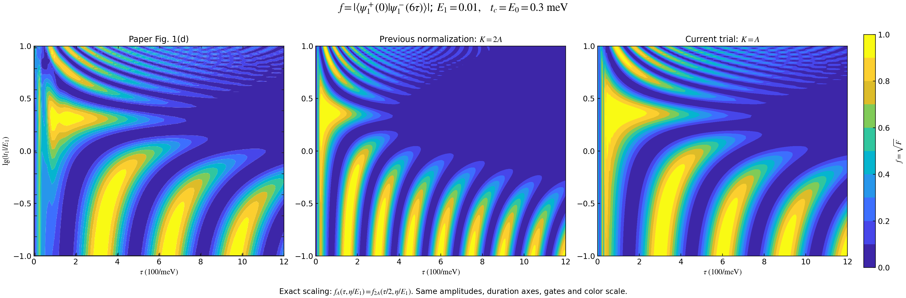

# SO(5) 状态 PDE 与保真度分析

本报告研究六段编织协议下，不可控参数 \(E_1,|t_1|\) 如何改变完整状态和终点保真度。

## 1. 符号约定

取 \(\hbar=1\)，模式顺序固定为 \((1,2,3,a,b)\)，能量单位为 meV，时间单位为 \(1/\mathrm{meV}\)。

| 符号 | 含义 |
|---|---|
| \(E=E_1\)、\(\eta=\lvert t_1\rvert\) | 两个不可控幅度，在一次实验中保持常数 |
| \(\tau,t_c,E_0\) | 可控设计量；推导保留符号，参数偏导时固定它们 |
| \(t\)、\(\zeta=t/\tau\) | 物理时间与归一化时间，范围分别为 \([0,6\tau]\)、\([0,6]\) |
| \(v=\zeta-j\) | 第 \(j+1\) 段局部时间，\(j=0,\ldots,5\)，\(v\in[0,1]\) |
| \(p,r,e_d,q\) | 实际耦合 \(\lvert t_2(t)\rvert,\lvert t_3(t)\rvert,E_d(t),\eta g(t)\) |
| \(e_i,L_{ij}\) | \(e_i\) 是模式坐标的单位向量；\(L_{ij}=e_ie_j^T-e_je_i^T\) 是反对称旋转生成元;表示majorana被旋转到了哪里 |
| \(R\)、\(K=2A\) | 五维传播矩阵及其物理时间生成元 |
| \(u,v,\mathcal B\) | 演化平面的两个正交单位向量与有向状态矩阵；向量 \(v\) 与局部时间 \(v\) 由上下文区分 |
| \(P=-\mathcal B^2\)、\(\rho\) | 平面投影矩阵与所研究波函数的密度矩阵 |
| \(F\)、\(f=\sqrt F\) | 目标重叠的平方、模长；论文色标对应 \(f\) |
| \(d,\mathbf x,\mathbf y,\mathbf h\) | \(\mathcal B\) 的十个分量，见第 2.3 节 |
| \(\ell\) | 离开初始 \((1,2)\) 子空间的概率，包括模式 \(3,a,b\) |

三个步骤完成一次交换，耗时 \(3\tau\)；重复两轮，总时间为 \(6\tau\)。控制重复，状态连续继承。完整状态与终点保真度记作

\[
\mathcal B(E,\eta,t\mid\tau,t_c,E_0),\qquad
F_{\rm end}(E,\eta\mid\tau,t_c,E_0)=F(E,\eta,6\tau\mid\tau,t_c,E_0).
\]

## 2. 通过状态量 \(\mathcal B\) 建立 PDE 的步骤

### 2.1  \(\mathfrak{so}(5)\) 基底和演化生成元

原模型为

\[
H=i e_d\gamma_a\gamma_b+iE\gamma_1\gamma_2
+ip\gamma_a\gamma_2-iq\gamma_b\gamma_1-ir\gamma_a\gamma_3.
\]

 \(e_i\) 只标记第 \(i\) 个模式的坐标位置(\[ J=(\phi_1,\phi_2,\phi_3,\phi_a,\phi_b). \], \[ Je_i=\phi_i. \])。外积 \(e_ie_j^T\) 是仅在第 \(i\) 行第 \(j\) 列为 1 的矩阵，因此
\[
L_{ij}=e_ie_j^T-e_je_i^T
\]

恰好记录一对模式间符号相反的混合。用 \(e\) 写出的矩阵能够表示 \(\gamma\) 产生的演化,例如majorana $\gamma_2$对应的\[ v(t)=R(t)e_2 \],对应的实际波函数为\[ \Phi_2(t)=J R(t)e_2 =\sum_i R_{i2}(t)\phi_i. \]。

五个模式共有 \(\binom52=10\) 对。十个 \(L_{ij}\) 线性独立，且任何实反对称五维矩阵都可写成

\[
S=\sum_{i<j}S_{ij}L_{ij}.
\]

因此它们构成 \(\mathfrak{so}(5)\) 的基底。严格说，\(SO(5)\) 是有限旋转的群，\(\mathfrak{so}(5)\) 是它的无穷小生成元空间；这里找到的是后者的基底。

把原模型的五项系数填入这套基底，得到

\[
A=EL_{12}+qL_{1b}-pL_{2a}+rL_{3a}+e_dL_{ab},
\]

即

\[
A=\begin{pmatrix}
0&E&0&0&q\\
-E&0&0&-p&0\\
0&0&0&r&0\\
0&p&-r&0&e_d\\
-q&0&0&-e_d&0
\end{pmatrix}.
\]

由 \(\{\gamma_i,\gamma_j\}=2\delta_{ij}\) 计算出

\[
i[H,\gamma_i]=2\sum_jA_{ij}\gamma_j,
\qquad \boxed{K=2A,\quad \dot R=KR,\quad R(0)=I.}
\tag{1}
\]

独立 Nambu 构造的活跃单粒子矩阵同样为 \(2iA\)，故波函数满足 \(i\dot\psi=2iA\psi\)。因子 2 由算符归一化确定

因为 \(K^T=-K\)，

\[
\frac{d}{dt}(R^TR)=R^T(K^T+K)R=0.
\]

初始值是单位矩阵，因此 \(R^TR=I\)；连续演化还保持 \(\det R=1\)，即 \(R\in SO(5)\)。

### 2.2 构造完整几何状态

初态与目标态为

$$
\psi_0=\frac{e_1-ie_2}{\sqrt2},\qquad
\psi_\star=\frac{e_1+ie_2}{\sqrt2}.
$$

由于 \(K\) 为实反对称矩阵,$\int K$变换是连续的过程，于是替换为变量$u,v$:

$$
\psi=\frac{u-iv}{\sqrt2},\qquad
u^Tu=v^Tv=1,\quad u^Tv=0.
$$

定义一个有向平面来描述演化过程的信息：

$$
\boxed{\mathcal B=uv^T-vu^T,\qquad
P=-\mathcal B^2=uu^T+vv^T,\qquad
\rho=\psi\psi^\dagger=\frac{P+i\mathcal B}2 \tag{2}.}
$$

\(P\) 指定二维平面的位置，\(\mathcal B\) 同时指定其定向；波函数的整体相位只是在平面内更换正交基，不改变 \(\mathcal B\)。

反过来，\(\mathcal B\) 唯一确定 \(\rho\)，所以它保留了这一可达态族除整体相位外的全部信息。

该态族是

$$
SO(5)/(SO(2)\times SO(3)),
$$

维数为 \(10-1-3=6\)。

**初态与目标态对应**
\[
u(0)=e_1 , v(0)=e_2\\
\\ \mathcal B_0=L_{12},\qquad \mathcal B_\star=-L_{12},\qquad
P_\star=P_0=\operatorname{diag}(1,1,0,0,0).
\]

因此 \(L_{12}\) 出现在保真度中，是由论文选择的初态与目标态决定的。

对式 (2) 求导，使用 \(\dot u=Ku,\dot v=Kv\)，得到

\[
\boxed{\partial_t\mathcal B=[K,\mathcal B],\qquad
\mathcal B(E,\eta,0)=L_{12}.}
\tag{3}
\]

演化保持 \(\mathcal B^T=-\mathcal B,\mathcal B^3=-\mathcal B,\operatorname{rank}\mathcal B=2,\|\mathcal B\|_F^2=2\)。十个分量表示六维有向平面状态，可以直接传播 \(\mathcal B\)，无需先计算整个 \(R\)

**提前补充：状态与保真度的几何意义**

初态 \((e_1-ie_2)/\sqrt2\) 对应 \(\mathcal B_0=L_{12}\)，两次理想交换后的目标态 \((e_1+ie_2)/\sqrt2\) 对应 \(\mathcal B_\star=-L_{12}\)。两态处于同一个平面，却具有相反定向，波函数彼此正交。因此完成目标既要求平面匹配，也要求定向匹配

论文的目标波函数重叠可以精确写成当前状态与目标状态之间的几何距离：

$$
\boxed{1-F=\frac{\|P-P_\star\|_F^2+
\|\mathcal B-\mathcal B_\star\|_F^2}{8},\qquad f=\sqrt F.}
$$

这里两项分别比较平面投影和有向状态，均由 \(\mathcal B\) 决定。扫描参数时，每个参数值对应一次完整演化后的终态，这些终态连成状态空间中的曲线。峰位是这条曲线局部最接近目标时的**参数值**，峰高则由该处的**状态距离**决定；具体解释见第 3.4 节。

### 2.3 展开为系数明确的状态方程

按固定顺序定义

\[
\mathbf b=(d,x_1,x_2,x_3,y_1,y_2,y_3,h_1,h_2,h_3)^T,
\]

\[
d=\mathcal B_{12},\quad
\mathbf x=(\mathcal B_{13},\mathcal B_{1a},\mathcal B_{1b}),\quad
\mathbf y=(\mathcal B_{23},\mathcal B_{2a},\mathcal B_{2b}),\quad
\mathbf h=(\mathcal B_{3a},\mathcal B_{3b},\mathcal B_{ab}).
\]

式 (3) 在物理时间下展开为

\[
\boxed{\begin{aligned}
\tfrac12\partial_t d&=-p x_2-\eta g y_3,\\
\tfrac12\partial_t x_1&=r x_2+E y_1-\eta g h_2,\\
\tfrac12\partial_t x_2&=p d-rx_1+e_dx_3+E y_2-\eta g h_3,\\
\tfrac12\partial_t x_3&=-e_dx_2+E y_3,\\
\tfrac12\partial_t y_1&=-E x_1+r y_2+p h_1,\\
\tfrac12\partial_t y_2&=-E x_2-r y_1+e_dy_3,\\
\tfrac12\partial_t y_3&=\eta g d-E x_3-e_dy_2-p h_3,\\
\tfrac12\partial_t h_1&=-p y_1+e_dh_2,\\
\tfrac12\partial_t h_2&=\eta g x_1-e_dh_1+r h_3,\\
\tfrac12\partial_t h_3&=\eta g x_2+p y_3-r h_2.
\end{aligned}}
\tag{4}
\]

将右端记作 \(M\mathbf b\)，则

\[
\partial_t\mathbf b=M\mathbf b,\qquad
M=M_c(t)+E M_E+\eta M_\eta(t),\qquad M^T=-M.
\]

\(M_c\) 是式 (4) 取 \(E=\eta=0\) 的矩阵。初值为 \(\mathbf b_0=(1,0,\ldots,0)^T\)，真实解满足 \(\|\mathbf b\|^2=1\)。

### 2.4 对两个不可控参数求偏导

因为 \(M\) 对参数仿射，直接得到具体的混合偏导方程：

\[
\boxed{\begin{aligned}
(\partial_t-M)\mathbf b_E
&=2(0,y_1,y_2,y_3,-x_1,-x_2,-x_3,0,0,0)^T,\\
(\partial_t-M)\mathbf b_\eta
&=2g(-y_3,-h_2,-h_3,0,0,0,d,0,x_1,x_2)^T.
\end{aligned}}
\tag{5}
\]

右端分别为 \(M_E\mathbf b,M_\eta\mathbf b\)，完全由当前状态和已知门控给出。二阶响应为

\[
\boxed{\begin{aligned}
(\partial_t-M)\mathbf b_{EE}&=2M_E\mathbf b_E,\\
(\partial_t-M)\mathbf b_{E\eta}&=M_E\mathbf b_\eta+M_\eta\mathbf b_E,\\
(\partial_t-M)\mathbf b_{\eta\eta}&=2M_\eta\mathbf b_\eta.
\end{aligned}}
\tag{6}
\]

这些参数导数不要求 \(E\tau,\eta\tau\) 小。主方程严格说是参数化时间 ODE，式 (5)—(6) 是其混合时间—参数 PDE；目前尚未得到只含终点 \(F(E,\eta)\) 的独立闭合标量方程。

若计算论文式样的时长峰，在固定 \(\zeta=t/\tau\) 下求导，接口是整数 \(\zeta\)。因为 \(M(E,\eta,\zeta)\) 归一化了 \(\tau\)，

\[
\begin{aligned}
\partial_\zeta\mathbf b&=\tau M\mathbf b,\\
\partial_\zeta\mathbf b_\tau&=\tau M\mathbf b_\tau+M\mathbf b,\\
\partial_\zeta\mathbf b_{\tau\tau}&=\tau M\mathbf b_{\tau\tau}+2M\mathbf b_\tau,\\
\partial_\zeta\mathbf b_{\tau\lambda}&=\tau M\mathbf b_{\tau\lambda}
+M\mathbf b_\lambda+\tau M_\lambda\mathbf b_\tau+M_\lambda\mathbf b,
\quad\lambda\in\{E,\eta\}.
\end{aligned}
\tag{7}
\]

终点 \(\zeta=6\) 的响应已包含总物理时长 \(6\tau\) 的变化。

### 2.5 代入六段控制，指定初值和接口

令 \(a(v)=(1-\cos\pi v)/2,c(v)=1-a(v)\)。同一套方程在每段使用以下系数：

| 段 | 时间区间 | \(p\) | \(r\) | \(e_d\) | \(g\) |
|---|---|---|---|---|---|
| 1、4 | \([0,\tau]\)、\([3\tau,4\tau]\) | \(t_ca\) | 0 | \(E_0c\) | \(a\) |
| 2、5 | \([\tau,2\tau]\)、\([4\tau,5\tau]\) | \(t_cc\) | \(t_ca\) | 0 | \(c\) |
| 3、6 | \([2\tau,3\tau]\)、\([5\tau,6\tau]\) | 0 | \(t_cc\) | \(E_0a\) | 0 |

初态与参数无关，所以所有一、二阶响应的初值为零。各段控制在接口连续；固定物理基底中的状态及全部响应也连续：

\[
\mathbf b(j\tau^+)=\mathbf b(j\tau^-),\qquad
\mathbf b_\lambda(j\tau^+)=\mathbf b_\lambda(j\tau^-),\qquad j=1,\ldots,5,
\]

二阶响应同样传递。

## 3. 如何求解 \(F\)，以及描述峰的位置、偏移和高度

### 3.1 从状态读出论文的目标重叠

论文比较演化态 \(\psi_1^-(6\tau)\) 与固定目标 \(\psi_1^+(0)\) 的重叠模长。任意时刻有

\[
F=|\langle\psi_\star|\psi(t)\rangle|^2=\operatorname{tr}(\rho_\star\rho)
=\frac14\left[\operatorname{tr}(P_\star P)-\operatorname{tr}(\mathcal B_\star\mathcal B)\right].
\]

代入 \(\mathcal B_\star=-L_{12}\) 得到可直接计算的精确公式：

\[
\boxed{F=\frac{d^2-d}{2}+\frac{\|\mathbf x\|^2+\|\mathbf y\|^2}{4},\qquad
f=\sqrt F.}
\tag{8}
\]

所以求解流程是：从给定初值连续传播六段 \(\mathbf b\)，然后在每个时刻或终点代入式 (8)。无需另外积分一个 \(F\) 方程。它与论文波函数重叠定义一致，坐标变换保持内积。

利用归一化$\boxed{ d^2+\|\mathbf x\|^2+\|\mathbf y\|^2+\|\mathbf h\|^2=1. }$，还可写成

\[
\boxed{F=\frac{(1-d)^2-\|\mathbf h\|^2}{4}
=\frac{1-\ell-d}{2},\qquad
\ell=\frac{1-d^2+\|\mathbf h\|^2}{2}.}
\tag{9}
\]

\(d\) 是整个有向平面在初始 \((1,2)\) 平面上的有符号投影,可以简单理解为方向 \(d=-1\) 对应目标，\(d=+1\) 对应初态。\(\ell\) 表示平面偏离初始子空间。两者共同决定峰高；\(\mathbf h\) 小并不意味着 \(\ell\) 小。初态存留为 \(F_{\rm initial}=(1-\ell+d)/2\)，故 \(F+F_{\rm initial}=1-\ell\)。

### 3.2 用参数响应计算梯度和曲率

令 \(\mathbf z=(\mathbf x,\mathbf y)\)。对式 (8) 求导，任意参数 \(\lambda,\mu\) 的响应读出为

\[
\boxed{F_\lambda=(d-\tfrac12)d_\lambda+\tfrac12\mathbf z\cdot\mathbf z_\lambda,}
\]

\[
\boxed{F_{\lambda\mu}=d_\lambda d_\mu+(d-\tfrac12)d_{\lambda\mu}
+\tfrac12\left(\mathbf z_\lambda\cdot\mathbf z_\mu
+\mathbf z\cdot\mathbf z_{\lambda\mu}\right).}
\tag{10}
\]

\(\mathbf b,\mathbf b_\lambda,\mathbf b_{\lambda\mu}\) 由式 (4)—(7) 联合传播获得。这是对实际有限参数点的响应，不依赖相邻网格点的数值差分。

### 3.3 峰特征的精确判据

本节峰判据中的 \(F\) 均指终点 \(F_{\rm end}\)。先选定扫描方向 \(s\)：固定 \(\tau\) 沿 \(\eta\) 扫描时 \(s=\eta\)；论文式热图的时长切片使用 \(s=\tau\)。令 \(\lambda\) 为改变的另一个参数，\(s_*(\lambda)\) 为同一条非退化峰分支。

| 特征 | 模型给出的表达 | 含义 |
|---|---|---|
| 位置 | \(F_s=0,\ F_{ss}<0\) | 求导数零点并检查负曲率 |
| 偏移 | \(ds_*/d\lambda=-F_{s\lambda}/F_{ss}\) | 参数变化推动峰移动的方向与速率 |
| 高度 | \(H(\lambda)=F(\lambda,s_*(\lambda)),\ H'=F_\lambda\) | 沿峰线的高度变化 |
| 高度曲率 | \(H''=F_{\lambda\lambda}-F_{s\lambda}^2/F_{ss}\) | 最佳调节扫描参数后的剩余高度变化 |
| 间距 | \(\Delta s=s_{*,n+1}-s_{*,n}\) | 两条指定峰分支的位置差 |
| 局部半宽 | \(\sqrt{2\Delta F/(-F_{ss})}\) | 允许下降 \(\Delta F\) 时的二阶近似半宽 |

偏移公式来自对 \(F_s(\lambda,s_*(\lambda))=0\) 求导。具体到两个不可控参数，

\[
\boxed{\frac{d\eta_*}{dE}=-\frac{F_{E\eta}}{F_{\eta\eta}}.}
\tag{11}
\]

对论文式时长峰，则

\[
\boxed{\frac{\partial\tau_*}{\partial E}=-\frac{F_{\tau E}}{F_{\tau\tau}},\qquad
\frac{\partial\tau_*}{\partial\eta}=-\frac{F_{\tau\eta}}{F_{\tau\tau}}.}
\tag{12}
\]

这些峰线方程精确成立，只要峰不退化。用固定斜率乘一次参数改变量是局部近似；较大变化需要沿分支持续更新导数。局部半宽也只是二阶近似，完整宽度可以求 \(F=H-\Delta F\) 的两侧交点。

正则峰连续移动。区域内部峰数变化须经过 \(F_s=F_{ss}=0\) 等退化，或峰进入、离开区域边界。

### 3.4 峰的几何解释：参数位置与状态距离

先区分两条曲线：\(\mathcal B(t)\) 是固定参数下的一次时间演化；\(\mathcal B_{\rm end}(s;\lambda)\) 是扫描参数 \(s\) 得到的终态曲线。后者的每个点都经过完整六段演化。例如沿 \(\tau\) 扫描时，一个点对应时长 \(6\tau\) 的实验结果，并不是同一次实验中的某个时刻。

由终态得到 \(P_{\rm end}=-\mathcal B_{\rm end}^2\)，定义它到固定目标的距离：

\[
\boxed{D^2(s;\lambda)=
\frac{\|P_{\rm end}-P_\star\|_F^2+
\|\mathcal B_{\rm end}-\mathcal B_\star\|_F^2}{8}
=1-F_{\rm end}(s;\lambda).}
\tag{13}
\]

这个距离同时比较平面及其定向。即使平面完全重合，定向相反也会使 \(F=0\)：初态就是这样的例子。只有到达目标有向平面时，才有 \(D=0,F=1\)。

**峰位与偏移。** 沿扫描方向，非退化保真度峰恰好对应距离平方的局部最小值：
\[
\partial_sD^2(s_*;\lambda)=0,\qquad
\partial_s^2D^2(s_*;\lambda)>0.
\]

因此峰位 \(s_*\) 是参数轴上的坐标。改变另一个参数 \(\lambda\) 会改变终态曲线，使局部最近点对应的参数值移动，形成峰位偏移。第 3.3 节的 \(ds_*/d\lambda\) 就定量描述这种移动；它不是状态在空间中移动的距离。

**峰高。** 在峰位处仍可能与目标有距离，故
\[
H=F_{\rm end}(s_*;\lambda)=1-D^2(s_*;\lambda),\qquad
f_*=\sqrt{1-D^2(s_*;\lambda)}.
\]

终态曲线在该处越接近目标，峰越高。参数变化既能移动最近点，也能改变其到目标的距离，所以峰位偏移和峰高变化是两种不同的几何信息。

**峰间距与宽度。** 若终态曲线多次接近目标，就会出现多个峰。两个相邻峰的间距是参数值之差 \(s_{*,n+1}-s_{*,n}\)，并不是两个终态之间的空间距离。若状态随参数近似重复，这些间距可表现为近似周期；几何定义本身不要求峰等间距。

峰的宽度则反映离开最佳参数值后，状态距离增大的快慢。令 \(\kappa=\partial_s^2D^2(s_*)=-F_{ss}(s_*)>0\)，局部有

\[
D^2(s)\simeq D^2(s_*)+\frac{\kappa}{2}(s-s_*)^2.
\]

对于相同的保真度下降量，\(\kappa\) 越大，允许的参数偏差越小，峰越窄。这是局部二阶描述，完整峰形仍由六段状态方程确定。

例如第 4.3 节 \(\eta/E=0.1\) 的两个代表性峰位于 \(\tau\approx150.428\) 和 \(299.859\)，对应 \(F\approx0.998753\) 和 \(0.987835\)。它们到目标的距离分别为 \(D\approx0.0353\) 和 \(0.1103\)，说明前一个峰更高是因为终态更接近目标；两峰的参数间隔约为 \(149.431/\mathrm{meV}\)。这里的距离 \(D\) 无量纲，峰位与间隔具有时间单位。

## 4. 结果分析：状态演化、条带与峰值图像

主结果使用 \(K=2A\)、原六段余弦门控，\(t_c=E_0=0.3\,\mathrm{meV}\)。时间轨迹取 \(\tau=100\)，保存 3001 个时间点；终点热图取 \(E=0.01\)，扫描 \(\tau\in[0,1200]\) 和 \(\log_{10}(\eta/E)\in[-1,1]\)，网格为 \(241\times101\)。

积分器为 DOP853，`rtol=2e-11`、`atol=2e-13`，最大局部归一化步长 0.025；热图输出间隔 \(\Delta\tau=5\) 不是积分器内部步长。\(F,f\) 使用论文的十档配色，\(\mathcal B\) 分量则使用以零为中心的 \([-1,1]\) 色标。

### 4.1 六段演化：第一轮输出怎样影响第二轮

图1：四列分别为理想情形，以及 \(E=0.01\) 时的 \(\eta/E=0.1,1,10\)；三行展示完整状态、平方重叠和模长。蓝线是目标重叠，紫线是初态存留。

理想情况下，一次交换后 \(F\approx1/4\)、\(f\approx1/2\)，第二轮后才接近 \(\mathcal B_\star\)。第三、第六段有 \(p=g=0\)，将状态方程 (4) 代入保真度公式 (9) 可得 \(\partial_tF=0\)，因此出现平台。第三段其他相干分量继续变化，随后第四、第五段据此改变方向和目标重叠。

非理想情况下，第一轮末仍有一定目标重叠，但第二轮可将状态转回初态一侧。强额外耦合的切片在中间段出现较快振荡。

### 4.2 终点热图：亮带是状态反复接近目标

图2：横轴为 \(\tau/(100/\mathrm{meV})\)，纵轴为 \(\log_{10}(\eta/E)\)。这里是固定 \(E\) 的 \((\eta,\tau)\) 切片，不是固定 \(\tau\) 的完整 \((E,\eta)\) 平面。

F的亮带对应 \(d\) 接近 \(-1\)、状态接近目标。改变 \(\eta\) 会改变累积相位和混合，使峰线倾斜、间距和高度变化。

图3：在这张图已采样的演化时长 \(t\ge100\) 区域，终点主要体现为 \(d,x_1,y_1\) 的变化，\(\|\mathbf h\|^2/4\) 最大约 \(4.72\times10^{-6}\)。由式 (9)，在该区域可高精度近似  \[ \mathcal B_{\rm end}\approx dL_{12}+x_1L_{13}+y_1L_{23}, \qquad d^2+x_1^2+y_1^2\approx1. \] 得到

\[
F\simeq(1-d)^2/4.
\]

也就是说,终态的有向平面主要位于 \((e_1,e_2,e_3)\) 三维子空间中。设定初态对应球面的北极，目标态对应南极；参数变化使终态在这个球面上移动。

因此终点亮带与定向图紧密对应。但是只是终点图，具体的演化并不能直接用球面近似.

### 4.3论文对照：时间尺度改善，但尚未完全对齐

三图均显示 \(f=\sqrt F\)，左图直接裁自论文，右图 \(K=A\) 作为归一化诊断。

