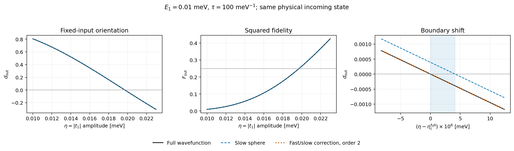

# 固定输入态的定向换号预测：球面模型与快慢反馈修正

本次完成 [geometric_moving_frame.md](geometric_moving_frame.md) 选定的检验：先用球面模型预测第二段终点的定向换号位置，再用完整五维波函数独立核对。主检验中，球面预测的参数误差约为 \(0.021\%\)；加入快慢几何混合的二阶响应后，换号位置误差降至约 \(2.1\times10^{-9}\,\mathrm{meV}\)。

这些预测没有拟合完整波函数结果。检验范围是固定物理输入态的第二段，不包含改变全协议参数时输入态的变化；换号位置也不是高保真度成功区域的完整边界。

## 1. 固定什么，改变什么

输入态取已有 `eta_low` 样本在第二周期第二段开始时的波函数：原协议 \(E_1=0.01,\eta=0.01,\tau_0=100\)，输入时刻为 \(4\tau_0\)。独立重新传播此前四段得到同一输入，最大波函数分量差约为 \(9.2\times10^{-13}\)。

主检验固定这个物理输入态、\(E_1=0.01\)、第二段时长 \(\tau=100\)，仅改变这一段的 \(\eta\in[0.01,0.023]\)。能量单位为 meV，\(\tau\) 单位为 \(\mathrm{meV}^{-1}\)，取 \(\hbar=1,t_c=0.3\)。\(\eta\) 是 \(|t_1(t)|=\eta g(t)\) 的幅度。

每个 \(\eta\) 都从同一输入态重新计算移动标架坐标及球面初值，而不是把球面初值保持不变。完整参考直接积分五维复波函数方程；球面预测积分已推导的三实分量定向方程。

终点判据为

\[
d_{\rm out}=0,
\qquad\text{球面模型中等价于 }m_z(1)=0.
\]

主区间的完整参考在两端分别为 \(d_{\rm out}\approx+0.805180,-0.304304\)。41 点扫描中，完整参考与球面模型的终点 \(d\) 均随 \(\eta\) 减小，扫描发现一个换号。扫描不构成排除所有其他零点的解析证明。

## 2. 独立预测与完整参考

| 方法 | 换号幅度 \(\eta_c\) / meV | 相对完整参考的绝对参数误差 / meV |
|---|---:|---:|
| 慢球面模型 | 0.019717132346 | \(4.129\times10^{-6}\) |
| 加快慢混合的一阶响应 | 0.019717113855 | \(4.110\times10^{-6}\) |
| 加快慢混合的二阶响应 | 0.019713005623 | \(2.111\times10^{-9}\) |
| 完整五维波函数 | 0.019713003513 | — |

球面模型的相对参数误差约为 \(0.02094\%\)。在它预测的换号幅度处，完整参考已有 \(d\approx-3.9243\times10^{-4}\)；因此在两种预测边界之间的一小段参数区间内，它会判断错定向符号。

这次检验同时确认了预测价值与近似偏差：球面模型准确定位了边界附近，但不能将它当成边界处的精确符号判据。二阶修正将这段不一致区间从约 \(4.13\times10^{-6}\) 缩小到约 \(2.11\times10^{-9}\,\mathrm{meV}\)。

在整个主区间的 41 个采样点上，球面预测的最大终点 \(d\) 误差约为 \(4.79\times10^{-4}\)，最大平方保真度误差约为 \(3.10\times10^{-4}\)。



左图是终点定向，中图是平方保真度，右图放大换号附近。黑线为完整参考，蓝虚线为球面预测，橙点线为二阶响应。右图阴影显示球面预测与完整参考判断不同定向的参数区间。

## 3. 为什么二阶修正有效：快平面返回的相干反馈

精确移动标架中，将波函数坐标分为快部分 \(f\in\mathbb C^2\) 与慢部分 \(s\in\mathbb C^3\)，令 \(C=\Gamma_{f,s}\)。在当前标架规范下，精确方程为

\[
\partial_v f=\Omega_f f-Cs,
\qquad
\partial_v s=G_s s+C^Tf,
\qquad \Omega_f=c\mu_+J,
\]

其中 \(G_s\) 是此前保留慢相位与慢几何混合的三维生成元，\(c=2\tau/\hbar\)。快部分的自由旋转完全已知：

\[
U_f(v,u)=\exp\{J[\Phi_f(v)-\Phi_f(u)]\},
\qquad \Phi_f(v)=c\int_0^v\mu_+(w)dw.
\]

消去快部分，得到一个对原模型精确的慢波函数记忆方程：

\[
\boxed{
\begin{aligned}
\partial_v s(v)={}&G_s(v)s(v)+C(v)^TU_f(v,0)f(0)\\
&-\int_0^v C(v)^TU_f(v,u)C(u)s(u)\,du.
\end{aligned}}
\]

这个核包含已知快相位与已知标架混合，不包含未知的完整传播矩阵 \(R\)。球面模型忽略了后两项。它们分别表示输入快分量的驱动，以及慢分量转入快平面后再返回的反馈。

当前输入快权重很小，一阶驱动只使预测边界移动约 \(1.85\times10^{-8}\,\mathrm{meV}\)。主要偏移来自含两次快慢混合的反馈，这解释了为什么一阶响应改善很小、二阶响应改善明显。

实际检验用等价的响应层级计算修正。写精确坐标生成元为 \(G_0+V\)，其中 \(G_0\) 保留两块内部全部运动，\(V\) 仅含快慢之间的连接。计算

\[
\begin{aligned}
\chi_0'&=G_0\chi_0,\\
\chi_1'&=G_0\chi_1+V\chi_0,\\
\chi_2'&=G_0\chi_2+V\chi_1,
\end{aligned}
\qquad
\chi_1(0)=\chi_2(0)=0,
\]

并用 \(Q(\chi_0+\chi_1+\chi_2)\) 求终点定向。这是对被略去的几何混合做响应展开；\(E\tau,\eta\tau\) 的完整累计相位始终保留。它不是保真度关于 \(E,\eta\) 的二阶泰勒展开。

二阶截断不是严格正交传播，主换号点附近的范数误差约为 \(5.4\times10^{-6}\)，零约束误差约为 \(5.0\times10^{-6}\)。代码没有通过重新归一化隐藏这些误差。本次很高的修正精度指换号位置；不能把它解释为完整物理态或保真度也精确到 \(10^{-9}\)。

## 4. 收敛与时长对照

将积分容差从 \(\mathrm{rtol}=2\times10^{-11}\) 收紧到 \(6\times10^{-13}\)，最大归一化时间步长从 \(0.01\) 减到 \(0.003\)，主检验三种换号位置的变化均低于 \(10^{-12}\,\mathrm{meV}\)，远小于报告的模型偏差。完整参考保留归一化与零约束。

再保持同一物理输入态与 \(E_1=0.01\)，只改变第二段时长：

| 第二段 \(\tau\) | 完整 \(\eta_c\) / meV | 球面边界误差 / meV | 二阶响应边界误差 / meV | 最大快慢混合指标 |
|---|---:|---:|---:|---:|
| 75 | 0.025982653026 | \(5.777\times10^{-6}\) | \(7.676\times10^{-9}\) | 0.1061 |
| 100 | 0.019713003513 | \(4.129\times10^{-6}\) | \(2.111\times10^{-9}\) | 0.0785 |
| 150 | 0.013539229498 | \(2.609\times10^{-6}\) | \(1.531\times10^{-10}\) | 0.0517 |

较短的 \(\tau=75\) 段在原 \([0.01,0.023]\) 区间内没有被两端异号夹住的边界，故将搜索区间扩至 \([0.01,0.035]\)。这些时长对照固定了此前 \(\tau_0=100\) 的输入态，不代表将完整六段协议统一改变时长。

这三组对照中，快慢混合指标和预测误差均随段时长增加而减小，支持把快慢反馈作为修正来研究。它们尚不构成一般参数下的严格误差界或普遍幂律。

## 5. 检验支持的结论与后续对象

此次检验支持在这一参数区域使用“慢球面定向 + 已知快相位反馈”的结构：它能在未拟合完整参考的情况下预测定向换号，并能从被略去的动力学项系统地修正边界。

主完整换号点处 \(F\approx0.249995\)，符合 \(d=0\) 时的几何瓶颈限制。研究 \(F\) 接近 1 的区域，还需要继续考察负定向返回与平面位置，而不能仅凭定向换号判断成功。

接下来研究真实全协议时，必须把 \(\mathcal B_{\rm in}(E,\eta)\) 的参数依赖接入。这次固定输入检验建立了第二段工具的预测能力，尚未给出全协议 \(F(E,\eta)\) 的边界。

代码：[verify_switch_boundary.py](geometric_validation/verify_switch_boundary.py)；完整记录：[switch_boundary.json](geometric_validation/switch_boundary.json)；曲线数据：[switch_boundary.npz](geometric_validation/switch_boundary.npz)；可导出图：[PDF](geometric_validation/switch_boundary.pdf)。

```sh
.venv/bin/python -B previous_work/geometric_validation/verify_switch_boundary.py
```
