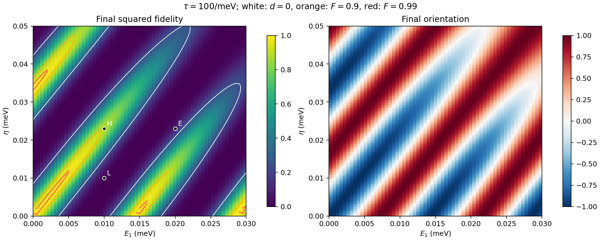
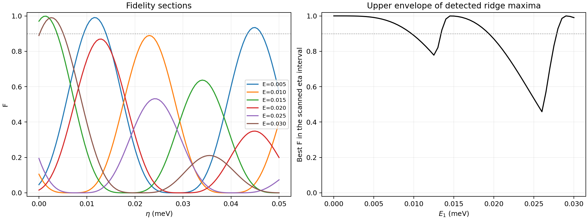

# 有限参数区域中的平面对齐、换号边界与高保真度条带

本文继续 [第二轮输入的几何分析](geometric_second_cycle_chain.md)，研究实际输入 \(\mathcal B_3(E,\eta)\) 与所需输入 \(\mathcal Q_3(E,\eta)\) 在一个有限参数区域内如何对齐。

采用论文的门控，固定

\[
\hbar=1,\quad t_c=E_0=0.3\,\mathrm{meV},\quad
\tau=100/\mathrm{meV},\quad
0\le E=E_1\le0.03\,\mathrm{meV},\quad
0\le\eta=|t_1|_{\mathrm{amplitude}}\le0.05\,\mathrm{meV}.
\]

这里 \(E\tau\) 最高为 3，\(\eta\tau\) 最高为 5。以下完整状态计算没有小量展开。\(F\) 是平方重叠，论文重叠模长为 \(\sqrt F\)。第三段保持 \(F\)，所以 \(F_5=F(6\tau)\)。

## 1. 用完整状态公式得到参数图

每个参数点分别计算

\[
\dot{\mathcal B}=[K,\mathcal B],\quad\mathcal B(0)=L_{12}
\quad\longrightarrow\quad \mathcal B_3,
\]

以及从终点反向传回

\[
\dot{\mathcal Q}=[K,\mathcal Q],\quad
\mathcal Q(5\tau)=-L_{12}
\quad\longrightarrow\quad\mathcal Q_3.
\]

随后用完整的五模式状态公式计算

\[
\boxed{F_5=\frac14\left[
\operatorname{tr}(P_{\mathcal Q_3}P_{\mathcal B_3})
-\operatorname{tr}(\mathcal Q_3\mathcal B_3)\right],
\quad d_5=-\frac12\langle\mathcal Q_3,\mathcal B_3\rangle_F.}
\]

没有用球面近似代替传播或保真度。网格为 \(61\times101=6161\) 个点，两个参数的间隔均为 \(0.0005\,\mathrm{meV}\)。



左图为完整 \(F_5\)，右图为 \(d_5\)。白线是 \(d_5=0\)，橙线是 \(F_5=0.9\)，红线是 \(F_5=0.99\)。标记 L、H、E 分别对应此前的低保真度、高保真度和改变 \(E\) 的样本。背景颜色来自网格；橙、红曲线连接完整状态方程求根细化后的切片交点，以避免粗网格把窄高保真度条带画成零散小岛。相应数据保存在结果文件中。

直接看到：参数区域出现重复的斜向条带，负定向条带内部的峰值高度不同。因此“进入负定向”与“达到高保真度”仍是两种条件。

## 2. 球面解释在这块区域内是否有效

取接口状态的三模式部分

\[
b=(\mathcal B_{12},\mathcal B_{13},\mathcal B_{23}),\qquad
q=(\mathcal Q_{12},\mathcal Q_{13},\mathcal Q_{23}),
\qquad \beta=\|b\|,\quad\chi=\|q\|.
\]

此前只检查了少数样本；现在在整个网格上检查：

| 检查量 | 所有网格点上的结果 |
|---|---:|
| 三模式外双向量分量的最大范数 \(\max\sqrt{1-\min(\beta,\chi)^2}\) | 0.004952 |
| 球面值 \(F_{S^2}=(1+\widehat b\cdot\widehat q)^2/4\) 的最大绝对误差 | \(1.5581\times10^{-5}\) |
| 球面值绝对误差的中位数 | \(1.0221\times10^{-6}\) |
| 固定模式 3 权重上界 \(F_{\mathrm{cap}}\) 的最小值 | 0.99999822 |

其中 \(\widehat b=b/\beta,\widehat q=q/\chi\)。最后一行说明，在这块网格上，实际与所需输入的模式 3 权重匹配得很好；大的保真度损失主要反映剩余有向平面没有对齐。

这些是网格与独立样本检验的结果，不是整个连续区域上的严格一致误差定理，也没有证明扩大参数范围或改变 \(\tau\) 后仍成立。

## 3. 条带来自相位对齐，峰值还受纬度限制

把两个单位三模式双向量写成

\[
\widehat b=(\sin\alpha,\cos\alpha\cos\varphi,
\cos\alpha\sin\varphi),
\]

\[
\widehat q=(\sin\alpha_\star,\cos\alpha_\star\cos\varphi_\star,
\cos\alpha_\star\sin\varphi_\star).
\]

定义 \(\Delta\varphi=\varphi-\varphi_\star\)，则球面夹角满足精确恒等式

\[
\cos\theta=\sin\alpha\sin\alpha_\star
+\cos\alpha\cos\alpha_\star\cos\Delta\varphi.
\]

当前网格还有一个经过检查的性质：

\[
\max|\alpha+\alpha_\star|<6.0\times10^{-6}\ \text{rad}.
\]

也就是实际平面和所需平面的纬度近乎相反。代入 \(\alpha_\star\approx-\alpha\)，得到

\[
\cos\theta\approx-\sin^2\alpha+\cos^2\alpha\cos\Delta\varphi,
\]

\[
\boxed{F_5\approx
\underbrace{\cos^4\alpha}_{\text{纬度因子}}
\underbrace{\cos^4(\Delta\varphi/2)}_{\text{方位角因子}}.}
\]

这个有限角度公式在所有网格点上的最大保真度绝对误差也是 \(1.5581\times10^{-5}\)。它没有对 \(\alpha\)、\(\Delta\varphi\)、\(E\) 或 \(\eta\) 作小量展开。

由此可以解释参数图的两个结构：

1. \(\Delta\varphi\approx2\pi n\) 时方位角对齐，形成重复的亮带。
2. 即使方位角对齐，峰值仍受到 \(F\lesssim\cos^4\alpha\) 限制。纬度偏离较大时，这条亮带本身也达不到高保真度。

例如 \((E,\eta)=(0.01,0.023)\) 处，

\[
\alpha\approx-0.239975,\qquad
\Delta\varphi\approx-0.043281\ \text{rad},
\]

\[
\cos^4\alpha\approx0.890209,\qquad
\cos^4(\Delta\varphi/2)\approx0.999064.
\]

两者乘积给出约 0.889375，完整结果为 0.889374。这里方位角已经很接近对齐，剩余损失主要反映纬度偏离；仅将方位角调得更准并不能消除它。

两因子是几何诊断，不是两个独立控制通道：\(E,\eta\) 都会改变纬度和方位角。

### 3.1 高保真度和换号的几何条件

在上述经检验的球面解释下，\(F\ge F_0\) 要求

\[
\boxed{\cos\alpha\,|\cos(\Delta\varphi/2)|\gtrsim F_0^{1/4}.}
\]

它同时约束纬度与相位。例如 \(F_0=0.9\) 时，必要的纬度范围约为
\(|\alpha|\lesssim0.228516\) rad；若纬度为零，则允许的相位偏差约为
\(|\Delta\varphi|\lesssim0.457031\) rad，按模 \(2\pi\) 取最近的对齐相位。

对应的最终换号边界近似满足

\[
\boxed{d_5=0\quad\Longrightarrow\quad
\cos\alpha\,|\cos(\Delta\varphi/2)|\approx1/\sqrt2.}
\]

实际换号边界仍由完整 \(d_5=0\) 求解，不用这个近似代替。

## 4. 实际参数分支和最佳峰值

对每个固定 \(E\) 的切片，先检测网格上的局部峰，再用完整状态方程在其附近优化 \(\eta\)，并与区间端点比较。得到下列检测到的最佳峰值：

| \(E\) / meV | 最佳 \(\eta\) / meV | 完整 \(F_5\) |
|---:|---:|---:|
| 0.005 | 0.01164416 | 0.991011 |
| 0.010 | 0.02300051 | 0.889374 |
| 0.015 | 0.00131997 | 0.999026 |
| 0.020 | 0.01282511 | 0.869505 |
| 0.025 | 0.02418651 | 0.532252 |
| 0.030 | 0.00261428 | 0.990210 |

这是当前 \(\eta\in[0,0.05]\) 区间内基于网格检测并细化的峰值，不是所有 \(\eta\) 上的全局优化定理。



最佳峰会从一条分支跳到另一条。\(E\) 增大时保真度既可能下降，也可能因进入另一条对齐分支而恢复。因此，\(\eta\approx2.3E\) 可以描述其中一条分支的大致方向，不能作为整个区域的通用抵消线。

### 4.1 同一个 E 可以有多条高保真度区间

例如 \(E=0.005\,\mathrm{meV}\)，完整状态方程给出的 \(F\ge0.9\) 区间边界约为

\[
\eta\in[0.00931174,\ 0.01397337]
\quad\text{或}\quad
[0.04342348,\ 0.04631716]\ \mathrm{meV}.
\]

而第一条亮带中，\(F\ge0.99\) 的区间约为

\[
\eta\in[0.01140322,\ 0.01188506]\ \mathrm{meV}.
\]

它们是不同相位分支的具体有限参数结果。

### 4.2 负定向区间明显宽于高保真度区域

在 \(E=0.01\,\mathrm{meV}\) 上，检测到三处最终定向换号：

\[
\eta\approx0.01511235,\quad0.03089227,\quad0.04832802\ \mathrm{meV}.
\]

所以在当前扫描范围内，\(d_5<0\) 出现在约

\[
(0.01511235,\ 0.03089227)
\quad\text{和}\quad(0.04832802,\ 0.05].
\]

但该切片检测到的最高保真度约为 0.889374，并没有达到 0.9。最终定向正确还不足以保证目标平面完整对齐。

## 5. 用精确参数导数描述曲线，而非给出固定比例

在任意有限参数点，实际输入与所需输入各自满足精确参数导数方程

\[
\dot S_\lambda=[K,S_\lambda]+[K_\lambda,\mathcal B],\qquad
\dot T_\lambda=[K,T_\lambda]+[K_\lambda,\mathcal Q].
\]

其中实际态初始导数为零，反向目标在 \(5\tau\) 的终点导数为零；两种方程分别向前和反向求解。

记 \(m(E,\eta)=d_5\)，有

\[
\partial_\lambda m=-\frac12\left[
\langle T_\lambda,\mathcal B_3\rangle_F
+\langle\mathcal Q_3,S_\lambda\rangle_F\right].
\]

在 \(\partial_\eta m\ne0\) 的正则边界上，隐函数定理给出

\[
\boxed{\left.\frac{d\eta}{dE}\right|_{d_5=0}
=-\frac{\partial_Ed_5}{\partial_\eta d_5}.}
\]

高保真度等值线 \(F_5=F_0\) 则使用

\[
\boxed{\left.\frac{d\eta}{dE}\right|_{F_5=F_0}
=-\frac{\partial_EF_5}{\partial_\eta F_5}.}
\]

本次已对换号、高保真度和方位角对齐曲线计算这些导数。\(E=0.01\) 上三条换号边界的局部斜率分别约为 2.399、2.092、2.335；它们并非同一条固定比例直线。

对于方位角，精确三模式坐标导数直接给出

\[
\partial_\lambda\Delta\varphi=
\frac{\mathcal B_{13}\partial_\lambda\mathcal B_{23}
-\mathcal B_{23}\partial_\lambda\mathcal B_{13}}
{\mathcal B_{13}^2+\mathcal B_{23}^2}
-\frac{\mathcal Q_{13}\partial_\lambda\mathcal Q_{23}
-\mathcal Q_{23}\partial_\lambda\mathcal Q_{13}}
{\mathcal Q_{13}^2+\mathcal Q_{23}^2}.
\]

该区域的方位角坐标没有经过球面极点，因此这些导数可用于追踪
\(\Delta\varphi=2\pi n\) 的分支。

### 5.1 相位对齐位置与最佳保真度位置不必重合

在 \(E=0.01\) 切片，相位对齐发生在
\(\eta\approx0.02322611\)，最佳保真度则在
\(\eta\approx0.02300051\)。两者差异可以由有限角度公式解释：

\[
\partial_\eta\log F\approx
-4\tan\alpha\,\partial_\eta\alpha
-2\tan(\Delta\varphi/2)\,\partial_\eta\Delta\varphi.
\]

峰值要平衡纬度变化与相位变化；单独令 \(\Delta\varphi=0\) 一般不是驻点条件。实际峰值仍用完整 \(F\) 求得，不依赖近似导数。

## 6. 数值检验与可复现结果

程序：[map_parameter_geometry.py](geometric_validation/map_parameter_geometry.py)。运行：

```sh
.venv/bin/python -B previous_work/geometric_validation/map_parameter_geometry.py
```

程序使用完整十分量方程批量计算实际输入和反向目标。检测到 93 个内部局部峰候选并细化；对窄高保真度区间补充峰值附近的求根括号。最终记录 179 个换号、132 个高保真度和 95 个相位对齐的细化交点，均位于固定 \(E\) 的切片上。

网格之外的等值线交点通过完整方程二分求根，\(\eta\) 括号宽度不大于 \(9.54\times10^{-10}\,\mathrm{meV}\)，最大函数残差小于 \(10^{-7}\)。这些误差描述单个切片交点，不能替代 \(E\) 方向的网格分辨率。

另选 39 个网格、曲线和峰值参数点，用独立复波函数方程直接传播到 \(5\tau\)。保真度最大差异小于 \(6\times10^{-14}\)，定向最大差异小于 \(10^{-13}\)。两处参数梯度另与独立波函数灵敏度方程比较，最大差异小于 \(2\times10^{-12}\)。完整网格上的简单平面约束误差小于 \(5\times10^{-12}\)。

数据和图像：

- [parameter_geometry.npz](geometric_validation/parameter_geometry.npz)：完整网格、\(\mathcal B_3,\mathcal Q_3\)、保真度、角度、几何损失和近似误差。
- [parameter_geometry.json](geometric_validation/parameter_geometry.json)：细化交点、曲线斜率、局部峰及验证结果。
- [六面板几何图](geometric_validation/parameter_geometry.png)：完整保真度、定向、夹角、三模式外分量、近似误差和方位角差。
- [保真度参数图 PDF](geometric_validation/parameter_fidelity_map.pdf)、[几何图 PDF](geometric_validation/parameter_geometry.pdf)。

目前已经把参数区域组织成了实际输入与所需输入之间的纬度偏离和相位分支，并用完整状态计算确定了换号曲线与高保真度区间。\(\alpha(E,\eta)\) 和 \(\Delta\varphi(E,\eta)\) 本身仍由演化方程计算，尚未得到通用闭式表达。

下一项集中的分析问题是：固定 \(\tau=100\) 及全部门控设置，从第一段的两个旋转通道和第二段的完整输运中，提取相对角度随不可控参数 \(E_1,t_1\) 的累计规律，解释条带的间距、弯曲和峰值高度，并刻画高保真区域的宽度和敏感方向。

这一方向的首轮预测已完成，见 [geometric_stripe_prediction.md](geometric_stripe_prediction.md)：以门控确定的标架约化整个周期，得到第一、第三段的显式累计角度及第二段的闭合角度方程。无需完整演化的中间输入即可预测 \(F_{\rm slow}=\cos^4y\cos^4(\Phi/2)\)，并在本区域匹配了全部 93 个内部峰。它是忽略快慢混合的有限相位近似，当前继续在同一固定协议下研究两个参数的影响。
