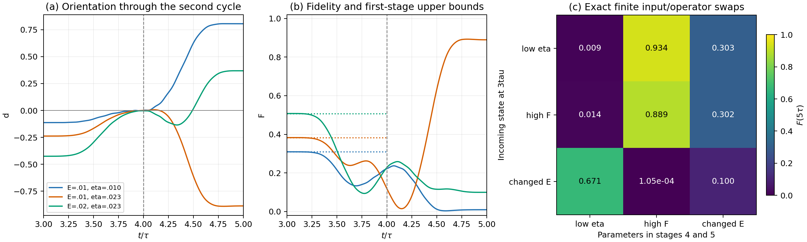

# 第二轮输入、相干旋转与最终保真度的几何分析

承接 [完整六段协议](geometric_full_protocol.md)，本文集中研究

\[
\mathcal B_3=\mathcal B(3\tau)
\longrightarrow\mathcal B_4=\mathcal B(4\tau)
\longrightarrow\mathcal B_5=\mathcal B(5\tau).
\]

采用同一完整状态量与论文门控：\(E=E_1\)、\(\eta=|t_1|\) 的幅度、\(\kappa=2/\hbar\)。\(F\) 是平方重叠，且最后一段保持 \(F\)，所以本文的 \(F_5\) 也是 \(F(6\tau)\)。

本次得到三个精确工具：第一段的几何上界；从最终目标反向传回的所需输入状态；将参数响应分到输入准备和随后两段的公式。另检验了边界状态何时接近三模式球面，作为有明确适用条件的几何解释。完整结果不要求 \(E\tau\) 或 \(\eta\tau\) 很小。

## 1. 第一段旋转什么，能做到什么

令第一段局部时间 \(s=t-3\tau\)，\(a=(1-\cos(\pi s/\tau))/2\)、\(b=1-a\)。控制为

\[
p=t_ca,\qquad q=\eta a,\qquad r=0,\qquad e_d=E_0b.
\]

沿用

\[
X_\pm=d\pm h_{ab},\qquad C_\pm=Z_a\pm iZ_b,
\qquad m_\pm=(X_\pm,\operatorname{Re}C_\pm,
\operatorname{Im}C_\pm)^T.
\]

两个通道的精确旋转是

\[
\boxed{\dot m_\pm=\kappa
\begin{pmatrix}
0&-V_\pm&0\\V_\pm&0&\Delta_\pm\\0&-\Delta_\pm&0
\end{pmatrix}m_\pm,\quad
V_\pm=(t_c\mp\eta)a,\quad\Delta_\pm=E\pm E_0b.}
\]

这相当于各自绕 \((-\Delta_\pm,0,V_\pm)\) 旋转，轴随时间改变。若其段内旋转记为 \(O_\pm\in SO(3)\)，则

\[
d_4=\frac12e_X^T[O_+m_+(3\tau)+O_-m_-(3\tau)],
\qquad e_X=(1,0,0)^T.
\]

此外，四个模式 3 分量
\(W=(\operatorname{Re}Z_3,\operatorname{Im}Z_3,h_{3a},h_{3b})^T\)
按完整协议文档中的四维反对称方程旋转，必须传递到下一段。

### 1.1 模式 3 权重给出整个第一段的上界

由于 \(r=0\)，模式 3 与其他模式没有直接耦合。因此

\[
k=P_{33}=\|W\|^2
\]

在 \(3\tau\to4\tau\) 保持不变；实际波函数的模式 3 权重为 \(k/2\)。两通道的共同半径是

\[
R=\sqrt{1-k},\qquad \|m_+\|=\|m_-\|=R.
\]

立即得到

\[
\boxed{|d(t)|\le R,\qquad
F(t)\le\frac{(1+R)^2}{4},\quad 3\tau\le t\le4\tau.}
\]

第二个结论使用了完整态空间上的 \(F\le(1-d)^2/4\)。它是几何上界，不取决于第一段旋转能否写出初等解。

例如 \(E=0.01,\eta=0.023,\tau=100\) 的已有样本有

\[
k\approx0.943509,\quad R\approx0.237679,\quad
F(t)\le0.382962\quad(3\tau\le t\le4\tau).
\]

因此这段本身无法把目标重叠提高到 0.9。它主要改变下一段所需的输入相干；第二段重新接入模式 3 后，才可能解除这个上界。

### 1.2 到达接口时，通道的实部和虚部承担不同作用

令第二段局部时间从 \(4\tau\) 开始。在该接口 \(p=t_c,q=\eta,r=e_d=0\)，定义

\[
J_4=t_c\operatorname{Re}Z_a+\eta\operatorname{Im}Z_b
=\frac12[(t_c-\eta)\operatorname{Re}C_+
          +(t_c+\eta)\operatorname{Re}C_-].
\]

精确初始速度为

\[
\boxed{\dot d(4\tau)=-\kappa J_4.}
\]

门控的一阶导数在接口为零，因此曲率也能直接写成

\[
\boxed{\begin{aligned}
\ddot d(4\tau)=-\frac{\kappa^2}{2}\big[&
(t_c-\eta)^2X_++(t_c+\eta)^2X_-\\
&+E((t_c-\eta)\operatorname{Im}C_+
    +(t_c+\eta)\operatorname{Im}C_-)\big].
\end{aligned}}
\]

第一段输出的通道实部决定第二段初速；通道位置和虚部参与曲率。随后 \(r\) 开启，\(W\) 中的模式 3 相干参与完整反馈，所以速度和曲率仍不能独自决定段末。

已有 \(E=0.02,\eta=0.023,\tau=100\) 样本的初速约为 \(-0.0004913\)，最终却为 \(d_5\approx+0.368447\)。轨迹先朝负侧运动，随后返回正侧。

## 2. 从最终目标反向传回“所需输入平面”

只看第一段是否提高当前 \(F\)，无法判断它是否有利于最终转换。我们还需要知道下一段希望收到怎样的完整输入。

引入另一个有向平面双向量 \(\mathcal Q(t)\)，满足

\[
\boxed{\dot{\mathcal Q}=[K,\mathcal Q],\qquad
\mathcal Q(5\tau)=-L_{12}.}
\]

这是同一个状态方程从终点向前面的时刻反向求解：

\[
\mathcal Q_4=\mathscr T_2^{-1}(-L_{12}),\qquad
\mathcal Q_3=\mathscr T_1^{-1}\mathcal Q_4.
\]

\(\mathcal Q_4\) 是第二段若要实现 \(F_5=1\)，在 \(4\tau\) 必须收到的状态；\(\mathcal Q_3\) 是两段合起来若要实现 \(F_5=1\)，在 \(3\tau\) 必须收到的状态。它们是合法的完整状态，不是只含一个标量的判据。

由于演化可逆，对固定参数这两个所需输入态是唯一的。一般仍需计算反向状态方程，但不需要完整传播矩阵 \(R\)。

### 2.1 最终保真度变成边界上两个平面的对齐问题

定义任意两个合法状态间的重叠函数

\[
\Psi(\mathcal B,\mathcal Q)=
\frac14[\operatorname{tr}(P_{\mathcal Q}P_{\mathcal B})
        -\operatorname{tr}(\mathcal Q\mathcal B)],
\qquad P_{\mathcal Q}=-\mathcal Q^2.
\]

\(\mathcal B,\mathcal Q\) 按同一对易子方程运动时，这个重叠保持不变，因此

\[
\boxed{F_5=\Psi(\mathcal B_3,\mathcal Q_3)
            =\Psi(\mathcal B_4,\mathcal Q_4).}
\]

这是精确有限参数公式。它把整条链的结果表达为接口处实际输入和所需输入的几何关系。

其误差有精确的距离表达：

\[
\boxed{1-F_5=\frac18\left[
\|P_{\mathcal B_3}-P_{\mathcal Q_3}\|_F^2
+\|\mathcal B_3-\mathcal Q_3\|_F^2\right].}
\]

第一项度量平面位置偏离，第二项度量有向双向量偏离；两项并非独立因果机制。

当前保真度 \(F(t)=\Psi(\mathcal B(t),-L_{12})\) 的目标固定，通常随时间改变。上面的 \(\Psi(\mathcal B(t),\mathcal Q(t))\) 使用随时间传回的目标，衡量的是未来终点的重叠。两者用途不同。

### 2.2 最终定向也有精确的边界判据

记 \(\langle A,B\rangle_F=\operatorname{tr}(A^TB)\)，则

\[
\boxed{d_5=-\frac12\langle\mathcal Q_3,\mathcal B_3\rangle_F
           =-\frac12\langle\mathcal Q_4,\mathcal B_4\rangle_F.}
\]

所以第二段输入空间中的最终定向换号集合为

\[
\boxed{\Sigma_{\mathrm{out}}=
\{\mathcal B\in\mathcal M:
\langle\mathcal Q_4,\mathcal B\rangle_F=0\}.}
\]

它是一个已知线性超平面与六维状态流形的交集。其两侧分别给出 \(d_5<0\) 和 \(d_5>0\)。把它沿第一段传回 \(3\tau\)，只需把法向量换为 \(\mathcal Q_3\)。它与段内瞬时瓶颈 \(d(t)=0\) 是不同的集合。

负定向仍不保证高保真度；还要检验平面投影是否对齐。这个公式把此前依靠段初速度判断终点的问题，改为整个后续演化对应的精确边界几何。

## 3. 区分模式权重不匹配和相干没有对齐

记

\[
k=P_{33}(\mathcal B_3)=P_{33}(\mathcal B_4),\qquad
k_\star=P_{33}(\mathcal Q_4)=P_{33}(\mathcal Q_3).
\]

对于固定 \(k\) 的合法状态与给定所需输入 \(\mathcal Q_4\)，有一个更一般的紧上界：

\[
\boxed{F_5\le F_{\mathrm{cap}}(k,k_\star)
=\frac14\left[1+\sqrt{(1-k)(1-k_\star)}
                 +\sqrt{kk_\star}\right]^2.}
\]

若设 \(k=\sin^2\alpha,k_\star=\sin^2\alpha_\star\)，则

\[
F_{\mathrm{cap}}=\cos^4\frac{\alpha-\alpha_\star}{2}.
\]

这个上界允许任意保持模式 3 权重的 \(SO(4)\) 状态旋转，因而比固定门控实际能实现的集合更宽。它的含义是：如果 \(k\ne k_\star\)，第一段无论怎样旋转其他相干，都无法给第二段准备完美输入；如果两者相等，上界为 1，但实际相干仍可能完全错位。

令 \(k_\star=0\)，就恢复第 1 节相对于固定最终目标的当前保真度上界。

因此可以写出非负的几何损失分解

\[
1-F_5=(1-F_{\mathrm{cap}})+(F_{\mathrm{cap}}-F_5).
\]

前一项是固定输入权重和第二段控制下不可避免的权重不匹配；后一项是剩余的完整状态对齐差距。它们不是对全协议参数作用的独立因果分解。

### 3.1 当前样本的失败主要不是权重不匹配

取 \(\tau=100,t_c=E_0=0.3,\hbar=1\)，能量单位 meV：

| \((E,\eta)\) | 实际 \(k\) | 所需 \(k_\star\) | 最终 \(F_5\) |
|---|---:|---:|---:|
| \((0.01,0.010)\) | 0.987324 | 0.987332 | 0.009487 |
| \((0.01,0.023)\) | 0.943509 | 0.943507 | 0.889374 |
| \((0.02,0.023)\) | 0.819314 | 0.819316 | 0.099714 |

三组的 \(F_{\mathrm{cap}}\) 都大于 \(0.999999999\)。所以这些差别不能归因于模式 3 权重缺乏匹配；决定实际差别的是剩余相干和有向平面的对齐。

这是已有样本的诊断，不是所有参数下 \(k\approx k_\star\) 的恒等式。

### 3.2 边界接近三个模式时，可用球面角度直观解释

在这些样本的 \(3\tau\) 接口，实际状态和所需输入都很接近 \(\operatorname{span}(e_1,e_2,e_3)\) 中的有向平面。定义

\[
b=(\mathcal B_{12},\mathcal B_{13},\mathcal B_{23}),\qquad
q=(\mathcal Q_{12},\mathcal Q_{13},\mathcal Q_{23}),
\]

以及 \(\beta=\|b\|,\chi=\|q\|\)。若它们严格局限在这三个模式内，\(\beta=\chi=1\)，状态流形退化为有向平面球面 \(S^2\)。此时

\[
\boxed{F_5=\frac{(1+b\cdot q)^2}{4}
=\cos^4\frac\theta2,\qquad b\cdot q=\cos\theta.}
\]

这个 \(\theta\) 是两个三模式双向量的球面夹角，不直接等于完整态空间的内禀距离。

一般状态仍用精确公式；可将三模式部分归一化后计算球面诊断值

\[
F_{S^2}=\frac14\left(1+\frac{b\cdot q}{\beta\chi}\right)^2.
\]

其保守绝对误差界为

\[
|F_5-F_{S^2}|\le
3\left(\sqrt{1-\beta}+\sqrt{1-\chi}\right).
\]

证明利用 \(\|\mathcal B-\widehat{\mathcal B}\|_F=2\sqrt{1-\beta}\)，其中 \(\widehat{\mathcal B}\) 是三模式部分归一化后的合法状态，以及
\(\|\rho(\mathcal B)-\rho(\widehat{\mathcal B})\|_F
\le\tfrac32\|\mathcal B-\widehat{\mathcal B}\|_F\)。它要求三模式部分非零，且只在 \(\beta,\chi\) 接近 1 时有用。

已有三组样本的具体对照为：

| \((E,\eta)\) | \(\theta/\pi\) | 完整 \(F_5\) | 球面值的绝对误差 |
|---|---:|---:|---:|
| \((0.01,0.010)\) | 0.797939 | 0.009487 | \(3.15\times10^{-7}\) |
| \((0.01,0.023)\) | 0.153381 | 0.889374 | \(1.77\times10^{-6}\) |
| \((0.02,0.023)\) | 0.620112 | 0.099714 | \(1.29\times10^{-6}\) |

这些样本中，低保真度对应两个有向平面近乎相反，高保真度对应较小夹角。这是经过检查的边界几何诊断，并不把整个段内演化替换成球面，也不预设所有参数都没有 ancilla 分量。

更长的已有协议 \((E,\eta,\tau)=(0.01,0.02344645627,500)\) 在 \(3\tau\) 的当前保真度约为 0.989471，但最终只有 \(1.195\times10^{-6}\)：它与所需输入的球面夹角约为 \(0.978948\pi\)。当前态接近固定最终目标，仍可能与后续演化所需的输入几乎相反。

## 4. 参数改变输入，还是改变随后的旋转

在任意有限参数点，对 \(\lambda=E,\eta\) 定义

\[
S_\lambda(t)=\partial_\lambda\mathcal B(t),\qquad
\dot S_\lambda=[K,S_\lambda]+[K_\lambda,\mathcal B],
\qquad S_\lambda(0)=0,
\]

\[
K_E=\kappa L_{12},\qquad K_\eta=\kappa g(t)L_{1b}.
\]

定义保真度对当前状态的反向传递梯度

\[
\boxed{C_F(t)=\frac12\left[
\mathcal B P_{\mathcal Q}+P_{\mathcal Q}\mathcal B+\mathcal Q
\right].}
\]

这是反对称矩阵，满足 \(\dot C_F=[K,C_F]\)。采用上三角坐标内积
\(A:S=\sum_{i<j}A_{ij}S_{ij}\)，有

\[
\delta\Psi=C_F:\delta\mathcal B.
\]

对 \(C_F:S_\lambda\) 求时间导数，对易子部分抵消，得到

\[
\frac d{dt}(C_F:S_\lambda)
=C_F:[K_\lambda,\mathcal B].
\]

因而整个参数响应可以精确分成

\[
\boxed{\begin{aligned}
\partial_\lambda F_5={}&
\underbrace{C_F(3\tau):S_\lambda(3\tau)}_{\text{前期输入准备}}\\
&+\underbrace{\int_{3\tau}^{4\tau}
C_F:[K_\lambda,\mathcal B]dt}_{\text{第二轮第一段的直接作用}}\\
&+\underbrace{\int_{4\tau}^{5\tau}
C_F:[K_\lambda,\mathcal B]dt}_{\text{第二轮第二段的直接作用}}.
\end{aligned}}
\]

这是在指定参数点的精确导数，不是围绕 \(E=\eta=0\) 的小量保真度展开。各段的积分沿完整有限参数轨迹计算，包含该轨迹中的全部相干反馈。

第一项还等于 \(0\to3\tau\) 的同一积分，可以进一步区分第一轮的三段。类似地，用 \(C_d=-\mathcal Q\) 替换 \(C_F\)，就得到 \(\partial_\lambda d_5\) 的分段贡献。

### 4.1 一组高保真度样本中，t1 的作用在各段抵消

在 \((E,\eta,\tau)=(0.01,0.023,100)\) 处，导数单位为 \(\mathrm{meV}^{-1}\)：

| 参数 | 前期输入准备 | \(3\tau\to4\tau\) | \(4\tau\to5\tau\) | 总导数 |
|---|---:|---:|---:|---:|
| \(E\) | −21.830291 | −4.537877 | −10.154844 | −36.523012 |
| \(\eta\) | −3.433936 | +3.302457 | +0.148180 | +0.016701 |

\(E\) 增大时，三部分在这个参数点都降低最终重叠；\(\eta\) 增大时，输入准备与后续两段的作用相反，总响应主要由抵消决定。因此接近零的 \(\partial_\eta F_5\) 并不表示每一段对 \(\eta\) 都不敏感，也不能仅凭一阶导数认定存在宽参数区间的稳定性。

另外两组样本有

\[
\begin{array}{c|cc}
(E,\eta)&\partial_EF_5&\partial_\eta F_5\\\hline
(0.01,0.010)&-25.201818&+10.670793\\
(0.02,0.023)&+110.249405&-51.376777
\end{array}
\]

说明参数响应的方向也会改变，不能把增加 \(E\) 或增加 \(\eta\) 的作用概括为全空间统一的好坏。

## 5. 用有限参数交换检验这条链

导数描述指定点的响应。为了检查有限参数变化，另固定一组实际 \(\mathcal B_3\)，只更换 \(3\tau\to5\tau\) 的两个段参数。通过 \(\Psi(\mathcal B_3,\mathcal Q_3)\) 得到以下结果：

| \(3\tau\) 输入态来自 | 后两段 \((0.01,0.010)\) | 后两段 \((0.01,0.023)\) | 后两段 \((0.02,0.023)\) |
|---|---:|---:|---:|
| 全程 \((0.01,0.010)\) | 0.009487 | 0.934208 | 0.303365 |
| 全程 \((0.01,0.023)\) | 0.013870 | 0.889374 | 0.301564 |
| 全程 \((0.02,0.023)\) | 0.670868 | 0.000105 | 0.099714 |

表内为 \(F_5\)。对角线是原来的完整协议；非对角线是固定输入的诊断，允许输入准备参数与后两段参数不同。

例如，对第一行输入，仅改变后两段 \(\eta\)，保真度由 0.009487 提高到 0.934208；将前期输入也改为后一套参数，实际结果则为 0.889374。输入准备和后续旋转的作用确实可以相反。

对 \(E\) 的有限改变也如此：不同输入放在相同后两段控制下可以得到完全不同的结果。这正是把 \(\mathcal B_3\) 和所需输入 \(\mathcal Q_3\) 分别保留的用途。

图中左、中的实线为完整有限参数轨迹，\(4\tau\) 虚线标出接口；中图水平点线是第一段的当前保真度上界。右图是上表的有限输入交换，只有对角线对应原全协议。

## 6. 验证范围与下一步

脚本：[verify_second_cycle_chain.py](geometric_validation/verify_second_cycle_chain.py)。完整数值、所需输入矩阵及导数贡献：[second_cycle_chain.json](geometric_validation/second_cycle_chain.json)。图像另有 [PDF](geometric_validation/second_cycle_chain.pdf)。

检验使用五组已有参数，独立演化复波函数及其参数导数，与状态量、反向目标和梯度公式比较。检查了反向重叠守恒、最终定向、分段参数响应、权重上界及其可达到性。最大记录检验误差小于 \(3\times10^{-12}\)；九组有限输入交换另与直接波函数传播核对。

目前的结论是：这条链可以被完整的实际输入与所需输入描述；第一段有明确的不变量和能力上界；最终换号边界是状态空间中一个传回的超平面；参数影响可以精确分到前期准备和随后两段。

一般的 \(\mathcal Q\)、通道旋转和导数积分仍需计算，本文没有得到覆盖全部参数的初等闭式解。三模式球面的解释也只在接口投影接近完整状态时成立。

这一项区域分析已完成，见 [geometric_parameter_space.md](geometric_parameter_space.md)：在固定 \(\tau=100\) 的有限参数网格中追踪换号、高保真度及相位对齐分支，检验球面解释，并将亮带位置和峰值高度分别联系到方位角差与纬度偏离。

## 附：固定模式权重上界的证明

给两个波函数各选整体相位，使其模式 3 分量为实数。它们的实正交标架可以写成

\[
\psi=\frac{\sqrt{1-k}\,a+\sqrt{k}\,e_3-iv}{\sqrt2},\qquad
\psi_\star=\frac{\sqrt{1-k_\star}\,a_\star
+\sqrt{k_\star}\,e_3-iv_\star}{\sqrt2},
\]

其中 \((a,v)\)、\((a_\star,v_\star)\) 是模式 3 正交补中的实正交单位对。退化端点按连续极限理解。

令 \(A=\sqrt{1-k}\)、\(A_\star=\sqrt{1-k_\star}\)、\(c=\sqrt{kk_\star}\)。对重叠模长再优化相位 \(\varphi\)，正交标架部分的最大实部由一个 \(2\times2\) 矩阵的奇异值之和界定：

\[
2|\langle\psi_\star|\psi\rangle|
\le\max_\varphi\left[
c\cos\varphi+
\sqrt{(1+AA_\star)^2\cos^2\varphi
      +(A+A_\star)^2\sin^2\varphi}\right].
\]

因为

\[
(1+AA_\star)^2-(A+A_\star)^2=kk_\star=c^2,
\]

右侧在 \(\cos\varphi=1\) 取最大值 \(1+AA_\star+c\)。选择 \(a=a_\star,v=v_\star\) 正好达到它，平方后得到第 3 节的紧上界。
