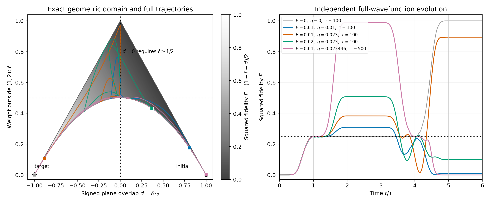

# 从有向平面出发研究状态、保真度与参数演化

本文以 [model.md](../model.md) 的五 Majorana 有效模型为出发点，重新组织研究对象：先寻找能够完整表示所研究波函数物理态的几何量，再把保真度作为这个态空间上的函数，最后分析参数如何改变其演化轨迹。

当前研究约束：固定 \(\tau=100\)、门控函数及其余协议设置，仅将 \(E_1\) 和 \(t_1\) 的幅度作为不可控参数。研究固定终点的二维保真度函数及其高保真区域、边界与敏感性；时间仅作为既定协议内的演化坐标。

选择的几何量是有向二维平面双向量

\[
\boxed{\mathcal B=uv^T-vu^T\in\mathfrak{so}(5).}
\]

下面证明它同时具备三个性质：保留所选波函数除整体相位外的全部信息；精确确定保真度；满足闭合的演化方程。这些结论不要求 \(E_1\tau\) 或 \(|t_1|\tau\) 是小量。

此前的分析归档在 [old_work](old_work/README.md)。本文从状态几何重新出发，不把旧工作中的局部抵消比例作为全空间结构。

当前选定的首个验证问题见第 7 节：利用几何约束预测定向翻转的必经区域，再与完整波函数演化独立对照。

继续研究参数机制的入口是 [geometric_coherence_dynamics.md](geometric_coherence_dynamics.md)：推导完整相干方程、第一段的两个精确旋转通道与标量记忆核，以及第三段的相位传递。

第二段的具体分析见 [geometric_second_stage.md](geometric_second_stage.md)：从瞬时旋转几何到完整相干记忆方程，并检查参数改变输入态和段内输运的不同作用。

当前选定的改进方向见 [geometric_moving_frame.md](geometric_moving_frame.md)：精确移动标架、保留有限相位的慢球面模型及其初步验证。[定向换号位置预测与反馈修正](geometric_boundary_validation.md) 已进一步完成独立检验。

完整六段协议及段间匹配见 [geometric_full_protocol.md](geometric_full_protocol.md)：统一使用完整状态量，补齐第二轮第一段的模式 3 相干，明确控制接口与几何瓶颈的区别，并验证整个分段拼接。

从参数直接预测角度及条带的下一步见 [geometric_stripe_prediction.md](geometric_stripe_prediction.md)：建立由门控确定的全周期慢旋转模型，积分第一、第三段角度，推导第二段的闭合角度输运，并独立预测条带位置和峰高。在既有有限参数区域检验了快慢混合近似的误差。

## 1. 模型、表示与研究范围

按照 \((1,2,3,a,b)\) 排列实基向量，定义

\[
L_{ij}=e_i e_j^T-e_j e_i^T.
\]

取 \(\{\gamma_i,\gamma_j\}=2\delta_{ij}\)，将有效哈密顿量写成

\[
H=\frac i2\gamma^T A\gamma,
\qquad
A=E_1L_{12}+|t_1|L_{1b}-|t_2|L_{2a}+|t_3|L_{3a}+E_dL_{ab}.
\]

沿用此前与论文 Majorana 波函数重叠对应的实向量表示，传播满足

\[
\dot R=KR,\qquad R(0)=I,\qquad K=\frac2\hbar A\in\mathfrak{so}(5).
\]

记 \(E=E_1\)、\(\eta\geq0\) 为 \(|t_1|\) 的控制幅度，\(|t_1(t)|=\eta g(t)\)。于是

\[
K(E,\eta,t)=\frac2\hbar\left[
EL_{12}+\eta g(t)L_{1b}-|t_2(t)|L_{2a}
+|t_3(t)|L_{3a}+E_d(t)L_{ab}\right].
\]

若将 \(|t_1|\) 作为常数，取 \(g=1\)；若使用论文协议，则采用相应的分段门控。以下几何结论适用于这两种情况，也适用于其他给定控制包络。

初始态与目标态为

\[
c_-=(e_1-ie_2)/\sqrt2,\qquad
c_+=(e_1+ie_2)/\sqrt2.
\]

研究的是 \(\psi(t)=R(t)c_-\) 到 \(c_+\) 的转换。论文中的保真度记为 \(f=|c_+^\dagger\psi|\)，本文用 \(F=f^2\) 表示平方重叠。在论文的双编织协议中，终点是 \(T=6\tau\)；中间时刻的同一函数衡量当前态到这个固定目标的重叠。

这里的“完整状态”指上述波函数的物理态。`model.md` 中的四元数矩阵给出旋量表示；它与这里的五维实向量表示需要区分。本文的 \(\mathcal B\) 不被直接解释为任意多体旋量态或整个量子门的完整描述。

## 2. 为什么用有向平面表示状态

令

\[
u=Re_1,\qquad v=Re_2.
\]

由于 \(R\) 正交，\(u,v\) 是一对实正交单位向量，且

\[
\psi=\frac{u-iv}{\sqrt2},\qquad
\mathcal B=uv^T-vu^T=RL_{12}R^T.
\]

将 \((u,v)\) 在自身平面内做保持定向的旋转，只会改变 \(\psi\) 的整体相位；\(\mathcal B\) 保持不变。反转平面定向则改变 \(\mathcal B\) 的符号，对应不同的波函数态。

因此，\(\mathcal B\) 消去了不影响物理态的整体相位，同时保留了区分 \(c_-\) 与 \(c_+\) 所需的定向信息。

### 2.1 从 \(\mathcal B\) 精确恢复密度矩阵

定义平面投影

\[
\boxed{P=-\mathcal B^2=uu^T+vv^T.}
\]

直接展开波函数外积，得到

\[
\boxed{
\rho=\psi\psi^\dagger=\frac12(P+i\mathcal B)
=\frac12(-\mathcal B^2+i\mathcal B).
}
\]

反过来，\(P=2\operatorname{Re}\rho\)、\(\mathcal B=2\operatorname{Im}\rho\)。所以在这条状态轨道上，\(\mathcal B\) 与纯态密度矩阵一一对应。它保留了各模式占据、相干和泄漏信息，而不仅是目标重叠。

这种对应使用了 \(\psi^\dagger\psi=1\)、\(\psi^T\psi=0\)。后一个约束由初态满足，并在实正交传播下保持；任意一般复五维态不一定满足它。

### 2.2 真正的态空间是六维流形

\(\mathcal B\) 始终满足

\[
\mathcal B^T=-\mathcal B,\qquad
\mathcal B^3=-\mathcal B,\qquad
\operatorname{rank}\mathcal B=2,\qquad
\|\mathcal B\|_F^2=2.
\]

它的状态空间是群轨道

\[
\boxed{
\mathcal M=\{RL_{12}R^T:R\in SO(5)\}
\simeq SO(5)/(SO(2)\times SO(3)),\qquad \dim\mathcal M=6.
}
\]

这里 \(SO(2)\) 对应平面内部的相位自由度，\(SO(3)\) 对应正交补中的基变换。\(\mathcal B\) 的十个反对称矩阵分量受到约束，只有六个独立状态自由度。

完整传播 \(R\) 有十个自由度；研究这个固定初态的波函数保真度只需要上述六维轨道。若要研究其他初态或完整门作用，需要保留额外信息。

## 3. 保真度是态空间上的精确几何函数

记

\[
\mathcal B_0=L_{12},\qquad P_0=-\mathcal B_0^2,
\qquad
\mathcal B_\star=-\mathcal B_0,\qquad
\rho_\star=\frac12(P_0-i\mathcal B_0).
\]

\(\mathcal B_\star\) 表示目标 \(c_+\)。对称矩阵与反对称矩阵的乘积迹为零，因而

\[
\boxed{
F=\Phi(\mathcal B)=\operatorname{tr}(\rho_\star\rho)
=\frac14\left[\operatorname{tr}(P_0P)
+\operatorname{tr}(\mathcal B_0\mathcal B)\right].
}
\]

把 \(P=-\mathcal B^2\) 代入，得到仅含李代数坐标的表达式

\[
\boxed{
\Phi(\mathcal B)=\frac14\left[
\sum_j(\mathcal B_{1j}^2+\mathcal B_{2j}^2)-2\mathcal B_{12}
\right].
}
\]

这是完整重叠公式，而非小偏离近似。初始态 \(\mathcal B_0\) 给出 \(F=0\)，目标态 \(-\mathcal B_0\) 给出 \(F=1\)。

### 3.1 保真度损失等于几何偏离

因为 \(\rho,\rho_\star\) 都是秩一投影，

\[
\boxed{
1-F=\frac12\|\rho-\rho_\star\|_F^2
=\frac18\left[
\|P-P_0\|_F^2+\|\mathcal B+\mathcal B_0\|_F^2
\right].
}
\]

第一项度量平面位置的偏离；第二项度量有向双向量与目标的偏离。第二项也随平面位置变化，因此不能把两项视为互不相关的误差机制。

仅使用无向投影 \(P\) 会丢失必要信息：初始态与目标态都有 \(P=P_0\)，但它们的保真度分别是 0 和 1。保留 \(\mathcal B\) 的定向正是关键。

上述矩阵范数给出嵌入空间中的弦距离。对应波函数射线在射影希尔伯特空间中的 Fubini–Study 距离是

\[
d_{\mathrm{FS}}(\rho,\rho_\star)=\arccos\sqrt F.
\]

不能未经证明就将它等同于 \(\mathcal M\) 上某个指定度量的内禀测地距离。

## 4. 状态的完整演化在流形上闭合

对 \(\mathcal B=R\mathcal B_0R^T\) 求导，利用 \(\dot R=KR\)、\(K^T=-K\)，得到

\[
\boxed{
\partial_t\mathcal B(E,\eta,t)=[K(E,\eta,t),\mathcal B(E,\eta,t)],
\qquad \mathcal B(E,\eta,0)=L_{12}.
}
\]

这个方程只需要当前 \(\mathcal B\) 和已知控制，无需同时求解完整 \(R\)。它自动保持上述轨道约束；在局部六维坐标 \(q\) 中，就是 \(\dot q=V(q;E,\eta,t)\)。

同时有

\[
\dot P=[K,P],\qquad \dot\rho=[K,\rho].
\]

保真度的变化由这一状态运动诱导：

\[
\boxed{
\dot F=\frac14\left[
\operatorname{tr}(P_0[K,P])+
\operatorname{tr}(\mathcal B_0[K,\mathcal B])\right].
}
\]

保真度等值面 \(\Phi^{-1}(F)\) 上有许多不同的状态。轨迹沿等值面运动时，\(F\) 可以不变，而后续演化仍取决于这种状态变化。以 \(\mathcal B\) 作为主变量就保留了这些信息。

## 5. \(E_1,t_1\) 作为态空间上的向量场

将完整速度场分解为

\[
\dot{\mathcal B}=V_c(t,\mathcal B)+E V_E(\mathcal B)
+\eta V_\eta(t,\mathcal B),
\]

其中 \(K_c\) 只含 \(t_2,t_3,E_d\)，且

\[
\boxed{
V_c=[K_c,\mathcal B],\qquad
V_E=\frac2\hbar[L_{12},\mathcal B],\qquad
V_\eta=\frac{2g(t)}\hbar[L_{1b},\mathcal B].
}
\]

它们都是 \(\mathcal M\) 的切向量场。参数大小改变这些速度场的权重；有限参数下的影响是整条轨迹的变化，不需要先对保真度作展开。

### 5.1 \(E_1\) 改变状态，但不直接改变瞬时目标重叠

在初始态，\([L_{12},\mathcal B_0]=0\)，所以单独 \(E_1\) 只给初始波函数整体相位。离开初始平面后，通常 \(V_E\neq0\)。例如对 \(j\in\{3,a,b\}\)，

\[
\left.\dot{\mathcal B}_{1j}\right|_E=\frac{2E}{\hbar}\mathcal B_{2j},\qquad
\left.\dot{\mathcal B}_{2j}\right|_E=-\frac{2E}{\hbar}\mathcal B_{1j}.
\]

然而 \(P_0\)、\(\mathcal B_0\) 都与 \(L_{12}\) 对易。由第 4 节的公式，对所有轨道态都有

\[
\boxed{d\Phi_{\mathcal B}(V_E)=0.}
\]

这是精确的几何事实：\(E_1\) 的速度场沿保真度等值面运动。它改变相干和后续控制的作用，从而仍然可以改变整段协议的终点保真度。不能将这个恒等式解释为 \(\partial_E F(E,\eta,T)=0\)。

### 5.2 \(t_1\) 打开另一个状态运动方向

在初始态有

\[
[L_{1b},L_{12}]=L_{2b},\qquad
V_\eta(t,\mathcal B_0)=\frac{2g(t)}\hbar L_{2b}.
\]

只要门控打开，它就直接推动状态离开初始有向平面。完整方程还给出

\[
\boxed{
\dot{\mathcal B}_{12}=-\frac2\hbar
\left[\eta g(t)\mathcal B_{2b}+|t_2(t)|\mathcal B_{1a}\right].
}
\]

这说明定向分量的变化由不同相干分量共同驱动。\(E_1\) 先改变这些分量，再影响 \(t_1\) 与门控耦合的效果。生成元满足 \([L_{12},L_{1b}]=-L_{2b}\)，因此一般不能把两个参数压缩成一个固定的线性组合。

### 5.3 一个保真度不变而状态继续演化的实际阶段

论文第三段有 \(t_1=t_2=0\)。此时

\[
K=\frac2\hbar(EL_{12}+|t_3|L_{3a}+E_dL_{ab})
\]

与目标投影 \(\rho_\star\) 对易，故对任意当前态都有 \(\dot F=0\)。但 \(\dot{\mathcal B}\) 通常非零，并会影响下一周期的演化。这给出了保留完整几何态而非只追踪 \(F\) 的具体理由。

## 6. 几何分析可以怎样继续

研究对象是参数族 \(\mathcal B(E,\eta,t)\in\mathcal M\)，以及由它诱导的 \(F(E,\eta,t)=\Phi(\mathcal B(E,\eta,t))\)。它把问题分成以下几个可分析的方向。

1. **状态轨迹与保真度等值面。** 分析速度场何时沿等值面运动、何时使轨迹接近或远离目标；找出保真度不变却对以后有作用的相干变化。
2. **参数平面在态空间中的像。** 固定终点 \(T\)，研究映射 \((E,\eta)\mapsto\mathcal B(E,\eta,T)\)。高保真度区域是这个像接近 \(\mathcal B_\star\) 的部分，而非预设的一条抵消直线。
3. **重复协议的几何作用。** 若一次三段传播为 \(C\)，则它作用为 \(\mathcal B\mapsto C\mathcal B C^T\)；双周期态是 \(C^2\mathcal B_0(C^2)^T\)。可以研究这一映射如何保持、转动或恢复有向平面。
4. **保留状态坐标的 PDE。** 如果之后需要研究所有初态的终点保真度，可在 \(\mathcal M\) 上建立输运方程；它的特征线就是当前的状态动力学。

例如在局部坐标 \(q\) 中，令 \(U(s,q;E,\eta,T)\) 表示从时刻 \(s\) 的态 \(q\) 出发，到固定终点 \(T\) 的保真度，则

\[
\partial_sU+V(q;E,\eta,s)\cdot\nabla_qU=0,
\qquad U(T,q;E,\eta,T)=\Phi(\mathcal B(q)).
\]

不同坐标图覆盖整个流形。这个 PDE 保留了完整状态；是否能进一步得到更简洁的参数空间方程，需要在此基础上研究，不能从单个 \(F\) 的定义直接假定闭合。

本文的 \(t\) 是固定控制协议下的真实演化时间。若改变 \(\tau\)，控制包络也随之改变；论文终点量应写作 \(F_{\rm end}(E,\eta,\tau)=\Phi(\mathcal B(E,\eta,6\tau;\tau))\)。分析时必须包含协议自身对 \(\tau\) 的依赖。

目前已经得到的是合适的状态变量、它与保真度的精确对应，以及完整有限参数的闭合演化。这为几何分析确定了对象；任意参数下的全局峰谷、恢复条件和最优关系尚需进一步推导。

## 7. 首个验证问题：定向翻转的几何瓶颈

先选择一个具体问题：**从初始态走到高保真度目标，轨迹是否必须经过某个由状态几何决定的区域？** 这个问题能给出解析预测，并可直接用原波函数演化核对。

### 7.1 两个可直接测量的几何量

定义有符号平面重叠，以及初始平面外的波函数权重：

\[
d=\mathcal B_{12},\qquad
\ell=\sum_{j\in\{3,a,b\}}|\psi_j|^2
=1-\frac12\operatorname{tr}(P_0P).
\]

\(d\) 表示当前有向平面在初始平面上的投影定向。它是连续量，不是整个流形上的离散拓扑标签；投影退化时 \(d=0\)。\(\ell\) 包含 \(\gamma_3,\gamma_a,\gamma_b\) 三个方向的权重，不等同于量子点占据或多体粒子数。中间时刻 \(\ell\) 大也不自动表示编织失败。

由精确保真度公式立刻得到

\[
\boxed{F=\frac{1-\ell-d}{2}.}
\]

初态位于 \((d,\ell)=(1,0)\)，目标位于 \((-1,0)\)。这两个坐标便于显示轨迹，但并不完整表示六维状态；它们仍不足以单独闭合演化。

### 7.2 允许区域与保真度界：不使用小量展开

令当前正交标架在初始平面上的投影为

\[
T=\begin{pmatrix}u_1&v_1\\u_2&v_2\end{pmatrix},
\]

其奇异值 \(s_1,s_2\) 满足 \(0\leq s_i\leq1\)。有

\[
d=\det T,\qquad d^2=s_1^2s_2^2,\qquad
\ell=1-\frac{s_1^2+s_2^2}{2}.
\]

利用 \(s_1^2+s_2^2\geq2s_1s_2=2|d|\)，以及
\((1-s_1^2)(1-s_2^2)\geq0\)，得到精确界

\[
\boxed{\frac{1-d^2}{2}\leq\ell\leq1-|d|,\qquad -1\leq d\leq1.}
\]

这也完整描述了二维投影的允许区域：给定满足上述界的 \((d,\ell)\)，可以选取相应奇异值，并在两个正交补方向上补足 \(u,v\)，构造一个实际的有向平面。它不意味着固定编织协议能够到达其中每一点。

将允许区域代入保真度公式，又得到

\[
\boxed{\max(0,-d)\leq F\leq\frac{(1-d)^2}{4}.}
\]

特别地，\(d\geq0\) 时必有 \(F\leq1/4\)。因此 \(F>1/4\) 必须伴随投影定向变为负。若要求 \(F\geq F_c\)，还必须有 \(d\leq1-2\sqrt{F_c}\)；若已有 \(d\leq-F_c\)，则足以保证 \(F\geq F_c\)。这些是全有限参数下的几何界，不是抵消线或渐近公式。

### 7.3 一个可以直接检验的必经条件

初始 \(d=1\)。任意连续演化若到达 \(F>1/4\)，就必须先经过一个 \(d=0\) 的时刻 \(t_\times\)。由允许区域可知

\[
\boxed{
\ell(t_\times)\geq\frac12,\qquad
F(t_\times)=\frac{1-\ell(t_\times)}2\leq\frac14.
}
\]

所以高保真度转换必然经历至少一次“平面外权重达到一半”的阶段。若整条轨迹始终满足 \(\ell<1/2\)，就不能到达 \(F>1/4\)。这揭示了一个与具体参数无关的几何瓶颈：态必须先离开初始平面，随后以目标定向返回。

这是必要条件，不能反过来说经过瓶颈就保证成功；轨迹可能再次回到错误定向，也可能在终点仍远离目标平面。

### 7.4 与完整波函数的独立对照

使用论文的两个三段余弦周期，\(t_c=E_0=0.3\,\mathrm{meV}\)、\(\hbar=1\)。分别积分复波函数的五个分量方程，以及 \(\dot{\mathcal B}=[K,\mathcal B]\) 的十个实分量方程；没有暗模投影、绝热近似或 \(E\tau,\eta\tau\) 展开。

能量单位为 meV，\(\tau\) 单位为 \(\mathrm{meV}^{-1}\)。以下 \(F\) 均为平方重叠。

| \(E\) | \(\eta\) | \(\tau\) | 终点 \(d\) | 终点 \(\ell\) | 终点 \(F\) |
|---|---|---|---|---|---|
| 0 | 0 | 100 | −0.999984 | 0.0000156 | 0.999984 |
| 0.01 | 0.01 | 100 | +0.805180 | 0.175846 | 0.009487 |
| 0.01 | 0.023 | 100 | −0.886132 | 0.107385 | 0.889374 |
| 0.02 | 0.023 | 100 | +0.368447 | 0.432124 | 0.099714 |
| 0.01 | 0.02344645627 | 500 | +0.997814 | 0.002184 | 0.00000120 |



左图画出精确允许区域及轨迹投影，方块表示终点；所有从右侧初态走向左侧目标的路径都必须在 \(d=0\) 处进入 \(\ell\geq1/2\) 的区域。右图直接由完整波函数求得 \(F(t)\)。灰线是零扰动参考，其余曲线保留有限参数。

五条路径中检测到的 \(d=0\) 点均满足瓶颈界。零扰动参考在这些点达到 \(\ell=1/2,F=1/4\)，说明该界可以取到；有限参数的路径也遵守同一个界。

两种独立传播得到的全时程保真度最大差为 \(3.2\times10^{-12}\) 以下，完整密度矩阵重构最大差为 \(4.3\times10^{-12}\) 以下。直接波函数结果对 \(F=(1-\ell-d)/2\) 的误差低于 \(1.1\times10^{-13}\)。这些数值检查核对表示与实现；瓶颈对一般参数成立的依据是前面的解析证明。

### 7.5 这个验证支持什么，下一步追问什么

最有区分力的是最后一行：终点的平面外权重只有约 0.0022，但 \(d\approx+1\)，故保真度接近零。轨迹回到了几乎相同的无向平面，却没有以目标定向结束。仅用平面位置或平面外权重作为状态变量，就无法解释这个结果；保留 \(\mathcal B\) 的定向可以。

在 \(\tau=100\) 时，改变 \(\eta\) 或 \(E\) 也会把终点从负定向一侧移回正定向一侧，对应表中的保真度变化。表格并没有证明这些变化对参数单调，也没有给出一般最优参数关系。

因此，首个验证已经得到三项结果：一个解析的必经条件；与完整波函数一致的有限参数预测；一个无向平面分析会遗漏的失败机制。接下来集中研究一个问题即可：**\(E_1,t_1\) 如何改变轨迹穿过瓶颈后的运动，使它以正确或错误的定向结束？** 仍以完整 \(\mathcal B\) 的相干分量和速度场为依据。

可复现脚本为 [verify_bottleneck.py](geometric_validation/verify_bottleneck.py)，结果记录为 [bottleneck.json](geometric_validation/bottleneck.json)，完整时程数据为 [bottleneck.npz](geometric_validation/bottleneck.npz)，另有 [PDF 图像](geometric_validation/bottleneck.pdf)。运行命令：

```sh
.venv/bin/python -B previous_work/geometric_validation/verify_bottleneck.py
```
