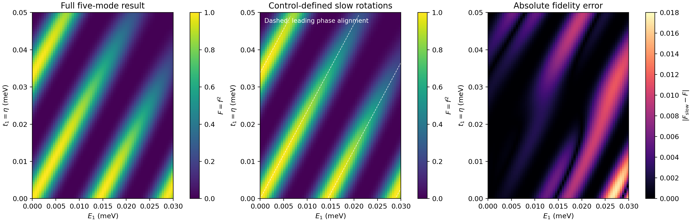
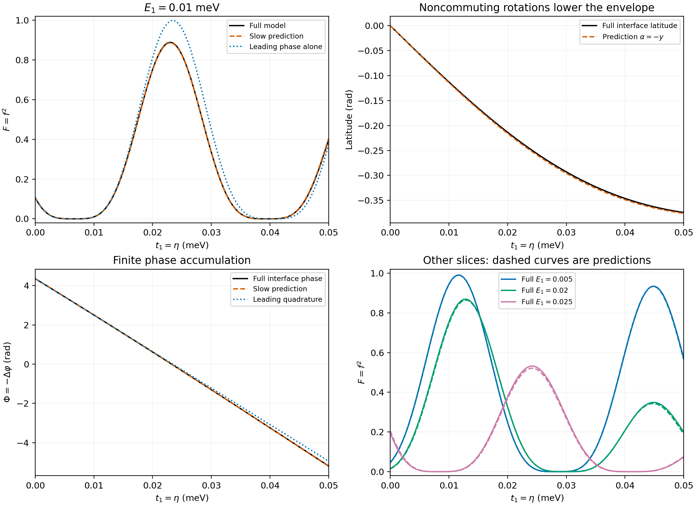

# 从演化方程预测条带：完整周期的慢旋转与角度输运

当前研究固定 \(\tau=100\)、全部门控函数、其余耦合幅度及六段协议。只有 \(E=E_1\) 和 \(\eta=|t_1|\) 是不可控参数；它们在一次演化中取定，其中时变耦合仍为 \(t_1(t)=\eta g(t)\)，\(g(t)\) 是既定包络。时间是演化坐标，终点固定为 \(6\tau=600\)，研究对象为 \(\mathcal B(E,\eta;t)\) 和二维函数 \(F_{\rm end}(E,\eta)\)。目标是确定固定协议的高保真区域、边界与参数容忍范围。

本次把此前“演化后提取角度”的几何解释，推进到一个**直接由门控和参数确定的完整周期预测模型**。第一、第三段的累计角度由已知函数的积分给出；第二段由三个闭合角度方程描述。三段拼接并重复后，可以同时预测条带位置和峰值高度，不需要先提供完整模型算出的中间输入态，也没有拟合完整结果中的系数。

这一步仍有明确近似：在由理想门控确定的标架中，略去快平面与慢空间的混合，保留慢空间的全部旋转。它没有把 \(E_1\tau\) 或 \(t_1\tau\) 当作小量展开，也不是整个参数空间的精确替代。完整状态的精确方程仍然是 \(\partial_t\mathcal B=[K,\mathcal B]\)。

在已有 \(6161\) 点区域，预测保真度的均方根误差为 \(0.00431\)，最大误差为 \(0.01734\)。由预测模型自身检测并细化的 \(93\) 个内部峰都与完整结果对应，峰位置均方根误差为 \(5.49\times10^{-5}\,\mathrm{meV}\)。下文说明这些预测从哪里来，以及尚未解决什么。



## 1. 选一个由门控直接确定的标架

采用 [model.md](../model.md) 的模式顺序 \((1,2,3,a,b)\)，记 \(E=E_1\)、\(\eta=|t_1|\)，每段局部时间 \(v\in[0,1]\)。设

\[
a(v)=\frac{1-\cos\pi v}{2},\quad b(v)=1-a(v),\quad
\rho(v)=\sqrt{a^2+b^2},\quad c=\frac{2\tau}{\hbar}.
\]

本次沿用 \(t_c=E_0=0.3\)，因而三段中的强耦合幅度均为

\[
\lambda(v)=t_c\rho(v)\geq\frac{t_c}{\sqrt2}.
\]

定义 \(s=a/\rho\)、\(t=b/\rho\)，即 \(s=\sin\vartheta,t=\cos\vartheta\)，\(\vartheta=\operatorname{atan2}(a,b)\) 从 \(0\) 增加到 \(\pi/2\)。取快平面的标架为 \((e_a,n)\)，并选择如下慢标架 \(D\)：

| 段 | 强耦合方向 \(n\) | 辅助方向 \(m\) | 慢标架 \(D\) |
|---|---|---|---|
| 第一段 | \(s e_2+t e_b\) | \(t e_2-s e_b\) | \((e_1,m,e_3)\) |
| 第二段 | \(t e_2-s e_3\) | \(s e_2+t e_3\) | \((e_1,m,e_b)\) |
| 第三段 | \(-t e_3+s e_b\) | \(s e_3+t e_b\) | \((e_1,e_2,m)\) |

每段 \(Q=(e_a,n,D)\in SO(5)\)。这是一个显式、参数无关的门控标架，在 \(E=\eta=0\) 时也正常。

对 \(\widetilde{\mathcal B}=Q^T\mathcal BQ\)，精确方程为

\[
\partial_v\widetilde{\mathcal B}=[G,\widetilde{\mathcal B}],
\qquad G=cQ^TAQ-Q^TQ'.
\]

这里 \(Q\) 是已知坐标变换，不能与未知传播矩阵 \(R\) 混淆。把 \(G\) 按 \(2+3\) 分块：

\[
G=\begin{pmatrix}c\lambda J&V\\-V^T&G_s\end{pmatrix},
\qquad J=\begin{pmatrix}0&1\\-1&0\end{pmatrix}.
\]

以下以 \(\ell_{ij}\) 表示**慢坐标中的三维**反对称生成元，避免与物理五维模式的 \(L_{ij}\) 混用。直接代入可得

\[
\boxed{
\begin{aligned}
G_{s,1}&=c\frac{E b-\eta a^2}{\rho}\,\ell_{12},\\
G_{s,2}&=c\left(\frac{E a}{\rho}\ell_{12}+\eta b\,\ell_{13}\right),\\
G_{s,3}&=cE\,\ell_{12}.
\end{aligned}}
\]

这些是精确生成元的慢对角块。被略去的块也明确已知：

\[
\begin{aligned}
V_1&=\begin{pmatrix}0&0&0\\-c(E s+\eta a t)&\vartheta'&0\end{pmatrix},\\
V_2&=\begin{pmatrix}0&0&0\\-cE t&-\vartheta'&0\end{pmatrix},\\
V_3&=\begin{pmatrix}0&0&0\\0&0&\vartheta'\end{pmatrix},\qquad
\vartheta'=\frac{(\pi/2)\sin\pi v}{\rho^2}.
\end{aligned}
\]

**近似只发生在令 \(V=0\) 这一步。** 被略去的混合同时包含弱耦合和标架转动。与此前按完整瞬时频率构造的 [第二段标架](geometric_moving_frame.md) 相比，本次的选择使第一、第三段可以直接积分；此前固定输入的局部误差不能作为本次完整周期的误差保证。

## 2. 第一、第三段及边界可以直接写出

设 \(R_{ij}(\theta)=\exp(\theta\ell_{ij})\)。第一、第三段慢传播分别为

\[
S_1=R_{12}(\theta_1),\quad
\theta_1=c(EI_0-\eta I_1),\qquad
S_3=R_{12}(\theta_3),\quad\theta_3=cE,
\]

其中两个常数完全由门控决定：

\[
\begin{aligned}
I_0&=\int_0^1\frac{b}{\rho}dv
=\frac12\int_0^1\frac{dv}{\rho}=0.5901702995080482,\\
I_1&=\int_0^1\frac{a^2}{\rho}dv
=\frac12\int_0^1\rho\,dv=0.4299233000511189.
\end{aligned}
\]

两处等号利用门控对称性 \(a(1-v)=b(v)\)。采用参数记号 \(m\) 的完全椭圆积分，还可写成 \(I_0=\mathrm K(1/2)/\pi\)、\(I_1=\mathrm E(1/2)/\pi\)；数值并非对完整保真度拟合。

第一段末慢基为 \((e_1,-e_b,e_3)\)，第二段初为 \((e_1,e_3,e_b)\)，所以输入坐标必须乘

\[
T=\begin{pmatrix}1&0&0\\0&0&1\\0&-1&0\end{pmatrix}
=R_{23}(\pi/2).
\]

第二、第三段接口的慢基相同。第三段末及下一周期初的慢基都为 \((e_1,e_2,e_3)\)。这些接口都不混合快慢空间。记第二段慢传播为 \(S_2\)，则一个周期的三维传播为

\[
\boxed{U=R_{12}(\theta_3)S_2T R_{12}(\theta_1).}
\]

初始波函数在慢空间中，近似模型全过程保持这一性质。三维双向量可由单位法向量

\[
m=(\mathcal B_{23},\mathcal B_{31},\mathcal B_{12})^T
\]

表示，初始 \(m_0=e_3\)。重复同一个周期后 \(m_6=U^2e_3\)，所以

\[
\boxed{d_6=(U^2)_{33},\qquad F_{\rm slow}=\frac{[1-d_6]^2}{4}.}
\]

这里 \(F=f^2\)，\(f\) 才是论文使用的重叠模长。三维模型通过正交旋转传播物理态，保持归一化及简单双向量约束；第一周期的输出自动成为第二周期的输入。

## 3. 第二段给出闭合的角度方程

对 \(S_2(v)\) 取 Euler 分解

\[
S_2(v)=R_{12}(x(v))R_{23}(y(v))R_{13}(z(v)).
\]

由 \(S_2'=G_{s,2}S_2\)，直接比较三个生成元的系数，得到

\[
\boxed{
\begin{aligned}
x'&=h-g\cos x\tan y,\\
y'&=g\sin x,\\
z'&=g\frac{\cos x}{\cos y},
\end{aligned}
\quad
h=\frac{cE a}{\rho},\quad g=c\eta b,\quad x(0)=y(0)=z(0)=0.}
\]

右边只有已知门控、参数和这三个角度，没有未知的五维 \(R\)、波函数或其他未闭合相干分量。这是有限参数处的非线性输运方程，没有对累计角度作 Taylor 截断。

这组坐标在 \(\cos y=0\) 时需要换图；原三维旋转仍然正常。此次整个参数网格上 \(\min\cos y\approx0.5338\)，处于同一坐标图内。实现中用三维旋转矩阵传播整个网格，并用独立角度方程核对，避免把坐标问题当作物理奇异性。

利用 \(R_{13}(z)T=TR_{12}(-z)\)，一周期传播变为

\[
U=R_{12}(\theta_3+x)R_{23}(\pi/2+y)R_{12}(\theta_1-z).
\]

定义终点累计相位

\[
\Phi=\theta_1+\theta_3+x(1)-z(1).
\]

矩阵相乘给出

\[
\boxed{
d_6=\sin^2 y-\cos^2 y\cos\Phi,\qquad
F_{\rm slow}=\cos^4y\,\cos^4\frac{\Phi}{2},}
\]

其中 \(y=y(1)\)。此前接口角度在本模型中对应

\[
\boxed{\alpha=-y,\qquad\Delta\varphi=-\Phi\pmod{2\pi}.}
\]

此外，\(m_3=Ue_3\)，反向所需输入为 \(m_\star=-U^Te_3\)，故两者第三分量分别为 \(U_{33}\) 与 \(-U_{33}\)。所以 \(\alpha_\star=-\alpha\) 在这个重复周期的三维模型中是恒等式。这解释了完整网格中两纬度近乎相反的现象；并不意味着完整五维路径始终在同一个球面上。

## 4. 条带的间距、弯曲与高度分别来自什么

第二段的 \(\eta b\) 在前部较强，\(Ea/\rho\) 在后部较强。为读出领先周期，先以保持各自脉冲面积的顺序旋转代替重叠输运：

\[
S_{2,\rm seq}=R_{12}(cEI_0)R_{13}(c\eta/2).
\]

这在两种旋转时间不重叠的极限精确，允许累计角度很大。实际门控存在重叠，因此它只是用于比较的粗略近似。代入一周期传播，得到

\[
\boxed{\Phi_{\rm lead}
=c\left[(1+2I_0)E-(I_1+\tfrac12)\eta\right].}
\]

这一步只用于提取条带的大致位置。对于混合有限参数，它一般不能代替完整慢旋转，也不具有本轮独立的重叠误差上界。若 \(E=0\) 或 \(\eta=0\)，则在慢模型中 \(y=0\)，这条相位式确实精确成立。

领先的相位对齐线为

\[
\eta_n(E)\approx
\frac{(1+2I_0)E-2\pi n/c}{I_1+1/2},\qquad n\in\mathbb Z.
\]

因此本门控下有

\[
\frac{d\eta_n}{dE}\approx2.344645627,
\qquad
\Delta\eta\approx\frac{2\pi}{c(I_1+1/2)}.
\]

在固定的 \(\tau=100,\hbar=1\) 下，\(c=200\)，\(\Delta\eta\approx0.03378335\,\mathrm{meV}\)。这是对有限累计相位的周期预测，不是 \(\tau E\ll1\) 时的一条局部抵消线。

角度方程进一步给出两条积分恒等式：

\[
\boxed{y(v)=c\eta\int_0^v b(u)\sin x(u)du,}
\]

\[
\boxed{
\Phi=\Phi_{\rm lead}+\delta\Phi,\qquad
\delta\Phi=-c\eta\int_0^1 b\left[
\cos x\,\frac{1+\sin y}{\cos y}-1\right]dv.}
\]

第一式说明：\(E\) 先建立旋转角 \(x\)，\(\eta\) 随后通过 \(\sin x\) 改变纬度。这来自 \(\ell_{12}\) 与 \(\ell_{13}\) 的不对易及门控重叠，不能用一个总能量差消除。第二式说明同一个混合过程还会修正累计相位，导致条带偏离直线。

在相位对齐处 \(\Phi=2\pi n\)，有

\[
F_{\rm slow}=\cos^4y.
\]

因此只预测相位而令所有峰高为 1 会丢失主要物理机制。实际峰需要平衡两个因素；在 \(F\neq0\) 的区域，固定 \(E\) 的内部驻点满足

\[
\boxed{2\tan y\,\partial_\eta y
+\tan(\Phi/2)\,\partial_\eta\Phi=0.}
\]

相位对齐线的局部斜率为 \(-\Phi_E/\Phi_\eta\)；若相位在所比较区间内近似线性，局部间距为 \(2\pi/|\Phi_\eta|\)。这两式的适用前提不能替代求解完整分支。

还有一个直接的几何判据：\(d_6=0\) 等价于 \(\cos\Phi=\tan^2y\)。当 \(|y|>\pi/4\) 时，任何相位都不能使这一终点定向为负，而且保真度包络小于 \(1/4\)。

## 5. 有限参数的梯度也闭合

记 \(u=(x,y,z)\)，上述右端为 \(f(u;E,\eta,v)\)。参数灵敏度在任意有限点满足

\[
\partial_v u_\lambda=(\partial_u f)u_\lambda+\partial_\lambda f,
\qquad u_\lambda(0)=0,\quad\lambda=E,\eta,
\]

其中显式参数项是

\[
\partial_E f=(ca/\rho,0,0)^T,\qquad
\partial_\eta f=cb(-\cos x\tan y,\sin x,\cos x/\cos y)^T.
\]

进而

\[
\Phi_E=c(1+I_0)+x_E-z_E,\qquad
\Phi_\eta=-cI_1+x_\eta-z_\eta,
\]

\[
\partial_\lambda F_{\rm slow}
=-4\cos^3y\sin y\cos^4(\Phi/2)y_\lambda
-2\cos^4y\cos^3(\Phi/2)\sin(\Phi/2)\Phi_\lambda.
\]

这些方程可以研究条带弯曲、实际峰位置和高度变化，且无需在零参数附近展开。它们同样是带参数的时间演化方程，不引入不同参数点之间的虚构扩散。

## 6. 独立预测的验证结果

比较范围为 \(E\in[0,0.03]\)、\(\eta\in[0,0.05]\)，步长均为 \(0.0005\)，\(\tau=100,t_c=E_0=0.3,\hbar=1\)。完整结果使用 [此前独立验证过的十分量网格](geometric_parameter_space.md)。预测计算只使用上述门控与三维慢生成元；完整网格在预测后用于比较。

| 量 | 本轮误差 |
|---|---:|
| \(F\) 网格均方根误差 | \(0.00430968\) |
| \(F\) 网格最大绝对误差 | \(0.0173383\) |
| 接口纬度最大误差 | \(0.0118069\) rad |
| 相位最大误差，模 \(2\pi\) 比较 | \(0.0518259\) rad |
| 只用领先相位的最大误差 | \(0.375884\) rad |
| 93 个内部峰的位置均方根误差 | \(5.49\times10^{-5}\,\mathrm{meV}\) |
| 93 个内部峰的位置最大误差 | \(1.66\times10^{-4}\,\mathrm{meV}\) |
| 相位对齐交点位置的最大误差 | \(1.85\times10^{-4}\,\mathrm{meV}\) |

相位交点比较包含 94 个内部交点及原点。根与峰均先从预测网格检测并由预测方程细化，再与同一 \(E\) 切片的完整结果匹配。峰高是在两个模型各自的峰位置比较，不能混同于同一点的网格误差。

各切片预测的最佳内部峰如下：

| \(E\) | 预测峰 \(\eta\) | 完整峰 \(\eta\) | 预测峰高 \(F\) | 完整峰高 \(F\) |
|---:|---:|---:|---:|---:|
| 0.005 | 0.01165311 | 0.01164416 | 0.990790 | 0.991011 |
| 0.010 | 0.02300067 | 0.02300051 | 0.887038 | 0.889374 |
| 0.015 | 0.00137719 | 0.00131997 | 0.998914 | 0.999026 |
| 0.020 | 0.01287015 | 0.01282511 | 0.864919 | 0.869505 |
| 0.025 | 0.02419061 | 0.02418651 | 0.521488 | 0.532252 |
| 0.030 | 0.00277723 | 0.00261428 | 0.988529 | 0.990210 |



例如 \(E=0.01,\eta=0.023\) 时，角度方程给出

\[
y\approx0.24261837,\qquad \Phi\approx0.04396951,
\qquad\delta\Phi\approx-0.03906451,
\]

所以峰高主要受纬度因子影响。完整保真度为 \(0.88937359\)，预测为 \(0.88703794\)。这也是不能只追踪相位对齐线的一个具体例子。

另对原点、两个既有样本、区域最大误差点及右上角，用原始复波函数直接传播六段，并与**保留 \(V\) 的精确标架方程**比较，波函数最大差异小于 \(1.3\times10^{-12}\)。解析标架导数、快慢对角块、角度分解、相位积分恒等式及有限参数梯度也分别核对。三维矩阵传播的正交误差小于 \(1.8\times10^{-11}\)，因子化恒等式误差小于 \(6.4\times10^{-12}\)。这些数值误差远小于略去 \(V\) 造成的模型误差。

## 7. 当前结论和下一步

本轮得到的是一套可独立预测完整协议的约化理论：门控积分决定领先条带；第二段的角度输运产生纬度和相位修正；重复周期把它们转成 \(F=\cos^4y\cos^4(\Phi/2)\)。它解释了此前观察到的反向纬度、近似平行的相位分支及明显不同的峰高。

在固定协议下，尚未得到整个 \((E,\eta)\) 参数空间的精确闭式解或统一误差界。弱耦合相对于 \(t_c\) 的大小，以及被略去的快慢混合，会影响本约化。本轮检验覆盖 \(E\tau\leq3,\eta\tau\leq5\)，保留了这些有限累计效应。

下一步保持全部协议设置固定，研究已知 \(V\) 的返回反馈如何修正 \(y(E,\eta),\Phi(E,\eta)\)，优先改善大 \(E\) 切片的峰高和相位偏移。在此基础上刻画高保真区域的宽度、边界和敏感方向，描述对两个不可控参数的容忍程度。此前 [局部反馈修正](geometric_boundary_validation.md) 已提供工具，但还需连同本次全周期输入与接口重新推导、验证；不能直接沿用固定输入的高精度结论。

复现：

```sh
.venv/bin/python -B previous_work/geometric_validation/predict_geometric_stripes.py
```

代码：[predict_geometric_stripes.py](geometric_validation/predict_geometric_stripes.py)。结果：[stripe_prediction.json](geometric_validation/stripe_prediction.json)、[stripe_prediction.npz](geometric_validation/stripe_prediction.npz)。导出图：[参数图 PDF](geometric_validation/stripe_prediction.pdf)、[角度与切片 PDF](geometric_validation/stripe_angles.pdf)。
