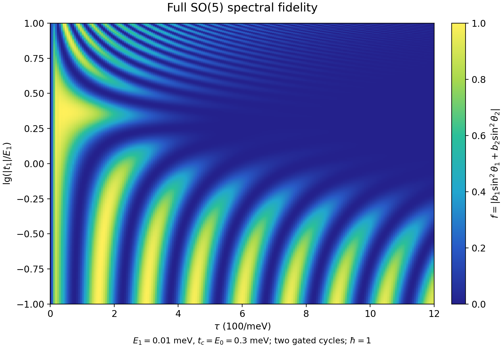
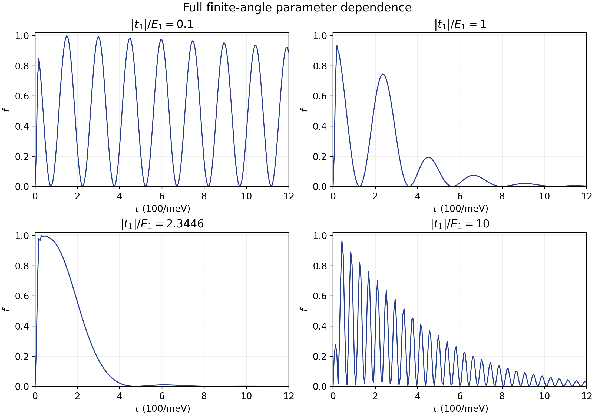

# 完整有限角度的 SO(5) 保真度与参数影响

时间与参数的精确偏微分系统、混合响应和峰线延拓见 [so5_parameter_pde.md](so5_parameter_pde.md)。

本次分析保留完整五 Majorana 模型，不对 E₁、t₁ 或它们的累计旋转角做微扰截断，也不做暗模投影。核心结果是双编织保真度的精确谱公式：

\[
\boxed{
f=\left|b_1\sin^2\theta_1+b_2\sin^2\theta_2\right|,
\qquad
F=f^2.
}
\]

\(\theta_1,\theta_2\) 是一次三段协议群元的两个旋转角，\(b_1,b_2\) 是相应旋转平面与初始 Majorana 波函数平面的投影系数。参数同时改变角度和投影系数，因此一般不能归结成一个固定的 \(aE_1-b|t_1|\) 组合。

这是完整保真度的精确表示。本文没有求出余弦协议下 \(\theta_r(E_1,t_1,\tau)\)、\(b_r(E_1,t_1,\tau)\) 的一般初等闭式函数；下面给出其精确定义、全参数响应方程，以及保留全部耦合的计算结果。不能把仍需求解的群演化称为已经得到初等闭式解。

## 1. 完整模型和协议

按 \((1,2,3,a,b)\) 排序，\(L_{ij}=e_i e_j^T-e_j e_i^T\)，采用 \(\{\gamma_i,\gamma_j\}=2\delta_{ij}\)。记 \(E=E_1\)、\(\eta=|t_1|\)，有

\[
\dot R=K(t)R,
\qquad
K=\frac2\hbar\left[
E L_{12}+\eta g(t)L_{1b}-|t_2|L_{2a}+|t_3|L_{3a}+E_dL_{ab}
\right].
\]

\(R(0)=I\)、\(R\in SO(5)\)。每段长度为 \(\tau\)，局部时间 \(v\in[0,1]\)，\(f_\pm=(1\pm\cos\pi v)/2\)，论文的门控为

| 段 | \(|t_2|\) | \(|t_3|\) | \(E_d\) | \(g\) |
|---|---|---|---|---|
| 1 | \(t_c f_-\) | 0 | \(E_0 f_+\) | \(f_-\) |
| 2 | \(t_c f_+\) | \(t_c f_-\) | 0 | \(f_+\) |
| 3 | 0 | \(t_c f_+\) | \(E_0 f_-\) | 0 |

令三个段的完整传播为 \(R_1,R_2,R_3\)，一次群元为

\[
C=R_3R_2R_1.
\]

由于论文的双交换使用两个相同周期，

\[
\boxed{R(6\tau)=C^2.}
\]

保真度采用之前已建立的 SO(5) 定义：

\[
c_-=(e_1-ie_2)/\sqrt2,\qquad c_+=(e_1+ie_2)/\sqrt2,
\qquad f=|c_+^\dagger C^2c_-|.
\]

等价的四个矩阵元素公式也仍然精确成立。

## 2. 完整保真度的几何坐标

设双周期传播 R 的左上 \(2\times2\) 块为 T，奇异值为 \(s_1\ge s_2\ge0\)，令 \(\sigma=\operatorname{sign}\det T\)。由于 R 正交，\(0\le s_i\le1\)，可写成 \(s_i=\cos\alpha_i\)，其中 \(\alpha_i\) 是初始平面和演化后平面的主角。

对 \(\det T\neq0\)，

\[
\boxed{
F=\frac14(s_1-\sigma s_2)^2
=\frac14(\cos\alpha_1-\sigma\cos\alpha_2)^2.
}
\]

证明来自

\[
4F=\|T\|_F^2-2\det T
=s_1^2+s_2^2-2\sigma s_1s_2.
\]

在 \(\det T=0\) 时，直接使用右侧 \((s_1^2+s_2^2)/4\) 即可，不必给零行列式定义定向。

因此有两个完整、非小角度的几何条件：

- 定向翻转时 \(\sigma=-1\)，\(F=(s_1+s_2)^2/4\)，高保真度要求两个主角都小。
- 定向未翻转时 \(\sigma=+1\)，\(F=(s_1-s_2)^2/4\le1/4\)。因此 \(F>1/4\) 必须伴随这个投影平面的定向翻转。

这里的 F 是指定波函数转换的平方重叠，不是整个编码门的平均保真度。

### 2.1 直接在李代数里演化保真度的几何对象

定义有向平面双向量

\[
\mathcal B(t)=R(t)L_{12}R(t)^T\in\mathfrak{so}(5).
\]

其完整演化方程是

\[
\boxed{\dot{\mathcal B}=[K,\mathcal B],\qquad\mathcal B(0)=L_{12}.}
\]

平面投影为 \(\Pi=-\mathcal B^2\)，波函数投影为 \((\Pi+i\mathcal B)/2\)。因此任意时刻都可由十个实李代数坐标直接求出目标平方重叠：

\[
\boxed{
F(t)=\frac14\left[
\sum_j\mathcal B_{1j}^2+\sum_j\mathcal B_{2j}^2-2\mathcal B_{12}
\right].
}
\]

这是一套闭合的、完全非微扰的“我们的语言”中的保真度动力学。双向量始终位于有向平面群轨道；初始 F=0，理想双交换终点 \(\mathcal B=-L_{12}\) 给出 F=1。没有用小量展开去替代真实 F。

两种扰动在这个方程中的作用可以明确区分。对 \(j\in\{3,a,b\}\)，E₁ 项给出

\[
\left.\dot{\mathcal B}_{1j}\right|_E=\frac{2E}{\hbar}\mathcal B_{2j},
\qquad
\left.\dot{\mathcal B}_{2j}\right|_E=-\frac{2E}{\hbar}\mathcal B_{1j}.
\]

它旋转跨平面的相干分量；因为目标投影与 \(L_{12}\) 对易，单独 E 项对瞬时 \(\dot F\) 的直接贡献为零，但这些相干分量会影响随后其他控制的作用。因此不能据此说整个协议的 F 与 E 无关。

同时，完整定向分量的方程包含

\[
\dot{\mathcal B}_{12}
=-\frac2\hbar\left[\eta g\,\mathcal B_{2b}+|t_2|\mathcal B_{1a}\right].
\]

t₁ 通过与 b 方向的耦合直接参与定向转换。E 与 t₁ 的影响是这套有限参数、非对易方程的联合结果。

## 3. 一次群元的两个旋转角

任意 \(C\in SO(5)\) 都有一个固定方向和两个正交旋转平面。可写成

\[
C=P_0+\cos\theta_1P_1+\sin\theta_1J_1
       +\cos\theta_2P_2+\sin\theta_2J_2.
\]

\(P_0\) 是秩 1 投影，\(P_1,P_2\) 是秩 2 投影，\(J_r^T=-J_r\)、\(J_r^2=-P_r\)。\(P_0+P_1+P_2=I\)。平方后

\[
C^2=P_0+\cos2\theta_1P_1+\sin2\theta_1J_1
        +\cos2\theta_2P_2+\sin2\theta_2J_2.
\]

因为 \(c_+^\dagger=c_-^T\)，振幅为复双线性型 \(c_-^TC^2c_-\)。对任意反对称矩阵 J，\(c_-^TJc_-=0\)，所以所有正弦项消失。

再利用 \(c_-^Tc_-=0\)，可得

\[
c_-^TC^2c_-=-2\sum_{r=1}^2(c_-^TP_rc_-)\sin^2\theta_r.
\]

定义

\[
\boxed{b_r=(P_r)_{22}-(P_r)_{11}+2i(P_r)_{12},}
\]

得到本文的有限角度公式

\[
\boxed{f=|b_1\sin^2\theta_1+b_2\sin^2\theta_2|.}
\]

该式对任意参数强度、任意 \(\tau\) 的完整模型都成立，不要求 \(E\tau\ll1\) 或 \(\eta\tau\ll1\)。其特殊简化依赖双交换为两个相同周期以及目标态是初态的复共轭。

### 3.1 角度和平面的直接求法

令 \(D=(C+C^T)/2\)，则

\[
D=P_0+\cos\theta_1P_1+\cos\theta_2P_2.
\]

实对称矩阵 D 的两个二重特征值是 \(\cos\theta_1,\cos\theta_2\)，相应的实特征子空间给出 \(P_1,P_2\)。

角度还可以由群迹不变量确定：

\[
s=\frac{\operatorname{tr}C-1}{2},\qquad
d^2=\frac{\operatorname{tr}C^2+3}{2}-s^2,
\]

\[
\boxed{\cos\theta_{1,2}=(s\pm\sqrt{d^2})/2.}
\]

角度取 \([0,\pi]\) 时已经足够计算保真度。跟踪连续频率时需要处理相位分支和旋转平面标签交换。

若两个角度简并，单独的平面分解可能不唯一，但两个 \(\sin^2\theta\) 相同，保真度只依赖合并后的投影，仍然唯一。零角度项的贡献为零。

## 4. 参数影响的三个部分：相位、平面、干涉

完整平方保真度为

\[
\boxed{
F=|b_1|^2\sin^4\theta_1+|b_2|^2\sin^4\theta_2
 +2\operatorname{Re}(b_1b_2^*)\sin^2\theta_1\sin^2\theta_2.
}
\]

所以 E₁、t₁ 可以通过三种机制改变 F：

1. 改变 \(\theta_r\)：移动振荡峰谷和恢复位置。
2. 改变 \(P_r\) 及 \(|b_r|\)：改变旋转平面与所测波函数的投影，形成振荡包络。
3. 改变 \(\arg b_1-\arg b_2\)：改变两个旋转通道的相干干涉。

\(|b_r|\le1\)，但 b 不是常数；它也随 \(E,\eta,\tau\) 变化。局部二阶公式只是上述三部分在某个理想群元附近的最低阶近似。一般不存在覆盖全参数区域的固定抵消比例。

这也提供了辨别“振幅减小”的方法：若 \(\sin^2\theta_r\) 小，主要是累计相位使双周期转换接近零；若 \(|b_r|\) 小，主要是旋转平面发生改变。两者在热图上都可能呈现低保真度，却有不同的群几何原因。

## 5. SO(3) 子空间中的完整角度解释

如果某个参数区间确实能忽略快模混合，则慢传播可用一个 SO(3) 群元表示。设一次慢群元的旋转轴为 \(n=(n_1,n_2,n_3)\)、角度为 \(\theta\)。其旋转平面投影为 \(P=I-nn^T\)，有

\[
b=(n_1-in_2)^2,
\qquad
\boxed{f=(1-n_3^2)\sin^2\theta,quad F=(1-n_3^2)^2\sin^4\theta.}
\]

这不是小角度展开。它将有限旋转的振荡因子和由轴倾斜决定的包络完全分开。但将五模模型约化到 SO(3) 本身仍需要验证；本文完整结果使用第 3 节的双平面公式。

## 6. 任意参数点的精确敏感性

群谱给出了非微扰的保真度形式，参数响应也可以在实际参数点计算。对一次周期的传播记 \(R(t)\)，对 \(p=E,\eta\)，有

\[
\partial_p C=C\,G_p,\qquad
\boxed{G_p=\int_0^{3\tau}R(t)^T(\partial_pK)R(t)\,dt.}
\]

\(\partial_EK=2L_{12}/\hbar\)、\(\partial_\eta K=2gL_{1b}/\hbar\)。这里 R 是包含当前 E、t₁ 的真实传播，而不是零扰动传播。该关系没有小参数要求。

因此

\[
\partial_p(C^2)=(\partial_p C)C+C(\partial_p C),
\]

\[
\boxed{\partial_p F
=2\operatorname{Re}\left[A^*c_-^T\partial_p(C^2)c_-\right],
\qquad A=c_-^TC^2c_-.}
\]

也可在非简并点从谱变量表达：

\[
\partial_pA=\sum_r\left[
(\partial_pb_r)\sin^2\theta_r+b_r\sin2\theta_r\,\partial_p\theta_r
\right].
\]

所以完整分析中，应随参数追踪角度、平面和真实梯度，而不把零扰动点的 Hessian 当作整个区域的响应。

## 7. 瞬时结构如何随 E、t₁ 改变

令 \(q(t)=\eta g(t)\)，\(K=2A/\hbar\)。完整瞬时矩阵有特征值 \(0,\pm i\lambda_+,\pm i\lambda_-\)，其中

\[
\mathcal S=t_2^2+t_3^2+E_d^2+E^2+q^2,
\qquad
\mathcal P=(E^2+q^2)t_3^2+(E E_d-q t_2)^2,
\]

\[
\boxed{\lambda_\pm^2=(\mathcal S\pm\sqrt{\mathcal S^2-4\mathcal P})/2.}
\]

这能精确定位慢旋转频率消失的点。以 \(t_c=E_0=\lambda_0\)、正 E 为例，第一段 \(r=f_-\) 时有

\[
E E_d-q t_2=\lambda_0[E(1-r)-\eta r^2].
\]

记 \(\rho=\eta/E>0\)，零点为

\[
\boxed{r_*=\frac{2}{1+\sqrt{1+4\rho}}.}
\]

因此 t₁/E₁ 不只改变某个总动态相位，也会移动协议中的瞬时慢模简并位置。第二段 \(t_3\neq0\) 时，非零 E、q 一般使 \(\mathcal P>0\)。瞬时谱本身不能替代完整群传播，因为特征平面也随时间变化；尤其不能跨过简并点直接假定所有分支都绝热跟随。

## 8. 参数的完整数值实例

以下取论文 Fig. 1 图注的 \(E=0.01\) meV、\(t_c=E_0=0.3\) meV、\(\hbar=1\)，采用完整门控群演化：

| \(\tau\)（meV⁻¹） | \(|t_1|/E_1\) | f | F |
|---|---|---|---|
| 100 | 0.1 | 0.241976 | 0.0585523 |
| 100 | 1 | 0.0974013 | 0.00948701 |
| 100 | 2.34465 | 0.941346 | 0.886133 |
| 500 | 2.34465 | 0.00109317 | \(1.19502\times10^{-6}\) |
| 1200 | 10 | 0.0215285 | 0.000463477 |

在原来的局部抵消比例处，\(\tau=500\) 时一个主要旋转角约为 \(3.10844\)，接近 \(\pi\)；相应 \(|b|\) 约为 0.995，并没有明显缩小。保真度下降主要来自 \(\sin^2\theta\) 接近零，而不是这个通道的投影消失。这说明局部抵消线并不是全时间的高保真度线。

参数的作用也不是单调的：

- \(\tau=100\)、\(\eta=0.001\) 时，\(\partial_EF\approx+90.305\,\mathrm{meV}^{-1}\)。
- 同一 \(\tau\)、\(\eta=0.01\) 时，\(\partial_EF\approx-25.202\,\mathrm{meV}^{-1}\)，而 \(\partial_\eta F\approx+10.671\,\mathrm{meV}^{-1}\)。
- 在 \(\eta/E=2.34465\)、\(\tau=100\) 处，\(\partial_\eta F\approx-14.510\,\mathrm{meV}^{-1}\)，因此该比例也不是此处完整 F 的驻点。

导数描述这些实际参数点附近的变化，不是围绕 E、t₁ 为零的微扰展开。

### 8.1 完整群谱公式的参数图

下图的颜色是 f，直接由第 3 节的完整谱公式计算；角度和投影平面由完整五模的周期群元得到。图中的参数和坐标取论文 Fig. 1(d) 图注的数值。

四个固定参数比例的截面如下：

### 8.2 “振幅衰减”不一定是投影系数缩小

在 \(\eta/E=1\) 的截面，直接从群谱提取网格中后几个局部峰：

| \(\tau/(100/\mathrm{meV})\) | f | 主导通道 \(|b|\) | 主导角 \(\theta\) |
|---|---|---|---|
| 2.34 | 0.745079 | 0.917080 | 2.091763 |
| 4.50 | 0.194535 | 0.997099 | 2.684098 |
| 6.66 | 0.073958 | 0.999746 | 2.866136 |
| 9.06 | 0.019688 | 0.999565 | 3.000785 |
| 11.46 | 0.005268 | 0.999993 | 3.068945 |

这些样本中 \(|b|\) 接近 1，而 \(\theta\) 越来越靠近 \(\pi\)，使 \(\sin^2\theta\) 变小。这里峰值下降主要来自周期群元的旋转角，而不是投影系数减小，更不是耗散。这个判断需要完整角度，无法从二阶损失公式得出。

## 9. 计算方法与验证

`so5_full_fidelity.py` 传播一次三段群元 C，再通过谱平面公式计算双周期保真度。其数值时间离散采用四阶群积分；每个反对称矩阵的指数通过完整的 Cayley–Hamilton 多项式计算。没有截断物理耦合或累计角度，时间步长只是数值精度控制。

核对内容：

- 单步五维矩阵指数与独立 `scipy.linalg.expm` 的最大残差约 \(3.4\times10^{-15}\)。
- 谱保真度公式与直接的波函数重叠／矩阵元素公式一致。
- 使用独立自适应 DOP853 积分验证不同参数强度和时间。在 \(\tau=1200\)、\(\eta=0.1\) 的测试点，每段 800 步时 F 的残差约 \(4.8\times10^{-11}\)，一次群元的最大矩阵元素残差约 \(5.0\times10^{-7}\)。
- 实际参数点的精确梯度方程与中心差分核对一致。
- 十个双向量坐标的独立传播与五维群传播的目标保真度核对一致。

相应原始记录是 `so5_full_validation.json` 和 `so5_full_parameter_analysis.json`。整张热图采用每段 800 步，其物理含义来自精确谱公式；数值误差由时间离散决定，不能把抽样核对说成对所有网格点都做了独立自适应积分。

热图网格为 201×241；全网格的谱公式与矩阵元素公式最大残差为 \(2.2\times10^{-13}\)，群元正交性最大残差为 \(1.2\times10^{-13}\)。原始角度、复投影系数和保真度保存在 `so5_full_fidelity_fig1d.npz`，图像另有 PDF 版本。

## 10. 本次分析得到和未得到的内容

已得到：完整 SO(5) 保真度的有限角度谱表示、全范围适用的几何判据、任意参数点的精确灵敏度方程、实际参数对相位和平面的影响，以及保留全部五模和两参数作用的图像。

未得到：一般余弦门控下两个角度和两个投影系数关于参数的初等闭式表达式。群结构本身不保证这个时变非对易问题具有这样的解。后续若追求完全解析的参数函数，应针对一次周期 C 的角度和平面继续研究可积条件、特殊参数关系或严格渐近极限，而不再把局部二阶公式当成完整保真度。
