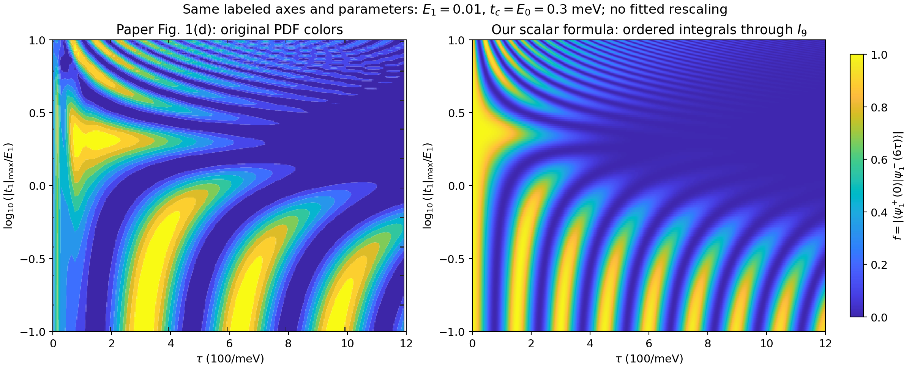
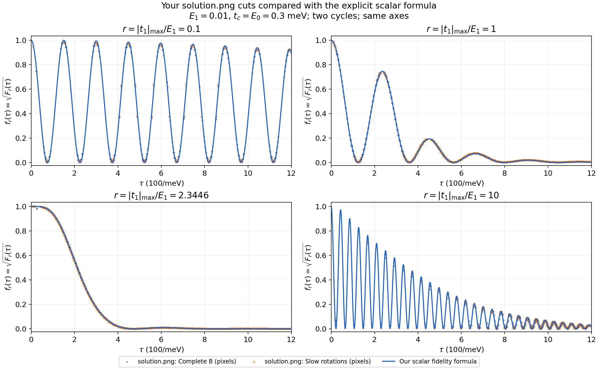
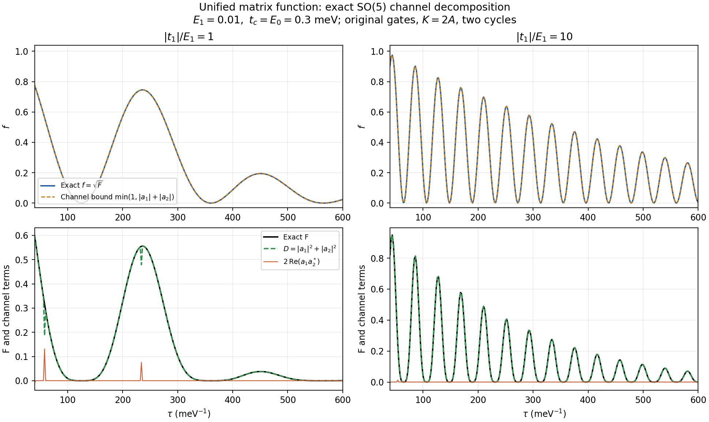

# PRB 111 保真度：解析延拓、具体公式、机制、验证与误差

**已得到可直接求值的保真度公式。** 在一阶低能投影模型内，两个规范化标量函数给出任意有限累计相位下的读出；函数由显式积分系数、收敛级数和有限递推定义。对完整五维模型，也有不作低能投影的矩阵函数与解析延拓表示。这里的“具体公式”允许收敛特殊函数级数，不声称已化成有限个初等函数或某个固定阶数的标准特殊函数。

本篇把原先分散的延拓构造、峰位与峰高机制、绘图核对、近似条件和误差估阶串成一条推导。微扰与几何门的独立论证见 [微扰分析](perturbation.md)；目录与复现入口见 [README](README.md)。

面向组会的独立叙述见 [完整汇报文档](analytic_continuation_report.md)，包含主公式推导、两张结果图的讲解、18 页幻灯片安排及技术附录。

**采用解析延拓的动机：**低阶微扰已经解释了初始保真度损失和抵消比例，但 Fig. 1(d) 涉及较大的累计相位与多次振荡，需要一个能保留全部相位阶数的具体函数。我们以低能模型在 $E_1=0$ 时可解的传播为起点，采用 $E(x)=xE_1$，由模型方程确定完整传播矩阵关于 $x$ 的展开系数，再求到 $x=1$。第 2 节说明这条路线；后续给出其收敛函数、保真度读出与完整模型推广。

阅读顺序：第 1–6 节构造函数并得到读出；第 7–8 节得到可高效绘图的统一公式并解释图像；第 9–10 节给出完整模型及更高层次的结构；第 11–13 节集中列验证、假设、误差和复现方式；第 16–17 节补齐四阶独立核对、局部余项与物理误差上界。

推导的完成程度与适用边界集中记录在第 14 节。核心收敛公式与读出恒等式已闭合；第 12 节说明误差尺度的来源，第 17 节已给出可计算的整体物理误差上界。它与级数截断界分别控制不同误差，不能混用。

第 1.2 节集中给出当前公式针对 Fig. 1(d) 的实际适用范围。第 15 节按本推导的全部假设分类列出失效与不适用情形，并逐项核对 PRB 111 的 Fig. 1 参数及后续纳米线场景；不能把公式可求值等同于对全部物理场景都准确。

## 1. 模型与三种“精确”的区别

采用 [model.md](../model.md) 的原余弦门控协议与 [PRB 111](../arts/prb111.pdf) 的目标读出：

$$
H=i\gamma_a(d\gamma_b+u_2\gamma_2-u_3\gamma_3)
+i\gamma_1(u_1\gamma_b+e\gamma_2),
\quad e=E_1,\quad \eta=|t_1|_{\max},\quad E_0=t_c=C.
$$

$\{\gamma_i,\gamma_j\}=2\delta_{ij}$，完整单粒子生成元为 $K=2A/\hbar$。每段时长 $\tau$，两圈连续执行共 $6\tau$。定义

$$
a(s)=\frac{1-\cos\pi s}{2},\quad b=1-a,\quad
q=\sqrt{a^2+b^2},\quad g=a/q,\qquad 0\le s\le1.
$$

三段 $(d,u_2,u_3,u_1)$ 依次为

$$
(Cb,Ca,0,\eta a),\quad(0,Cb,Ca,\eta b),\quad(Ca,0,Cb,0).
$$

除另行讨论参数延拓外，物理参数取实且 $e,\eta>0$。所用变量为

$$
\alpha=\frac{e\tau}{\hbar},\quad \nu=\frac{\eta\tau}{\hbar},\quad
r=\frac\eta e,\quad \lambda=\frac{e\tau}{\hbar}.
$$

$\alpha,\nu$ 是独立的延拓变量；固定比例截面是射线 $(\alpha,\nu)=(\lambda,r\lambda)$。

统一用

$$
f=|\langle\psi_1^+(0)|\psi_1^-(6\tau)\rangle|,\qquad F=f^2.
$$

| 层级 | 精确的对象 | 另外存在的误差 |
|---|---|---|
| 标量函数 $\mathsf C,\mathsf S$ 的无限级数 | 一阶低能投影模型，全累计相位 | 相对完整模型有投影、几何与有限速度误差 |
| 完整五维矩阵函数的无限级数 | 所指定二次模型与脉冲 | 没有投影误差；仍不代表模型外的物理 |
| 实际图像中的有限阶、离散求积结果 | 上述函数的数值近似 | 级数截断、求积、浮点误差 |

单圈理想几何门与一阶有效动力学为

$$
B=e^{i\pi X/4},\quad U_{\rm cyc}=BD_3D_2D_1,
\quad D_1=e^{-i(\nu j-\alpha k)Z},\quad D_3=e^{-i\alpha Y},
$$

$$
iD_2'=(\nu bZ+\alpha gY)D_2,\quad D_2(0)=I,
\quad k=\frac{\mathsf K(1/2)}\pi,\quad j=\frac{\mathsf E(1/2)}\pi.
$$

$X,Y,Z$ 是逻辑 Pauli 矩阵。此有效模型需要弱耦合和辅助模式绝热，但没有对第二段的低能内部运动作绝热近似。

### 1.1 快模的含义与两套公式的关系

**快模指由强耦合形成、具有较大内禀振荡频率的辅助费米子模式。** 在忽略 $e,u_1$ 的理想参考模型中，定义

$$
R=\sqrt{d^2+u_2^2+u_3^2},\qquad
\gamma_c=\frac{d\gamma_b+u_2\gamma_2-u_3\gamma_3}{R},\qquad
c_f=\frac{\gamma_a+i\gamma_c}{2}.
$$

于是

$$
\boxed{H_0=iR\gamma_a\gamma_c=R(2c_f^\dagger c_f-1),\qquad
\Delta_{\rm fast}=2R,\quad\omega_{\rm fast}=2R/\hbar.}
$$

$\omega_{\rm fast}$ 是冻结瞬时参数时的模式频率。当前脉冲满足 $R=C\sqrt{a^2+b^2}\in[C/\sqrt2,C]$，所以辅助能隙始终保持量级 $C$。其组成却沿控制路径变化：$\gamma_c$ 从 $\gamma_b$ 依次转到 $\gamma_2$、$-\gamma_3$，最后回到 $\gamma_b$。

剩余的 $\gamma_1$ 和与 $\gamma_c$ 正交的两个 Majorana 组合，在理想参考模型中为零模。较小的 $E_1,t_1$ 给这些自由度引入低能内部劈裂与动力学，形成本文所说的慢模；非零扰动下的精确模式还含快慢混合，见 [微扰文档第 2–3 节](perturbation.md)。

消去快模，是在弱耦合、辅助绝热及初末制备匹配的条件下，将演化约化到快费米子保持低能占据的子空间。其理想投影为

$$
P_0=1-c_f^\dagger c_f=\frac{1-i\gamma_a\gamma_c}{2},
\qquad e,\eta\ll C,\quad C\tau/\hbar\gg1.
$$

这个子空间随控制移动，因此投影后仍保留 holonomy；虚跃迁还会带来高阶修正。这里的绝热条件针对辅助大能隙，**不要求低能子空间内部的演化也完全绝热**。

| 表示 | 如何处理快模 | 保留的动力学 |
|---|---|---|
| 第 3–8 节的标量函数与保真度 | 作低能约化，辅助快模近似保持低能占据 | 理想几何输运及一阶有效哈密顿量内的全部累计相位 |
| 第 9 节的完整五维矩阵函数 | 保留全部五个 Majorana 自由度 | 快模、慢模及二者之间的转移，包括有限速度泄漏 |

因此两套公式可以用于相互核对：标量公式便于提取峰位和峰高机制，完整矩阵公式用于评估低能约化的偏差。第 12 节区分物理近似与函数求值误差，第 17 节给出可计算的物理误差上界及其适用条件。

### 1.2 实际适用范围：针对论文 Fig. 1(d) 的结论

**对于论文 Fig. 1(d) 的参数，当前解析公式在已检查的辅助绝热时间窗口内具有较好的实用准确性，能够解释主要峰结构；较大 $t_1$ 时存在可见修正。** 这个判断来自标量公式与同一归一化完整五维模型的直接比较，也有公式本身的独立求值检查支持。

具体采用图注参数 $E_1=0.01\,\mathrm{meV}$、$E_0=t_c=C=0.3\,\mathrm{meV}$，原三段门控、两圈连续执行、$K=2A/\hbar$。定义 $r=\eta/E_1$，$\eta=|t_1|_{\max}$。在 $\hbar=1$ 的计时单位下，已核对区间为

$$
50\le\tau\le1200\,\mathrm{meV}^{-1},\qquad
0.5\le\alpha=E_1\tau/\hbar\le12.
$$

| $r=0.1,1,2.3446$，上述时间区间 | 三条截线各 576 个采样点，$f$ 的绝对差均小于 $0.006$ | 数值近似较好，可以分析峰结构与保真度变化 |
|---|---|---|
| 参数或时间区域 | 已有结果 | 如何使用 |
| $r=10$，上述时间区间 | 最大绝对差约 $0.04924$，部分点超过 $0.01$ | 可解释趋势，但不能要求相同的逐点精度 |
| 极短时间区域 | 投影式与完整模型存在明显偏差；真实 $\tau\to0$ 时分别趋于 1 与 0 | 用完整五维公式处理有限速度动力学 |

表中误差针对重叠模 $f$，不是平方读出 $F=f^2$，也不是相对误差。四条截线的统计不等于整幅连续参数域的统一误差界；$\tau=50\,\mathrm{meV}^{-1}$ 是现有核对区间的下端，不是已经证明的普适有效性阈值。具体差值和位置见第 11.2、15.7 节。

**公式求值与物理近似分开评价。** 当前热图所有采样值均有限；24 个独立低能 ODE 检验点上的最大差约为 $2.19\times10^{-9}$。这表明已有实现能准确求值低能公式，但不能用该数值代替表中的完整模型近似误差。

**因子 2 试验单独保留。** 第 11.1 节的 $\mathfrak f(\alpha/2,\nu/2)$ 试验使峰数量和宽度在视觉上更接近论文，但没有据此确认原文归一化约定。上表仍是原公式与同一 $K=2A$ 完整模型的比较，不能直接挪作缩放后试验图的定量误差。

论文后续不同纳米线场景中的典型 $E_1,t_1$ 通常更小，在有效强耦合、模式隔离和驱动条件相当时，更有利于低能近似；尚不能仅凭这一点宣布全文所有物理案例都已通过验证。逐类条件和证据范围见第 15.5 节。

## 2. 动机与延拓路线：从零杂化到目标模型

### 2.1 为什么从单参数解出发？

微扰结果 $f=1-c_2(r)\lambda^2+c_4(r)\lambda^4+\cdots$ 适合小累计角，不能直接覆盖图中的全部振荡。另一方面，低能投影模型在 $E_1=0$ 时有明确的三角函数读出

$$
f(0,\nu)=\cos^2[(1/2+j)\nu].
$$

这提供了可解的出发点。目标是从该点系统地加入非零 $E_1$，构造一个具有明确系数和收敛规则的函数，进而求出峰位、峰高及其变化；允许结果是特殊函数级数，不要求终点仍是一条余弦。

### 2.2 参数路径正是 $E(0)=0$、$E(1)=E_1$

固定目标 $E_1=e$，并固定 $\eta,C,\tau$ 及原门控形状。引入无量纲辅助参数 $x$，取最简单的解析路径

$$
\boxed{E(x)=xE_1,\qquad E(0)=0,\qquad E(1)=E_1.}
$$

相应的一族模型为

$$
H_x(t)=H_{\rm ref}(t)+xE_1V(t),\qquad
H_{\rm ref}(t)=H(t;e=0),\qquad V=i\gamma_1\gamma_2.
$$

$H_{\rm ref}$ 仍保留门控 $t_1$，与第 1.1 节同时忽略两种弱耦合的快模参考哈密顿量 $H_0$ 不同。$x$ 是模型参数空间中的插值坐标；对每个固定 $x$，$E(x)$ 在整个物理协议中保持恒定。物理驱动仍按原来的时间 $t$ 或段内时间 $s$ 进行。

沿这条路径，

$$
\alpha(x)=\frac{E(x)\tau}{\hbar}=x\lambda,
\qquad \nu=\frac{\eta\tau}{\hbar}\ \text{保持固定},
\qquad \lambda=\frac{E_1\tau}{\hbar}.
$$

因此该延拓在 $(\alpha,\nu)$ 平面沿固定 $\nu$ 的直线进行。此前绘图的固定比例截面 $(\alpha,\nu)=(\lambda,r\lambda)$ 则是另一条扫描路径：它在固定物理耦合下改变 $\tau$。特别地，延拓中 $\eta/E(x)$ 随 $x$ 改变，$x=0$ 时该比值不适合作坐标，使用 $\alpha,\nu$ 即可。

### 2.3 如何确定从 $x=0$ 到 $x=1$ 的解？

固定有限物理演化时长，记参考传播为 $U_{\rm ref}$，写

$$
U_x(t)=U_{\rm ref}(t)W_x(t),\qquad
\dot W_x=-\frac{ixE_1}{\hbar}V_I(t)W_x,\qquad
V_I=U_{\rm ref}^{-1}VU_{\rm ref},\quad W_x(0)=I.
$$

按 $x$ 展开，并由方程逐阶确定系数：

$$
W_x(t)=\sum_{n=0}^{\infty}x^nW^{[n]}(t),\qquad W^{[0]}=I,
$$

$$
\boxed{W^{[n+1]}(t)=-\frac{iE_1}{\hbar}
\int_0^tV_I(u)W^{[n]}(u)du.}
$$

初始归一化与这些系数共同给出 $x=0$ 附近的解析芽。若
$M=|E_1|\hbar^{-1}\int_0^t\|V_I(u)\|du$，则
$$
\|W^{[n]}(t)\|\le\frac{M^n}{n!}.
$$

所以有限时长下矩阵元关于 $x$ 整解析；保留全部级数可直接在 $x=1$ 求和，得到目标传播 $U_{x=1}$。数学上无需强制把区间分成许多小步；计算时也可以在已知参数中心重展开，再逐步延拓，见第 4.2 节。

关键是**模型方程决定了全部导数**。仅知道 $x=0$ 的一条标量余弦保真度，不能确定离开该参数轴的传播矩阵。两个端点条件确定了我们要连接的模型；所选解析路径和动力学方程进一步确定整个函数。

### 2.4 这怎样变成后面的标量函数与保真度？

在低能模型的第二段，沿上述路径有

$$
i\partial_sD_2(s;x)=[\nu b(s)Z+x\lambda g(s)Y]D_2(s;x).
$$

$x=0$ 时 $D_2(s;0)=e^{-i\nu P(s)Z}$ 已知，其中
$P(s)=\int_0^sb(u)du$。将它提出后写
$$
D_2(s;x)=e^{-i\nu P(s)Z}W(s;x),
$$

$$
\partial_sW=x\lambda
\begin{pmatrix}0&-g e^{2i\nu P}\\g e^{-2i\nu P}&0\end{pmatrix}W,
\qquad W(0;x)=I.
$$

反复积分就得到第 3 节的明确系数 $J_m$；按偶数阶、奇数阶分别整理，便是 $\mathsf C_\nu(x\lambda;s)$ 与 $\mathsf S_\nu(x\lambda;s)$。第一、三段的显式指数也代入 $\alpha=x\lambda$，随后按原顺序组合三段和两圈。最终取 $x=1$，从完整传播得到复重叠振幅，再计算 $f=|\mathcal A|$，就是第 6 节的具体保真度公式。

延拓的对象是传播矩阵或复振幅。模长 $f=|\mathcal A|$ 不是复全纯函数；$F=|\mathcal A|^2$ 在实物理参数上实解析，完整模型的 $f$ 在振幅零点还可能不可微。复参数推导中保留全纯的矩阵系数，最后在实物理参数上取复共轭和模长。

第 9 节把同一收敛构造思想用于完整五维模型，不作快模投影；其中 $z=e^{i\pi s}$ 的局部级数延拓沿时间路径求值，与本节的参数路径 $E(x)=xE_1$ 属于两个不同的延拓方向。

### 2.5 路径选择、解的唯一性与反向参数构造

线性 $E(x)$ 不是唯一选择。任意解析 $E(x)=E_1h(x)$，只要 $h(0)=0,h(1)=1$，例如 $h=x^2$ 或 $3x^2-2x^3$，都可用于参数化同一模型族。固定有限时间，完整传播在耦合参数上整解析，所以终点精确解相同。不同有限阶截断则可能有不同误差，且实际误差不必随阶数单调下降。这里的唯一性依赖模型方程和完整解析芽；只给两个端点值不足以确定一个解析函数。

另一种构造是固定 $\alpha$，从 $\nu=0$ 出发。写

$$
D_2=e^{-i\alpha GY}\widetilde W_\alpha(\nu;s),\qquad
i\widetilde W_\alpha'=
\nu b[Z\cos(2\alpha G)-X\sin(2\alpha G)]\widetilde W_\alpha,
\quad \widetilde W_\alpha(\nu;0)=I.
$$

令 $V_0=I$，则可由另一个已知核递推

$$
V_{n+1}(s)=-i\int_0^s b(u)
[Z\cos(2\alpha G(u))-X\sin(2\alpha G(u))]V_n(u)du,
\qquad \widetilde W_\alpha=\sum_{n\ge0}\nu^nV_n.
$$

实 $\alpha$ 时 $\|V_n(1)\|\le(1/2)^n/n!$，故对所有有限 $\nu$ 收敛。把两种表示分别代回原方程，均得到 $iD_2'=(\nu bZ+\alpha gY)D_2$ 和 $D_2(0)=I$。由初值问题唯一性，

$$
\boxed{e^{-i\nu PZ}W_\nu(\alpha;s)
=e^{-i\alpha GY}\widetilde W_\alpha(\nu;s).}
$$

这给出解析层面的等价证明。数值实现时应在相同基底与相位约定下比较整个 $D_2$，再比较保真度；只比较一个读出可能掩盖某些矩阵误差。两种参数级数的独立数值互比尚未执行，不能把此构造登记成已完成的数值验证。

## 3. 构造两个规范化标量函数

### 3.1 显式积分系数与收敛

设

$$
P(s)=\int_0^s b(u)du=\frac s2+\frac{\sin\pi s}{2\pi},\quad
G(s)=\int_0^s g(u)du.
$$

后者本身可以写成不完全椭圆积分：

$$
G(s)=\frac{\mathsf F(\pi s\mid1/2)
-\sqrt2\arcsin[\sin(\pi s)/\sqrt2]}{2\pi},\quad G(1)=k.
$$

$\mathsf F(\varphi\mid m)=\int_0^\varphi(1-m\sin^2\theta)^{-1/2}d\theta$ 沿实幅角 $0\le\varphi\le\pi$ 连续定义。**这不意味着整个保真度是一个椭圆积分**：非对易演化还需要以下有序积分。

定义 $J_0=1$，对 $m\ge1$：

$$
J_m(s;\nu)=\int_{0<s_m<\cdots<s_1<s}
\prod_{\ell=1}^m g(s_\ell)
\exp\left[2i\nu\sum_{\ell=1}^m(-1)^{\ell+1}P(s_\ell)\right]d^ms.
$$

所有被积函数均已知，不含待求态。由此定义

$$
\boxed{\mathsf C_\nu(\alpha;s)=\sum_{n=0}^\infty(-1)^n\alpha^{2n}J_{2n}(s;\nu)},
$$

$$
\boxed{\mathsf S_\nu(\alpha;s)=\sum_{n=0}^\infty(-1)^n\alpha^{2n+1}J_{2n+1}(s;\nu)}.
$$

它们是本工作定义的“广义余弦、正弦”，不是声称已有某个标准名称。实 $\nu$ 时 $|J_m|\le G^m/m!$。复 $\nu$ 时，有序区间内

$$
0\le\sum_{\ell=1}^m(-1)^{\ell+1}P(s_\ell)\le P(s),
$$

故只需再乘 $e^{2|\operatorname{Im}\nu|P(s)}$。紧集上一致收敛证明二者关于 $(\alpha,\nu)$ 联合整解析。

从 $E(x)=xe$ 出发，$\alpha=x\lambda$，直接有

$$
\mathsf C=1-x^2\lambda^2J_2+x^4\lambda^4J_4-\cdots,
\quad \mathsf S=x\lambda J_1-x^3\lambda^3J_3+\cdots.
$$

这些系数与初始归一化定义了可唯一延拓的解析芽。

### 3.2 矩阵规范方程与标量方程

令 $k_\pm=g e^{\pm2i\nu P}$。逐项求导可得

$$
W=\begin{pmatrix}\mathsf C_\nu&-\mathsf S_\nu\\
\mathsf S_{-\nu}&\mathsf C_{-\nu}\end{pmatrix},\qquad
W'=\alpha\begin{pmatrix}0&-k_+\\k_-&0\end{pmatrix}W,\quad W(0)=I,
$$

$$
\boxed{D_2(s)=e^{-i\nu P(s)Z}W(s).}
$$

消去第二个分量后，$\mathsf C_\nu$ 与 $\mathsf S_\nu$ 均满足

$$
u''-\left(\frac{g'}g+2i\nu b\right)u'+\alpha^2g^2u=0.
$$

为在 $\alpha=0$ 保持两个独立解，引入 $\mathsf H_\nu=\mathsf S_\nu/\alpha$，取可去奇点值 $\mathsf H_\nu(0;s)=J_1(s;\nu)$。正确归一化为

$$
\mathsf C(0)=1,\quad \lim_{s\to0}\frac{\mathsf C'}{k_+}=0;
\qquad \mathsf H(0)=0,\quad \lim_{s\to0}\frac{\mathsf H'}{k_+}=1.
$$

此处括号里的 0 表示时间端点。$g(0)=0$ 导致标量方程有表观奇点，不能只用通常的函数值和一阶导数区分两解。Wronskian 为

$$
\mathsf C\mathsf H'-\mathsf C'\mathsf H=k_+.
$$

### 3.3 Volterra 形式

定义已知积分算子

$$
(\mathcal K_\nu\phi)(s)=\int_0^s k_+(u)du\int_0^u k_-(v)\phi(v)dv.
$$

则

$$
\mathsf C=1-\alpha^2\mathcal K_\nu\mathsf C,
\quad \mathsf H=J_1-\alpha^2\mathcal K_\nu\mathsf H,
$$

$$
\mathsf C=\sum_{n\ge0}(-\alpha^2)^n\mathcal K_\nu^n1,
\quad \mathsf H=\sum_{n\ge0}(-\alpha^2)^n\mathcal K_\nu^nJ_1.
$$

因此这不是只给原方程的解换名字：函数已有明确系数、独立归一化与收敛保证。

## 4. 有限递推与实际解析延拓

### 4.1 有理化变量及局部级数

取 $z=\tan(\pi s/2)$，则 $b=(1+z^2)^{-1}$、$g=z^2/\sqrt{1+z^4}$。标量方程化为

$$
u_{zz}+\left[\frac{2z}{1+z^2}-\frac2z+\frac{2z^3}{1+z^4}
-\frac{4i\nu}{\pi(1+z^2)^2}\right]u_z
+\frac{4\alpha^2z^4}{\pi^2(1+z^2)^2(1+z^4)}u=0.
$$

令 $c=4i\nu/\pi,d=4\alpha^2/\pi^2$，乘去分母：

$$
(z+2z^3+2z^5+2z^7+z^9)u''
+(-2-2z^2+2z^6+2z^8-cz-cz^5)u'+dz^5u=0.
$$

代入 $u=\sum_{n\ge0}a_nz^n$：

$$
\begin{aligned}
0={}&n(n-3)a_n-c(n-1)a_{n-1}+2(n-2)(n-4)a_{n-2}\\
&+2(n-4)(n-5)a_{n-4}-c(n-5)a_{n-5}\\
&+[2(n-6)^2+d]a_{n-6}+(n-8)(n-7)a_{n-8}.
\end{aligned}
$$

负下标取零。$\mathsf C$ 取 $a_0=1,a_3=0$；$\mathsf H$ 取 $a_0=0,a_3=2/(3\pi)$。例如

$$
\mathsf C=1-\frac{2\alpha^2}{9\pi^2}z^6
-\frac{4i\nu\alpha^2}{21\pi^3}z^7+\cdots,
\qquad
\mathsf H=\frac{2z^3}{3\pi}+\frac{2i\nu z^4}{\pi^2}+\cdots.
$$

最近的复系数奇点限制从 $z=0$ 出发的局部收敛圆。物理终点是 $z=\infty$，不能把无穷直接代入零点附近的截断 Taylor 级数。可沿正实轴用重叠圆盘重心展开，并在末端换 $w=1/z$；每次按上一圆盘的函数值和导数匹配。

### 4.2 参数延拓与复时间延拓不同

关于参数，$\mathsf C,\mathsf S$ 已是整函数。也可从实中心 $\alpha_0$ 出发写 $W(\alpha_0+\Delta)=W_0Z_\Delta$：

$$
Z_\Delta'=\Delta W_0^{-1}
\begin{pmatrix}0&-k_+\\k_-&0\end{pmatrix}W_0Z_\Delta.
$$

实参数下 $W_0$ 幺正，按 $\Delta$ 截到 $N$ 阶的矩阵余项不超过

$$
e^{|\Delta|G(s)}\frac{(|\Delta|G(s))^{N+1}}{(N+1)!}.
$$

固定有限时间，有限参数空间内不需要绕开真实奇点，参数延拓无路径歧义。复时间则涉及 $q=\sqrt{a^2+b^2}$ 的分支，需从 $q(0)=1$ 沿指定路径延拓。实 $s\in[0,1]$ 无分支歧义；复时间连接矩阵或 Stokes 分析是另一问题，未用作本次绘图的拟合依据。

## 5. 函数性质及退化检查

由系数定义可知 $\mathsf C$ 关于 $\alpha$ 为偶、$\mathsf S$ 为奇。迹为零的规范系统给出

$$
\mathsf C_\nu\mathsf C_{-\nu}+\mathsf S_\nu\mathsf S_{-\nu}=1.
$$

实 $\alpha,\nu$ 时，反号参数等于复共轭，故 $|\mathsf C|^2+|\mathsf S|^2=1$；复参数延拓时必须保留反号记法。

两参数极限为

$$
\nu=0:\ \mathsf C_0(\alpha;s)=\cos[\alpha G(s)],\quad
\mathsf S_0(\alpha;s)=\sin[\alpha G(s)];
\qquad
\alpha=0:\ \mathsf C_\nu=1,\ \mathsf S_\nu=0.
$$

设 $W_{ba}$ 是同一规范系统从 $s_a$ 到 $s_b$ 的传播，记其元素为 $C_{ba},S_{ba}$。由 $W_{20}=W_{21}W_{10}$ 得推广加法公式

$$
C_{20}=C_{21}C_{10}-S_{21}S_{10,-\nu},\qquad
S_{20}=C_{21}S_{10}+S_{21}C_{10,-\nu}.
$$

这里各段的核采用同一全局 $P(s)$；若重置积分原点，必须同时变换相位。这些恒等式可用于分段延拓与实现核对。

第一段的任意中间时刻也可显式求出。令
$h(s)=\sqrt2\arcsin[\sin(\pi s)/\sqrt2]$，则

$$
\int_0^s\frac bqdu=\frac{\mathsf F(\pi s\mid1/2)+h(s)}{2\pi},\qquad
\int_0^s\frac{a^2}qdu=\frac{\mathsf E(\pi s\mid1/2)-h(s)}{2\pi},
$$

$$
\int_0^s q(u)du=\frac{\mathsf E(\pi s\mid1/2)}\pi.
$$

因此 $D_1(s)=\exp\{-i[\nu\int_0^sa^2/q-\alpha\int_0^sb/q]Z\}$ 是有限椭圆积分与指数的组合，快模的相位积分也可如此表示。困难集中在第二段的不对易连接，而非每一段都缺少标准特殊函数表达。这里 $\mathsf E(\varphi\mid m)$ 表示第二类不完全椭圆积分。

## 6. 从传播矩阵推导保真度的具体公式

### 6.1 第二段连接振幅

取固定 $r>0$，定义

$$
\rho=\sqrt{r^2b^2+g^2},\quad
\vartheta=\operatorname{atan2}(g,rb),\quad
Q=e^{i\vartheta X/2},\quad D_2=QV.
$$

因 $Q(0)=I,Q(1)=B$，

$$
iV'=(\lambda\rho Z+\kappa X)V,\quad
\kappa=\frac{\vartheta'}2=
\frac{r(bg'-b'g)}{2\rho^2},\quad V(0)=I.
$$

写 $V(1)=\begin{pmatrix}a_V&\beta\\-\beta^*&a_V^*\end{pmatrix}$。利用 $V(1)=B^\dagger D_2(1)$，记 $C_\nu=\mathsf C_\nu(\alpha;1)$、$S_\nu=\mathsf S_\nu(\alpha;1)$，得到

$$
\boxed{\beta=-\frac{e^{-i\nu/2}S_\nu+i e^{i\nu/2}C_\nu^*}{\sqrt2}},
\qquad \delta=\alpha(1+k)-\nu j.
$$

### 6.2 两圈组合与 Cayley–Hamilton 恒等式

将 $D_2=BV$ 代回单圈，利用 $B^2=iX$：

$$
U_{\rm cyc}=iXM,\qquad M=e^{-i\alpha Z}V e^{-i(\nu j-\alpha k)Z}.
$$

$M$ 的两个独立元素为

$$
a_M=a_V e^{-i[\alpha+\nu j-\alpha k]},\qquad
b_M=\beta e^{-i\delta}.
$$

$\operatorname{tr}U_{\rm cyc}=-2\operatorname{Im}b_M$，而 $\det U_{\rm cyc}=1$，故

$$
U_{\rm cyc}^2=(\operatorname{tr}U_{\rm cyc})U_{\rm cyc}-I.
$$

两圈逻辑翻转概率为 $4|a_M|^2(\operatorname{Im}b_M)^2$。这里需要明确证明它与原单粒子读出的关系，以免混淆 $f$ 与 $F$。对任意去掉整体相位的逻辑传播

$$
\mathcal U=\begin{pmatrix}u&v\\-v^*&u^*\end{pmatrix}\in SU(2),
\qquad \mathcal U^\dagger\sigma_i\mathcal U
=\sum_j(R_3)_{ij}\sigma_j,
$$

在初始三个慢 Majorana 的顺序 $(1,2,3)$ 中，取
$\xi=(1,-i,0)^T/\sqrt2$。直接计算矩阵元素得到

$$
\xi^T R_3\xi
=\frac{(R_3)_{11}-(R_3)_{22}-i[(R_3)_{12}+(R_3)_{21}]}2
=-v^2.
$$

因此原单粒子重叠模为 $|\xi^TR_3\xi|=|v|^2$，平方读出为 $F=|v|^4$。取 $\mathcal U=U_{\rm cyc}^2$，Cayley–Hamilton 恒等式给出其非对角元
$v=-2i a_M^*\operatorname{Im}b_M$，从而
$$
\boxed{\mathfrak f(\alpha,\nu)=4(1-|\beta|^2)
\left[\operatorname{Im}(e^{-i\delta}\beta)\right]^2.}
$$

联同已经显式定义的 $\mathsf C,\mathsf S$，这就是二参数具体保真度公式。无需再求一个未定义的传播子。若要平方读出，最后取 $F=\mathfrak f^2$。

### 6.3 截面、峰高因子与相位

固定比例的截面是同一函数的一元限制：

$$
\boxed{f_{r_0}(\tau)=\mathfrak f\left(\frac{e\tau}{\hbar},
\frac{r_0e\tau}{\hbar}\right)=\mathfrak f(\lambda,r_0\lambda).}
$$

在 $(\lambda,\log_{10}r)$ 热图中，这是水平切线，不是对颜色取平均或重新定义保真度。

展开 $|\beta|^2$ 得

$$
p=\frac12+\operatorname{Im}(e^{-i\nu}C_\nu S_\nu),\quad
\mathcal V=4p(1-p),\quad \chi=\arg\beta-\delta,
$$

$$
\boxed{f=\mathcal V\sin^2\chi.}
$$

$\chi$ 控制条纹位置，$\mathcal V$ 是可达峰高的上界，并不预设它单调衰减。$\beta=0$ 时直接取 $f=0$，不使用无定义的相位。

正耦合下 $\kappa\ge0$ 且 $\int_0^1\kappa ds=\pi/4$。转移概率满足 $|p'|\le2\kappa\sqrt{p(1-p)}$，从 $p(0)=0$ 积分可得

$$
\arcsin\sqrt{p(1)}\le\pi/4,\qquad 0\le p(1)\le1/2.
$$

因此在当前模型内，低能内部转移减弱会降低目标读出的峰高。

### 6.4 直接取两个零耦合极限，并与微扰结果核对

这项检查直接从特殊函数级数和第 6.2 节的读出公式出发。固定 $\tau$、强控制 $C$ 及原三段协议，使用独立参数
$\alpha=E_1\tau/\hbar$、$\nu=\eta\tau/\hbar$。取 $E_1\to0$ 而保留 $\eta$ 时，$\alpha\to0$、$\nu$ 固定；$r=\eta/E_1$ 发散，因此不向固定 $r$ 的积分核或余项估计直接代入这个极限。

**首先，$E_1=\eta=0$。** 此时 $\alpha=\nu=0$。由级数定义，

$$
\mathsf C_0(0;1)=1,\qquad \mathsf S_0(0;1)=0,
\qquad \beta=-\frac{i}{\sqrt2},\qquad\delta=0.
$$

逐项代入保真度公式：

$$
f(0,0)=4\left(1-\frac12\right)
\left[\operatorname{Im}\left(-\frac{i}{\sqrt2}\right)\right]^2
=1,\qquad \boxed{F(0,0)=1.}
$$

这与理想两圈几何门一致：弱扰动消失后 $D_1=D_2=D_3=I$，单圈为 $B$，两圈为 $B^2=iX$，将指定初态变成目标态。强控制仍执行完整编织路径。

**其次，$E_1=0$、$\eta$ 保留。** 对任意有限 $\nu$，级数在 $\alpha=0$ 时直接给出

$$
\mathsf C_\nu(0;1)=1,\qquad \mathsf S_\nu(0;1)=0.
$$

所以

$$
\beta=-\frac{i}{\sqrt2}e^{i\nu/2},\qquad
|\beta|^2=\frac12,\qquad \delta=-\nu j.
$$

记 $\Theta=(1/2+j)\nu$，便有

$$
e^{-i\delta}\beta=-\frac{i}{\sqrt2}e^{i\Theta}
=\frac{\sin\Theta-i\cos\Theta}{\sqrt2}.
$$

因此

$$
\boxed{f(0,\nu)=\cos^2\Theta
=\cos^2\left[\left(\frac12+\frac{\mathsf E(1/2)}\pi\right)
\frac{\eta\tau}{\hbar}\right],\qquad F(0,\nu)=\cos^4\Theta.}
$$

椭圆积分常数 $\mathsf E(1/2)/\pi\simeq0.4299233$，故 $\Theta\simeq0.9299233\,\eta\tau/\hbar$。从第二个极限再令 $\eta\to0$，也得到第一个极限的 $f=F=1$。

**独立从有效哈密顿量检查。** 在 $E_1=0$ 的参数轴上，三段恰好为

$$
D_1=e^{-i\nu jZ},\qquad
D_2=e^{-i\nu Z/2},\qquad D_3=I,
\qquad U_{\rm cyc}=B e^{-i\Theta Z}.
$$

两个动态因子同轴对易，所以这一轴上不需要截断累计角。直接相乘得到

$$
\big[(B e^{-i\Theta Z})^2\big]_{12}=i e^{i\Theta}\cos\Theta.
$$

用第 6.2 节证明的单粒子读出对应 $f=|[U_{\rm cyc}^2]_{12}|^2$，再次得到 $f=\cos^2\Theta$。它与 [微扰文档第 7.4 节](perturbation.md) 的只有 $t_1$ 结果完全相同。

再展开到四阶：

$$
f=1-\Theta^2+\frac{\Theta^4}{3}+O(\Theta^6),\qquad
F=1-2\Theta^2+\frac{5\Theta^4}{3}+O(\Theta^6).
$$

这给出与单参数微扰系数的逐阶一致性。这里在 $E_1=0$ 轴上直接展开，没有把固定 $r$ 的 $O_r(\lambda^6)$ 余项未经证明地拿到 $r=\infty$。

上述等式均针对一阶低能投影模型。有限 $C\tau/\hbar$ 的完整五维模型仍可能有非绝热偏差，不能仅因 $E_1=\eta=0$ 就断言其读出恰好为一。并且，$E_1=0$ 时初始零能态简并，本文始终沿用 $E_1\to0^+$ 的连续读出约定，即固定 $\zeta=(e_1-ie_2)/\sqrt2$ 及其粒子—空穴伙伴，不在简并子空间内重新任意选择初末态。

这两个极限检验了函数归一化、两圈组合、相位系数和 $f/F$ 的区分；它们没有单独验证同时含 $E_1,\eta$ 的全部混合项。

### 6.5 与 PRB 105, 054507 (2022) 的单动态相位结果对照

对照文献为 Chen 等人的 [PRB 105, 054507](../arts/prb105.pdf)，题为 *Non-Abelian statistics of Majorana zero modes in the presence of an Andreev bound state*（[出版信息](https://journals.aps.org/prb/abstract/10.1103/PhysRevB.105.054507)）。这里直接核对其第 III 节、式 (3)–(4)、Fig. 3 及注释 [68]，不进行新的数值扫描。

**先区分模型对应与读出对应。** 原文式 (3) 为

$$
H_{105}=i\gamma_6\left(t_1^{(105)}\gamma_2+
t_2^{(105)}\gamma_3+t_3^{(105)}\gamma_5\right)
+i\epsilon_d(t)\gamma_1\gamma_2.
$$

在固定 Majorana 标号下，对照本文模型，取

$$
\gamma_6=\gamma_a,\quad\gamma_5=\gamma_b,\quad
t_1^{(105)}=u_2,\quad t_2^{(105)}=-u_3,\quad
t_3^{(105)}=d.
$$

负号可相应转移到 Majorana 基底的符号约定。此时两者的强耦合项具有相同的星形结构，而 PRB 105 的扰动对应本文的

$$
\boxed{u_1(t)=0,\qquad E_1\longrightarrow\epsilon_d(t),}
$$

其中后者一般随时间变化，实际控制路径也不同。特别地，原文的 $t_1^{(105)}$ 是辅助 Majorana 与 $\gamma_2$ 的编织耦合，**不是**本文额外的 $\gamma_1$–$\gamma_b$ 耦合 $t_1$。因此不能仅凭符号或振荡曲线，把 PRB 105 整个模型直接认定为本文的 $E_1=0$ 特例。

PRB 105 的初始 ABS 能量可以很小，但其 Fig. 3(a) 与注释 [68] 明确指出，分离、融合过程会产生非零杂化能。这允许“初始近零能、编织时有动态相位”，不等于全过程 $\epsilon_d(t)=0$。若在它的理想辅助绝热模型中令 $\epsilon_d(t)$ 全程为零，则恢复理想编织，目标重叠为一。

**原文实际给出的目标重叠。** PRB 105 将两次交换分解为三个动态区间与两个几何交换，定义

$$
\frac{\theta_2}{2}=\frac1\hbar\int_T^{4T}\epsilon_2(t)\,dt.
$$

这里 $\epsilon_2$ 是原文中间动态区间的有效杂化系数；不应未经投影就把它等同于任意一个裸耦合。原文取 $\hbar=1$。按第 III 节式 (4) 后的结果，并以零动态相位时 $\psi_1^-\to\psi_1^+$ 固定目标通道，有

$$
\boxed{
f_{105}=\left|\langle\psi_1^+(0)|\psi_1^-(6T)\rangle\right|
=\frac{1+\cos\theta_2}{2}
=\cos^2\frac{\theta_2}{2}.
}
$$

返回 $\psi_1^-(0)$ 的重叠模为 $(1-\cos\theta_2)/2$，另两个通道 $\psi_2^\pm(0)$ 的重叠模各为 $|\sin\theta_2|/2$。绝对值用于与图中的非负重叠模统一。这里比较的是单粒子重叠的模；若采用本文的平方定义，$F_{105}=\cos^4(\theta_2/2)$。

**与本文 $E_1=0$ 的直接代数对照。** 第 6.4 节已经从特殊函数定义得到

$$
\Theta=\mathcal A\nu,\qquad
\mathcal A=\frac12+\frac{\mathsf E(1/2)}\pi,
\qquad f=\cos^2\Theta.
$$

两圈传播矩阵的两个独立元素为

$$
u=-i e^{-i\Theta}\sin\Theta,\qquad
v=i e^{i\Theta}\cos\Theta.
$$

沿用第 6.2 节的 $SU(2)\to SO(3)$ 读出映射，并加入不参与演化的 $\gamma_4$ 以定义 $\psi_2^\pm$，三个类型的重叠模分别为 $|v|^2$、$|u|^2$ 与 $|uv|$。因而有完整的模长对照：

| 初态为 $\psi_1^-$ 时的读出 | PRB 105 的相位表示 | 本文 $E_1=0$ 的投影结果 |
|---|---|---|
| 目标态 $\psi_1^+$ | $\cos^2(\theta_2/2)$ | $\cos^2\Theta$ |
| 返回态 $\psi_1^-$ | $\sin^2(\theta_2/2)$ | $\sin^2\Theta$ |
| $\psi_2^+$、$\psi_2^-$，每个通道 | $\lvert\sin\theta_2\rvert/2$ | $\lvert\sin2\Theta\rvert/2$ |

因此在有效读出相位的识别

$$
\boxed{\theta_2^{\rm eff}=2\Theta
=2\left(\frac12+\frac{\mathsf E(1/2)}\pi\right)
\frac{\eta\tau}{\hbar}}
$$

下，各通道的模长形式一致。归一化也一致：

$$
\cos^4\Theta+\sin^4\Theta
+2\left(\frac{\sin2\Theta}{2}\right)^2=1.
$$

这项识别比较的是读出相位，不是声称两篇文章的全部微观参数、相位或控制波形相同。PRB 105 中另外两个角 $\theta_1,\theta_3$ 还控制复振幅的相位；重叠模一致不意味着完整传播矩阵相同。

两者的小相位展开也一致：

$$
1-f_{105}=\frac{\theta_2^2}{4}-\frac{\theta_2^4}{48}
+O(\theta_2^6)
\ \xrightarrow{\theta_2=2\Theta}\ 
\Theta^2-\frac{\Theta^4}{3}+O(\Theta^6).
$$

**与图像的对应及验证范围。** 原文以 $\theta_2=2\pi T/\Delta T$ 描述 Fig. 3(b) 的振荡，其中 $\Delta T$ 是扫描单步时长 $T$ 时的振荡周期。所以其目标通道为 $\cos^2(\pi T/\Delta T)$：峰值一、谷值零、周期性恢复，不存在当前单相位近似内的持续包络衰减。本文对应预测为

$$
\Delta\tau=\frac{\pi\hbar}{\mathcal A\eta},\qquad
\mathcal A\eta\tau/\hbar=n\pi\ \Longrightarrow\ f=1.
$$

这支持了本文 $E_1=0$ 时的振荡与恢复机制，以及 $f$ 为余弦平方而 $F$ 为余弦四次方的读出约定。它不能独立验证 $\mathcal A\simeq0.9299233$：该系数来自本文特定三段余弦门控的积分，PRB 105 使用不同结构与控制过程，未给出与本文相同的裸参数—脉冲映射。

还需注意，本文只有 $E_1$ 时同样得到 $f=\cos^2[(1+2k)\alpha]$，也具有该单相位形式。因此“观察到余弦平方”本身不能区分误差来自 $E_1$ 还是 $t_1$。本项外部对照验证了单相位读出的解析结构和机制；没有验证两个扰动同时存在的混合项，也没有把低能公式升级为有限速度完整模型的精确恒等式。

## 7. 适合绘图的统一有序积分公式及严格截断界

前面的 $J_m$ 级数在 $\alpha$ 很大时可能需要高阶。可在瞬时本征标架中去掉大对角相位，得到另一种与它严格等价、对全部实 $\lambda$ 有统一截断界的表示。

定义已知作用量

$$
\mathcal S_r(s)=\int_0^s\rho(u)du,\qquad S_1=\mathcal S_r(1),
\quad V=e^{-i\lambda\mathcal S_rZ}W_c.
$$

则

$$
iW_c'=\begin{pmatrix}0&\kappa e^{2i\lambda\mathcal S_r}\\
\kappa e^{-2i\lambda\mathcal S_r}&0\end{pmatrix}W_c.
$$

对实物理参数，令 $I_0(s)=1$，递推

$$
\boxed{I_m(s)=\int_0^s\kappa(u)e^{2i\lambda\mathcal S_r(u)}
\overline{I_{m-1}(u)}du.}
$$

这是已知核的累积积分；复共轭形式只在实参数求值时使用。定义

$$
\mathcal C_r(\lambda)=I_1(1)-I_3(1)+I_5(1)-\cdots,
\quad \beta=-ie^{-i\lambda S_1}\mathcal C_r,
$$

$$
\Psi_r=\lambda(S_1+1-rj+k).
$$

于是同一保真度又写成

$$
\boxed{f_r(\lambda)=4(1-|\mathcal C_r|^2)
\left[\operatorname{Re}(e^{-i\Psi_r}\mathcal C_r)\right]^2.}
$$

这个式子连同 $I_m$ 的积分递推，就是热图和截面图实际使用的公式；它不是低阶 $\lambda$ 多项式。$\mathcal C_r$ 是连接振幅的简写，注意它不同于原规范函数 $\mathsf C_\nu$。

因 $A_0=\int\kappa=\pi/4$，每阶都有与 $r,\lambda$ 无关的界

$$
|I_m(1)|\le\frac{A_0^m}{m!}.
$$

截到奇数阶 $2N+1$，有

$$
|\mathcal C_r-\mathcal C_{r,2N+1}|
\le\sum_{n=N+1}^\infty\frac{A_0^{2n+1}}{(2n+1)!}.
$$

这个振幅界转换为读出界的常数也可以直接证明。将相位旋转后的复数记为 $z=u+iv$，读出多项式为

$$
\mathcal Q(z)=4(1-|z|^2)u^2.
$$

在 $|z|\le1$ 内，

$$
\|\nabla\mathcal Q\|
\le8|u|(1-|z|^2)+8u^2|z|
\le8|z|\le8.
$$

精确连接函数与任意此类奇数阶截断的模均不超过
$\sum_{n\ge0}A_0^{2n+1}/(2n+1)!=\sinh(\pi/4)<1$，二者的连线也在单位圆盘内。由均值不等式，

$$
|f-f_{2N+1}|\le8\sum_{n=N+1}^\infty\frac{A_0^{2n+1}}{(2n+1)!}.
$$

特别地，

$$
\boxed{|f-f_5|\le
\frac{8A_0^7}{7!}\frac1{1-A_0^2/(8\cdot9)}<2.96\times10^{-4}},
$$

$$
\boxed{|f-f_9|\le
\frac{8A_0^{11}}{11!}\frac1{1-A_0^2/(12\cdot13)}<1.42\times10^{-8}}.
$$

这是正有限 $r$、实 $\lambda$ 下，对**精确积分后的级数截断**的统一界，不包含离散求积或完整模型投影误差。$r=0,\infty$ 应使用单参数极限，不把奇异瞬时标架直接代入程序。

两个端点检查也很直接：慢模型的 $\lambda=0$ 时 $I_m=A_0^m/m!$，所以 $\mathcal C_r=1/\sqrt2$、$f=1$；第二段内部完全绝热时 $\beta\to0$、$f\to0$。这里的 $\lambda\to0$ 是慢模型的边界，不能当作完整模型物理时间 $\tau=0$ 的结果。

## 8. 从延拓函数提取图像机制

### 8.1 小累计角与不对易的来源

两个时刻的第二段生成元满足

$$
[h(s),h(u)]=2i\alpha\nu[g(s)b(u)-b(s)g(u)]X.
$$

仅一个弱耦合存在时，该交换子为零，得到

$$
f(\alpha,0)=\cos^2[(1+2k)\alpha],\qquad
f(0,\nu)=\cos^2[(1/2+j)\nu].
$$

一般比例下，小角展开为

$$
f=1-[\mathcal B-\mathcal Ar]^2\lambda^2+\mathcal P_4(r)\lambda^4+O_r(\lambda^6),
\quad \mathcal A=1/2+j,\quad\mathcal B=1+2k.
$$

$\mathcal P_4$ 的全部系数和推导见 [微扰文档第 7 节](perturbation.md)。第 16 节已从 $\mathsf C,\mathsf S$ 独立展开，逐项验证全部四阶混合系数，并给出明确的六阶余项界。$r_*=\mathcal B/\mathcal A$ 使左侧亮区较平坦；这个展开不承担整张热图的长时间拟合。

### 8.2 从只有 $t_1$ 的余弦出发：弱 $e$ 延拓

固定 $\nu$、对 $\alpha$ 展开。定义

$$
M_c(\nu)-iM_s(\nu)=\int_0^1g(s)e^{-i\nu[1-2P(s)]}ds,
\qquad T_\nu=\operatorname{Im}J_2(1;\nu).
$$

从 $C=1-\alpha^2J_2+\cdots$、$S=\alpha J_1+\cdots$ 代入读出，可得

$$
p=\frac12-\alpha M_s+O_\nu(\alpha^3),\quad
\mathcal V=1-4\alpha^2M_s^2+O_\nu(\alpha^4),
$$

$$
\chi=-\frac\pi2+\mathcal A\nu
-\alpha(1+k+M_c)+\alpha^2(T_\nu-M_sM_c)+O_\nu(\alpha^3).
$$

因此

$$
\begin{aligned}
f(\alpha,\nu)={}&[1-4\alpha^2M_s^2]\,
\cos^2[\mathcal A\nu-\alpha(1+k+M_c)
+\alpha^2(T_\nu-M_sM_c)]\\
&+O_\nu(\alpha^3).
\end{aligned}
$$

不仅恢复了余弦，还明确给出相位的一阶漂移和峰高的二阶损失。令 $\varepsilon_+=e/\eta$、$\alpha=\varepsilon_+\nu$，固定峰序号 $n$，$\nu_n^{(0)}=n\pi/\mathcal A$，则

$$
\nu_n=\nu_n^{(0)}+
\varepsilon_+\frac{\nu_n^{(0)}}{\mathcal A}
[1+k+M_c(\nu_n^{(0)})]+O_n(\varepsilon_+^2),
$$

$$
f_n=1-4\varepsilon_+^2[\nu_n^{(0)}]^2M_s(\nu_n^{(0)})^2
+O_n(\varepsilon_+^3).
$$

$|M_c|\le k$，故领先峰位向更长时间移动。固定 $n$ 的误差阶不能直接外推到 $n\to\infty$。

### 8.3 从只有 $E_1$ 的余弦出发：弱 $t_1$ 延拓

固定 $\alpha$，定义

$$
N_c=\int_0^1b\cos(2\alpha G)ds,\qquad
N_s=\int_0^1b\sin(2\alpha G)ds,
$$

$$
T_- =\int_{s>u}b(s)b(u)\sin[2\alpha(G(s)-G(u))]dsdu.
$$

在 $e$ 项的相互作用绘景同样展开得

$$
f(\alpha,\nu)=[1-4\nu^2N_s^2]
\cos^2[\mathcal B\alpha-\nu(j+N_c)+\nu^2(T_--N_sN_c)]
+O_\alpha(\nu^3).
$$

沿 $\nu=r\alpha$，固定 $n$、$\alpha_n^{(0)}=n\pi/\mathcal B$：

$$
\alpha_n=\alpha_n^{(0)}+
 r\frac{\alpha_n^{(0)}}{\mathcal B}[j+N_c(\alpha_n^{(0)})]+O_n(r^2),
$$

$$
f_n=1-4r^2[\alpha_n^{(0)}]^2N_s(\alpha_n^{(0)})^2+O_n(r^3).
$$

两侧近似分别适合不同边缘，不把它们拼成全参数的精确有限三角式。

### 8.4 端点的三次相位与过渡时间尺度

余弦脉冲在端点二次开启：

$$
g(1-u)=1+O(u^4),\quad1-2P(1-u)=\frac{\pi^2u^3}{6}+O(u^5),
$$

$$
b(s)=1+O(s^2),\quad2G(s)=\frac{\pi^2s^3}{6}+O(s^5).
$$

因此相关积分的领先项来自三次端点相位，而不是通常的非驻相端点。设

$$
d_0=\frac{\Gamma(1/3)}6\left(\frac6{\pi^2}\right)^{1/3}.
$$

由 $\int_0^\infty e^{-icu^3}du=\Gamma(1/3)e^{-i\pi/6}/(3c^{1/3})$ 可得

$$
M_s\sim d_0\nu^{-1/3},\quad M_c\sim\sqrt3d_0\nu^{-1/3},
\quad N_s\sim d_0\alpha^{-1/3},\quad N_c\sim\sqrt3d_0\alpha^{-1/3},
$$

下一项可保守计为相应大参数的 $O(x^{-1})$。这说明边缘峰损失随累计时间增长；弱次要耦合的展开不对时间一致。

更直接地，设 $c_2=\pi^2/4$。大 $r$ 的末端取 $y=(c_2\nu)^{1/3}(1-s)$，主导方程为

$$
i\partial_y\psi=-[y^2Z+\kappa_+Y]\psi,
\qquad \kappa_+=\frac\alpha{(c_2\nu)^{1/3}}.
$$

小 $r$ 的起点取 $y=(c_2\alpha)^{1/3}s$，得

$$
i\partial_y\psi=[\kappa_-Z+y^2Y]\psi,
\qquad \kappa_-=\frac\nu{(c_2\alpha)^{1/3}}.
$$

$\kappa_\pm\sim1$ 给出过渡尺度

$$
\boxed{\lambda_{\rm cross}\sim r^{-3/2}\ (r\ll1),\qquad
\lambda_{\rm cross}\sim\sqrt r\ (r\gg1).}
$$

这是尺度律，不是带已确定前因子的精确分界线。它解释了为何两侧参数悬殊时，振荡可持续到更长累计时间，而中间区域更早进入弱读出。

### 8.5 固定比例的长时间衰减是相干相消

固定 $0<r<\infty$，$\lambda\to\infty$ 时，瞬时标架的 $\lambda\rho Z$ 主导，$\beta\to0$。对应规范函数满足

$$
S_\nu\simeq-i e^{i\nu}C_\nu^*,\qquad |C_\nu|^2,|S_\nu|^2\to1/2.
$$

单圈趋于 $iXe^{-i\Phi Z}$，两圈趋于 $-I$，所以目标双交换读出趋于零。整个推导仍为幺正演化，未引入退相干。

当前端点满足

$$
\kappa(0)=\kappa(1)=0,\quad \rho(0)=r,\quad\rho(1)=1,
\quad\kappa'(0)=\frac{\pi^2}{4r},\quad\kappa'(1)=-\frac{\pi^2r}{4}.
$$

仅对 $I_1$ 分部积分还不足以控制完整连接的余项。可以再作一次瞬时对角化来补齐这一步。令

$$
\theta_\lambda=\arctan\frac\kappa{\lambda\rho},\qquad
T_\lambda=e^{-i\theta_\lambda Y/2},\qquad
\Omega_\lambda=\sqrt{\lambda^2\rho^2+\kappa^2},\qquad
\Phi_\lambda(s)=\int_0^s\Omega_\lambda(u)du.
$$

写 $V=T_\lambda\widetilde V$，得到精确方程

$$
i\widetilde V'=(\Omega_\lambda Z-\theta_\lambda'Y/2)\widetilde V.
$$

固定有限 $r>0$ 时，$\min\rho>0$，$\theta_\lambda$ 及所需有限阶导数均为 $O_r(\lambda^{-1})$；两个端点 $T_\lambda=I$。去掉对角相位后，非对角生成元的范数积分为 $O_r(\lambda^{-1})$，其三阶及以上奇数 Dyson 项总和为 $O_r(\lambda^{-3})$。故

$$
\beta=e^{-i\Phi_\lambda(1)}
\int_0^1\frac{\theta_\lambda'}2e^{2i\Phi_\lambda(s)}ds
+O_r(\lambda^{-3}).
$$

两次分部积分将积分的领先项写为
$[\theta_\lambda'e^{2i\Phi_\lambda}/(4i\Omega_\lambda)]_0^1$，其余为 $O_r(\lambda^{-3})$。端点上
$\theta_\lambda'/\Omega_\lambda=\kappa'/(\lambda^2\rho^2)$，且
$\Phi_\lambda(1)=\lambda S_1+O_r(\lambda^{-1})$。代入上述端点系数，得到完整连接振幅

$$
\beta=\frac{i\pi^2}{16\lambda^2}
[r e^{i\lambda S_1}+r^{-3}e^{-i\lambda S_1}]+O_r(\lambda^{-3}).
$$

代入读出：

$$
\boxed{\begin{aligned}
f_r(\lambda)=\frac{\pi^4}{64\lambda^4}\big[&r\cos\lambda(S_1+rj-k-1)\\
&+r^{-3}\cos\lambda(S_1+1-rj+k)\big]^2+O_r(\lambda^{-5}).
\end{aligned}}
$$

于是 $f=O_r(\lambda^{-4})$、$F=O_r(\lambda^{-8})$。这是投影模型固定比例的大时间渐近式，不对 $r\to0,\infty$ 一致，也不自动等于有限 $C$ 全模型在无限时间上的幂律。

### 8.6 一般峰位可以怎样求？

沿固定比例射线，$f'=\mathcal V'\sin^2\chi+\mathcal V\chi'\sin2\chi$。非零峰满足

$$
\mathcal V'\sin\chi+2\mathcal V\chi'\cos\chi=0,
\quad \chi'=\operatorname{Im}(\beta'/\beta)-\delta'.
$$

这里 $d/d\lambda=\partial_\alpha+r\partial_\nu$，函数导数可逐项从收敛级数得到。包络相对缓慢时

$$
\chi\simeq(n+\tfrac12)\pi+\frac{\mathcal V'}{2\mathcal V\chi'},\qquad
f_{\rm peak}\simeq\mathcal V.
$$

因此既有一般隐式峰位方程，也有边缘参数下的显式峰位、峰高展开；没有用经验拟合代替机制。

## 9. 完整五维模型的矩阵特殊函数

标量公式的局限来自快模投影，并非解析延拓本身。完整模型同样能构造具体函数。

### 9.1 规范矩阵函数及原模型参数

在 $(1,2,3,a,b)$ 顺序下，令 $L_{ij}=e_ie_j^T-e_je_i^T$。每段生成元写为

$$
\frac{dR_j}{ds}=\frac\tau\hbar(X_j+Y_j\cos\pi s)R_j,\quad R_j(0)=I_5.
$$

| 段 | $X_j$ | $Y_j$ |
|---|---|---|
| I | $2eL_{12}+\eta L_{1b}-CL_{2a}+CL_{ab}$ | $-\eta L_{1b}+CL_{2a}+CL_{ab}$ |
| II | $2eL_{12}+\eta L_{1b}-CL_{2a}+CL_{3a}$ | $\eta L_{1b}-CL_{2a}-CL_{3a}$ |
| III | $2eL_{12}+CL_{3a}+CL_{ab}$ | $CL_{3a}-CL_{ab}$ |

定义 $d$ 维规范矩阵函数

$$
\mathfrak M_d(P,Q;s)=\sum_{n\ge0}A_ns^n,\quad A_0=I,
$$

$$
\boxed{(n+1)A_{n+1}=PA_n+
Q\sum_{m=0}^{\lfloor n/2\rfloor}\frac{(-1)^m\pi^{2m}}{(2m)!}A_{n-2m}.}
$$

它满足 $\mathfrak M_d'=(P+Q\cos\pi s)\mathfrak M_d$。系数显式递推，解对有限 $s,P,Q$ 整解析。令

$$
W=\mathfrak M_5(\tau X_3/\hbar,\tau Y_3/\hbar;1)
\mathfrak M_5(\tau X_2/\hbar,\tau Y_2/\hbar;1)
\mathfrak M_5(\tau X_1/\hbar,\tau Y_1/\hbar;1),
$$

$$
\boxed{\mathcal R=W^2,\quad
f_{\rm full}=|\zeta^TW^2\zeta|,\quad\zeta=(e_1-ie_2)/\sqrt2.}
$$

这是原五维模型的具体解析表示，不要求 $e/C,\eta/C$ 小；实际数值仍需截断与延拓。

### 9.2 直接求完时间有序积分的超几何表示

也可将每段余弦写成指数，令 $A_{j,0}=X_j$、$A_{j,\pm1}=Y_j/2$。对 $m_1,\ldots,m_n\in\{-1,0,1\}$，记 $S_\ell=m_1+\cdots+m_\ell$。标量有序积分为

$$
I_{\boldsymbol m}(s)=\int_{0<t_n<\cdots<t_1<s}
\exp[i\pi\sum_\ell m_\ell t_\ell]d^nt.
$$

用 $v_\ell=t_\ell-t_{\ell+1}$、$v_n=t_n$ 变成单纯形积分。展开指数并使用

$$
\int_{w_\ell\ge0,\,\sum w_\ell\le1}\prod w_\ell^{k_\ell}d^nw
=\frac{\prod k_\ell!}{(n+\sum k_\ell)!},
$$

得到

$$
I_{\boldsymbol m}(s)=\frac{s^n}{n!}
\Phi_2^{(n)}(1,\ldots,1;n+1;i\pi sS_1,\ldots,i\pi sS_n),
$$

其中明确以级数定义

$$
\Phi_2^{(n)}(\boldsymbol b;c;\boldsymbol z)=
\sum_{k_1,\ldots,k_n\ge0}
\frac{\prod_\ell(b_\ell)_{k_\ell}}{(c)_{\sum k_\ell}}
\prod_\ell\frac{z_\ell^{k_\ell}}{k_\ell!}.
$$

故

$$
R_j(s)=I+\sum_{n\ge1}\frac{(\tau s/\hbar)^n}{n!}
\sum_{\boldsymbol m\in\{-1,0,1\}^n}
\Phi_2^{(n)}(\boldsymbol1;n+1;i\pi s\boldsymbol S)
A_{j,m_1}\cdots A_{j,m_n}.
$$

这保留了全部非对易乘法次序，且不含待计算的时间排序算符。它证明“所有参数的具体公式”确实存在，但直接枚举随阶数增长的多重求和并不高效。

### 9.3 完整级数的保守截断界

令 $M_j=|\tau|(\|X_j\|+\|Y_j\|)/\hbar$。外层 Dyson 阶数截到 $N$ 后

$$
\|R_j-R_{j,N}\|\le\delta_j=e^{M_j}\frac{M_j^{N+1}}{(N+1)!}.
$$

对实物理参数，精确矩阵正交。设 $\Delta=\prod_j(1+\delta_j)-1$，则

$$
\|W-W_N\|\le\Delta,\qquad
\|W^2-W_N^2\|\le\delta_R=(2+\Delta)\Delta,
$$

$$
|f-f_N|\le\delta_R,\qquad |F-F_N|\le2\delta_R+\delta_R^2.
$$

这是保守的全局界；大 $C\tau$ 时不能用它宣称很低阶就足够。

### 9.4 实际采用的有理变量局部延拓

取 $z=e^{i\pi s}$，沿上半单位圆从 1 到 $-1$。一段方程化为

$$
z^2U_z=(B_2z^2+B_1z+B_0)U,
\quad B_2=B_0=\frac{\tau Y}{2i\pi\hbar},\quad B_1=\frac{\tau X}{i\pi\hbar}.
$$

在 $z_0\ne0$ 处取局部规范传播 $U=\sum A_n(z-z_0)^n$，$A_0=I,A_{-1}=A_{-2}=0$。设

$$
D_0=B_2z_0^2+B_1z_0+B_0,\quad D_1=2B_2z_0+B_1,
$$

则

$$
\boxed{(n+1)z_0^2A_{n+1}=(D_0-2nz_0I)A_n
+[D_1-(n-1)I]A_{n-1}+B_2A_{n-2}.}
$$

在 $|z-z_0|<|z_0|$ 内求值后移到下一中心，各段局部传播按时间顺序左乘。程序把系数乘上步长幂以避免巨大中间数。该有限宽度递推是完整模型参考曲线的求值方法；并非将传播生成元作低阶 Magnus 截断。

第 9.3 节的界针对全局 Dyson 阶数截断，不能直接套用为这里局部 Taylor 阶数的数值误差界。当前实现依靠改变局部阶数、分段密度及独立 ODE 进行采样核对；尚未为每个局部圆盘构造可计算的余项上界并沿全部乘积传播，也未给出浮点舍入的区间包络。因此精确函数的存在与收敛已证明，具体程序的全参数精度认证仍未完成。

## 10. 完整模型的抽象结构：导数、敏感性与两个旋转通道

这些结构提供进一步解析研究的入口，但不预设可以通过一个参数把所有高阶项同时消掉。

### 10.1 规范矩阵函数的性质

若 $[P,Q]=0$，则 $\mathfrak M_d=\exp[Ps+Q\sin(\pi s)/\pi]$。相似变换与函数相容；端点反演满足

$$
\mathfrak M_d(P,Q;1)^{-1}=\mathfrak M_d(-P,Q;1),
$$

后式由反向时间的生成元 $-[P+Q\cos\pi(1-s)]=-P+Q\cos\pi s$ 得到。一般非对易时，单条标量余弦无法保留这些矩阵结构。

### 10.2 参数导数也由同一函数构造

对参数 $p$，令 $P_p=\partial_pP,Q_p=\partial_pQ$，则增广系统为

$$
\mathfrak M_{2d}\left(
\begin{pmatrix}P&0\\P_p&P\end{pmatrix},
\begin{pmatrix}Q&0\\Q_p&Q\end{pmatrix};s\right)
=\begin{pmatrix}U&0\\\partial_pU&U\end{pmatrix}.
$$

二阶导数满足

$$
U_{pq}'=G U_{pq}+G_pU_q+G_qU_p+G_{pq}U.
$$

因此峰位置和峰高的响应可以解析定义。若 $F_\tau=0,F_{\tau\tau}<0$，则

$$
\partial_e\tau_*=-\frac{F_{\tau e}}{F_{\tau\tau}},\qquad
\partial_eF(\tau_*,e)=F_e(\tau_*,e).
$$

这比只看一条余弦的导数信息完整，也避免对图像反复有限差分。

### 10.3 $SO(5)$ 的两个旋转平面

实参数单圈 $W\in SO(5)$ 有一个固定轴与两个旋转平面。记相应正交投影为 $P_0,P_1,P_2$，旋转角为 $\theta_1,\theta_2$。因为 $\zeta^T\zeta=0$、$\zeta^TA\zeta=0$ 对任意反对称 $A$ 成立，设 $s_j=\zeta^TP_j\zeta$，得

$$
\boxed{\zeta^TW^2\zeta=-2s_1\sin^2\theta_1-2s_2\sin^2\theta_2.}
$$

$F$ 是两项的模方之和加干涉交叉项。两个旋转相位和其读出权重都会随参数变化，这解释了为何仅把单参数余弦中的频率换成一个“有效频率”通常不足。

在非简并区域，可由矩阵不变量直接求投影：令 $H_s=(W+W^T)/2$，

$$
S=\frac{\operatorname{tr}W-1}{2},\quad Q=\frac{\operatorname{tr}W^2+3}{4},\quad
c_{1,2}=\frac{S\pm\sqrt{2Q-S^2}}2=\cos\theta_{1,2},
$$

$$
P_0=\frac{(H_s-c_1I)(H_s-c_2I)}{(1-c_1)(1-c_2)},\quad
P_j=\frac{(H_s-I)(H_s-c_kI)}{(c_j-1)(c_j-c_k)},\quad k\ne j.
$$

角度简并处不使用带零分母的公式，而取合并投影或连续极限；原矩阵函数仍然正常。

### 10.4 参数不确定性的严格粗界

完整模型中，对两圈原协议，Duhamel 公式与正交性给出

$$
\|\partial_e\mathcal R\|\le12\tau/\hbar,\qquad
\|\partial_\eta\mathcal R\|\le4\tau/\hbar.
$$

于是相同 $C,\tau$ 下

$$
|\Delta f|\le\min\left(1,\frac{12\tau|\Delta e|+4\tau|\Delta\eta|}{\hbar}\right).
$$

这是参数变化的粗 Lipschitz 界，通常远比局部灵敏度保守；与下一节的模型近似误差不是同一来源。

### 10.5 状态量、参数导数与通道响应的完整计算规则

第一圈第 $j$ 段内部的传播为
$R_j(s)R_{j-1}(1)\cdots R_1(1)$；第二圈在右侧再乘第一圈结果 $W$。故边界状态与全部相干分量连续传递。

若使用反对称状态量 $\mathscr B=\mathcal R L_{12}\mathcal R^T$，令
$\operatorname{ad}_P(B)=[P,B]$，同一规范函数满足

$$
\mathfrak M_{10}(\operatorname{ad}_P,\operatorname{ad}_Q;s)B_0
=\mathfrak M_5(P,Q;s)B_0\mathfrak M_5(P,Q;s)^{-1}.
$$

两边由同一初值问题确定，所以从五维传播子换成十维反对称量，不需要另造一种函数。原目标重叠也可写为

$$
F=\frac{(1-\mathscr B_{12})^2-\mathscr B_{3a}^2
-\mathscr B_{3b}^2-\mathscr B_{ab}^2}{4}.
$$

一般有泄漏时，不能把 $(1-\mathscr B_{12})/2$ 直接当作原文 $f$；无泄漏三维极限才恢复这一简化。

令每段的 $G_j=(\tau/\hbar)(X_j+Y_j\cos\pi s)$，则

$$
G_e=\frac{2\tau}{\hbar}L_{12},\qquad
G_\eta=\frac\tau\hbar
\begin{cases}(1-\cos\pi s)L_{1b},&j=1,\\
(1+\cos\pi s)L_{1b},&j=2,\\0,&j=3,
\end{cases}
\quad G_\tau=\frac{X_j+Y_j\cos\pi s}{\hbar}.
$$

$G_{ee},G_{e\eta},G_{\eta\eta},G_{\tau\tau}$ 为零，但
$G_{\tau e}=2L_{12}/\hbar$、$G_{\tau\eta}=G_\eta/\tau$，在 $\tau=0$ 用系数的连续值。段传播的参数导数初值为零，跨段按 Leibniz 规则组合。

参数 $(\tau,e,\eta)$ 的总阶数不超过二阶，共 10 个矩阵分量，组成 50 维三角增广系统。只计算到二阶导数不等于把基础演化按弱耦合截断到二阶；基础矩阵函数仍保留全部阶数。$\partial_\tau$ 改变整段时长，不是固定协议中某个瞬时时刻的导数。

在第 10.3 节的非简并谱坐标片，记 $\Delta=2Q-S^2$，对任意参数 $p$ 有

$$
S_p=\tfrac12\operatorname{tr}W_p,\quad
Q_p=\tfrac12\operatorname{tr}(WW_p),\quad
\Delta_p=2Q_p-2SS_p,
$$

$$
(c_{1,2})_p=\frac{S_p}{2}\pm\frac{\Delta_p}{4\sqrt\Delta},\qquad
(\theta_j)_p=-\frac{(c_j)_p}{\sqrt{1-c_j^2}}.
$$

角坐标导数还需 $|c_j|<1$。令复读出振幅为 $\mathcal A=\zeta^T\mathcal R\zeta$，则

$$
\mathcal A_p=-2\sum_{j=1}^2[(s_j)_p\sin^2\theta_j
+s_j\sin2\theta_j(\theta_j)_p],
$$

$$
F_p=2\operatorname{Re}(\mathcal A^*\mathcal A_p),\qquad
F_{pq}=2\operatorname{Re}(\mathcal A_q^*\mathcal A_p+\mathcal A^*\mathcal A_{pq}).
$$

这把权重变化与角度变化明确分开；谱坐标失效时，直接用 $\mathcal A_p=\zeta^T\mathcal R_p\zeta$，避免把坐标奇点当作物理奇点。

## 11. 结果验证：热图、截面与独立传播核对

### 11.1 与论文 Fig. 1(d) 比较什么？



[矢量 PDF](figures/fidelity_formula/paper_vs_formula.pdf)。左图来自原 PDF 的实际面板；右图从第 7 节的积分公式求值，截到 $I_9$，不是由原五维薛定谔方程逐网格积分，也没有拟合时间缩放或比例参数。

使用图注的 $e=0.01\,\mathrm{meV}$、$C=0.3\,\mathrm{meV}$、两圈协议。以 $\hbar=1$ 的能量倒数单位计时，横轴 $x=\tau/(100/\mathrm{meV})$ 恰为 $\lambda$，纵轴为 $\log_{10}r$。

当前目的按用户确定的范围：论文图用于比较条纹与区域结构的趋势，**定量检验以同一 $K=2A$ 约定的完整 SO(5) 模型和用户原有结果为准**。原文图注与正文还分别出现 $e=0.01$、$0.001\,\mathrm{meV}$ 的不一致表述；本工作没有默默替换参数。传播归一化可能影响对照，但尚未证明原图差异一定由因子 2 导致，不能把趋势一致表述为定量复现原图。

**2026-11-02 因子 2 试验：**按用户要求另存 [三栏对照 PDF](figures/fidelity_formula/paper_vs_formula_factor2_trial.pdf)（[PNG](figures/fidelity_formula/paper_vs_formula_factor2_trial.png)），依次为原文、原标量公式、$\mathfrak f(\alpha/2,\nu/2)$。本试验把动态演化速率除以 2，比例 $r$ 和显示横轴保持不变，等价于 $f_{\rm trial}(r,x)=f_{\rm original}(r,x/2)$。由此峰间距和宽度在横轴方向扩大两倍；例如 $r=0.1$ 的前两峰由 $x=1.5,3.0$ 移至 $3.0,6.0$。目测峰数量与宽度更接近论文，但仍有峰位及局部形状差异，尚不构成归一化约定已查明的结论。

该图直接使用已存网格中 $\lambda\le6$ 的值，以 $x=2\lambda$ 作图，没有插值或重算动力学；试验横轴步长为 0.04，原图为 0.02。原图与原数据保留。复现命令为 `MPLCONFIGDIR=/tmp/quantumsss_fidelity_mpl .venv/bin/python read/code/plot_fidelity_formula.py --normalization-trial`；参数与峰位记录见 [试验记录](data/normalization_factor2_trial.json)。

### 11.2 截面就是同一个保真度公式



[矢量 PDF](figures/fidelity_formula/solution_vs_scalar_formula.pdf)；用户源图仍为 [solution.png](../solution.png)。灰点与橙叉分别从源图的 `Complete B`、`Slow rotations` 曲线取像素；蓝线由同一标量保真度公式计算。像素读数有线宽、抗锯齿和标定误差，不当作原始模拟数组；也没有仅凭 `Slow rotations` 标签就假定其生成方程完全等同于本次投影模型。

| 比例 $r$ | 对应热图水平截线 | 公式解释的特征 |
|---:|---:|---|
| 0.1 | $\log_{10}r=-1$ | 接近单 $e$ 余弦，多峰、峰高缓慢下降 |
| 1 | $0$ | 两项均显著，较早进入弱内部转移区 |
| 2.3446 | 约 $0.370$ | 初始二阶损失抵消，随后仍有四阶及更高阶变化 |
| 10 | $1$ | 主要由 $t_1$ 决定快振荡，弱 $e$ 引起峰位与峰高变化 |

以完整 SO(5) 数组直接对比，避免像素误差，在 $0.5\le\lambda\le12$、步长 $0.02$ 的网格上，已有结果为：

| $r$ | 标量公式与完整模型的最大绝对差 | 均方根差 |
|---:|---:|---:|
| 0.1 | $0.0058086$ | $0.0016063$ |
| 1 | $0.0054725$ | $0.0008712$ |
| 2.3446 | $0.0018549$ | $0.0007778$ |
| 10 | $0.0492437$ | $0.0248836$ |

这些是有限网格上的实际差值，不是对所有参数的严格误差上界。$r=10$ 时 $\eta/C=1/3$，投影条件较弱，后段可见偏差与此相容；仅此比较不能单独鉴定每种误差的幂律。

作用量与统一读出相位系数为：

| $r$ | $S_1=\int_0^1\rho ds$ | $D_r=S_1+1-rj+k$，即 $\Psi_r=D_r\lambda$ |
|---:|---:|---:|
| 0.1 | 0.608045 | 2.155223 |
| 1 | 0.932719 | 2.092966 |
| 2.3446 | 1.523606 | 2.105778 |
| 10 | 5.210659 | 2.501596 |

注意峰位还受复连接函数 $\mathcal C_r$ 的相位影响，不能只把 $D_r$ 当作单一振荡频率。

### 11.3 已有数值核对证明了什么？

详细记录见 [verification.json](data/verification.json)、[截面对照数据](data/solution_vs_scalar_formula.json) 与 [完整模型核对记录](data/full_model_cuts.json)。

| 核对 | 已有最大差或残差 | 证据范围 |
|---|---:|---|
| $I_9$、2049 点求积 vs 独立低能 ODE | $2.19\times10^{-9}$ | 4 个比例各 6 个时间，共 24 点 |
| $I_9$、2049 点 vs $I_{13}$、4097 点 | $2.19\times10^{-9}$ | 同 24 点 |
| 热图 $f_9$ vs $f_5$ | $6.01\times10^{-5}$ | 281×601 网格；实际差，不是总误差 |
| 重构 $\mathsf C,\mathsf S$ 的幺正残差 | $3.72\times10^{-8}$ 以内 | 热图网格；结构检查不能独自证明准确性 |
| 完整矩阵函数缓存 vs 新阶数/步长求值 | 约 $8.11\times10^{-14}$ | $r=0.1,\tau=150,300,600$ 的读出 |

原完整矩阵曲线还在 4 个比例、$\tau=8,150,600,1200$ 共 16 点与独立 DOP853 传播核对：矩阵元素最大差约 $1.60\times10^{-9}$，目标 $f$ 最大差约 $4.77\times10^{-13}$；局部递推加密的矩阵差约 $1.87\times10^{-13}$ 以内。这些是既有核对结果，保存在原记录中；不是证明所有参数点都达到同样精度。

热图的 281 个比例行中，较大比例区用了更密网格以解析密集条纹。重整后的程序复用已验证网格，并重新检查少量独立点和缓存一致性；没有为了整理文档重复整张扫描。

### 11.4 短时间为何不能强求两个模型吻合？

完整模型在真实 $\tau=0$ 时 $\mathcal R=I$，$\zeta^T\zeta=0$，故 $f_{\rm full}(0)=0$。慢投影模型已经假设辅助几何路径绝热完成，在弱扰动累计相位 $\lambda\to0$ 时给 $f_{\rm slow}\to1$。

这两个极限不相同。慢模型的正确小角窗口是 $C\tau/\hbar\gg1$ 同时 $e\tau/\hbar,\eta\tau/\hbar\ll1$，不是在固定全部能量时令 $\tau\to0$。因此对照统计显式排除了最初的快速非绝热瞬态。

### 11.5 已完成的完整模型参数响应与通道检验

为保留已完成的抽象层次分析，其代码与结果也一起归档，而不与未继续的探索分支一并删除。



图中 $r=1,10$、$40\le\tau\le600$。上排是完整 $f$ 和逐点三角界
$\min(1,|a_1|+|a_2|)$，$a_j=-2s_j\sin^2\theta_j$；下排满足
$F=|a_1|^2+|a_2|^2+2\operatorname{Re}(a_1a_2^*)$。三角界也随时间振荡，不将它称为慢包络；该精确分解本身不证明某种衰减律。

原记录 [unified_function_verification.json](data/unified_function_verification.json) 包含 7 组参数点，覆盖两条参数轴、$\tau=0$ 和 $E_0\ne t_c$ 的情况。70 个传播矩阵及一、二阶导数与独立六段 ODE 的最大缩放误差约 $7.93\times10^{-10}$；加密延拓的最大缩放差约 $7.84\times10^{-13}$。缩放误差为分量最大绝对差除以 $\max(1,\text{参考分量最大绝对值})$，不是所有导数具有同样的绝对精度。562 个通道采样点的振幅重建误差低于 $3\times10^{-14}$。

一个已核对的局部峰位预测：在 $e=\eta=0.01,C=0.3,\hbar=1$ 时，

$$
\tau_*=236.119086931,\quad F_*=0.556098422384,
$$

$$
\partial_e\tau_*=-37000.41134,\quad
\partial_\eta\tau_*=13412.05239,\quad
\partial_eF_*=126.32163,\quad\partial_\eta F_*=-126.02868.
$$

| 单参数变化 | 一阶预测峰位 | 独立 ODE 重算峰位 | 预测 $F$ 峰高 | 重算 $F$ 峰高 |
|---|---:|---:|---:|---:|
| $\Delta e=10^{-5}$ | 235.749083 | 235.749604 | 0.557361639 | 0.557359629 |
| $\Delta\eta=10^{-5}$ | 236.253207 | 236.253259 | 0.554838136 | 0.554837397 |

变化减半后，峰位残差约缩小 3.8–3.9 倍，峰高残差约缩小 4 倍，支持此局部一阶响应预测的二阶余项。这与第 12 节尚未逐项数值验证的物理投影误差阶数是两类不同的检验；也不将这一峰附近的变化方向推广到所有峰。

## 12. 假设与误差预算

### 12.1 假设清单

| 项目 | 所采用的条件 | 影响 |
|---|---|---|
| 模型与符号 | 原二次 Majorana 模型、固定相位、$K=2A/\hbar$ | 改变归一化或相位需重新映射控制与坐标 |
| 控制协议 | 上述三段余弦，$u_1$ 按门控开关，两圈无重置 | 不能套用全程恒定 $t_1$ 分支的结果 |
| 等幅控制 | 标量公式取 $E_0=t_c=C$ | 完整矩阵代码允许二者独立；脉冲常数会随协议变化 |
| 低能投影 | $e,\eta\ll C$，辅助能隙有下界 | 标量函数相对完整模型有物理近似误差 |
| 辅助模式绝热 | $C\tau/\hbar\gg1$，初末制备与低能子空间匹配 | 不描述快速起始瞬态 |
| 内部动力学 | 保留 $\alpha,\nu$ 全部阶数 | 第 6–7 节不额外要求 $\lambda\ll1$ 或内部绝热 |
| 孤立幺正演化 | 无退相干、耗散、随机漂移 | 图中峰高下降可以由相干机制解释 |
| 读出 | 指定单粒子重叠 $f$，$F=f^2$ | $f=1$ 不等于整个逻辑门都正确 |
| 具体绘图 | 奇数连接积分至 $I_9$、2049 点求积 | 附加截断与离散误差分别评估 |

下面的物理误差估阶针对**固定的原协议、初末低能匹配、弱耦合、有隙与慢驱动**。本节说明各尺度的来源；第 17 节另由精确旋转和积分恒等式，给出闭合的整体上界。大 $O$ 记法本身不指定数值常数，实际误差保证应使用第 17 节的可计算积分量，不能把各项系数直接取成 1。

### 12.2 静态投影误差：为什么读出里没有 $L\epsilon^2$？

设 $W_*=\sqrt{e^2+\eta^2}$，$\epsilon=W_*/C$、$L=C\tau/\hbar$。原路径 $R=Cq\ge C/\sqrt2$。微扰消去快模给

$$
H_{\rm eff}=-\left(R+\frac{\omega^2}{2R}\right)I+h^{(1)}
+O(W_*^3/C^2).
$$

二阶静态能量是共同相位，不影响本任务的读出；故不能把它的累计量 $L\epsilon^2$ 直接当作保真度损失。首次可能影响读出的静态无迹修正为三阶，累积为

$$
\boxed{\delta_{U,\mathrm{stat}}=O\left(\frac{\tau W_*^3}{\hbar C^2}\right)
=O(L\epsilon^3).}
$$

这里 $\delta_U$ 表示优化无关整体相位后，对读出有关的传播或状态误差量级。大时间会累积小能量偏差；标量函数对 $\lambda$ 精确并不能阻止这种模型误差。

### 12.3 几何误差与端点匹配

由精确低能投影，$\boldsymbol n_+-\boldsymbol n=O(\epsilon^2)$，故

$$
\delta_{U,\mathrm{geom}}=O(\epsilon^2).
$$

当前路径还给出每圈领先立体角修正

$$
\delta\Omega=\frac{e\eta}{C^2}+O(\epsilon^4).
$$

当前 $e/C=1/30$ 时首项为 $r/900$ 弧度。$r=1$ 约 $0.00111$，$r=10$ 约 $0.0111$；后者也更需注意高阶项。这是立体角修正，不应直接当作数值相同的 $1-f$。

原协议的闲置端点 $\boldsymbol v=(C,0,0)$、$\boldsymbol w=(0,e,0)$，快模投影与理想端点一致。若改为别的初末制备，可能出现额外的一阶投影失配，当前估计不能原样套用。

### 12.4 有限速度：末态泄漏与内部相位分开计算

泄漏振幅的一般形式为

$$
a_{\rm leak}\sim\int_0^1A(s)e^{iL\Phi(s)}ds,\qquad \Phi'(s)\ne0.
$$

原余弦段在所有连接端点有控制一阶导数为零，所以 $A$ 的首个边界项为零。两次分部积分给

$$
\boxed{a_{\rm leak}=O(L^{-2}),\qquad P_{\rm leak}=O(L^{-4}).}
$$

这是最终时刻、满足端点匹配的估计，不声称演化中每个时刻的泄漏都同阶。

一般系统即使末态泄漏小，虚跃迁仍可引起 $O(L^{-1})$ 的内部相位。当前模型有进一步的结构消去：理想快模的移动连接为

$$
G_{\rm off}=\frac{i\hbar}{2}\gamma_c\dot\gamma_c,
\quad G_{\rm off}^2=\frac{\hbar^2}{4}|\dot{\boldsymbol n}|^2I.
$$

消去能隙 $2R$ 后，

$$
-\frac{P G_{\rm off}QG_{\rm off}P}{2R}
=-\frac{\hbar^2|\dot{\boldsymbol n}|^2}{8R}P
$$

仍是共同相位。弱扰动改变投影和分母后，可能出现的无迹速度修正为

$$
\delta h_{\rm speed,tr}=O\left(\frac{\hbar^2W_*}{C^2\tau^2}\right),
\quad \delta_{U,\rm speed,tr}=O(\epsilon/L).
$$

导数及边界传播修正计入 $O(L^{-2})$，故当前结构下可采用

$$
\boxed{\delta_{U,\rm speed}=O(\epsilon/L+L^{-2}).}
$$

若不使用共同相位的特殊消去，只能保守保留通用的 $O(L^{-1})$ 项；若改变端点平滑性，也可能恢复 $O(L^{-1})$ 的泄漏振幅。

### 12.5 物理传播误差的阶数预算及其严格控制

去掉共同相位，按上述消去与速度展开，可以先将候选阶数整理为

$$
\boxed{\delta_U=O(\epsilon^2+L\epsilon^3+\epsilon/L+L^{-2}).}
$$

等价的有量纲形式为

$$
O\left(\frac{W_*^2}{C^2}+
\frac{\tau W_*^3}{\hbar C^2}+
\frac{\hbar W_*}{C^2\tau}+
\frac{\hbar^2}{C^2\tau^2}\right).
$$

还需这些累计误差本身小；不能把 $\epsilon\ll1$ 单独当作任意长时间有效的保证。固定 $r$，令 $\epsilon_e=e/C$、$L=\lambda/\epsilon_e$，则

$$
\boxed{\delta_U=O_r\left[\epsilon_e^2
(1+\lambda+\lambda^{-1}+\lambda^{-2})\right].}
$$

该写法只在辅助绝热窗口内有意义。$\lambda\to0$ 的负幂提示近似失效，不代表完整模型的真实误差发散；$r$ 很大时隐藏常数也变大。

整体预算现已由第 17 节闭合为指定参数域内的算符范数上界；这里先保留其物理尺度依据。已有精确谱可给出辅助子空间的间隔下界

$$
\Delta_{\rm aux}(s)=2(s_+-s_-)
\ge2(R-W)\ge\sqrt2C-2W_*.
$$

因此 $W_*<C/\sqrt2$ 是保持辅助间隔的一个充分条件，但有隙本身不是误差估计。第 17 节使用原五维生成元的精确分块，统一控制弱耦合、速度混合项与六段端点，证明整体误差受上述阶数约束，并给出显式积分上界。这个整体上界不要求逐项求出静态、几何、泄漏各自的最优渐近系数，也不等于已证明整张图误差小于某个指定容限。

严谨比较还应固定嵌入与范数。对本协议相同的初末坐标，可取
$J:\mathbb C^3\to\mathbb C^5$，$Jv=(v_1,v_2,v_3,0,0)^T$，并定义

$$
d_R=\|\mathcal R_{\rm full}(6\tau)J-JR_{\rm slow}(6\tau)\|_2.
$$

这里 $R_{\rm slow}$ 是包含理想 holonomy 和有效动力学的三维旋转，$\|\cdot\|_2$ 为算符范数。因为 $\zeta=J\xi$，直接有

$$
|f_{\rm full}-f_{\rm slow}|\le d_R.
$$

第 17.4 节正是对这里的 $d_R$ 证明 $d_R\le\mathcal E_{\rm phys}$，从而完成近似传播到原读出的误差控制。不能直接比较维数不同的完整算符与逻辑算符，也不能把局部能量修正当作同量级的末态读出误差。

### 12.6 从状态误差转成保真度误差：峰顶何时再高一阶？

将慢模型的归一化末态嵌入完整空间，与完整模型末态优化整体相位后的距离记为 $d$，$d=O(\delta_U)$。若参考读出为 $f_0$，令两态夹角为 $\theta$，则 $d=2\sin(\theta/2)$。

把精确态写成参考态方向与正交方向的和，并用目标态在正交方向的投影范数 $\sqrt{1-f_0^2}$，得到

$$
\boxed{|f-f_0|\le\sqrt{1-f_0^2}\,d\sqrt{1-d^2/4}
+\frac{f_0d^2}{2}.}
$$

所以一般点 $|f-f_0|=O(d)$。只有参考读出恰好为 1 时，目标态就是参考态（差整体相位），从而

$$
\boxed{1-f=d^2/2,\qquad1-F=d^2+O(d^4).}
$$

例如几何振幅偏差为 $O(\epsilon^2)$，在精确理想峰顶单独产生的损失可为 $O(\epsilon^4)$；静态累计振幅 $O(L\epsilon^3)$ 在该情形产生 $O(L^2\epsilon^6)$。若多项误差同时存在，应先将振幅误差相加再平方，包含交叉项。

局部峰值小于 1 时，不能只因为它是“峰顶”就宣称所有误差平方化。参考读出为零时则 $f=O(d)$、$F=O(d^2)$。这里的 $d$ 属于同一读出态空间；不能把未换算的某个 Hamiltonian 系数直接代入。

### 12.7 加上级数截断、求积与像素误差

令 $\widehat f_9$ 为实际程序输出，可写成分层预算：

$$
|f_{\rm full}-\widehat f_9|
\ \lesssim\ c_g\epsilon^2+c_dL\epsilon^3+c_v\epsilon/L+c_bL^{-2}
+1.42\times10^{-8}+\delta_{\rm num}.
$$

这里前四项仍是带未定常数的渐近写法，符号 $\lesssim$ 不直接提供数值保证。严格使用时，应把这四项替换为第 17.4 节的 $\min(1,\mathcal E_{\rm phys})$；$1.42\times10^{-8}$ 是独立的统一级数截断界。物理近似、级数截断和实际求积三项需要分别计入。

对固定有限参数和固定截断阶数，平滑积分核的复合累积 Simpson 离散误差按 $O(N^{-4})$ 估计，其常数随振荡频率、比例和端点尺度变化。已有 24 个点的约 $2.19\times10^{-9}$ 差值支持当前实现，但不是对整个连续参数域的证明。浮点误差另计。

若比较的是图片曲线，还要加像素提取与插值误差；直接对完整 SO(5) 数组的表格没有这一项。热图色条的颜色反读不适合作为精确截面数据，本次整理已不再使用该旧比较图。

物理误差阶数尚未通过系统改变 $C$、$\tau$、弱耦合幅度的缩放扫描逐项验证。第 17 节补充的是联合上界的解析证明及其求值检查，不把它解释为每个渐近项都具有非零首项系数，也不需要为当前误差估价目标重做整张动力学扫描。

## 13. 保存的结果与复现

主程序和实际结果分别保存于 [code](code/)、[data](data/) 和 [figures/fidelity_formula](figures/fidelity_formula/)。在项目根目录使用已有虚拟环境：

```bash
MPLCONFIGDIR=/tmp/quantumsss_fidelity_mpl .venv/bin/python read/code/plot_fidelity_formula.py
MPLCONFIGDIR=/tmp/quantumsss_fidelity_mpl .venv/bin/python read/code/compare_solution_cuts.py
```

第一个程序从统一有序积分公式生成热图，执行少量独立 ODE 核对，并比较完整矩阵曲线；第二个程序将同一公式与用户源图截面直接叠加。已有网格与完整曲线会复用；缺失时可重新计算。

完整模型参考曲线单独由下式生成或检查缓存：

```bash
.venv/bin/python read/code/full_model.py
```

完整模型的参数响应与通道诊断可另行复现（主热图、截面不依赖此步骤）：

```bash
MPLCONFIGDIR=/tmp/quantumsss_fidelity_mpl .venv/bin/python read/code/analyze_unified_function.py
```

依赖为 NumPy、SciPy、Matplotlib、Pillow；第 16–17 节的符号核对和脉冲微分另用 SymPy。从原论文重新裁图需要系统命令 `pdftoppm`。程序使用原始 [prb111.pdf](../arts/prb111.pdf) 与 [solution.png](../solution.png)，不改写它们。临时整页 PDF 渲染存于 `/tmp`，工作目录只保留实际展示的面板与结果图。

| 文件 | 用途 |
|---|---|
| [plot_fidelity_formula.py](code/plot_fidelity_formula.py) | 标量积分、热图与独立检查 |
| [compare_solution_cuts.py](code/compare_solution_cuts.py) | 公式截面与用户源图对照 |
| [full_model.py](code/full_model.py) | 五维矩阵函数、局部延拓、直接 ODE 校验及缓存再生成 |
| [image_samples.py](code/image_samples.py) | 记录固定像素坐标和颜色规则，提取源图曲线 |
| [unified_matrix_response.py](code/unified_matrix_response.py) | 参数导数的增广系统、旋转通道与局部峰响应 |
| [analyze_unified_function.py](code/analyze_unified_function.py) | 完整模型导数、函数性质、通道与峰位预测的核对 |
| [check_continuation_fourth_order.py](code/check_continuation_fourth_order.py) | 延拓公式独立展开、四阶系数符号核对及六阶余项检验 |
| [projection_error_bound.py](code/projection_error_bound.py) | 不求解动力学的物理误差上界、适用域及结构核对 |
| [formula_grid.npz](data/formula_grid.npz) | 热图网格、$f_9,f_5,\mathcal V$ 与幺正残差 |
| [full_model_cuts.npz](data/full_model_cuts.npz) | 完整 SO(5) 的四条参考曲线 |
| [full_model_cuts.json](data/full_model_cuts.json) | 参数、矩阵性质、既有独立传播检查及源图比较记录 |
| [verification.json](data/verification.json) | 标量公式的截断界、探针核对、与完整数组的差值 |
| [solution_vs_scalar_formula.npz](data/solution_vs_scalar_formula.npz) | 同轴保存的标量与完整截面数组 |
| [solution_vs_scalar_formula.json](data/solution_vs_scalar_formula.json) | 截面作用量、相位系数及像素误差统计 |
| [unified_channels.npz](data/unified_channels.npz) | 完整模型两通道及干涉项的数组 |
| [unified_function_verification.json](data/unified_function_verification.json) | 参数响应、通道重建、局部峰预测的既有检验 |
| [continuation_fourth_order_check.json](data/continuation_fourth_order_check.json) | 全部二阶、四阶系数及六个方向的余项缩放记录 |
| [projection_error_bound.json](data/projection_error_bound.json) | 物理上界的分项、16 个参数点及已有数组的实际偏差 |

目前完成的是：明确函数构造与读出公式、可控的级数截断、四阶独立核对、同模型的数值验证，以及带适用条件的可计算物理误差上界。有限标准特殊函数归约、通过额外控制全阶消去所有误差，以及论文图条纹差异的唯一归因，均不作为已完成结论。

## 14. 推导审查：已闭合的主链与未完成事项

本节汇总文档的解析推导和误差声明。完整模型的数值证据沿用第 11 节已有记录；2026-11-02 完成第 16 节的局部四阶核对、第 17 节的物理误差上界。当前主线已包含公式、机制、检验及适用条件；全域高精度认证仍需更紧的物理界与程序舍入控制，不能把这项更高要求混同为公式尚未得到。

### 14.1 哪些结论有闭合的论证？

| 结论 | 依据与适用范围 |
|---|---|
| 参数延拓存在且终点唯一 | 有限时长、固定基底、线性耦合参数下，Dyson 系数具有阶乘界；传播矩阵为整函数 |
| $\mathsf C,\mathsf S$ 确实求解第二段传播 | 有序积分定义、逐项微分、矩阵初值及一致收敛相互吻合；实参数时恢复幺正性 |
| 从两圈传播得到原文的 $f$ | 第 6.2 节补齐 $\xi^TR_3\xi=-v^2$，所以 $f=|v|^2$、$F=|v|^4$；无泄漏投影内没有额外平方或平方根 |
| 两种零耦合极限与微扰结果一致 | 第 6.4 节直接代入级数及读出：双零极限为 $f=1$，只有 $t_1$ 时为 $\cos^2[(1/2+j)\nu]$；再由两圈矩阵乘法独立核对 |
| 与 PRB 105 的单动态相位读出一致 | 第 6.5 节核对目标、返回及另外两个通道的模长形式；$\theta_2=2\Theta$ 时相符，但两篇控制协议不同，不能据此认定裸模型相同或独立确认脉冲积分系数 |
| 延拓式与微扰式的全部四阶系数一致 | 第 16 节从有序积分矩出发，独立得到 $\alpha^3\nu,\alpha^2\nu^2,\alpha\nu^3$ 等系数；逐项符号差为零 |
| 小累计角四阶展开的明确余项界 | 第 16.5 节以传播矩阵的 Dyson 范数界证明 $\lvert R_6\rvert\le e^{4Q}(4Q)^6/6!$，只约束投影模型内的 Taylor 截断 |
| 标量公式相对完整五模模型的物理误差上界 | 第 17 节由精确旋转、Sylvester 恒等式及 Duhamel 估计，给出显式 $\mathcal E_{\rm phys}$，并在指定域证明整体联合估阶；界较保守 |
| $I_9$ 截断的统一界 | $\int\kappa=\pi/4$、有序积分阶乘界及读出梯度界，给出精确积分条件下 $|f-f_9|<1.42\times10^{-8}$ |
| 完整五维函数是原模型的解析表示 | 系数递推满足原线性初值问题，三段有序乘积与两圈平方保留原协议 |
| 固定正有限比例的长时首项 | 第 8.5 节补齐第二次对角化、奇数 Dyson 尾项及边界积分，得到投影模型的 $f=O_r(\lambda^{-4})$ |

这里的“解析表示”是收敛级数或规范函数表示。用户已允许这一解的形式，因此没有归约成有限个标准特殊函数，本身不构成未完成或推导漏洞。

### 14.2 尚未严格完成的部分

**更紧的物理精度保证。** 第 17 节已证明整体物理误差上界及 $O(\epsilon^2+L\epsilon^3+\epsilon/L+L^{-2})$ 联合估阶，但保守上界不足以给整个论文参数域保证 0.01 的绝对精度。如另行要求这一精度，需要利用指定读出的相消或加入有效动力学校正；这属于提高保证精度，不再是缺少基本误差不等式。

**实际绘图的全域数值误差。** 精确积分的截断界不包含累积求积、作用量相位的离散误差与浮点舍入；有限探针的约 $2.19\times10^{-9}$ 差值也不是连续热图域的统一上界。完整模型的局部 Taylor 传播同样尚缺逐段可计算的余项与舍入界。已有数值核对支持实现，但不能替代这类全域认证。

**渐近结论的统一适用区间。** 固定 $r$ 的长时展开、固定峰序号的弱参数展开、边缘比例的过渡尺度，各自采用不同极限。文档没有给出同时覆盖 $r\to0,\infty$ 和全部 $\lambda$ 的统一渐近式。解释有限图像时须分别使用对应条件；不能把投影模型的无限时间幂律直接推广到固定有限 $C$ 的完整模型。

### 14.3 可以加强验证、但不应误称为数学漏洞的事项

第 2.5 节从 $\eta=0$ 出发的参数级数，已通过同一初值问题证明与现有构造等价；两套全阶参数级数的独立数值互比尚未执行。这是有价值的实现检查，尤其适合核对整个传播矩阵，而不是核心函数等价性仍无依据。

论文 Fig. 1(d) 当前承担趋势比较；定量基准是同约定 SO(5) 演化与用户源图。尚未把论文条纹位置差异唯一归因于传播归一化或参数标注，因此不能报告“已定量复现论文原图”。这是已明确限定的验证范围。

按当前“具体公式、解释图像、附带误差估价”的目标，第 16–17 节已补齐主要验证与物理误差控制。不要求再求误差函数的精确形式；只有另行要求整张图的保证精度时，再收紧物理界并补全求积、局部矩阵延拓的数值认证。

## 15. 适用范围审查：逐项对照 PRB 111

本节于 2026-11-02 对照 [PRB 111 原文](../arts/prb111.pdf) 的 Secs. II–III、Table I、Figs. 1–10 和附录 B–C 整理。依据为原文模型、图注、实际图像及第 11 节已有核对；本次只做文献核查和参数算术，没有新增动力学模拟。

**结论：当前标量公式不能无条件覆盖论文的全部参数、时长和物理结果。** Fig. 1 的协议与本公式匹配，弱耦合、辅助绝热窗口内已有较好的同模型数值支持；快速操作和大 $t_1$ 区域需要完整五维传播。后续各类纳米线的选定案例支持论文的五模有效描述，但作者的拟合不等于已经验证了我们的进一步低能投影。原文没有提供足以逐点认证全部场景投影精度的全程能隙、有效强耦合及误差界。

### 15.1 三个模型层级及证据不能混同

$$
\text{纳米线紧束缚 BdG 模型，原文式 (3)–(6)}
\quad\longrightarrow\quad
\text{五个活动 Majorana 的模型，式 (2)}
\quad\longrightarrow\quad
\text{本文二维逻辑演化与标量公式}.
$$

第一步把纳米线的相关低能态、一个活动 QD 费米子及其耦合抽取出来；第二步再消去辅助快模，并保留领先有效动力学和理想几何输运。论文的 Fig. 1 数值研究式 (2)，后续图中标为 effective model 的虚线也来自该模型。它们并非直接使用我们的 $\mathsf C,\mathsf S$ 公式。

因此“完整五维”只表示对式 (2) 没有进一步丢掉自由度，不表示已经包含原文纳米线 BdG 模型中的全部激发、所有 QD 自旋能级或环境效应。第 9 节矩阵函数可以去掉第二步近似，不能自动消除第一步建模近似。

### 15.2 按推导假设分类列出不适用或需重新处理的情形

下表区分确定不能原样使用、需要精度检查和需要扩大模型三种情况；不是说每种情形都已在论文的选定案例中发生。

| 情形 | 哪一层受到影响，为什么 | 对应处理及原文情况 |
|---|---|---|
| $E_1$ 或 $\eta$ 与强耦合 $C$ 同量级 | 当前领先阶低能约化不再受小参数控制；有能隙也不自动保证原公式准确 | 用完整五维函数；Fig. 1 上沿 $\eta/C=1/3$ 已属于较弱的尺度分离 |
| 快、慢子空间间隔趋于零 | 该快模不能继续作为孤立辅助扇区消去；投影及其导数可能不再连续受控 | 保留相关模式；Fig. 1 指定区间内有正下界，见下节 |
| 强耦合路径经过 $R=0$ | 理想参考投影中 $\gamma_c=\boldsymbol v/R$ 无定义，理想几何构造需重做 | 当前三段协议不经过此点；其他同时关闭所有强耦合的路径可能经过 |
| 驱动过快或含额外快速调制 | 跨辅助能隙的转移不能忽略，领先绝热模型不足 | 完整五维动力学；真实 $\tau\to0$ 是明确反例，纳米线曲线也有短时瞬态 |
| 演化时间使遗漏修正积累显著 | 即使高能泄漏小，遗漏的内部能量修正也会积累相位 | 检查累计误差或使用完整传播；不能把全相位求和理解成任意长时间均准确 |
| 初态、终态不属于所选低能扇区，或没有一致的制备与读出 | 冻结辅助占据的前提不满足；简并点任意重选本征态会改变读出 | 使用实际初态和投影嵌入；论文规定了其 $\psi_j^\pm$ 初态，但对一般实验制备并无保证 |
| 脉冲形状、强幅度比例、阶段时长或重复方式改变 | 当前 $b,g,j,k$、几何门及 $U_{\rm cyc}^2$ 不再是该协议的表达式 | 重建方程和系数；Fig. 1 与本文匹配，不能把等幅常数直接用于任意脉冲 |
| 相位差改变、右侧 $E_2\ne0$、额外双线性耦合不可忽略 | 原生成元或活动模式数变化；原标量公式不能直接套用 | 修改矩阵模型；Sec. II 明确固定相位差 $\pi$ 并取 $E_2=0$ |
| 多个 ABS、额外 QD 自旋/轨道能级或体态参与 | 五模有效模型本身可能不足，尤其在其与其他态的间隔变小时 | 保留更多 BdG 模式；原文在 QD 中加入 Zeeman 项，但未给出所有案例的全程隔离误差界 |
| 电荷相互作用等非二次项显著 | 自由 Majorana 的 $SO(5)$ 闭合动力学不再完整 | 使用相应多体模型；论文的模型没有包含这些项 |
| 环境耗散、宇称中毒、热混合或时间噪声不可忽略 | 单次纯态、孤立幺正传播及指定重叠不能直接代表实验统计 | 使用密度矩阵、噪声平均等；这些不是本文编织模拟已处理的效应 |
| 改问平均门保真度、整个门矩阵或隧穿电导 | 当前 $f$ 只是指定单粒子初末态的重叠模；指标不同 | 重新定义读出；原文附录 B 的电导另用带引线自能的 Green 函数计算 |
| 有限级数或求积网格不足 | 数值实现误差，并非无限级数不存在或投影物理失效 | 增阶、加密或局部延拓；已给的采样误差不能作为全域保证 |
| 把特定渐近式或统一截断界用到其假设之外 | 固定正有限 $r$ 的长时式、正耦合下的 $I_m$ 界不自动覆盖所有边界或符号 | 回到一般 $\mathsf C,\mathsf S$ 或完整矩阵函数，重新分析相应极限 |

一般的绝热诊断涉及低能簇与外部态的间隔及投影变化率，例如 $\hbar\|\dot P\|/\Delta_{\rm aux}$。对固定平滑脉冲族，它表现为 $C\tau/\hbar\gg1$ 的尺度条件；这个简写不能替代不同波形、不同能隙条件下的实际检查。若低能子空间内部发生简并，而它与外部态仍分隔，保留整个低能簇即可，内部简并本身不使投影失效。

对遗漏有效项 $\delta h$，其相位影响取决于 $\hbar^{-1}\int\|\delta h(t)\|dt$，不只取决于瞬时幅度。第 12 节针对当前模型给出的 $\tau W_*^3/(\hbar C^2)$ 等仍是条件性阶数预算；不把它们当作已知系数的保真度误差数值。

### 15.3 不属于物理失效的表观奇点

| 表观问题 | 正确处理 |
|---|---|
| $E_1=0$ 导致 $r=\eta/E_1$ 发散 | 使用独立坐标 $(\alpha,\nu)$；第 6.4 节已直接取极限 |
| $\eta=0$ 或 $\alpha=\nu=0$ | 函数级数正常；初末态仍须保持原连续读出约定 |
| $g(0)=0$，消元方程有 $g'/g$ | 原二维矩阵方程和积分级数正则，按其规范初值求解 |
| $\beta=0$ 时 $\arg\beta$ 不存在 | 直接用复振幅计算 $f$，不使用相位分解 |
| 重叠为零、曲线有谷点 | 不妨碍传播矩阵求解；完整模型的模长可能出现尖点，不能据此认定传播不解析 |
| 参数比 $r$ 很大，但两个绝对耦合都很小 | 是否能投影由相对辅助能隙的大小决定，不能单凭 $r$ 判断 |

有限维、有限时长、具有本任务所用有界系数的完整方程，在实能级交叉处仍有唯一传播。即使某种谱投影失效，也不产生完整矩阵演化无法定义的点。

### 15.4 Fig. 1：哪些条件能逐项确认？

按 Fig. 1 图注取 $E_1=0.01\,\mathrm{meV}$，$E_0=t_c=C=0.3\,\mathrm{meV}$；图的范围为 $0.1\le r\le10$，$0\le\tau\le1200\,\mathrm{meV}^{-1}$，并采用 $\hbar=1$。正文另有 $0.001\,\mathrm{meV}$ 的不一致标注；此处沿用此前与用户确定的图注约定，不把下面的数值判断混用于两种数值。

令

$$
W_*=\sqrt{E_1^2+\eta^2},\qquad
\epsilon=W_*/C,\qquad L=C\tau/\hbar.
$$

| $r$ | $\eta$（meV） | $\epsilon$ | 已有 $0.5\le\alpha\le12$ 网格中 $\max\lvert f_{\rm scalar}-f_{\rm full}\rvert$ |
|---:|---:|---:|---:|
| 0.1 | 0.001 | 0.03350 | 0.0058086 |
| 1 | 0.010 | 0.04714 | 0.0054725 |
| 2.3446 | 0.023446 | 0.08497 | 0.0018549 |
| 10 | 0.100 | 0.33500 | 0.0492437 |

表中实际差值来自 [已保存的同模型对照](data/solution_vs_scalar_formula.json)，是 $f$ 的绝对差，不是相对误差、论文图像误差或连续域误差界。它支持前几条截面的近似精度，也说明上沿不能承诺同等精度。误差不必随 $r$ 单调变化，因读出会发生相干抵消。

**能隙方面，整幅 Fig. 1 的参数范围可以排除辅助间隔闭合。** 设 $s_+\ge s_-$ 为完整五模耦合矩阵的两个非负奇异值，$W(s)=\sqrt{E_1^2+u_1(s)^2}$。由两个耦合行向量的 Gram 矩阵可得 $s_+\ge R$、$s_-\le W$，故

$$
\Delta_{\rm aux}=2(s_+-s_-)
\ge2(R-W)\ge\sqrt2C-2W_*.
$$

在最不利的 $r=10$ 处，$W_*\simeq0.100499\,\mathrm{meV}$，因此

$$
\boxed{\Delta_{\rm aux}\ge0.22327\,\mathrm{meV}>0.}
$$

这说明当前热图不存在必须因辅助能隙闭合而中断分析的位置，但不能据此证明理想投影与精确投影相同，或证明上沿的领先阶近似足够准确。

**速度方面，不能覆盖真实的零时长端点。** 定义横坐标 $x=\tau/(100\,\mathrm{meV}^{-1})$，则 $L=30x$；$x\lesssim1/30$ 时连 $L\gg1$ 都不满足。$1/30$ 是尺度指示，不是给定误差容限下的精确边界。已有截面对照从 $x=0.5$ 开始，即 $L=15$，没有给最初瞬态作精度保证。

固定有界耦合，真正 $\tau\to0$ 时 $\mathcal R(6\tau)\to I$，因 $\zeta^T\zeta=0$，$f_{\rm full}\to0$。标量投影式却给 $f_{\rm scalar}\to1$。原文 p. 205411-3 关于 $\tau$ 接近零、几何项主导的说法，若按真实零时长理解，不能与有界 Hamiltonian 的短时极限相容；合理解释是辅助绝热但弱动态相位小的窗口

$$
\hbar/C\ll\tau\ll\hbar/W_*.
$$

右侧上界用于保证理想编织附近的小动态误差，**不是**我们全相位保真度公式的必要条件。公式允许 $W_*\tau/\hbar$ 不小，但仍要控制被投影忽略的修正。若 $W_*/C$ 不够小，这个理想编织窗口本身也不会宽。

因此 Fig. 1 的判断是：路径和读出匹配、辅助间隔有严格正下界；有限速度端点不适用投影，上沿弱耦合近似较弱，极长时间的统一精度尚未证明。完整五维函数仍可处理同一模型的这些区域。

### 15.5 具体纳米线场景：论文提供了什么支持？

后续图使用原文式 (3)–(6) 的紧束缚纳米线及自旋 QD，且实际端点隧穿取 $t_c=0.23t_0$（p. 205411-5）。该裸端点隧穿与 Majorana 波函数重叠后才形成有效的 $t_2,t_3$，不能直接把它当成本文 $C$，也不能自动把 Fig. 1 的 $E_0=t_c=0.3\,\mathrm{meV}$ 套到每一条纳米线曲线。

下表汇总图注中三个典型编织点的耦合范围。所有能量均以 meV 为单位；$W_{*,\max}$ 是三个配对数据中的最大 $\sqrt{E_1^2+\eta^2}$，不是把两列各自最大值任意配对。

本节沿用 $\eta=|t_1|_{\max}$ 的工作记号；原文另用 $\eta$ 表示无量纲的 local estimator，两者不是同一个量，不能把原图中的 local estimator 代入这里的弱耦合条件。

| 场景与来源 | 图注三个点的 $E_1$ 范围 | 有效 $\eta=|t_1|$ 范围 | $W_{*,\max}$ | 能作出的判断 |
|---|---|---|---:|---|
| 有限长均匀线，Fig. 2 | $3.368\times10^{-5}$–$5.500\times10^{-3}$ | $2.00\times10^{-4}$–$5.10\times10^{-3}$ | 0.005504 | 式 (2) 拟合支持有限重叠描述；投影仍需实际辅助间隔与速度 |
| 阶梯化学势，Fig. 3 | $8.289\times10^{-4}$–$5.900\times10^{-3}$ | $2.00\times10^{-3}$–$9.25\times10^{-3}$ | 0.009855 | 三个点有有效模型拟合；图像可见短时瞬态及部分剩余差异 |
| 平滑化学势，Fig. 4 | $1.547\times10^{-5}$–$3.450\times10^{-4}$ | $2.00\times10^{-5}$–$7.20\times10^{-4}$ | 0.0007274 | 绝对弱耦合更小，若强能隙相当，较有利于投影；长时扫描仍需累计误差控制 |
| 阶梯 QD 结构，Fig. 5 | $1.3569\times10^{-4}$–$2.1000\times10^{-3}$ | $9.00\times10^{-4}$–$4.60\times10^{-3}$ | 0.004602 | 有效模型支持选定点；界面额外子隙态是否可消去需检查 |
| 平滑 QD 结构，Fig. 6 | $6.216\times10^{-5}$–$4.717\times10^{-3}$ | $1.20\times10^{-3}$–$8.80\times10^{-3}$ | 0.008802 | 同上；平滑空间势本身不是整个编织能隙的保证 |
| 静态无序，Fig. 7 | $2.247\times10^{-5}$–$1.200\times10^{-3}$ | $2.00\times10^{-4}$–$5.00\times10^{-4}$ | 0.001217 | 特定样本、选定 ABS 的拟合有支持，不能推广到任意无序实现 |
| 第二个无序样本，Fig. 10 / 附录 C | $5.75\times10^{-5}$–$6.71\times10^{-4}$ | $2.50\times10^{-4}$–$3.50\times10^{-3}$ | 0.003564 | 增加另一组样本证据，仍不是全部无序及磁场的认证 |

这些典型点的 $W_*$ 都小于 $0.01\,\mathrm{meV}$。**如果额外确认有效强尺度仍为 $C=0.3\,\mathrm{meV}$，**则最大 $W_*/C\simeq0.03285$，小于 Fig. 1 上沿的 0.335，说明弱耦合条件会明显更好。这是条件性尺度比较，不能据此宣布所有真实纳米线案例已经通过了强能隙、速度和全程模式隔离检查。

另一个重要例子是 Fig. 2(d)：$\eta/E_1\simeq59.38$，但 $\eta=0.002\,\mathrm{meV}$；大比值来自很小的 $E_1$。所以不能仅因它超出当前热图的 $r\le10$ 就判定投影失效。若使用一般标量函数，有限实参数的级数仍正常；数值求值和不同极限的渐近式需各自检查。

对论文其余结果：

| 原文部分 | 本公式能解释的内容 | 不能据此声称的内容 |
|---|---|---|
| Fig. 8，加入非均匀势后编织改善 | 较小的有效 $E_1,t_1$ 可扩大辅助绝热且动态误差小的窗口 | 图注没有像 Figs. 2–7 那样列出两条曲线的完整有效参数；不能给出已核实的投影误差或直接代入比较 |
| 各图的全磁场能谱与临界区域 | 可从选定低能态抽取模型参数 | 磁场临界处或多能级接近处不保证五模隔离；已展示的少数固定磁场编织点不等于覆盖整幅磁场扫描 |
| Fig. 9 与附录 B 的电导 | 可帮助识别候选低能态、约束部分参数 | 孤立编织保真度公式不能直接计算带引线的电导，也不能从零偏压峰单独证明辅助绝热 |

原文的无序是固定的空间随机势；$E_1$ 随磁场的振荡也主要是不同静态样本参数之间的比较。两者都不能直接当作一次编织过程中已包含的随机时间噪声。附录 B 的零温设定针对电导计算，不能据此声称本文已验证有限温度或耗散条件下的编织。

此外，超导配对幅度 $\Delta(x)$ 不等于所有参数下的实际最小激发能隙。对于真实纳米线，既要隔离辅助快模，也要检查它与其他 ABS、体激发及 QD 能级的间隔；只比较 $E_1,t_1$ 与 Table I 中的 $0.25\,\mathrm{meV}$ 配对幅度，不足以完成上述检查。

### 15.6 当前能够支持的最终判断

| 所问范围 | 结论 |
|---|---|
| 当前二维有效方程的有限参数解析求值 | 已构造收敛函数；两条参数轴和端点表观奇点可处理 |
| Fig. 1 的整个参数区间是否存在辅助能隙闭合 | 在图注参数与原协议下可以排除，有正下界 |
| 标量公式是否对 Fig. 1 全部时长、比例都准确 | 不能；零时长端点明确不适用，上沿尺度分离较弱，其余仍受有限精度与累计误差限制 |
| 论文列举的六类纳米线机制是否原则上都能使用这种分析 | 可以在抽取出有效参数、确认孤立模式及辅助绝热后使用；ABS 的成因本身不禁止该方法 |
| 是否已经证明每类机制的全部物理参数、所有图像都满足投影条件 | 没有；原文拟合与本工作既有测试不提供这样的统一保证 |
| 投影失效是否使原问题无法解析求解 | 不会自动导致；用完整五维函数，若五模建模也不足则保留更多自由度 |

要把某条真实纳米线曲线进一步判定为满足给定精度，需要固定其实际有效强脉冲、全程相关能隙、初末制备及读出，再比较当前标量式、完整式 (2) 与原 BdG 演化。仅凭静态 $E_1,t_1$、一个零偏压峰或一条拟合曲线，尚不足以认证全部环节。

### 15.7 实际绘图有没有不准确的点？已有数组的逐点核查

本项直接读取 `formula_grid.npz` 与 `solution_vs_scalar_formula.npz`，并核对 [绘图代码](code/plot_fidelity_formula.py)；没有重新求解任何传播方程。参数就是当前图使用的 $E_1=0.01$、$C=0.3\,\mathrm{meV}$。下文 $x=\tau/(100\,\mathrm{meV}^{-1})=\alpha$。

**公式数值求值与原模型近似精度需要分别判断。** 已保存的 281×601 个热图值全部有限，范围为 $[2.32\times10^{-11},1]$，没有 NaN 或发散。第 11 节 24 个探针相对独立低能 ODE 的最大差约为 $2.19\times10^{-9}$；这支持公式实现，但不意味着它与完整五模模型的差也这么小。

原代码统计完整模型误差时使用 `use = lam >= .5`，绘图却仍使用全部 $0\le x\le12$ 的标量值。因此排除了短时区域的误差统计不能代表图中最左侧的精度。

以 $r=1$ 为例，短时数组直接给出：

| $x$ | $\tau$（$\mathrm{meV}^{-1}$） | 标量公式 $f$ | 完整五模 $f$ | 绝对差 |
|---:|---:|---:|---:|---:|
| 0 | 0 | 1 | 0 | 1 |
| 0.02 | 2 | 0.999375 | 0.449440 | 0.549935 |
| 0.10 | 10 | 0.984444 | 0.607253 | 0.377190 |
| 0.20 | 20 | 0.938717 | 0.855225 | 0.083492 |
| 0.50 | 50 | 0.656485 | 0.661958 | 0.005473 |

短时误差随时间可以振荡，并非单调减少。这里已经有实际偏差证据，不只是一般性的失效可能。热图总横轴跨度为 12，最左侧区域很窄，视觉上的总体趋势相似容易掩盖它。

在原统计区间 $0.5\le x\le12$ 内，每条截线有 576 个已存采样点，最大差的位置为：

| $r$ | 最大差所在 $x$ | 标量公式 $f$ | 完整五模 $f$ | 最大绝对差 |
|---:|---:|---:|---:|---:|
| 0.1 | 0.50 | 0.252932 | 0.258741 | 0.005809 |
| 1 | 0.50 | 0.656485 | 0.661958 | 0.005473 |
| 2.3446 | 1.84 | 0.634212 | 0.636067 | 0.001855 |
| 10 | 4.06 | 0.253888 | 0.204644 | 0.049244 |

前三条截线在该采样区间内的全部点绝对差均小于 0.01；$r=10$ 有 430/576 个点大于 0.01，全部点小于 0.05。这支持把上沿用于趋势解释，但不支持要求它逐点达到 0.01 的绝对精度。没有保存完整 281 行对应的全模型热图，因此不把四条截线结论扩大成全部热图点的误差保证。

上面所有逐点差值都来自同一个 $K=2A$ 约定，不能归因于不同归一化。与论文原图之间的周期或条纹差异则是另一项对照：上述基准图和误差统计没有拟合或加入因子 2 的时间重缩放；第 11.1 节另存了后来尝试的 $\mathfrak f(\alpha/2,\nu/2)$ 对照图。该试验改善了视觉对应，但没有作者原始数组来证明一个统一因子足以消除全部差异。当前仍按趋势比较原图，按同约定完整模型判断定量精度。

## 16. 独立四阶检验与可计算的局部余项界

本节于 2026-11-02 完成。检验保持原来的归一化，从第 3 节定义的延拓函数出发，而不是把已有微扰多项式重新当成输入求值。结果是：全部二阶、四阶系数与 [微扰文档第 7 节](perturbation.md) 一致，包括两条参数轴无法检验的三个四阶混合项。

本节记

$$
\alpha=\frac{E_1\tau}{\hbar},\qquad
\nu=\frac{\eta\tau}{\hbar},\qquad
d=|\alpha|+|\nu|,\qquad
\mathcal A=\frac12+j,\quad \mathcal B=1+2k.
$$

$O(d^n)$ 表示二参数原点附近按**总次数**计的余项。这里检验的是投影模型的小累计角展开；物理上可通过在辅助绝热的固定时长下减小弱耦合进入该区域，不能据此推断完整模型的真实零时长极限。

### 16.1 直接展开延拓函数的积分系数

沿用 $P(1)=1/2$、$G(1)=k$，引入三个已知脉冲矩：

$$
m_1=\int_0^1gP\,ds,\qquad m_2=\int_0^1gP^2\,ds,
$$

$$
\mathcal D_P=\int_{0<u<s<1}g(s)g(u)[P(s)-P(u)]\,du\,ds.
$$

将指数直接展开，得到

$$
J_1(1;\nu)=k+2i\nu m_1-2\nu^2m_2+O(\nu^3),\qquad
J_2(1;\nu)=\frac{k^2}{2}+2i\nu\mathcal D_P+O(\nu^2),
\qquad J_3(1;0)=\frac{k^3}{6}.
$$

因此终点函数满足

$$
\boxed{\begin{aligned}
C_\nu&=1-\frac{k^2}{2}\alpha^2-2i\mathcal D_P\alpha^2\nu+O(d^4),\\
S_\nu&=k\alpha+2im_1\alpha\nu
-2m_2\alpha\nu^2-\frac{k^3}{6}\alpha^3+O(d^4).
\end{aligned}}
$$

为与原来的微扰计算比较，定义同一组脉冲常数

$$
J_p=\int_0^1g(1-2P)\,ds,\quad
T_p=\frac12\int_0^1g(2P-\tfrac12)^2\,ds,\quad
U_p=\frac12\int_0^1b(2G-k)^2\,ds.
$$

前两项展开平方即可得到

$$
m_1=\frac{k-J_p}{2},\qquad
m_2=\frac{T_p}{2}+\frac{3k}{16}-\frac{J_p}{4}.
$$

最后一项利用 $P(s)-P(u)=\int_u^s b(t)\,dt$ 换序：

$$
\mathcal D_P=\int_0^1b(t)G(t)[k-G(t)]\,dt,\qquad
U_p=\frac{k^2}{4}-2\mathcal D_P,
$$

即 $\mathcal D_P=k^2/8-U_p/2$。这一步明确把延拓中的有序积分矩与微扰中的一维脉冲积分接了起来。

### 16.2 读出相位和峰高分别贡献什么？

为了在原点使用正则的相位分支，令

$$
z_\beta=i\sqrt2\,\beta
=e^{i\nu/2}C_\nu^*-ie^{-i\nu/2}S_\nu,\qquad z_\beta(0,0)=1.
$$

将上一节的展开代入，记 $h_1=\nu/2-k\alpha$，得到

$$
\begin{aligned}
z_\beta={}&1+ih_1-\frac{h_1^2}{2}-J_p\alpha\nu\\
&+i\left(\frac{k^3\alpha^3}{6}-U_p\alpha^2\nu
+T_p\alpha\nu^2-\frac{\nu^3}{48}\right)+O(d^4).
\end{aligned}
$$

原保真度公式可精确改写为

$$
f=(2-|z_\beta|^2)\,[\operatorname{Re}(e^{-i\delta}z_\beta)]^2
=\mathcal V\cos^2\theta,
$$

$$
\mathcal V=1-(|z_\beta|^2-1)^2,\qquad
\theta=\operatorname{Im}\log z_\beta-\delta,\qquad
\delta=(1+k)\alpha-j\nu.
$$

这里 $\log z_\beta$ 取原点附近 $\log1=0$ 的分支；它只用于局部展开，原来的不含相位读出式不受其他位置的 $z_\beta=0$ 影响。

从有序积分的定义还能直接得到

$$
C_{-\nu}(-\alpha)=C_\nu(\alpha)^*,\qquad
S_{-\nu}(-\alpha)=-S_\nu(\alpha)^*,\qquad
z_\beta(-\alpha,-\nu)=z_\beta(\alpha,\nu)^*.
$$

故 $f(-\alpha,-\nu)=f(\alpha,\nu)$，奇数**总次数**全部消失；这不是说 $f$ 对每个参数单独都是偶函数。例如 $\alpha\nu$ 项可以存在。

首先，

$$
|z_\beta|^2=1-2J_p\alpha\nu+O(d^4),\qquad
\boxed{\mathcal V=1-4J_p^2\alpha^2\nu^2+O(d^6)}.
$$

其次，将 $\log(1+\zeta)=\zeta-\zeta^2/2+\zeta^3/3+\cdots$ 用于上面的 $z_\beta$。记

$$
w=\mathcal B\alpha-\mathcal A\nu,
$$

则相位为

$$
\begin{aligned}
\theta={}&-w+
\left(\frac{k^2}{4}-U_p-kJ_p\right)\alpha^2\nu\\
&+\left(T_p-\frac{k}{8}+\frac{J_p}{2}\right)\alpha\nu^2+O(d^5).
\end{aligned}
$$

定义

$$
a_4=U_p-\frac{k^2}{4}-(1+k)J_p,\qquad
b_4=\frac{k}{8}+jJ_p-T_p,
$$

就能写成更便于解释的形式：

$$
\boxed{\theta=-w-\alpha\nu[J_pw+a_4\alpha+b_4\nu]+O(d^5)}.
$$

因此耦合同时存在时，三阶相位修正改变条纹位置；四阶峰高修正使领先相位抵消后仍有保真度损失。它们来自同一延拓函数，不是另外加入的拟合项。

### 16.3 四阶保真度及逐项比较

展开 $\mathcal V\cos^2\theta$，得到

$$
\boxed{\begin{aligned}
f(\alpha,\nu)={}&1-w^2+\frac{w^4}{3}
-2J_p\alpha\nu w^2-4J_p^2\alpha^2\nu^2\\
&-2\alpha\nu w(a_4\alpha+b_4\nu)+R_6(\alpha,\nu),
\qquad R_6=O(d^6).
\end{aligned}}
$$

令 $\alpha=\lambda,\nu=r\lambda$，有 $w=(\mathcal B-\mathcal Ar)\lambda$，恰好还原微扰文档中的 $\mathcal P_4(r)$。符号核对逐项比较了三个二阶系数和下表五个四阶系数，差均**恒等于零**，不是仅在几个参数点数值接近。

| 单项式 | 从延拓读出得到的系数 | 数值 |
|---|---|---:|
| $\alpha^4$ | $\mathcal B^4/3$ | 7.533141269 |
| $\alpha^3\nu$ | $-\frac43\mathcal B^3\mathcal A-2J_p\mathcal B^2-2\mathcal B a_4$ | −12.905269008 |
| $\alpha^2\nu^2$ | $2\mathcal B^2\mathcal A^2+4J_p\mathcal A\mathcal B-4J_p^2-2\mathcal B b_4+2\mathcal A a_4$ | 8.269348609 |
| $\alpha\nu^3$ | $-\frac43\mathcal B\mathcal A^3-2J_p\mathcal A^2+2\mathcal A b_4$ | −2.354496373 |
| $\nu^4$ | $\mathcal A^4/3$ | 0.249268421 |

本协议的常数为

$$
\begin{gathered}
\mathcal A=0.929923300051,\qquad \mathcal B=2.180340599016,\\
J_p=0.0604519505581,\quad T_p=0.0525309547956,\quad U_p=0.0636943062813,\\
a_4=-0.119509835649,\qquad b_4=0.0472300347214.
\end{gathered}
$$

例如，二阶部分为

$$
1-w^2
=1-4.753885127718\,\alpha^2
+4.055099050145\,\alpha\nu
-0.864757343978\,\nu^2.
$$

若用平方保真度，记上式的四次齐次部分为 $P_4(\alpha,\nu)$，则

$$
F=f^2=1-2w^2+w^4+2P_4(\alpha,\nu)+O(d^6).
$$

$F$ 的四阶系数也已符号核对。上面显示的小数只用于阅读；严格的余项估计针对积分定义的准确系数，不包含人为舍入系数造成的误差。

### 16.4 抵消线提供了额外检验

在 $r_*=\mathcal B/\mathcal A$ 上，$w=0$，于是

$$
\boxed{1-f=4J_p^2\alpha^2\nu^2+O(d^6)
=4r_*^2J_p^2\lambda^4+O(\lambda^6).}
$$

此时三阶相位只在六阶开始影响 $\cos^2\theta$，四阶损失完全来自 $\mathcal V$。这同时解释了为什么二阶抵消能产生较平坦的高保真度区域，却并不消除小耦合下的四阶损失。

两条轴上的检验也自动保留：$\nu=0$ 给 $\cos^2(\mathcal B\alpha)$ 的四阶展开；$\alpha=0$ 给 $\cos^2(\mathcal A\nu)$ 的四阶展开。相比此前的轴上验证，本节新增的是对两个耦合共同作用时的系数与机制的检验。

### 16.5 不只写大 $O$：一个明确的六阶余项界

令

$$
Q=\mathcal B|\alpha|+\mathcal A|\nu|.
$$

考虑固定方向上的缩放 $(\alpha,\nu)\mapsto(t\alpha,t\nu)$。一圈的三个动态因子分别为 $D_1,D_2,D_3$。利用第一、三段已经求出的指数形式，可用常生成元表示这两段而不改变终点传播；第二段保留原时间依赖。这样选取的生成元具有如下积分范数：

$$
\begin{aligned}
q_1&=|\nu j-\alpha k|\le j|\nu|+k|\alpha|,\\
q_2&=\int_0^1\sqrt{\nu^2b^2+\alpha^2g^2}\,ds
\le\frac{|\nu|}{2}+k|\alpha|,\\
q_3&=|\alpha|.
\end{aligned}
$$

因此 $q_1+q_2+q_3\le Q$，两圈合计不超过 $2Q$。几何矩阵 $B$ 与 $t$ 无关且幺正，可以通过幺正共轭移入相邻动态段；共轭不改变范数。Dyson 有序积分界因而给出两圈逻辑传播的系数估计

$$
\mathcal U(t)=\sum_{n=0}^\infty U_nt^n,\qquad
\|U_n\|\le\frac{(2Q)^n}{n!}.
$$

由第 6.2 节，$f(t)=|[\mathcal U(t)]_{12}|^2$。设 $f(t)=\sum c_nt^n$，则在实 $t$ 上将振幅级数与其共轭相乘，有

$$
|c_n|\le\sum_{m=0}^n
\frac{(2Q)^m}{m!}\frac{(2Q)^{n-m}}{(n-m)!}
=\frac{(4Q)^n}{n!}.
$$

又因奇数项恒为零，在 $t=1$ 得到

$$
\boxed{\begin{aligned}
|R_6(\alpha,\nu)|
&\le \sum_{m=3}^{\infty}\frac{(4Q)^{2m}}{(2m)!}\\
&=\cosh(4Q)-1-\frac{(4Q)^2}{2!}-\frac{(4Q)^4}{4!}\\
&\le e^{4Q}\frac{(4Q)^6}{6!}.
\end{aligned}}
$$

这给出了可直接代入参数的保守上界，并且不依赖固定 $r$，可覆盖原点附近包括两条轴的各个方向。它对任意有限实参数都是数学上的界，但只有小 $Q$ 时才有精度估计价值；大 $Q$ 时可以很松，不能拿来替代整个热图的全相位公式。

**此界的对象是 $f-f_{\le4}$。** 若直接计算完整的 $\mathsf C,\mathsf S$ 公式，就没有这里的 Taylor 截断误差。它既不包含实际积分程序的舍入与离散误差，也不包含消去快模所带来的物理模型误差。

### 16.6 数值余项缩放检验与本次结论

[核对脚本](code/check_continuation_fourth_order.py) 先用符号运算比较所有系数，再独立积分第 3.2 节定义 $\mathsf C,\mathsf S$ 的矩阵初值方程，用准确读出式与四阶多项式比较。积分采用 DOP853，设置 `rtol=3e-14, atol=1e-15`；这些是求解器容差，不当作已证明的总误差界。

每个方向归一化为 $\max(|\alpha|,|\nu|)=h$，取 $h=0.4,0.2,0.1,0.05$。由

$$
p_{\mathrm{obs}}=\log_2\frac{|f(h)-f_{\le4}(h)|}
{|f(h/2)-f_{\le4}(h/2)|}
$$

估计余项阶数。最后一次减半，即 $h=0.1\to0.05$，结果为：

| 方向 | $\alpha=0$ | $\nu=0$ | $r=0.1$ | $r=1$ | $r=r_*$ | $r=10$ |
|---|---:|---:|---:|---:|---:|---:|
| $p_{\mathrm{obs}}$ | 5.99933 | 5.99633 | 5.99666 | 5.99985 | 5.99992 | 5.99969 |

例如 $r=1$ 时，$h=0.1$ 和 $0.05$ 的绝对剩余分别约为 $1.3684\times10^{-7}$ 和 $2.1383\times10^{-9}$，比值接近 $2^6=64$。全部采样结果保存在 [检查记录](data/continuation_fourth_order_check.json)。这种有限点检查支持六阶缩放；六阶阶数和上界本身由前面的解析推导保证。

复现命令：

```bash
PYTHONDONTWRITEBYTECODE=1 .venv/bin/python read/code/check_continuation_fourth_order.py
```

至此，已完成的是**延拓式与微扰式在同一投影模型内的非平凡一致性检验**，并把局部 $O(d^6)$ 补成可计算上界。两条推导共享同一个有效模型，因此相符并不能独立证明低能投影的物理准确性。

如果目标是进一步提高原模型的定量精度，应保留全相位函数，并研究

$$
f_{\rm full}=f+\Delta_{\rm proj}.
$$

若只使用四阶近似，则是

$$
f_{\rm full}=f_{\le4}+R_6+\Delta_{\rm proj}.
$$

本节控制的是 $R_6$；$\Delta_{\rm proj}$ 的已知截面偏差见第 15.7 节。后续第 17 节进一步给出了完整五模模型与标量公式之间的可计算物理误差上界。两种误差需要分别计入，不能把这里的六阶余项当作投影误差。

## 17. 物理投影误差的显式上界：不必求出误差函数

本节于 2026-11-02 补充。目标是控制

$$
f_{\rm full}=f_{\rm analytic}+\Delta_{\rm proj},
$$

而不是求出 $\Delta_{\rm proj}$ 的每一次振荡。下面利用原五维方程的结构，给出只含脉冲函数、其导数、三维矩阵逆及一维积分的上界。它不需要完整模型的传播解，也不假定标量函数中的累计角小。

**结论的强弱需要明确。** 本节闭合了指定协议下的物理传播误差不等式，并证明第 12 节的整体联合估阶；得到的界较保守，不能据此声称论文全部参数达到 0.01 的绝对精度。理论上界与已有实际偏差在第 17.6 节并列报告。

### 17.1 精确移动标架：把遗漏耦合写出来

令 $x=e/C,\ y=\eta/C,\ L=C\tau/\hbar$，每段仍用 $s\in[0,1]$。在

$$
(\gamma_1,\boldsymbol f_1\cdot\boldsymbol\gamma,
\boldsymbol f_2\cdot\boldsymbol\gamma,\gamma_a,\gamma_c)
$$

顺序下，使用微扰文档第 5 节的平行输运基。前三个坐标为慢空间，最后两个为辅助空间。包含移动基导数的**精确**五维生成元为

$$
\mathcal K=
\begin{pmatrix}
A&0&\Omega\boldsymbol u\\
0^T&0&\Omega\\
-\Omega\boldsymbol u^T&-\Omega&0
\end{pmatrix},
\qquad \Omega=2Lq.
$$

这里 $A$ 是实反对称 $3\times3$ 矩阵，恰好生成目前标量公式的慢演化；$A_{23}=0$，其余元素及向量 $\boldsymbol u$ 全部已知。记

$$
\mu(s)=\frac{a'(s)}{2Lq(s)^3},
$$

则有：

| 段 | $A_{12}$ | $A_{13}$ | $\boldsymbol u^T$ |
|---|---|---|---|
| I | $2L(xb-ya^2)/q$ | $0$ | $(a(x+yb)/q^2,\,-\mu,\,0)$ |
| II | $-2Lyb$ | $2Lxg$ | $(xb/q^2,\,0,\,\mu)$ |
| III | $0$ | $2Lx$ | $(0,\,\mu,\,0)$ |

矩阵下标指本节的移动坐标，不是原始 Majorana 标签。$\boldsymbol u$ 的第一分量来自弱耦合沿快模方向的分量，另两分量来自标架转动；因此同时包含弱耦合和速度误差。

这一步没有作微扰截断。原方程经过正交换基得到上式；去掉 $\boldsymbol u$ 所连接的块，才是现有的领先慢模型。每段末恢复物理坐标时，原来的 holonomy 同样保留。

### 17.2 一次精确旋转与剩余耦合

定义

$$
\sigma=\sqrt{1+\boldsymbol u^T\boldsymbol u},\qquad
M=I_3-\frac{\boldsymbol u\boldsymbol u^T}{\sigma(\sigma+1)},
$$

$$
\mathcal O=
\begin{pmatrix}
M&\boldsymbol u/\sigma&0\\
-\boldsymbol u^T/\sigma&1/\sigma&0\\
0^T&0&1
\end{pmatrix}\in SO(5).
$$

它把与 $\gamma_c$ 耦合的方向对准新的辅助轴。进行精确坐标变换后，

$$
\widehat{\mathcal K}
=\mathcal O^T\mathcal K\mathcal O-\mathcal O^T\mathcal O'
=\begin{pmatrix}
\widehat A&\boldsymbol c&0\\
-\boldsymbol c^T&0&\omega\\
0^T&-\omega&0
\end{pmatrix},
$$

其中

$$
\boxed{\begin{aligned}
\widehat A&=MAM-
\frac{\boldsymbol u\boldsymbol u'^T-\boldsymbol u'\boldsymbol u^T}
{\sigma(\sigma+1)},\\
\boldsymbol c&=\frac{M(A\boldsymbol u-\boldsymbol u')}{\sigma},
\qquad \omega=\Omega\sigma.
\end{aligned}}
$$

因此误差分成两项：慢块由 $A$ 变成 $\widehat A$；剩余的快慢耦合由 $\boldsymbol c$ 给出。公式仍是恒等式，尚未忽略任何高阶项。

原协议一圈的初末有 $\boldsymbol u=0$，故 $\mathcal O=I$。I–II、II–III 的交界处，标架与 $\mathcal O$ 连续；圈间标架的变换只在慢空间内实现理想 holonomy。因此组合六段时，不额外引入初末投影失配。下面按各段分别估计，保留所有段端点项，允许导数在交界处跳变。

### 17.3 用 Sylvester 方程控制快慢转移

写

$$
\widehat{\mathcal K}=K_d+V,\qquad
K_d=\operatorname{diag}(\widehat A,D),\quad
D=\omega\begin{pmatrix}0&1\\-1&0\end{pmatrix},
$$

$$
V=\begin{pmatrix}0&B_c\\-B_c^T&0\end{pmatrix},
\qquad B_c=(\boldsymbol c,\boldsymbol0).
$$

只要在该段满足

$$
\boxed{\omega>\|\widehat A\|_2,}
$$

就可显式构造一个反对称矩阵

$$
S=\begin{pmatrix}0&X\\-X^T&0\end{pmatrix},
\qquad [K_d,S]=V.
$$

无需一般的矩阵方程求解器，令

$$
\boldsymbol h=(\omega^2I_3+\widehat A^2)^{-1}\boldsymbol c,\qquad
\boxed{X=(\widehat A\boldsymbol h,\ \omega\boldsymbol h),}
$$

即可直接核对 $\widehat AX-XD=B_c$。因为 $\widehat A$ 反对称，

$$
\lambda_{\min}(\omega^2I_3+\widehat A^2)
\ge\omega^2-\|\widehat A\|_2^2>0.
$$

需要的导数也完全显式。令 $N=\omega^2I_3+\widehat A^2$，则

$$
\begin{aligned}
N'&=2\omega\omega'I_3+\widehat A'\widehat A+\widehat A\widehat A',\\
\boldsymbol h'&=N^{-1}(\boldsymbol c'-N'\boldsymbol h),\\
X'&=(\widehat A'\boldsymbol h+\widehat A\boldsymbol h',\quad
\omega'\boldsymbol h+\omega\boldsymbol h').
\end{aligned}
$$

所以只用到 $A,A',\boldsymbol u,\boldsymbol u',\boldsymbol u''$，它们由上面的脉冲表直接微分得到。

现在令 $U$ 是 $\widehat{\mathcal K}$ 的精确传播，$U_d$ 是 $K_d$ 的传播。Duhamel 恒等式为

$$
U(1,0)-U_d(1,0)=\int_0^1U(1,s)V(s)U_d(s,0)\,ds.
$$

利用 $[K_d,S]=V$，

$$
\frac{d}{ds}\big[U(1,s)S(s)U_d(s,0)\big]
=U(1,s)[S'-V-VS]U_d(s,0).
$$

积分一次并取范数；所有传播均正交，范数为 1，得到

$$
\|U-U_d\|_2
\le \|S(0)\|_2+\|S(1)\|_2+
\int_0^1(\|S'\|_2+\|V\|_2\|S\|_2)\,ds.
$$

再用 $\|S\|_2=\|X\|_2,\ \|S'\|_2=\|X'\|_2,\ \|V\|_2=|\boldsymbol c|$，得到每段可计算量

$$
\boxed{
E_i^{\rm off}=
\|X_i(0)\|_2+\|X_i(1)\|_2+
\int_0^1\big(\|X_i'\|_2+|\boldsymbol c_i|\|X_i\|_2\big)\,ds.
}
$$

证明中出现 $U,U_d$ 只是为了建立恒等式；**上界的计算不需要求出它们**。

### 17.4 完整两圈的物理保真度误差界

同样由 Duhamel 恒等式，$\widehat A$ 与原慢生成元 $A$ 的传播差不超过

$$
\boxed{E_i^{\rm diag}=\int_0^1\|\widehat A_i-A_i\|_2\,ds.}
$$

将三段组合两次，利用正交矩阵乘积的望远镜估计，定义

$$
\boxed{\mathcal E_{\rm phys}
=2\sum_{i=1}^3(E_i^{\rm diag}+E_i^{\rm off}).}
$$

这个因子 2 只表示协议执行两圈，与传播归一化试验无关。

在原始初末坐标中，令 $J:\mathbb C^3\to\mathbb C^5$ 是第 12.5 节的嵌入，则

$$
\boxed{
d_R=\|\mathcal R_{\rm full}J-JR_{\rm slow}\|_2
\le\min(2,\mathcal E_{\rm phys}).
}
$$

理由是上述逐段估计可先扩展为五维比较传播：慢块取 $A$，辅助块取 $D$；其作用在初始慢空间上正是 $R_{\rm slow}$。各段的 $\mathcal O$ 在内部交界处消去，整圈初末为恒等，所以恢复原始坐标不会改变这个比较。

初态 $\zeta=J\xi$ 与目标态都归一化，故反三角不等式给出

$$
\boxed{
|\Delta_{\rm proj}|=|f_{\rm full}-f_{\rm analytic}|
\le \min(1,\mathcal E_{\rm phys}),\qquad
|F_{\rm full}-F_{\rm analytic}|
\le \min(1,2\mathcal E_{\rm phys}).
}
$$

这就是所需的具体物理误差估价。不需要给 $\Delta_{\rm proj}$ 本身构造另一个特殊函数，也不必把校正后的慢方程重新解出来。

若直接使用当前 $I_9$ 程序输出，误差预算可写为

$$
|f_{\rm full}-\widehat f_9|
\le \min(1,\mathcal E_{\rm phys})
+1.42\times10^{-8}+\delta_{\rm num},
$$

其中 $\delta_{\rm num}$ 单独表示求积与浮点误差。若只使用四阶多项式，则再使用第 16.5 节的 $R_6$ 上界。这里的物理不等式与级数不等式均有证明；程序的全域舍入认证并未因此自动完成。

### 17.5 适用域与原来候选阶数的证明

上述积分界的条件是：使用原来的余弦三段、两圈、相同初末读出，各段光滑，并满足 $\omega>\|\widehat A\|_2$。它没有使用 $e\tau/\hbar\ll1$ 或 $\eta\tau/\hbar\ll1$。

可以直接给出一个无需采样的充分条件。令

$$
\epsilon=\sqrt{x^2+y^2},\qquad
U_0=\sqrt{2\epsilon^2+\frac{\pi^2}{2L^2}},\qquad
U_1=\sqrt{8\pi^2\epsilon^2+\frac{25\pi^4}{8L^2}}.
$$

由 $q\ge1/\sqrt2,\ |a'|\le\pi/2,\ |a''|\le\pi^2/2$ 和
$|(q^2)'|\le\pi/2$，三段一致地满足

$$
|\boldsymbol u|\le U_0,\qquad |\boldsymbol u'|\le U_1,\qquad
\|A\|_2\le2L\epsilon.
$$

具体地，$\boldsymbol u$ 的弱耦合分量及其导数分别不超过
$\sqrt2\epsilon,\ 2\sqrt2\pi\epsilon$；速度分量及其导数分别不超过
$\pi/(\sqrt2L),\ 5\pi^2/(2\sqrt2L)$。两类分量沿正交坐标，故可用上面的平方和界。

$M$ 的特征值为 $1,1,1/\sigma$。结合
$\|\boldsymbol u\boldsymbol u'^T-\boldsymbol u'\boldsymbol u^T\|_2
\le|\boldsymbol u||\boldsymbol u'|$，得到

$$
\boxed{
\omega-\|\widehat A\|_2
\ge(\sqrt2-2\epsilon)L-\frac{U_0U_1}{2}
\equiv g_{\rm suff}(\epsilon,L).
}
$$

因此 $g_{\rm suff}>0$ 就足以保证所有矩阵逆存在。这里是无量纲移动生成元的分离条件，不要把 $g_{\rm suff}$ 当作以 meV 为单位的物理能隙。

对论文参数 $e=0.01,\ C=0.3,\ 0\le r\le10$，以及已比较的 $\tau\ge50\,\mathrm{meV}^{-1}$，有

$$
\epsilon\le\epsilon_0=\frac{\sqrt{101}}{30}\simeq0.334996,\qquad L\ge15.
$$

$g_{\rm suff}/L$ 随 $\epsilon$ 增大而减小，随 $L$ 增大而增大。因此整个域内

$$
\boxed{\omega-\|\widehat A\|_2
\ge 0.69134\,L>0.}
$$

这个条件保证本节上界可用，**不保证其数值小于所需误差容限**。

现在说明它如何控制此前的误差阶数。在上述固定域内，脉冲及所需导数都有统一常数，故

$$
\begin{gathered}
A,A'=O(L\epsilon),\qquad
\boldsymbol u,\boldsymbol u',\boldsymbol u''=O(\epsilon+L^{-1}),\\
M-I=O((\epsilon+L^{-1})^2).
\end{gathered}
$$

于是

$$
\begin{aligned}
\|\widehat A-A\|_2
&=O\!\left[L\epsilon(\epsilon+L^{-1})^2+
(\epsilon+L^{-1})^2\right]\\
&=O(\epsilon^2+L\epsilon^3+\epsilon/L+L^{-2}).
\end{aligned}
$$

剩余耦合及其导数满足

$$
\boldsymbol c,\boldsymbol c'=O(L\epsilon^2+\epsilon+L^{-1}).
$$

由已经证明的统一分离条件，$N^{-1}=O(L^{-2})$、
$N'=O(L^2)$。代入 $\boldsymbol h,X,X'$ 的显式公式可得

$$
X,X'=O(\epsilon^2+\epsilon/L+L^{-2}).
$$

最后一项满足

$$
|\boldsymbol c|\|X\|_2
=O(L\epsilon^4+\epsilon^3+\epsilon^2/L+\epsilon/L^2+L^{-3}),
$$

在 $\epsilon\le\epsilon_0<1,\ L\ge15$ 上可吸收到同一个较粗的界中。把这些估计代入第 17.4 节，就得到

$$
\boxed{
d_R\le\mathcal E_{\rm phys}
=O(\epsilon^2+L\epsilon^3+\epsilon/L+L^{-2}),
}
$$

其中隐藏常数可选为仅依赖固定脉冲、$\epsilon_0$ 和 $L_{\min}$ 的统一常数；实际求值使用第 17.4 节的显式积分量，不必猜测这些常数。

这把原来的候选预算升级成了**联合上界的阶数证明**。它不是声称各项都一定非零，也不单独证明某种泄漏概率的最优渐近系数。快模影响、速度混合项、分段边界均已包含在同一个精确不等式中。

固定 $r$ 时，也恢复

$$
d_R=O_r\!\left[
(e/C)^2(1+\lambda+\lambda^{-1}+\lambda^{-2})
\right],
\qquad \lambda=e\tau/\hbar,
$$

但仍须满足上述 $L$ 和分离条件。短时间的负幂与长时间的累计项解释了为何不能将领先公式无条件用于任意时长。

### 17.6 代入论文参数：保守上界与实际偏差

[误差界代码](code/projection_error_bound.py) 只执行脉冲微分、矩阵运算和一维求积，没有重新进行完整模型动力学扫描。它同时完成三类结构核对：

- 将原五维生成元直接换到移动坐标，与第 17.2 节的精确分块公式比较，最大矩阵范数差约 $8.54\times10^{-14}$。
- 检验 $\mathcal O^T\mathcal O=I$ 和 Sylvester 恒等式，最大残差分别约 $3.33\times10^{-16}$、$8.95\times10^{-16}$；另核对段间变换连续及初末 $\mathcal O=I$，残差小于 $6.42\times10^{-18}$。
- 将解析 $X'$ 与中心差分比较，最大差约 $3.17\times10^{-11}$；该差分只用于代码检查，上界求值使用解析导数。

取 $e=0.01,\ C=0.3,\ \hbar=1$，每个 $r$ 检查 $\tau=50,100,400,1200$，共 16 个点。下表列出 $\tau=400\,\mathrm{meV}^{-1}$，即 $\lambda=4,\ L=120$ 的结果：

| $r$ | $\min(1,\mathcal E_{\rm phys})$ 的数值求值 | 同点已有数组的实际绝对差 |
|---:|---:|---:|
| 0.1 | 0.028244 | 0.00147808 |
| 1 | 0.040717 | 0.00035798 |
| 2.3446 | 0.076847 | 0.00051731 |
| 10 | 0.902260 | 0.03202833 |

实际差值读取第 15.7 节使用的同一份缓存，没有调节归一化或拟合常数。所有 16 个点的已有差值均低于本次上界的数值求值；这些点的检查支持实现，理论不等式的成立则来自前面的推导。

**上界显著保守。** 它对整个三维慢空间控制最坏状态，并把各段误差取范数后相加，不利用指定读出中的相消。在 $\tau=50$、前三个比例处，上界约为 0.57，而实际误差小得多；$r=10,\tau=1200$ 时未裁剪的 $\mathcal E_{\rm phys}\simeq2.1693$，对 $f$ 只能给出平凡界 1。上界变大不能反推实际误差一定大；小的采样差也不能把理论界自动收紧。

所有小数来自自适应浮点求积，记录的最大求积误差估计约 $4.83\times10^{-10}$。**积分表达式是严格上界，所列小数不是经过区间算术认证的上界端点。** 它们用于量化保守程度，不能声称已经完成每一位小数的机器验证。

完整分项、分离条件、结构检查和 16 个点的对照保存在
[projection_error_bound.json](data/projection_error_bound.json)。复现命令：

```bash
PYTHONDONTWRITEBYTECODE=1 .venv/bin/python read/code/projection_error_bound.py
```

### 17.7 当前成果的最终使用方式

对当前研究目标，可以采用以下完整表述：

$$
\boxed{
f_{\rm full}(E_1,\eta,C,\tau)
=\mathfrak f(E_1\tau/\hbar,\eta\tau/\hbar)
+\Delta_{\rm proj},\qquad
|\Delta_{\rm proj}|\le\min(1,\mathcal E_{\rm phys}).
}
$$

$\mathfrak f$ 由第 3–7 节的收敛函数明确给出；$\mathcal E_{\rm phys}$ 由本节的脉冲积分明确给出，适用条件也可直接检查。局部四阶展开、误差截断、完整模型近似三者不再混用。

至此，“具体公式、机制、独立四阶检验、物理误差上界及适用条件”这条主线已经闭合。**不需要进一步求出 $\Delta_{\rm proj}$ 的精确函数形式。** 如果研究目标另行提高到对整片参数域保证 0.01 的绝对误差，当前保守界还不够，届时才需要针对指定读出收紧估计或加入修正后的有效动力学；这不是当前公式成立所必需的额外任务。

本节的完整模型仍指原文五个活动 Majorana 的有效模型。它不额外控制五模模型与微观纳米线 BdG 模型之间的误差，也不处理改动脉冲、初末态或开放系统后产生的新误差。
