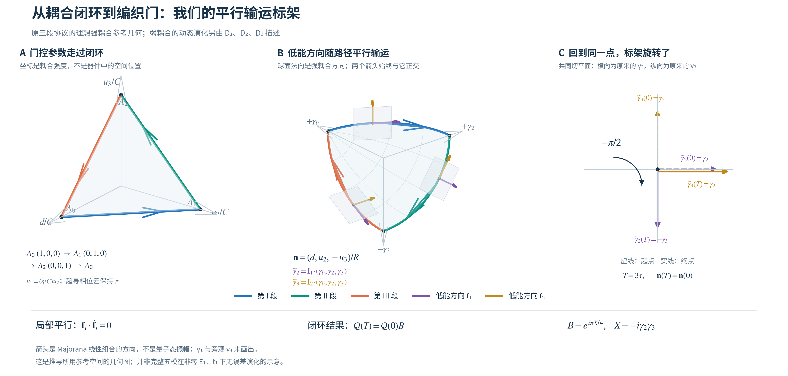
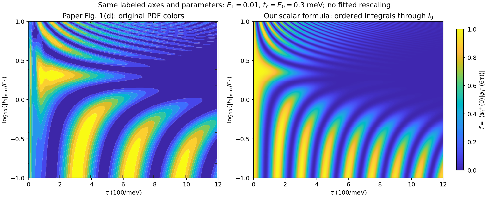
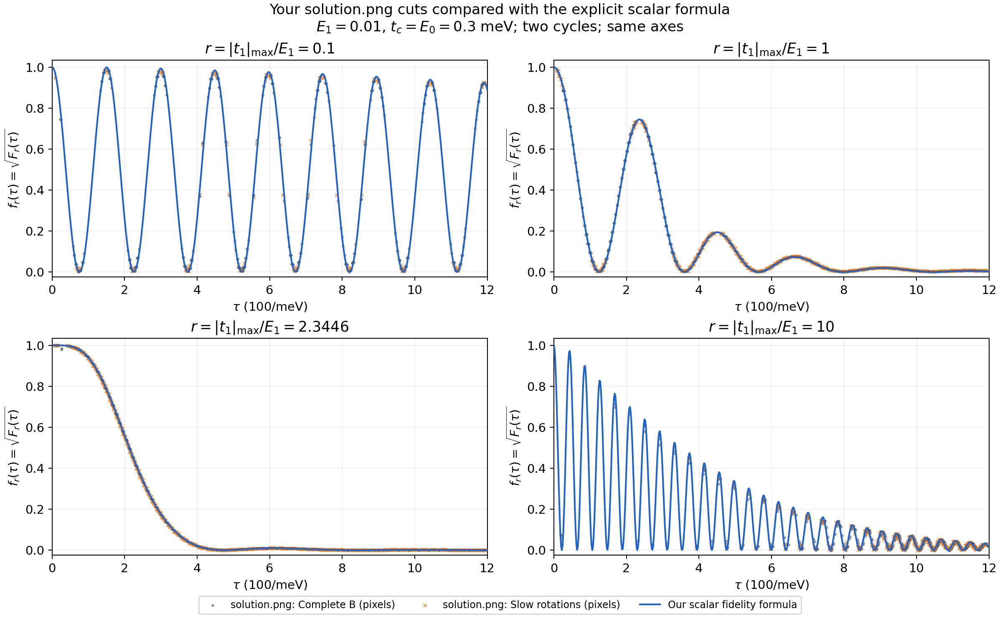

### 1. 问题与模型

我们希望回答：**当 Majorana 杂化 $E_1$ 和额外耦合 $t_1$ 同时非零时，能否写出具体保真度公式，并解释论文 Fig. 1(d)？**

**先把整个推导串起来：**原 Hamiltonian 中的强耦合($H_0$)形成一个有较大激发能的辅助模式。我们近似认为它保持低能占据，将弱耦合(V)对其余自由度的作用保留下来。随后，在随低能空间移动的基底中求解三段传播；其中第二段通过参数延拓构造成收敛函数。最后换回起点基底、连续执行两圈，得到指定读出的解析式。

参考文献的模型思路:Holonomic implementation of CNOT gate on topological Majorana qubits 下面简写2008.pdf.  借鉴论文思路，这里也使用了平行移动标架，从而能够把每段演化的哈密顿量给单独分析

| model          | 2008.pdf                         | 这里的推导                                 |
| -------------- | -------------------------------- | ------------------------------------------ |
| 找计算空间     | 求随控制参数变化的简并基态空间   | 用强耦合部分确定低能空间，再加入弱耦合     |
| 描述几何变化   | 计算瞬时基态的 Berry 联络、曲率  | 选择连续平行输运基底，跟踪其闭环变化       |
| 得到几何门     | 积分联络或曲率，得到 holonomy    | 从终点基底相对起点的旋转得到 理想编织\(B\) |
| 处理内部动力学 | 理想协议保持简并，只产生共同相位 | \(E_1,t_1\) 产生非平凡动态演化，必须保留   |

本文思路:

| 环节 | 实际做什么 | 注 |
|---|---|---|
| 分清辅助模式与剩余模式 | 把原 Majorana 算符换成适合强耦合的线性组合 | 变量换元 |
| 低能 | 近似保持辅助模式未激发 | 物理近似发生在这里；并非禁止量子点同时耦合多个 Majorana |
| 连续移动基底 | 跟随低能子空间，计算其中的动态传播 $D_1,D_2,D_3$ | 一圈后基底的净旋转是 $B$ |
| 解析延拓 | 从 $E_1=0$ 的传播出发，由方程确定非零 $E_1$ 的全部系数 | 求解约化模型；时间排序被保留在特殊函数中 |
| 组合并读出 | $U_{\rm cyc}=BD_3D_2D_1$，再计算 $U_{\rm cyc}^2$ 的指定读出 | 得到解析 $f_0$；与完整的误差记为 $\Delta_{\rm phys}$ |

因此，汇报中的“解析解”指低能有效模型内保留全部累计相位的解。它允许低能态在量子点上有成分，也允许低能空间内部有显著的动态演化；完整五模的高能跃迁和遗漏修正由后面的误差分析评估。

取 $\{\gamma_i,\gamma_j\}=2\delta_{ij}$，模型为

$$
H=i\gamma_a(d\gamma_b+u_2\gamma_2-u_3\gamma_3)
+i\gamma_1(u_1\gamma_b+e\gamma_2),
\qquad d=E_d,\quad e=E_1,\quad \eta=|t_1|_{\max}.
$$

$u_j(t)=|t_j(t)|$ 为门控耦合幅度，强控制幅度 $E_0=t_c=C$。每段持续 $\tau$，局部时间 $s\in[0,1]$，定义

$$
a(s)=\frac{1-\cos\pi s}{2},\qquad b=1-a,\qquad
q=\sqrt{a^2+b^2},\qquad g=\frac aq.
$$

| 控制段 | $d$ | $u_2$ | $u_3$ | $u_1$ |
|---|---:|---:|---:|---:|
| I | $Cb$ | $Ca$ | $0$ | $\eta a$ |
| II | $0$ | $Cb$ | $Ca$ | $\eta b$ |
| III | $Ca$ | $0$ | $Cb$ | $0$ |

三段完成一次交换，连续两圈共 $6\tau$。

采用原文指定初末态的读出

$$
f_{\rm full}=|\langle\psi_1^+(0)|\psi_1^-(6\tau)\rangle|
$$

下文用 $f_0$ 表示低能解析公式，记作$f_{full}=f_0 + \Delta_{phys}$ 后面会给出误差的估价.

### 2. 完整结果公式

定义一些和动力学演化累计的相位角相关的常数，j、k这些在直接对1、3段积分会得到

$$
\begin{gathered}
\alpha=\frac{E_1\tau}{\hbar},\qquad
\nu=\frac{\eta\tau}{\hbar},\\
j=\int_0^1\frac{a^2}{q}ds=\frac{\mathsf E(1/2)}\pi,\qquad
k=\int_0^1\frac bq ds=\frac{\mathsf K(1/2)}\pi.
\end{gathered}
$$

$\mathsf E,\mathsf K$ 是参数 $m=1/2$ 的完全椭圆积分，$j\simeq0.4299233$、$k\simeq0.5901703$。最终读出为

$$
\boxed{

f_0=\mathfrak f(\alpha,\nu)
=4(1-|\beta|^2)
\left[\operatorname{Im}(e^{-i\delta}\beta)\right]^2,\\
\beta=-\frac{e^{-i\nu/2}\mathsf S_\nu(\alpha;1)
+i e^{i\nu/2}\mathsf C_\nu(\alpha;1)^*}{\sqrt2},\\ 
\delta=(1+k)\alpha-j\nu.

}
$$

其中两个特殊函数的定义为：令

$$
P(s)=\int_0^s b(u)du=\frac s2+\frac{\sin\pi s}{2\pi},\qquad J_0=1,
$$

$$
J_m(s;\nu)=
\int_{0<s_m<\cdots<s_1<s}
\left[\prod_{\ell=1}^m g(s_\ell)\right]
\exp\!\left[2i\nu\sum_{\ell=1}^m(-1)^{\ell+1}P(s_\ell)\right]
ds_1\cdots ds_m.
$$

定义广义的余弦与正弦

$$
\boxed{
\begin{aligned}
\mathsf C_\nu(\alpha;s)&=\sum_{n=0}^{\infty}(-1)^n\alpha^{2n}J_{2n}(s;\nu),\\
\mathsf S_\nu(\alpha;s)&=\sum_{n=0}^{\infty}(-1)^n\alpha^{2n+1}J_{2n+1}(s;\nu).
\end{aligned}
}
$$

所有积分核均已知，不含待求波函数。实 $\nu$ 下有

$$
|J_m(s;\nu)|\le\frac{G(s)^m}{m!},\qquad
G(s)=\int_0^s g(u)du,
$$

因此级数对任意有限累计角收敛。$J_m$的意义是，在已经包含 \(t_1\) 演化的背景下，\(E_1\) 项产生的第 \(m\) 阶相干作用

### 3. 推导主线：拆分 $H_0+V$ → 低能投影 → 求解动力学 → 回到起点基底

用 $H_0$ 确定随控制变化的低能空间，将 $V$ 对剩余自由度的作用投影进去，在移动基底中求解，再换回起点基底。哈密顿量的拆分本身是精确的；近似发生在忽略辅助模式的激发及相关修正时。解析延拓用于求解投影后第二段的动态传播。

**1.拆分强、弱耦合-->holonomy**    原模型写成
$$
H=H_0+V,\qquad
H_0=i\gamma_a(d\gamma_b+u_2\gamma_2-u_3\gamma_3),\qquad
V=i\gamma_1(u_1\gamma_b+e\gamma_2).
$$

强耦合部分可通过模式换元写成

$$
H_0=iR\gamma_a\gamma_c,\qquad
R=\sqrt{d^2+u_2^2+u_3^2},\qquad
\gamma_c=\frac{d\gamma_b+u_2\gamma_2-u_3\gamma_3}{R}.
$$

$\gamma_a,\gamma_c$ 形成激发能为 $2R$ 的辅助模式，当前路径上 $R\ge C/\sqrt2$。当弱耦合远小于 $C$、控制相对辅助能隙足够慢时，近似保持这个模式的低能占据。其余自由度仍可以发生动态演化。

为看清 $V$ 的作用，令 $\boldsymbol\Gamma=(\gamma_b,\gamma_2,\gamma_3)$、$\boldsymbol n=(d,u_2,-u_3)/R$。在与 $\boldsymbol n$ 正交的平面内选取两个连续平行输运方向 $\boldsymbol f_1,\boldsymbol f_2$，对应剩余模式 $\widetilde\gamma_2=\boldsymbol f_1\cdot\boldsymbol\Gamma$、$\widetilde\gamma_3=\boldsymbol f_2\cdot\boldsymbol\Gamma$。将弱耦合向量 $\boldsymbol w=(u_1,e,0)$ 分解，得到

$$
\begin{aligned}
V&=\underbrace{i\omega\gamma_1\gamma_c}_{V_{\rm off}}
+\underbrace{i\gamma_1(w_1\widetilde\gamma_2+w_2\widetilde\gamma_3)}_{V_{\rm in}},\\
\omega&=\boldsymbol w\cdot\boldsymbol n,\qquad
w_i=\boldsymbol w\cdot\boldsymbol f_i.
\end{aligned}
$$

$V_{\rm off}$ 作用于量子点辅助耦合的空间；$V_{\rm in}$ 直接作用于剩余模式。强耦合参考模型的低能投影为 $P_0=(1-i\gamma_a\gamma_c)/2$，因为

$$
P_0V_{\rm off}P_0=0,\qquad P_0VP_0=P_0V_{\rm in}P_0.
$$

我们需要用到所谓低能近似：研究不激发辅助模式时，弱耦合仍能产生的内部作用。 它没有令整个 $V$ 为零。我们近似的认为，$V_{off}$对我们想研究的动力学是没有间接影响的，因为上面投影为0,没有直接影响。但不排除可能引起的修正。完整模型中的跨能区混合、虚跃迁及真实激发，需要由投影修正和误差分析处理。

起点的轴约定为 $X=-i\gamma_2\gamma_3,Y=-i\gamma_3\gamma_1,Z=-i\gamma_1\gamma_2$，后续始终沿同一连续标架输运。

在随动逻辑基底中，$-i\gamma_1\widetilde\gamma_2$ 对应固定 Pauli 矩阵 $Z$，$-i\widetilde\gamma_3\gamma_1$ 对应 $Y$。去掉共同能量后，保留的内部作用为

$$
\boxed{h_K=-w_1Z+w_2Y.}
$$

$Z$ 项单独作用产生相对相位，$Y$ 项单独作用混合两个逻辑基态；两者都不要求激发辅助模式。

**平行输运标架的几何图。**

左图是实际强耦合参数 $(d,u_2,u_3)/C$ 的三段路径；中图把它归一化为 $\boldsymbol n=(d,u_2,-u_3)/R$，紫色、金色箭头表示与强耦合方向正交的两个低能 Majorana 方向；右图在共同起终点比较，展示标架净转过 $-\pi/2$。两根箭头用于构造逻辑基底 $\mathcal Q(t)$，不直接代表两列多体态的振幅。整个过程是一个理想编织过程.

局部平行输运不代表箭头在整个三维空间中方向固定，而是它在当前低能平面内没有额外旋转。控制路径闭合以后，标架仍可发生净旋转，这就是 holonomy。图展示当前推导的理想强耦合参考几何；弱耦合的内部动态作用由 $D_1,D_2,D_3$ 描述，其中 $D_2$ 由上述延拓求出。完整模型的投影修正和泄漏由误差分析另行评估。它与 2008.pdf 使用同一种几何思路，具体路径和标架则由当前模型确定。

**2.求解三段低能动态传播，第二段使用参数延拓。** 将原脉冲和上述标架代入，三段有效 Hamiltonian 为
$$
h_{\rm I}=\frac{\eta a^2-eb}{q}Z,\qquad
h_{\rm II}=\eta bZ+egY,\qquad
h_{\rm III}=eY.
$$

第一、三段分别只沿一个固定逻辑轴作用，可以直接积分。第二段同时有 $Z,Y$ 两项，且两项比例随时间改变，必须保留时间有序性：

$$
D_1=e^{-i(j\nu-k\alpha)Z},\quad D_3=e^{-i\alpha Y},\qquad
iD_2'=[\nu bZ+\alpha gY]D_2,\quad D_2(0)=I.
$$

为了求出 $D_2$，固定 $\eta,\tau$ 和波形，从 $E_1=0$ 的可解传播延拓到目标参数，引入
$$
E(x)=xE_1,\qquad E(0)=0,\quad E(1)=E_1.
$$

$x$ 是参数空间坐标，不是实验时间。在 $x=0$，$D_2=e^{-i\nu PZ}$ 可直接求解，记作$D_{ref}$；提出这个参考传播后，写

$$
D_2(s)=e^{-i\nu P(s)Z}W(s),\qquad
W'=\alpha
\begin{pmatrix}
0&-g e^{2i\nu P}\\
g e^{-2i\nu P}&0
\end{pmatrix}W,\quad W(0)=I.
$$

**沿延拓把式中的 $\alpha$ 替换为 $x\alpha$**，由 $W(0)=I$ 反复积分，并按偶数阶、奇数阶整理，便得到第 2 节的 $\mathsf C,\mathsf S$；最后取 $x=1$。对实物理参数，
$$
W=\begin{pmatrix}\mathsf C_\nu&-\mathsf S_\nu\\
\mathsf S_\nu^*&\mathsf C_\nu^*\end{pmatrix}.
$$

延拓的对象是传播矩阵；其全部系数由动力学方程确定。

补充： W的定义来自于，恢复非零 \(E_1\)。真正的 \(D_2\) 不再等于这个已知的指数，于是定义\[ \boxed{ W(s)=D_{\rm ref}(s)^\dagger D_2(s). } \] ，表示在扣除已知参考演化之后，还剩下怎样的演化，等价地，\[ \boxed{ D_2(s)=e^{-i\nu P(s)Z}W(s). } \]

这一递推也可直接从相互作用绘景的 Dyson 展开得到。在当前有限维、有限时间、系数有界的模型中，完整 Dyson 级数同样收敛；需要小累计角控制的是简单的低阶截断。这里的参数延拓将参考传播和全部高阶项整理成明确的函数，并没有改变投影近似的适用范围。

**3.组合动态传播。**

先区分两个任务：$D=D_3D_2D_1$ 算出态在移动坐标系中的最终系数；$B$ 将这些系数转换到起点坐标系。矩阵按这个顺序相乘，不需要交换顺序，也就不需要假设它们对易。

**为什么恰好有两个低能基底态？** 因为我们同时固定了辅助模式的低能占据和系统的总宇称。这里数的是多体态，不是剩余 Majorana 算符的个数。

当前耦合涉及五个 Majorana；构造多体态时，还包括不参与这些耦合的旁观 Majorana $\gamma_4$。在随动标架中，六个 Majorana 可以组成三个普通费米子模式：

$$
f_{\rm aux}=\frac{\gamma_a+i\gamma_c}{2},\qquad
f_L=\frac{\gamma_1+i\widetilde\gamma_2}{2},\qquad
f_R=\frac{\widetilde\gamma_3+i\gamma_4}{2}.
$$

每个模式的占据数只能是 $0$ 或 $1$。辅助模式满足

$$
H_0=R(2n_{\rm aux}-1),\qquad n_{\rm aux}=f_{\rm aux}^\dagger f_{\rm aux}.
$$

低能投影固定 $n_{\rm aux}=0$。另外两个模式本来还有 $|n_L,n_R\rangle=|00\rangle,|01\rangle,|10\rangle,|11\rangle$ 四种占据。若选择总偶宇称，就要求 $n_{\rm aux}+n_L+n_R$ 为偶数，因此只剩

$$
\boxed{
|0_L(t)\rangle=|0,0,0\rangle_t,\qquad
|1_L(t)\rangle=|0,1,1\rangle_t.
}
$$

这里三个数字依次表示 $(n_{\rm aux},n_L,n_R)$，下标 $t$ 表示占据是相对于当前随动模式定义的。若选择总奇宇称，则保留 $|0,0,1\rangle_t,|0,1,0\rangle_t$，仍然是两个态。整个计数为

$$
\boxed{
6\text{ 个 Majorana}
\ \longrightarrow\ 2^3=8\text{ 个多体态}
\ \xrightarrow{\text{固定总宇称}}\ 4\text{ 个}
\ \xrightarrow{n_{\rm aux}=0}\ 2\text{ 个}.
}
$$

两个保留态在 $H_0$ 下的能量都是 $-R$，因为它们的辅助占据相同。这就是此前所说的共同能量。弱耦合可以使它们产生能量差或相互混合，但我们仍保留整个二维空间，并求解其中的动态演化。

因此，$\mathcal Q(t)$ 是把所选的两个低能基底态并排放置得到的矩阵：

$$
\mathcal Q(t)=\begin{pmatrix}|q_0(t)\rangle&|q_1(t)\rangle\end{pmatrix},\qquad
\mathcal Q(t)\begin{pmatrix}c_0(t)\\c_1(t)\end{pmatrix}
=c_0(t)|q_0(t)\rangle+c_1(t)|q_1(t)\rangle.
$$

$|q_0\rangle,|q_1\rangle$ 是上述二维空间中按平行输运约定选取的一组基底。在固定总宇称的四维多体空间中，$\mathcal Q$ 是 $4\times2$ 矩阵，满足 $\mathcal Q^\dagger\mathcal Q=I_2$、$\mathcal Q\mathcal Q^\dagger=P_0$；后一个式子的 $P_0$ 也限制在同一宇称扇区中。它把两个坐标系数转换成原空间中的物理态。在低能近似下写

$$
|\psi(t)\rangle\simeq\mathcal Q(t)c(t).
$$

$\mathcal Q(t)$ 描述基底怎样移动，$c(t)$ 描述态在这个基底中的系数怎样变化。将它代入薛定谔方程并投影，得到

$$
i\hbar\dot c=
\left[\mathcal Q^\dagger H\mathcal Q
-i\hbar\mathcal Q^\dagger\dot{\mathcal Q}\right]c.
$$

我们采用平行输运基底，令 $\mathcal Q^\dagger\dot{\mathcal Q}=0$。又因 $\mathcal Q^\dagger H_0\mathcal Q=-RI_2$，去掉它产生的共同相位后，便得到第二步求解的方程

$$
\boxed{i\hbar\dot c=h_Kc,\qquad h_K=\mathcal Q^\dagger V\mathcal Q.}
$$

三段的时间顺序给出 $c(T)=D_3D_2D_1c(0)$，其中 $T=3\tau$。另一方面，强控制回到起点后，连续平行输运的基底满足

$$
\mathcal Q(T)=\mathcal Q(0)B,\qquad B=e^{i\pi X/4}.
$$

将这两个结果直接代入终态：

$$
\begin{aligned}
|\psi(T)\rangle
&\simeq\mathcal Q(T)c(T)\\
&=\mathcal Q(T)D_3D_2D_1c(0)\\
&=\mathcal Q(0)\,BD_3D_2D_1c(0).
\end{aligned}
$$

因此，去掉共同相位、相对于起点基底的低能传播为

$$
\boxed{U_{\rm cyc}=BD_3D_2D_1.}
$$

**这里仅仅做了代入，没有交换任何矩阵，所以即使 $[H_0,V]\ne0$，也不妨碍得到这个乘积。** $B$ 是终点与起点基底之间的转换，不是完整模型中一个可以与 $V$ 的传播任意分开的因子。$B$ 与 $D$ 本身也通常不对易，不能将 $BD$ 随意改成 $DB$。

实际过程中几何与动态作用同时发生；式子不表示实验上先做动态门、再做几何门。全部 $D_j$ 必须在同一套连续输运标架中定义。重复同一物理控制周期时，在共同起点基底中有

$$
U_{\rm two}=U_{\rm cyc}^2=(BD)^2,
$$

一般不能改写成 $B^2D^2$。

为避免与弱耦合 $V$ 混淆，将此处的连接矩阵记作 $V_{\rm conn}$，由 $D_2(1)=BV_{\rm conn}$ 定义，其非对角元 $(V_{\rm conn})_{12}$ 就是主公式中的 $\beta$。再用二阶矩阵哈密顿-凯莱恒等式

$$
U_{\rm cyc}^2=(\operatorname{tr}U_{\rm cyc})U_{\rm cyc}-I
$$

得到 $|[U_{\rm two}]_{12}|^2=4(1-|\beta|^2)[\operatorname{Im}(e^{-i\delta}\beta)]^2$。在本投影与约定下，原单粒子重叠模满足 $f_0=|[U_{\rm two}]_{12}|^2$，因此主公式没有遗漏平方或平方根。

### 4. 结果分析：公式解释了什么？

#### 4.1 两个极限的理论检验：理想编织与仅有 $t_1$ 的情形

以下固定强控制 $C$、段时长 $\tau$ 和三段路径，令 $\mathcal A=\tfrac12+j,\mathcal B=1+2k$。$t_1=0$ 指其峰值 $\eta=0$，即额外门控耦合 $u_1(t)$ 全程为零；编织所需的 $t_2,t_3$ 仍照常打开和关闭。

**极限一：$E_1=t_1=0$，恢复理想编织。**

此时 $\alpha=\nu=0$。由特殊函数级数直接得到

$$
\mathsf C_0(0;1)=1,\qquad \mathsf S_0(0;1)=0,
\qquad \beta=-\frac{i}{\sqrt2},\qquad \delta=0.
$$

代回主公式：

$$
\boxed{
f_0(0,0)=4\left(1-\frac12\right)
\left[\operatorname{Im}\left(-\frac{i}{\sqrt2}\right)\right]^2=1,
\qquad F_0(0,0)=1.
}
$$

其物理原因是三个动态因子均为单位阵：$D_1=D_2=D_3=I$。于是单圈 $U_{\rm cyc}=B$，两圈 $U_{\rm two}=B^2=iX$，将指定初态翻转到目标态。这验证了公式的归一化与理想几何门极限。

**极限二：仅 $E_1=0$，保留非零 $t_1$。**

此时 $\alpha=0$，但 $\nu=\eta\tau/\hbar$ 可以为任意有限值。由同一组级数得到

$$
\mathsf C_\nu(0;1)=1,\qquad \mathsf S_\nu(0;1)=0,
\qquad \beta=-\frac{i}{\sqrt2}e^{i\nu/2},\qquad \delta=-j\nu.
$$

定义单圈积累的动态角

$$
\Theta=\left(\frac12+j\right)\nu
=\left(\frac12+\frac{\mathsf E(1/2)}\pi\right)\frac{\eta\tau}{\hbar}.
$$

由于 $|\beta|^2=1/2$，且

$$
e^{-i\delta}\beta=-\frac{i}{\sqrt2}e^{i\Theta}
=\frac{\sin\Theta-i\cos\Theta}{\sqrt2},
$$

保真度化为完整的三角函数形式：

$$
\boxed{
f_0(0,\nu)=\cos^2\Theta
=\cos^2\!\left[\left(\frac12+\frac{\mathsf E(1/2)}\pi\right)
\frac{\eta\tau}{\hbar}\right],\qquad
F_0(0,\nu)=\cos^4\Theta.
}
$$

**为什么这时可以得到余弦？** 从有效 Hamiltonian 独立计算，三段传播恰为
$$
D_1=e^{-ij\nu Z},\qquad D_2=e^{-i\nu Z/2},\qquad D_3=I,
\qquad U_{\rm cyc}=B e^{-i\Theta Z}.
$$

同一圈内的两个动态因子同轴对易，可以直接合并。连续两圈后，

$$
\big[(B e^{-i\Theta Z})^2\big]_{12}=i e^{i\Theta}\cos\Theta,
\qquad f_0=|[U_{\rm two}]_{12}|^2=\cos^2\Theta.
$$

因此，动态相位使指定读出周期性振荡：$\Theta=n\pi$ 时恢复 $f_0=1$，$\Theta=(n+\tfrac12)\pi$ 时 $f_0=0$。这不是小角近似；再令 $\eta\to0$，自然回到第一个极限。

若展开到四阶，则

$$
f_0=1-\Theta^2+\frac{\Theta^4}{3}+O(\Theta^6),\qquad
F_0=1-2\Theta^2+\frac{5\Theta^4}{3}+O(\Theta^6),
$$

与此前仅有 $t_1$ 的独立微扰结果一致。另一条参数轴 $\eta=0$ 也有 $f_0=\cos^2(\mathcal B\alpha)$，作为补充交叉检查。

**这两个极限的适用含义：**上述等式在领先低能模型内成立；有限速度的完整五模结果 $f_{\rm full}$ 仍可能有偏差。取 $E_1\to0$ 时保留 $\eta,\tau$，直接使用独立变量 $(\alpha,\nu)$，不把发散的 $r=\eta/E_1$ 代入固定比例渐近式；初末态沿用 $E_1\to0^+$ 的连续读出约定。两个极限验证了理想门和单参数动力学，双参数混合项则由已有四阶核对另行检验。

#### 4.2 峰位与峰高来自两个不同因素

令 $p=|\beta|^2,\chi=\arg\beta-\delta$，可将同一结果改写成

$$
\boxed{f_0=\underbrace{4p(1-p)}_{\mathcal V}\sin^2\chi.}
$$

$\chi$ 描述振荡相位，$\mathcal V$ 限制峰高。两者都随参数变化，因此实际峰位不能只由一个固定频率决定，峰高也不必单调下降。$\beta=0$ 时直接使用主公式，不取无定义的相位。

两个弱耦合同时存在时，$Y,Z$ 不对易，使连接振幅的模和相位一起变化；这解释了为什么图像一般不再是一条等幅余弦。固定正有限比例 $r=\eta/E_1$ 时，低能模型还给出长时 $f_0=O_r(\alpha^{-4})$：这里的衰减来自相干演化，不需要引入耗散；该渐近式不直接保证有限 $C$ 完整模型的无限时行为。

#### 4.3 中间高保真度区域：二阶抵消，但仍有高阶损失

在小累计角下，

$$
f_0=1-(\mathcal B\alpha-\mathcal A\nu)^2
+O\bigl((|\alpha|+|\nu|)^4\bigr).
$$

所以当

$$
\boxed{r=r_*\equiv\frac{\eta}{E_1}
=\frac{1+2k}{1/2+j}\simeq2.3446,}
$$

二阶损失消失，初始高保真度区域较平坦。但此处仍有

$$
1-f_0=4J_p^2\alpha^2\nu^2
+O\bigl((|\alpha|+|\nu|)^6\bigr),\qquad
J_p=2\int_0^1g(s)\!\int_s^1b(u)du\,ds>0.
$$

因此这是一条指定读出的二阶抵消线，不意味着全部时间上保真度为一，也不意味着整个逻辑门无误差。一般双参数展开的全部四阶系数已与独立微扰结果逐项核对。

### 5. 图像与验证结果

[热图 PDF](figures/fidelity_formula/paper_vs_formula.pdf)。取图注参数 $E_1=0.01\,\mathrm{meV},C=0.3\,\mathrm{meV}$，横轴为 $\lambda=E_1\tau/\hbar$，纵轴为 $\log_{10}r$。公式解释单参数主导区的振荡、中间区域的变化，以及峰位和峰高的共同演化。（下图归一化2后）

[截面 PDF](figures/fidelity_formula/solution_vs_scalar_formula.pdf)。截面就是 $f_r(\lambda)=\mathfrak f(\lambda,r\lambda)$，没有重新拟合。图中的源图像素含提取误差；下表直接使用完整模型数组，在 $0.5\le\lambda\le12$、步长 $0.02$ 的已有网格上比较：

| $r=\eta/E_1$ | 解析公式与完整五模模型的最大绝对差 |
|---:|---:|
| $0.1$ | $0.00581$ |
| $1$ | $0.00547$ |
| $2.3446$ | $0.00185$ |
| $10$ | $0.04924$ |

前三条截线在该采样区间内差值均小于 $0.01$；$r=10$ 时 $\eta/C=1/3$，低能近似变弱，偏差明显增大。这是有限网格的验证，不是整张热图的统一精度保证。

此外，公式与独立低能微分方程在 24 个测试点的最大差约 $2.19\times10^{-9}$。该比较检验的是公式求值；上表检验的是低能近似与完整模型的差别，两种精度不能混同。[验证记录](data/verification.json)；[截面对照记录](data/solution_vs_scalar_formula.json)。

### 6. 近似条件与最终结论

标量公式的主要条件是

$$
\epsilon=\frac{\sqrt{E_1^2+\eta^2}}C\ll1,\qquad
L=\frac{C\tau}{\hbar}\gg1.
$$

它不要求 $\alpha,\nu\ll1$，但弱耦合高阶修正会随时间累积。在已证明的能隙分离与速度条件下，可写成

$$
\boxed{
f_{\rm full}=\mathfrak f(\alpha,\nu)+\Delta_{\rm phys},\qquad
|\Delta_{\rm phys}|\le\min(1,\mathcal E_{\rm phys}),
}
$$

$$
\mathcal E_{\rm phys}
=O\!\left(\epsilon^2+L\epsilon^3+\frac\epsilon L+\frac1{L^2}\right).
$$

$\mathcal E_{\rm phys}$ 的明确脉冲积分表达及适用条件见 [技术文档第 17 节](analytic_continuation.md#17-物理投影误差的显式上界不必求出误差函数)。上界较保守；不能把大 $O$ 当成已知数值系数，也不能把有限网格上的小偏差推广为全部参数的精度保证。

绘图使用同一函数的等价有序积分表示，截至第九阶的**纯级数截断误差**有界于 $1.42\times10^{-8}$；它不是九阶累计角多项式，且该界不包括实际求积与上述物理近似误差。说明见 [技术文档第 7 节](analytic_continuation.md#7-适合绘图的统一有序积分公式及严格截断界)。

