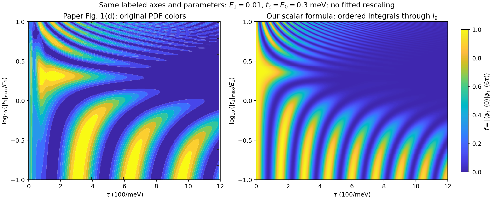
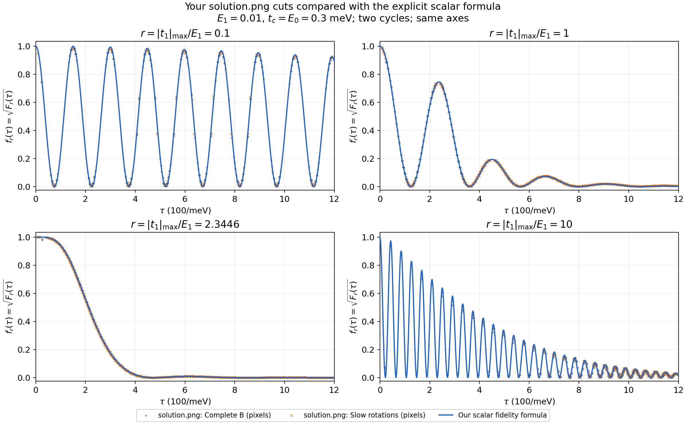

# PRB 111 编织保真度的解析构造：从参数延拓到图像机制与误差控制

**研究汇报文档｜2026-11-02**

研究对象：Yu Zhang、Yijia Wu、Jie Liu、X. C. Xie，*Quantifying the non-Abelian property of Andreev bound states in inhomogeneous Majorana nanowires*，Phys. Rev. B **111**, 205411 (2025)，DOI：10.1103/PhysRevB.111.205411。[原论文](../arts/prb111.pdf)。

本文汇报我们针对该文有效模型开展的解析工作。原论文提供模型、协议和待解释图像；下面的延拓函数、保真度构造、四阶核对及物理误差估计，是本项目整理出的分析结果。本文可独立阅读，适合约 35–40 分钟组会；最后给出幻灯片安排、讨论问题与复现入口。

## 摘要

对于具有有限 Majorana 杂化 $E_1$ 和额外门控耦合 $t_1$ 的编织模型，低阶微扰能够解释初始保真度损失，却无法覆盖随操作时间出现的多次振荡。我们以 $E_1=0$ 的可解传播为起点，通过参数路径 $E(x)=xE_1$，由动力学方程确定完整传播矩阵的解析展开，构造两个规范化的收敛函数 $\mathsf C_\nu,\mathsf S_\nu$。组合三段控制与两圈交换后，得到原文指定读出的具体解析式。

该公式在领先低能有效模型中保留全部累计相位，能够分离峰位与峰高机制，恢复单参数余弦平方极限，并与独立微扰推导的全部四阶系数一致。通过等价的有序积分表示，绘图所用 $I_9$ 截断具有明确的统一余项界。与同约定完整 SO(5) 模型的截线比较支持其适用窗口内的定量准确性。进一步从原五维方程出发，构造了只依赖脉冲及一维积分的物理误差上界，明确了低能近似与数值求值两类误差。

本工作的最终形式是

$$
\boxed{
f_{\rm full}
=\mathfrak f(E_1\tau/\hbar,\eta\tau/\hbar)+\Delta_{\rm proj},
\qquad
|\Delta_{\rm proj}|\le\min(1,\mathcal E_{\rm phys}),
}
$$

其中 $\eta=|t_1|_{\max}$，$\mathfrak f$ 与 $\mathcal E_{\rm phys}$ 都有明确的可计算定义。误差界较保守，不能据此宣称论文全部参数都达到百分之一精度。

## 1. 研究问题：需要怎样的解析结果？

原论文研究非均匀纳米线中的 Andreev 束缚态如何影响编织。对于其中的有效模型，我们关注一个更具体的问题：在保留原控制协议的前提下，能否写出随 $E_1,t_1,\tau$ 变化的保真度公式，并由公式解释 Fig. 1(d) 的条纹、峰高变化和中间高保真度区域？

这一问题有三个相互关联的目标：

1. **构造具体函数。** 函数应有明确系数、初始归一化和收敛规则，能直接求值。
2. **给出物理机制。** 说明动态相位怎样改变峰位置，不对易演化怎样改变峰高，为什么某个比例附近初始损失较弱。
3. **控制近似。** 说明解析式在哪个模型内成立，以及它与完整五模模型相差多少。

仅有 $f=1-c_2\tau^2+\cdots$ 的局部展开，不能描述整张图的多次振荡。另一方面，目标允许使用收敛特殊函数表示，因此可以从可解模型出发，系统地保留非对易传播的全部阶数。

## 2. 模型、门控协议与读出

### 2.1 五个活动 Majorana 的有效模型

采用 $\{\gamma_i,\gamma_j\}=2\delta_{ij}$，Hamiltonian 为

$$
\boxed{
H=i\gamma_a(d\gamma_b+u_2\gamma_2-u_3\gamma_3)
+i\gamma_1(u_1\gamma_b+e\gamma_2),
\qquad e=E_1.
}
$$

$\gamma_a$ 与强控制方向形成辅助模式；$e$ 描述有限杂化，$u_1$ 是随门控变化的额外耦合。取等幅强控制 $E_0=t_c=C$，每段时长 $\tau$，段内时间 $s\in[0,1]$：

$$
a(s)=\frac{1-\cos\pi s}{2},\quad b=1-a,\quad
q=\sqrt{a^2+b^2},\quad g=\frac aq.
$$

| 控制段 | $d$ | $u_2$ | $u_3$ | $u_1$ |
|---|---:|---:|---:|---:|
| I | $Cb$ | $Ca$ | $0$ | $\eta a$ |
| II | $0$ | $Cb$ | $Ca$ | $\eta b$ |
| III | $Ca$ | $0$ | $Cb$ | $0$ |

三段构成一次交换，连续执行两圈，总时长为 $6\tau$，中途不重置状态。$\eta=|t_1|_{\max}$ 是峰值幅度；把 $t_1$ 当作全程常量会改变问题。

### 2.2 无量纲变量与保真度约定

定义

$$
\alpha=\frac{e\tau}{\hbar},\qquad
\nu=\frac{\eta\tau}{\hbar},\qquad
r=\frac{\eta}{e},\qquad
\lambda=\frac{e\tau}{\hbar}.
$$

$\alpha,\nu$ 是独立参数；固定 $r$ 改变操作时间时，沿射线
$(\alpha,\nu)=(\lambda,r\lambda)$ 扫描。

本文始终区分

$$
f=\left|\langle\psi_1^+(0)|\psi_1^-(6\tau)\rangle\right|,
\qquad F=f^2.
$$

它们是指定初态到目标态的读出，不能自动等同于平均门保真度。在原坐标 $(1,2,3,a,b)$ 下，完整单粒子传播满足

$$
\dot{\mathcal R}=K\mathcal R,\qquad K=\frac{2A_{\rm full}}{\hbar},
\qquad
f_{\rm full}=|\zeta^T\mathcal R\zeta|,
\quad \zeta=\frac{(1,-i,0,0,0)^T}{\sqrt2}.
$$

这里使用转置，是因为目标是初始单粒子态的粒子—空穴伙伴。后面所有定量对照都沿用同一个 $K=2A_{\rm full}/\hbar$ 约定。

## 3. 低能约化做了什么？

### 3.1 快模、慢模与两个不同的小参数

先看强耦合部分。令

$$
\boldsymbol v=(d,u_2,-u_3),\quad R=|\boldsymbol v|=Cq,\quad
\gamma_c=\frac{d\gamma_b+u_2\gamma_2-u_3\gamma_3}{R}.
$$

由 $c_f=(\gamma_a+i\gamma_c)/2$ 得

$$
H_0=iR\gamma_a\gamma_c=R(2c_f^\dagger c_f-1),
\qquad \Delta_{\rm fast}=2R,\quad \omega_{\rm fast}=\frac{2R}{\hbar}.
$$

“快”指辅助模式的内禀振荡频率。当前协议中 $R\in[C/\sqrt2,C]$；其方向依次经过
$\gamma_b\to\gamma_2\to-\gamma_3\to\gamma_b$。其余三个慢 Majorana 在理想参考模型中为零模，加入弱耦合后产生内部动力学。

领先约化要求

$$
\epsilon=\frac{\sqrt{e^2+\eta^2}}C\ll1,\qquad
L=\frac{C\tau}{\hbar}\gg1.
$$

它将辅助模式近似保持在低能占据，同时保留移动慢空间的几何输运。**辅助模式绝热不要求慢空间内部也绝热。** 并且，$\epsilon\ll1$ 不等于 $\alpha,\nu\ll1$：长时间内，弱耦合也可以积累很大的相位。

| 对象 | 保留的内容 | 精确性的含义 |
|---|---|---|
| 本文标量公式 | 理想几何输运、领先弱耦合动力学的全部累计相位 | 在指定低能模型内精确 |
| 完整五维矩阵函数 | 五个活动 Majorana 及快慢转移 | 在原五模模型内精确 |
| 图中的有限积分级数 | 特殊函数的截断和数值求积 | 另有计算误差 |

### 3.2 投影后的三段传播

在初始慢空间取

$$
X=-i\gamma_2\gamma_3,\qquad
Y=-i\gamma_3\gamma_1,\qquad
Z=-i\gamma_1\gamma_2.
$$

令 $\boldsymbol\gamma=(\gamma_b,\gamma_2,\gamma_3)$，
$\boldsymbol n=\boldsymbol v/R$。各段可以选择如下平行输运的暗平面基：

| 段 | $\boldsymbol n$ | $\boldsymbol f_1$ | $\boldsymbol f_2$ |
|---|---|---|---|
| I | $(b,a,0)/q$ | $(-a,b,0)/q$ | $(0,0,1)$ |
| II | $(0,b,-a)/q$ | $(-1,0,0)$ | $(0,a,b)/q$ |
| III | $(a,0,-b)/q$ | $(-b,0,-a)/q$ | $(0,1,0)$ |

弱耦合向量为 $\boldsymbol w=(u_1,e,0)$。在该移动标架中，领先投影是

$$
h_K=-\boldsymbol w\cdot\boldsymbol f_1\,Z
+\boldsymbol w\cdot\boldsymbol f_2\,Y.
$$

代入脉冲表，逐段得到

$$
h_{\rm I}=\frac{\eta a^2-eb}{q}Z,\qquad
h_{\rm II}=\eta bZ+egY,\qquad
h_{\rm III}=eY.
$$

方向 $\boldsymbol n$ 的闭合路径在本符号约定下围出有向立体角
$\Omega_{\rm geom}=-\pi/2$，对应
$B=e^{-i\Omega_{\rm geom}X/2}$。理想几何门与单圈传播为

$$
B=e^{i\pi X/4},\qquad U_{\rm cyc}=BD_3D_2D_1.
$$

第一、三段可直接积分：

$$
D_1=e^{-i(\nu j-\alpha k)Z},\qquad D_3=e^{-i\alpha Y},
$$

$$
j=\frac{\mathsf E(1/2)}{\pi}\simeq0.4299233001,\qquad
k=\frac{\mathsf K(1/2)}{\pi}\simeq0.5901702995.
$$

$\mathsf E,\mathsf K$ 为参数 $m=1/2$ 的完全椭圆积分。真正的非对易部分集中在

$$
\boxed{
iD_2'(s)=[\nu b(s)Z+\alpha g(s)Y]D_2(s),\qquad D_2(0)=I.
}
$$

记无量纲第二段生成元 $h(s)=\nu b(s)Z+\alpha g(s)Y$，则两个时刻满足

$$
[h(s),h(u)]
=2i\alpha\nu[g(s)b(u)-b(s)g(u)]X.
$$

因此两个耦合同时存在时，一般不能把第二段简化为一个固定轴的指数。这正是要构造连接函数的原因。

## 4. 解析延拓的动机与实际构造

### 4.1 参数路径 $E(x)=xE_1$

固定目标 $E_1=e$、$\eta,C,\tau$ 以及脉冲形状，取

$$
\boxed{E(x)=xE_1,\qquad E(0)=0,\quad E(1)=E_1.}
$$

$x$ 是模型参数，不是物理时间。对每个固定 $x$，杂化在整个操作过程中取常量 $xE_1$。于是

$$
\alpha(x)=x\lambda,\qquad \nu\ \text{固定}.
$$

在起点 $\alpha=0$，第二段精确为

$$
D_2(s;0)=e^{-i\nu P(s)Z},\qquad
P(s)=\int_0^sb(u)\,du=\frac s2+\frac{\sin\pi s}{2\pi}.
$$

我们延拓的是这个**完整传播矩阵**。仅知道 $E_1=0$ 时的余弦保真度，无法确定横向的参数导数；导数必须由 Hamiltonian 和初值确定。

### 4.2 动力学方程怎样确定解析芽？

一般地，将参考传播提出，写成

$$
U_x(t)=U_{\rm ref}(t)W_x(t),\qquad
\dot W_x=-\frac{ixE_1}{\hbar}V_I(t)W_x,\qquad W_x(0)=I.
$$

令 $W_x=\sum_{n\ge0}x^nW^{[n]}$，则

$$
W^{[0]}=I,\qquad
W^{[n+1]}(t)=-\frac{iE_1}{\hbar}\int_0^tV_I(u)W^{[n]}(u)\,du.
$$

有限时间下，若 $M=|E_1|\hbar^{-1}\int\|V_I\|dt$，有
$\|W^{[n]}\|\le M^n/n!$。因此这套系数定义整解析的传播矩阵，取 $x=1$ 即得到目标模型的传播。

线性路径是方便的选择。对于同一模型族，其他解析参数化 $E(x)=E_1h(x)$、$h(0)=0,h(1)=1$ 具有相同的精确终点解；有限阶截断则可能不同。由于这里的参数级数整收敛，数学上不必强制沿 $x$ 分步求值。

### 4.3 与低能投影的关系

低能投影决定我们正在求解哪一个有效方程；解析延拓负责求解这个方程。两者是不同步骤。当前简洁标量式从已经约化的二维方程出发，所以其物理误差来自约化。第 12 节给出的五维构造说明：解析延拓本身并不要求低能投影。

## 5. 构造两个规范化标量函数

将可解的对角传播提出：

$$
D_2(s)=e^{-i\nu P(s)Z}W(s),
$$

$$
W'=\alpha
\begin{pmatrix}
0&-g e^{2i\nu P}\\
g e^{-2i\nu P}&0
\end{pmatrix}W,\qquad W(0)=I.
$$

令 $G(s)=\int_0^sg(u)\,du$，其中 $G(1)=k$。反复积分，定义

$$
J_m(s;\nu)=
\int_{0<s_m<\cdots<s_1<s}
\prod_{\ell=1}^m g(s_\ell)
\exp\!\left[2i\nu\sum_{\ell=1}^m(-1)^{\ell+1}P(s_\ell)\right]d^ms,
\qquad J_0=1.
$$

将偶数阶、奇数阶分别整理：

$$
\boxed{
\mathsf C_\nu(\alpha;s)=
\sum_{n=0}^{\infty}(-1)^n\alpha^{2n}J_{2n}(s;\nu),
}
$$

$$
\boxed{
\mathsf S_\nu(\alpha;s)=
\sum_{n=0}^{\infty}(-1)^n\alpha^{2n+1}J_{2n+1}(s;\nu).
}
$$

于是

$$
W=
\begin{pmatrix}
\mathsf C_\nu&-\mathsf S_\nu\\
\mathsf S_{-\nu}&\mathsf C_{-\nu}
\end{pmatrix}.
$$

这两个函数具有明确的系数和归一化；系数中的被积函数全部已知，不含待求态。对实 $\nu$，

$$
|J_m(s;\nu)|\le\frac{G(s)^m}{m!}.
$$

对复 $\nu$，利用有序时间与 $P$ 的单调性，交错和位于 $[0,P(s)]$，只需增加因子 $e^{2|\operatorname{Im}\nu|P(s)}$。因此级数在复参数紧集上一致收敛，关于 $(\alpha,\nu)$ 联合整解析。

实物理参数下，

$$
C_{-\nu}=C_\nu^*,\quad S_{-\nu}=S_\nu^*,\quad
|C_\nu|^2+|S_\nu|^2=1,
$$

其中下文简称 $C_\nu=\mathsf C_\nu(\alpha;1)$、
$S_\nu=\mathsf S_\nu(\alpha;1)$。在 $\nu=0$ 轴上，

$$
\mathsf C_0(\alpha;s)=\cos[\alpha G(s)],\qquad
\mathsf S_0(\alpha;s)=\sin[\alpha G(s)].
$$

复参数延拓时使用 $C_{\pm\nu},S_{\pm\nu}$ 的解析定义；复共轭关系及最终取模只在实物理参数上使用。传播矩阵的整解析性不意味着复参数上的模长也是全纯函数。

因此，“广义正弦、余弦”是对这套规范函数的描述。整个保真度包含非对易有序积分，不能仅由脉冲常数中出现椭圆积分，就将整个解称为一个椭圆积分。

## 6. 从传播矩阵得到原文保真度

### 6.1 第二段连接振幅

令 $V=B^\dagger D_2(1)$，按 SU(2) 形式写成

$$
V=\begin{pmatrix}a_V&\beta\\-\beta^*&a_V^*\end{pmatrix}.
$$

直接相乘得到

$$
\boxed{
\beta=-\frac{e^{-i\nu/2}S_\nu+i e^{i\nu/2}C_\nu^*}{\sqrt2},
\qquad \delta=(1+k)\alpha-j\nu.
}
$$

### 6.2 两圈组合与读出映射

利用 $B^\dagger YB=Z$ 和 $B^2=iX$，单圈可写成

$$
U_{\rm cyc}=iXM,\qquad
M=e^{-i\alpha Z}V e^{-i(\nu j-\alpha k)Z}.
$$

记 $M$ 的两个独立元素为 $a_M,b_M$，则
$b_M=e^{-i\delta}\beta$、
$|a_M|^2=1-|\beta|^2$、
$\operatorname{tr}U_{\rm cyc}=-2\operatorname{Im}b_M$。
由 Cayley–Hamilton 恒等式，
$$
U_{\rm cyc}^2=(\operatorname{tr}U_{\rm cyc})U_{\rm cyc}-I.
$$

两圈传播的非对角元为
$v=-2ia_M^*\operatorname{Im}b_M$。
还需将逻辑传播映射到原文的单粒子读出。对
$$
\mathcal U=
\begin{pmatrix}u&v\\-v^*&u^*\end{pmatrix},
\qquad
\mathcal U^\dagger\sigma_i\mathcal U=\sum_j(R_3)_{ij}\sigma_j,
\qquad
\xi=\frac{(1,-i,0)^T}{\sqrt2},
$$

直接计算给出 $\xi^TR_3\xi=-v^2$。因此原文重叠模为
$f=|v|^2$，而 $F=|v|^4$。最终得到
$$
\boxed{
\mathfrak f(\alpha,\nu)
=4(1-|\beta|^2)
\left[\operatorname{Im}(e^{-i\delta}\beta)\right]^2,
\qquad F=\mathfrak f^2.
}
$$

这一平方关系来自 $SU(2)\to SO(3)$ 的单粒子读出映射，不能仅凭“振幅”或“概率”的名称猜测。

对于任意固定比例，截面就是同一个函数的一元限制：

$$
\boxed{
f_r(\tau)=\mathfrak f(e\tau/\hbar,\eta\tau/\hbar)
=\mathfrak f(\lambda,r\lambda).
}
$$

至此，特殊函数定义、三段组合、两圈操作及原文读出已连成完整链条。

## 7. 实际绘图采用的等价公式

原来的参数级数在累计角很大时可能需要较多项。对固定 $0<r<\infty$，可以先提取第二段的快速对角相位，再展开剩余连接。

定义

$$
\rho=\sqrt{r^2b^2+g^2},\qquad
\vartheta=\operatorname{atan2}(g,rb),\qquad
\kappa=\frac{\vartheta'}2
=\frac{r(bg'-b'g)}{2\rho^2}.
$$

写 $D_2=e^{i\vartheta X/2}V(s)$，则

$$
iV'=(\lambda\rho Z+\kappa X)V,\qquad V(0)=I.
$$

由于 $\vartheta(0)=0,\vartheta(1)=\pi/2$，这里的终点 $V(1)$ 正是上一节的连接矩阵。令

$$
\mathcal S_r(s)=\int_0^s\rho(u)\,du,\qquad S_1=\mathcal S_r(1),
$$

在实参数下递推

$$
I_0(s)=1,\qquad
I_m(s)=\int_0^s\kappa(u)e^{2i\lambda\mathcal S_r(u)}
\overline{I_{m-1}(u)}\,du.
$$

定义连接函数

$$
\mathcal C_r(\lambda)=I_1(1)-I_3(1)+I_5(1)-\cdots,
\qquad \beta=-ie^{-i\lambda S_1}\mathcal C_r,
$$

得到

$$
\boxed{
f_r(\lambda)=
4(1-|\mathcal C_r|^2)
\left[\operatorname{Re}(e^{-i\Psi_r}\mathcal C_r)\right]^2,
\qquad
\Psi_r=\lambda(S_1+1-rj+k).
}
$$

$\mathcal C_r$ 与 $\mathsf C_\nu$ 是不同的函数记号，通过同一传播矩阵联系。这一公式保留全部 $\lambda$ 相位，并不是把保真度按 $\lambda$ 截成九阶多项式。

正耦合下有

$$
\kappa\ge0,\qquad \int_0^1\kappa\,ds=\frac\pi4\equiv A_0,\qquad
|I_m(1)|\le\frac{A_0^m}{m!}.
$$

截到 $I_9$ 时，读出误差满足

$$
\boxed{
|f-f_9|
\le8\sum_{n=5}^{\infty}\frac{A_0^{2n+1}}{(2n+1)!}
<1.42\times10^{-8}.
}
$$

常数 8 来自单位圆盘内读出多项式
$4(1-|z|^2)(\operatorname{Re}z)^2$ 的梯度界；精确函数及截断均位于半径 $\sinh(\pi/4)<1$ 的圆盘内。

这一截断界对正有限 $r$ 和全部实 $\lambda$ 一致，但假设每个积分被准确计算；求积离散与浮点误差另计。两条单参数轴使用直接极限。

## 8. 从公式理解图像

### 8.1 峰位与峰高由两个量共同决定

令

$$
p=|\beta|^2
=\frac12+\operatorname{Im}(e^{-i\nu}C_\nu S_\nu),
\qquad
\mathcal V=4p(1-p),\qquad
\chi=\arg\beta-\delta.
$$

则

$$
\boxed{f=\mathcal V\sin^2\chi.}
$$

相位 $\chi$ 控制干涉条纹，$\mathcal V$ 给出可达峰高的上界。后者由第二段的内部转移决定，并不预设为单调包络。在 $\beta=0$ 的位置使用原始读出式，无需定义相位。

一般峰位置满足

$$
\frac{df_r}{d\lambda}
=\mathcal V'\sin^2\chi+\mathcal V\chi'\sin2\chi=0.
$$

因此峰位既依赖相位，也受峰高因子的变化影响。仅以 $\Psi_r$ 的系数作为“唯一振荡频率”会遗漏连接振幅自身的相位。

### 8.2 初始高保真度区域与二阶抵消

记

$$
\mathcal A=\frac12+j\simeq0.9299233001,\qquad
\mathcal B=1+2k\simeq2.1803405990,\qquad
w=\mathcal B\alpha-\mathcal A\nu.
$$

小累计角时，

$$
f=1-w^2+O((|\alpha|+|\nu|)^4).
$$

因此

$$
\boxed{r_*=\mathcal B/\mathcal A\simeq2.3446456}
$$

使指定读出的二阶损失消失。完整四阶式为

$$
\begin{aligned}
f={}&1-w^2+\frac{w^4}{3}
-2J_p\alpha\nu w^2-4J_p^2\alpha^2\nu^2\\
&-2\alpha\nu w(a_4\alpha+b_4\nu)+O((|\alpha|+|\nu|)^6),
\end{aligned}
$$

其中

$$
J_p=0.0604519505581,\qquad
a_4=-0.119509835649,\qquad b_4=0.0472300347214.
$$

这些常数由已知脉冲积分给出，定义及独立推导见附录 B。在抵消线上，

$$
\boxed{
1-f=4r_*^2J_p^2\lambda^4+O(\lambda^6).
}
$$

所以中间比例附近的高保真度区域首先表现为初始下降较平坦，并不意味着该比例下所有操作时长都对应完美编织。指定读出的二阶抵消也不等于整个逻辑门的误差消失。

### 8.3 从参数轴进入二维区域：峰怎样移动？

以 $E_1=0$ 的可解轴为例，定义

$$
M_c(\nu)-iM_s(\nu)
=\int_0^1g(s)e^{-i\nu[1-2P(s)]}\,ds.
$$

对固定 $\nu$ 展开小 $\alpha$，相位的领先形式与峰高因子分别为

$$
\chi=-\frac\pi2+\mathcal A\nu-\alpha[1+k+M_c(\nu)]
+O_\nu(\alpha^2),
$$

$$
\mathcal V=1-4\alpha^2M_s(\nu)^2+O_\nu(\alpha^4).
$$

令 $\varepsilon_+=e/\eta$，第 $n$ 个单参数峰为
$\nu_n^{(0)}=n\pi/\mathcal A$。固定峰序号下，

$$
\begin{aligned}
\nu_n&=\nu_n^{(0)}
+\varepsilon_+\frac{\nu_n^{(0)}}{\mathcal A}
[1+k+M_c(\nu_n^{(0)})]+O_n(\varepsilon_+^2),\\
f_n&=1-4\varepsilon_+^2[\nu_n^{(0)}]^2
M_s(\nu_n^{(0)})^2+O_n(\varepsilon_+^3).
\end{aligned}
$$

因为 $|M_c|\le k$，领先峰位修正指向更长操作时间。第一式描述峰的移动，第二式描述峰高下降；二者都由延拓系数确定。固定峰序号的误差不能直接外推至无限多个峰。

### 8.4 为什么会出现长时间弱读出区域？

固定 $0<r<\infty$，在投影模型中令 $\lambda\to\infty$，第二段内部也趋于绝热，连接振幅 $\beta$ 变小。单圈趋于 $iXe^{-i\Phi Z}$，两圈趋于 $-I$，目标翻转读出因而趋于零。

当前脉冲满足 $\kappa(0)=\kappa(1)=0$；控制剩余连接后可得

$$
\beta=O_r(\lambda^{-2}),\qquad
\boxed{f=O_r(\lambda^{-4}),\quad F=O_r(\lambda^{-8}).}
$$

这里仍是孤立、幺正的相干演化，峰高下降不需要引入退相干机制。这个固定比例渐近式不对 $r\to0,\infty$ 一致，也不能直接推广为有限强尺度 $C$ 下完整模型的无限时间定律。

余弦脉冲的二次开启还给出三次端点相位，产生尺度关系

$$
\lambda_{\rm cross}\sim r^{-3/2}\quad(r\ll1),\qquad
\lambda_{\rm cross}\sim\sqrt r\quad(r\gg1).
$$

它们解释了参数悬殊时振荡为何能持续到更长时间；这些是尺度律，未给出精确分界线的前因子。

## 9. 结果图及讲解顺序

### 9.1 热图：比较条纹与区域结构



**图 1。** 左侧为原论文 PDF 的 Fig. 1(d)，右侧由本报告第 7 节的有序积分公式计算。参数取图注中的 $E_1=0.01\,\mathrm{meV}$、$C=0.3\,\mathrm{meV}$。以 $\hbar=1$ 计时，横轴数值为 $\lambda=\tau/(100\,\mathrm{meV}^{-1})$，纵轴为 $\log_{10}r$。右图采用 $I_9$ 截断和 2049 点求积。[PDF 版](figures/fidelity_formula/paper_vs_formula.pdf)。

展示时先说明坐标，再解释三个区域：

- 下部 $r\ll1$：接近只有 $E_1$ 的振荡，较多峰保持较高读出。
- 上部 $r\gg1$：$t_1$ 主导较快振荡，有限 $E_1$ 改变峰位与峰高。
- 中间 $r\simeq r_*$：初始二阶损失减弱；继续增加时间后，内部转移与相干相消仍会降低读出。

这张图支持主要机制与趋势的对应。峰数量、宽度和位置仍有差异，论文原始数组不可用，因此不作逐点定量复现的声明。本报告沿用原计算约定；此前的因子 2 试验单独存档，不并入下面的定量误差统计。

### 9.2 截面：同一个二维函数的一元限制



**图 2。** 蓝线为 $f_r(\lambda)=\mathfrak f(\lambda,r\lambda)$；灰点和橙叉分别取自已有 [solution.png](../solution.png) 中的 `Complete B` 与 `Slow rotations` 曲线。它们是像素读数，存在图像提取误差。[PDF 版](figures/fidelity_formula/solution_vs_scalar_formula.pdf)。

| 比例 $r$ | 对应热图水平位置 | 主要观察 |
|---:|---:|---|
| 0.1 | $\log_{10}r=-1$ | 接近单参数余弦，峰高下降缓慢 |
| 1 | $0$ | 两种耦合共同作用，后续峰高明显降低 |
| 2.3446 | 约 $0.370$ | 初始曲线较平坦，随后仍下降 |
| 10 | $1$ | 快振荡与峰高变化并存，后段可见模型差异 |

截面没有引入新的保真度定义，也没有对热图颜色取平均。图中 `Slow rotations` 的标签本身不足以证明其生成方程与当前投影完全相同，定量比较使用下一节的直接数组。

## 10. 验证：哪些部分已经被独立检查？

### 10.1 参数轴与外部文献

直接代入规范函数可得

$$
\begin{aligned}
f(0,0)&=1,\\
f(0,\nu)&=\cos^2(\mathcal A\nu),\\
f(\alpha,0)&=\cos^2(\mathcal B\alpha).
\end{aligned}
$$

这些结果也可以由各轴上对易的有效 Hamiltonian 独立相乘得到。双零结果是投影模型完成几何路径后的读出；不能据此断言固定有限 $C$ 的完整模型在真实 $\tau=0$ 时也给出 1。

[PRB 105, 054507 (2022)](../arts/prb105.pdf) 的单动态相位结果给出
$f_{105}=\cos^2(\theta_2/2)$。在读出相位识别
$\theta_2=2\mathcal A\nu$ 后，与当前单参数轴的模长结构一致。两篇协议及裸耦合映射不同，这个对照不独立验证本协议的 $\mathcal A$ 数值，也不能把两篇模型直接视作同一个参数极限。

### 10.2 双参数四阶核对

从延拓积分矩出发，独立展开 $C_\nu,S_\nu$ 并代入读出；再与 Pauli 矩阵乘积的微扰推导比较。三个二阶系数、五个四阶系数全部恒等，尤其包括

$$
\alpha^3\nu,\qquad \alpha^2\nu^2,\qquad \alpha\nu^3.
$$

这检验了两条参数轴无法覆盖的耦合混合项。数值上，在两条轴和 $r=0.1,1,r_*,10$ 六个方向同时缩小累计角，四阶剩余均呈六阶缩放。例如 $\alpha=\nu$ 从 0.1 减半到 0.05，剩余绝对值从约 $1.3684\times10^{-7}$ 降至 $2.1383\times10^{-9}$，比值接近 $64$。

### 10.3 函数求值的独立检查

| 检查 | 结果 | 能支持的结论 |
|---|---:|---|
| $I_9$/2049 点与独立低能 ODE | 24 个探针最大差 $2.19\times10^{-9}$ | 公式求值实现一致 |
| $I_9$/2049 点与 $I_{13}$/4097 点 | 同组探针最大差 $2.19\times10^{-9}$ | 增阶、加密结果稳定 |
| 全部热图采样 | 281×601 个点有限，$f\in[2.32\times10^{-11},1]$ | 未出现数值发散 |
| 完整矩阵函数与独立五维 ODE | 既有 16 点的目标 $f$ 最大差约 $4.77\times10^{-13}$ | 完整模型参考实现有独立支持 |

有限探针的差值不等于连续参数域的统一数值误差界；结构上的幺正性检查也不能独自证明精度。

### 10.4 与完整五模模型的直接数组比较

比较采用同一个 $K=2A_{\rm full}/\hbar$、相同初末读出和原门控。参数为 $E_1=0.01,\ C=0.3\,\mathrm{meV}$；区间为
$0.5\le\lambda\le12$，即 $50\le\tau\le1200\,\mathrm{meV}^{-1}$，每条截线 576 点：

| $r$ | $f$ 的最大绝对差 | 均方根差 |
|---:|---:|---:|
| 0.1 | 0.0058086 | 0.0016063 |
| 1 | 0.0054725 | 0.0008712 |
| 2.3446 | 0.0018549 | 0.0007778 |
| 10 | 0.0492437 | 0.0248836 |

前三条截线在该采样区间内的差均小于 0.006；$r=10$ 时 $\eta/C=1/3$，领先投影的精度明显较弱。该表来自直接数组，区别于图 2 的像素对照，也不能扩展成整幅热图每一点的误差保证。

极短时间尤其需要区分：完整模型 $\mathcal R(0)=I$，所以 $f_{\rm full}(0)=|\zeta^T\zeta|=0$；投影式已假定几何路径完成，给出 $f_{\rm analytic}(0,0)=1$。这是近似适用窗口的差异。

## 11. 误差控制：把公式写成可用的近似结论

### 11.1 需要分别计入的误差

| 误差 | 比较的对象 | 当前控制方式 |
|---|---|---|
| 物理投影误差 | 完整五模模型与领先低能公式 | 显式积分上界 $\mathcal E_{\rm phys}$ |
| 绘图级数截断 | 完整连接函数与 $I_9$ | 正有限 $r$ 下统一界 $1.42\times10^{-8}$ |
| 数值求积、浮点误差 | 准确积分与实际程序输出 | 独立 ODE、增阶和加密检查；全域区间认证尚未做 |
| 局部 Taylor 截断 | 完整低能公式与四阶多项式 | 明确六阶余项界，仅在使用多项式时需要 |

### 11.2 物理误差上界的结果

在精确移动坐标中，一次显式正交旋转将原五维生成元写为

$$
\widehat{\mathcal K}=
\begin{pmatrix}
\widehat A&\boldsymbol c&0\\
-\boldsymbol c^T&0&\omega\\
0^T&-\omega&0
\end{pmatrix}.
$$

$A$ 生成原来的慢模型，$\widehat A-A$ 是慢块修正，$\boldsymbol c$ 是剩余快慢耦合。若 $\omega>\|\widehat A\|_2$，可以显式求得 Sylvester 方程的解 $X$，并定义

$$
E_i^{\rm diag}=\int_0^1\|\widehat A_i-A_i\|_2\,ds,
$$

$$
E_i^{\rm off}=
\|X_i(0)\|_2+\|X_i(1)\|_2+
\int_0^1\big(\|X_i'\|_2+|\boldsymbol c_i|\|X_i\|_2\big)\,ds.
$$

这些矩阵全部由脉冲显式构造，详见附录 C。两圈的上界为

$$
\boxed{
\mathcal E_{\rm phys}=2\sum_{i=1}^3(E_i^{\rm diag}+E_i^{\rm off}),
\qquad |f_{\rm full}-f_{\rm analytic}|
\le\min(1,\mathcal E_{\rm phys}).
}
$$

该证明包含所有段端点与速度混合项，没有把某个局部能量修正直接当成最终保真度误差。计算上界只需要已知函数的一维积分，不需要先求出完整传播子。

在

$$
\epsilon\le\frac{\sqrt{101}}{30}\simeq0.334996,\qquad L\ge15
$$

的域内，分离条件有统一正下界，并得到

$$
\boxed{
\mathcal E_{\rm phys}
=O\!\left(\epsilon^2+L\epsilon^3+\frac{\epsilon}{L}+\frac1{L^2}\right).
}
$$

这一域包含上述论文参数的 $0\le r\le10,\tau\ge50$。大 $O$ 表示联合上界的阶数；实际估价使用明确的积分量，不能将隐藏系数都取成 1。

### 11.3 理论界与实际误差为什么不同？

以下取 $\tau=400\,\mathrm{meV}^{-1}$，即 $\lambda=4,L=120$：

| $r$ | $\min(1,\mathcal E_{\rm phys})$ 的数值求值 | 同点数组的实际绝对差 |
|---:|---:|---:|
| 0.1 | 0.028244 | 0.00147808 |
| 1 | 0.040717 | 0.00035798 |
| 2.3446 | 0.076847 | 0.00051731 |
| 10 | 0.902260 | 0.03202833 |

上界控制整个慢子空间中的最坏状态，并将各段误差取范数后相加，不利用当前读出的相消，所以明显保守。$r=10,\tau=1200$ 时甚至只能给出平凡界 1；这不意味着实际差达到 1。

积分不等式具有解析证明；表中小数由浮点求积得到，不是区间算术认证的端点。16 个已检查参数点的实际偏差均低于计算出的界，但这项采样不能替代证明。

### 11.4 最终应怎样报告精度？

对完整延拓函数：

$$
f_{\rm full}=\mathfrak f+\Delta_{\rm proj},\qquad
|\Delta_{\rm proj}|\le\min(1,\mathcal E_{\rm phys}).
$$

对实际绘图输出：

$$
|f_{\rm full}-\widehat f_9|
\le\min(1,\mathcal E_{\rm phys})+1.42\times10^{-8}+\delta_{\rm num}.
$$

若改用四阶多项式，令 $Q=\mathcal B|\alpha|+\mathcal A|\nu|$，另有

$$
|f-f_{\le4}|\le
\cosh(4Q)-1-\frac{(4Q)^2}{2!}-\frac{(4Q)^4}{4!}
\le e^{4Q}\frac{(4Q)^6}{6!}.
$$

完整函数求值时没有这项 Taylor 截断误差。原图的像素提取误差也不属于五模动力学误差，应单独处理。

## 12. 完整五维矩阵函数：超出投影范围时的表示

标量式的物理近似来自约化，解析延拓同样可以直接用于五维模型。令
$L_{ij}=e_ie_j^T-e_je_i^T$，每段写成
$$
R_i'=\frac{\tau}{\hbar}(X_i+Y_i\cos\pi s)R_i,\qquad R_i(0)=I_5.
$$

| 段 | $X_i$ | $Y_i$ |
|---|---|---|
| I | $2eL_{12}+\eta L_{1b}-CL_{2a}+CL_{ab}$ | $-\eta L_{1b}+CL_{2a}+CL_{ab}$ |
| II | $2eL_{12}+\eta L_{1b}-CL_{2a}+CL_{3a}$ | $\eta L_{1b}-CL_{2a}-CL_{3a}$ |
| III | $2eL_{12}+CL_{3a}+CL_{ab}$ | $CL_{3a}-CL_{ab}$ |

定义规范矩阵函数

$$
\mathfrak M_d(P,Q;s)=\sum_{n\ge0}A_ns^n,\qquad A_0=I,
$$

$$
\boxed{
(n+1)A_{n+1}=PA_n+
Q\sum_{m=0}^{\lfloor n/2\rfloor}
\frac{(-1)^m\pi^{2m}}{(2m)!}A_{n-2m}.
}
$$

它满足 $\mathfrak M_d'=(P+Q\cos\pi s)\mathfrak M_d$，因而

$$
\begin{aligned}
W={}&\mathfrak M_5(\tau X_3/\hbar,\tau Y_3/\hbar;1)
\mathfrak M_5(\tau X_2/\hbar,\tau Y_2/\hbar;1)\\
&\times\mathfrak M_5(\tau X_1/\hbar,\tau Y_1/\hbar;1),\\
\mathcal R&=W^2,\qquad f_{\rm full}=|\zeta^TW^2\zeta|.
\end{aligned}
$$

这是不消去快模的五维解析表示，不要求 $e/C,\eta/C$ 小。实际代码采用局部级数递推与沿时间路径的延拓，保持全部矩阵乘法次序。它为标量式提供完整模型参考，也可处理有限速度区域。

两种表示各有作用：标量函数更直接地揭示相位和内部转移，矩阵函数保留全部五模演化。它们都属于收敛函数构造，并不要求压缩成有限个初等函数。五模 Hamiltonian 本身仍是物理有效模型，不能据此宣称已精确求解任意微观纳米线。

## 13. 本工作的结论与贡献边界

本工作已经完成以下分析链：

$$
\text{明确原协议}
\ \longrightarrow\ \text{建立低能非对易传播}
\ \longrightarrow\ \text{构造收敛延拓函数}
\ \longrightarrow\ \text{得到原文读出}
\ \longrightarrow\ \text{解释图像并控制误差}.
$$

具体成果包括：

1. 给出全累计相位的二参数保真度函数，明确其系数、归一化、收敛和求值方式。
2. 将峰位、峰高、二阶抵消和长时弱读出联系到同一个传播函数。
3. 完成参数轴、全部四阶混合项、独立数值求值和完整模型截线对照。
4. 构造可计算物理误差上界，并证明指定参数域内的联合估阶。
5. 保留不作低能投影的五维矩阵函数，明确两套表示的关系。

参数解析性、Dyson 展开和矩阵恒等式都是标准数学工具。本工作的具体价值在于把它们落实到这个门控协议，得到可复用的函数、读出公式、机制及误差控制；给函数命名本身不是独立的创新性依据。

当前成果能够支持“解释 Fig. 1(d) 的主要机制，并在明确范围内计算保真度”。它没有将非零 $E_1,t_1$ 的全过程证明为纯几何门，也没有给论文全部微观场景提供统一精度认证。论文热图的逐点复现、每个数值程序的区间算术认证、针对全参数域的百分之一误差保证，均属于更高或不同的目标。

**对目前的研究目标，具体解析式与误差估价已经足够，无需求出 $\Delta_{\rm proj}$ 的精确振荡函数。**

## 14. 建议的组会讲述顺序

以下可组织为 18 页、约 35–40 分钟的主报告。长推导作为备份页，主讲时突出“输入是什么、函数如何确定、它解释什么、误差控制到哪里”。

| 页 | 内容 | 应突出的一句话 |
|---:|---|---|
| 1 | 标题与最终结果 | 得到全累计相位的保真度函数，并附带物理误差估价 |
| 2 | 原论文问题与 Fig. 1(d) | 希望从公式解释条纹、峰高与中间区域 |
| 3 | 五模 Hamiltonian 和三段表 | $t_1$ 随门控变化，两圈总时长 $6\tau$ |
| 4 | 读出与参数 | 区分 $f,F$，区分 $\epsilon,L$ 与累计角 |
| 5 | 快模投影和几何门 | 辅助绝热仍允许内部非绝热动力学 |
| 6 | 第二段的非对易方程 | 两个耦合存在时，传播轴随时间变化 |
| 7 | 参数路径 $E(x)=xE_1$ | 延拓完整传播矩阵，导数由模型决定 |
| 8 | $J_m$ 与 $\mathsf C,\mathsf S$ | 显式系数、归一化与阶乘界定义函数 |
| 9 | 两圈读出推导 | 用 Cayley–Hamilton 和 $SU(2)\to SO(3)$ 得到主公式 |
| 10 | 适合绘图的连接表示 | $I_9$ 控制连接级数，不截断大累计相位 |
| 11 | 相位与峰高分解 | 同一公式分别控制峰的位置和可达高度 |
| 12 | 抵消比例与四阶剩余 | 二阶抵消留下严格非零的四阶损失 |
| 13 | 参数悬殊与长时机制 | 幺正相干演化也能产生弱目标读出 |
| 14 | 热图与四条截面 | 趋势对照和定量基准分别说明 |
| 15 | 独立验证 | 参数轴、混合项、求值与完整模型均有检查 |
| 16 | 误差层级与物理界 | 误差函数不必精确求出，但上界必须明确 |
| 17 | 适用范围和保守程度 | 有界不等于足够小，不能混淆采样差与保证 |
| 18 | 最终贡献 | 公式、机制、验证与误差控制形成闭合主线 |

开场可以这样表述：

> 我们研究的是，能否从 PRB 111 的有效模型直接构造一个保真度函数，既覆盖多次振荡，又解释峰位和峰高。为此，我们从一个可解的传播矩阵出发进行参数延拓，得到收敛函数表示，并明确它相对完整模型的误差。

结束时可以回到一行公式：

$$
f_{\rm full}=\mathfrak f+\Delta_{\rm proj},
\qquad |\Delta_{\rm proj}|\le\min(1,\mathcal E_{\rm phys}),
$$

随后说明 $\mathfrak f$ 已能求值和分析，$\mathcal E_{\rm phys}$ 已有构造，现阶段的主要限制是误差界的保守程度。

## 15. 组会中可能被问到的问题

**这是显式解析式吗？**  
是收敛特殊函数意义下的具体解析表示。函数有明确积分系数、初值和递推，不保留未定义的传播子；求值仍需要级数或求积。

**为什么不是只把原方程的解换一个名字？**  
构造额外提供了系数、收敛界、参数轴、可控截断、渐近机制和误差预算。函数命名只是记号，这些可计算结构才构成结果。

**只知道 $E_1=0$ 的余弦，能推出整个二维函数吗？**  
不能。模型方程确定传播矩阵的全部参数导数，再由初值和收敛性确定目标解。

**$E(x)=xE_1$ 改变了真实控制脉冲吗？**  
没有。每个 $x$ 对应一次参数固定的完整协议；$x$ 是辅助模型参数。原门控仍按物理时间运行。

**换一条延拓路径，会得到不同物理解吗？**  
同一整解析传播函数在相同终点的精确值相同。有限截断的误差可以不同，也不保证单调逼近。

**低能投影会不会丢掉我们关心的振荡？**  
它忽略辅助模式的高阶影响，却保留领先慢模型的全部累计相位。已用完整五模模型检查其偏差，并给出物理误差上界。

**为什么 $f$ 是逻辑翻转概率，原文却称它为波函数重叠模？**  
原文的单粒子读出通过 $SU(2)\to SO(3)$ 映射满足 $\xi^TR_3\xi=-v^2$，所以其模为 $|v|^2$。这就是必须单独证明读出映射的原因。

**峰高下降是不是退相干？**  
当前模型没有耗散。下降可以由内部转移减弱及两圈相干相消产生。

**$r_*$ 是否给出了完美几何门？**  
它只消去指定读出的二阶损失，仍有四阶剩余，也未消去所有门误差和物理投影修正。

**理论上界比实际误差大很多，是否说明公式不准确？**  
不是。上界控制最坏情况且忽略相消；公式的实际准确性由指定参数下的直接比较补充评估。不能将两种证据互相替代。

## 附录 A：标量微分方程、归一化与局部延拓

从 $W$ 的矩阵方程消去一个分量，$\mathsf C_\nu$ 与 $\mathsf S_\nu$ 均满足

$$
y''-\left(\frac{g'}g+2i\nu b\right)y'
+\alpha^2g^2y=0.
$$

由于 $g(0)=0$，不能只用通常的函数值与一阶导数区分两个解。令
$\mathsf H_\nu=\mathsf S_\nu/\alpha$，在 $\alpha=0$ 取可去奇点值 $J_1$；用

$$
\begin{aligned}
\mathsf C(0)&=1,&
\lim_{s\to0}\frac{\mathsf C'}{g e^{2i\nu P}}&=0,\\
\mathsf H(0)&=0,&
\lim_{s\to0}\frac{\mathsf H'}{g e^{2i\nu P}}&=1
\end{aligned}
$$

固定两套规范解。其 Wronskian 为
$\mathsf C\mathsf H'-\mathsf C'\mathsf H=g e^{2i\nu P}$。
原矩阵初值问题在端点正常，标量方程的奇点来自消元坐标。

取 $z=\tan(\pi s/2)$，有
$b=(1+z^2)^{-1}$、$g=z^2/\sqrt{1+z^4}$。令
$c=4i\nu/\pi,\ d=4\alpha^2/\pi^2$，方程化为

$$
(z+2z^3+2z^5+2z^7+z^9)y''
+(-2-2z^2+2z^6+2z^8-cz-cz^5)y'
+dz^5y=0.
$$

代入 $y=\sum a_nz^n$ 得有限宽度递推

$$
\begin{aligned}
0={}&n(n-3)a_n-c(n-1)a_{n-1}
+2(n-2)(n-4)a_{n-2}\\
&+2(n-4)(n-5)a_{n-4}
-c(n-5)a_{n-5}\\
&+[2(n-6)^2+d]a_{n-6}
+(n-8)(n-7)a_{n-8}.
\end{aligned}
$$

负下标取零。$\mathsf C$ 取 $a_0=1,a_3=0$；$\mathsf H$ 取
$a_0=0,a_3=2/(3\pi)$。局部收敛半径受复奇点限制，物理终点为 $z=\infty$，因此用重叠圆盘重展开并在末端换 $1/z$，而不是把无穷直接代入原点截断级数。

这是时间变量的局部解析延拓；它与主文的参数路径 $E(x)=xE_1$ 是不同的求值方向。

## 附录 B：从延拓函数独立恢复四阶式

定义已知脉冲矩

$$
m_1=\int_0^1gP\,ds,\quad m_2=\int_0^1gP^2\,ds,\quad
\mathcal D_P=\int_{s>u}g(s)g(u)[P(s)-P(u)]\,du\,ds.
$$

由有序积分直接展开，总次数记为 $d=|\alpha|+|\nu|$：

$$
\begin{aligned}
C_\nu&=1-\frac{k^2\alpha^2}{2}
-2i\mathcal D_P\alpha^2\nu+O(d^4),\\
S_\nu&=k\alpha+2im_1\alpha\nu
-2m_2\alpha\nu^2-\frac{k^3\alpha^3}{6}+O(d^4).
\end{aligned}
$$

引入

$$
J_p=\int_0^1g(1-2P)\,ds,\quad
T_p=\frac12\int_0^1g(2P-\tfrac12)^2\,ds,\quad
U_p=\frac12\int_0^1b(2G-k)^2\,ds.
$$

展开平方并交换积分次序可得

$$
m_1=\frac{k-J_p}{2},\qquad
m_2=\frac{T_p}{2}+\frac{3k}{16}-\frac{J_p}{4},\qquad
\mathcal D_P=\frac{k^2}{8}-\frac{U_p}{2}.
$$

尤其最后一式来自
$\mathcal D_P=\int_0^1bG(k-G)\,ds$。
令 $z_\beta=i\sqrt2\,\beta$，则

$$
z_\beta=1+ih_1-\frac{h_1^2}{2}-J_p\alpha\nu
+i\left(\frac{k^3\alpha^3}{6}-U_p\alpha^2\nu
+T_p\alpha\nu^2-\frac{\nu^3}{48}\right)+O(d^4),
\quad h_1=\nu/2-k\alpha.
$$

在原点附近取 $\log z_\beta$ 的连续分支，有

$$
f=\mathcal V\cos^2\theta,\quad
\mathcal V=1-(|z_\beta|^2-1)^2,\quad
\theta=\operatorname{Im}\log z_\beta-\delta.
$$

定义

$$
a_4=U_p-\frac{k^2}{4}-(1+k)J_p,\qquad
b_4=\frac{k}{8}+jJ_p-T_p,
$$

便得到

$$
\mathcal V=1-4J_p^2\alpha^2\nu^2+O(d^6),\qquad
\theta=-w-\alpha\nu[J_pw+a_4\alpha+b_4\nu]+O(d^5).
$$

代入 $\cos^2\theta$ 就得到主文四阶式。恒等式
$z_\beta(-\alpha,-\nu)=z_\beta(\alpha,\nu)^*$
保证 $f$ 只含偶数总次数，但不要求它对每个参数单独为偶函数。

| 四阶单项式 | 系数数值 | 与独立微扰结果的符号差 |
|---|---:|---:|
| $\alpha^4$ | 7.533141269 | 0 |
| $\alpha^3\nu$ | −12.905269008 | 0 |
| $\alpha^2\nu^2$ | 8.269348609 | 0 |
| $\alpha\nu^3$ | −2.354496373 | 0 |
| $\nu^4$ | 0.249268421 | 0 |

六阶余项界也有直接依据：在同一方向上缩放 $(\alpha,\nu)\mapsto t(\alpha,\nu)$，两圈动态生成元积分范数不超过 $2Q$，其中 $Q=\mathcal B|\alpha|+\mathcal A|\nu|$。传播系数满足
$\|U_n\|\le(2Q)^n/n!$，读出 $f=|U_{12}|^2$ 的系数满足
$|c_n|\le(4Q)^n/n!$。奇数项消失后，对六阶以上求和即得主文第 11.4 节的界。

## 附录 C：物理误差上界的完整构造与证明

### C.1 移动生成元及精确旋转

令 $x_e=e/C,\ x_t=\eta/C$，避免与参数延拓坐标 $x$ 混淆。以三个慢坐标、$\gamma_a,\gamma_c$ 排序，

$$
\mathcal K=
\begin{pmatrix}
A&0&\Omega\boldsymbol u\\
0^T&0&\Omega\\
-\Omega\boldsymbol u^T&-\Omega&0
\end{pmatrix},
\qquad \Omega=2Lq,\quad \mu=\frac{a'}{2Lq^3}.
$$

$A$ 反对称，$A_{23}=0$；其余元素为

| 段 | $A_{12}$ | $A_{13}$ | $\boldsymbol u^T$ |
|---|---|---|---|
| I | $2L(x_eb-x_ta^2)/q$ | 0 | $(a(x_e+x_tb)/q^2,-\mu,0)$ |
| II | $-2Lx_tb$ | $2Lx_eg$ | $(x_eb/q^2,0,\mu)$ |
| III | 0 | $2Lx_e$ | $(0,\mu,0)$ |

定义

$$
\sigma=\sqrt{1+|\boldsymbol u|^2},\qquad
M=I_3-\frac{\boldsymbol u\boldsymbol u^T}{\sigma(\sigma+1)},\qquad
\mathcal O=
\begin{pmatrix}
M&\boldsymbol u/\sigma&0\\
-\boldsymbol u^T/\sigma&1/\sigma&0\\
0^T&0&1
\end{pmatrix}.
$$

直接计算 $\mathcal O^T\mathcal O=I$，且

$$
\mathcal O^T\mathcal K\mathcal O-\mathcal O^T\mathcal O'
=
\begin{pmatrix}
\widehat A&\boldsymbol c&0\\
-\boldsymbol c^T&0&\omega\\
0^T&-\omega&0
\end{pmatrix},
$$

$$
\widehat A=MAM-
\frac{\boldsymbol u\boldsymbol u'^T-\boldsymbol u'\boldsymbol u^T}
{\sigma(\sigma+1)},\qquad
\boldsymbol c=\frac{M(A\boldsymbol u-\boldsymbol u')}{\sigma},
\qquad\omega=\Omega\sigma.
$$

所有等式都是精确换基，尚未作弱耦合截断。一圈初末 $\boldsymbol u=0$，故 $\mathcal O=I$；段间 $\mathcal O$ 连续，圈间的标架变换只作用在慢空间。下面保留每段的端点项，因此也允许其导数分段跳变。

### C.2 消去快慢振荡的积分恒等式

令

$$
K_d=\operatorname{diag}(\widehat A,D),\quad
D=\omega\begin{pmatrix}0&1\\-1&0\end{pmatrix},\quad
V=\begin{pmatrix}0&B_c\\-B_c^T&0\end{pmatrix},\quad
B_c=(\boldsymbol c,\boldsymbol0).
$$

在 $\omega>\|\widehat A\|_2$ 下，

$$
\boldsymbol h=(\omega^2I_3+\widehat A^2)^{-1}\boldsymbol c,\qquad
X=(\widehat A\boldsymbol h,\omega\boldsymbol h),\qquad
S=\begin{pmatrix}0&X\\-X^T&0\end{pmatrix}
$$

满足 $[K_d,S]=V$。逆矩阵存在，因为
$\lambda_{\min}(\omega^2I+\widehat A^2)\ge
\omega^2-\|\widehat A\|_2^2>0$。

令 $U$、$U_d$ 分别由 $K_d+V$、$K_d$ 生成。Duhamel 恒等式及一次分部积分给出

$$
U(1,0)-U_d(1,0)=\int_0^1U(1,s)V(s)U_d(s,0)\,ds,
$$

$$
\frac{d}{ds}[U(1,s)S(s)U_d(s,0)]
=U(1,s)[S'-V-VS]U_d(s,0).
$$

所有传播矩阵正交，故

$$
\|U-U_d\|_2\le
\|S(0)\|_2+\|S(1)\|_2+
\int_0^1(\|S'\|_2+\|V\|_2\|S\|_2)\,ds.
$$

用 $\|S\|_2=\|X\|_2,\ \|V\|_2=|\boldsymbol c|$，即得到主文的
$E_i^{\rm off}$。再对 $\widehat A$ 与 $A$ 应用 Duhamel 公式，得到
$E_i^{\rm diag}$。

$X'$ 也可直接求值。令 $N=\omega^2I+\widehat A^2$，则

$$
\boldsymbol h'=N^{-1}(\boldsymbol c'-N'\boldsymbol h),\qquad
N'=2\omega\omega'I+\widehat A'\widehat A+\widehat A\widehat A',
$$

$$
X'=(\widehat A'\boldsymbol h+\widehat A\boldsymbol h',
\ \omega'\boldsymbol h+\omega\boldsymbol h').
$$

最终只需脉冲及至多 $\boldsymbol u''$ 的导数，不需要求 $U,U_d$。

### C.3 两圈、嵌入与原文读出

对六段正交传播的乘积作望远镜估计。段间换基相消，一圈初末的 $\mathcal O$ 为恒等。令
$J:\mathbb C^3\to\mathbb C^5$ 为 $Jv=(v_1,v_2,v_3,0,0)^T$，得到

$$
d_R=\|\mathcal R_{\rm full}J-JR_{\rm slow}\|_2
\le2\sum_{i=1}^3(E_i^{\rm diag}+E_i^{\rm off})
=\mathcal E_{\rm phys}.
$$

由于 $\zeta=J\xi$ 且初末态归一化，

$$
\begin{aligned}
|f_{\rm full}-f_{\rm analytic}|
&\le|\zeta^T(\mathcal R_{\rm full}J-JR_{\rm slow})\xi|
\le d_R,\\
|F_{\rm full}-F_{\rm analytic}|
&\le2d_R.
\end{aligned}
$$

再利用 $0\le f,F\le1$，得到主文所用的裁剪界。这里比较的是同一空间中的嵌入传播，避免直接比较维数不同的算符。

### C.4 一个可直接检查的统一适用域

令 $\epsilon=\sqrt{x_e^2+x_t^2}$。脉冲导数给出

$$
|\boldsymbol u|\le U_0=
\sqrt{2\epsilon^2+\frac{\pi^2}{2L^2}},\qquad
|\boldsymbol u'|\le U_1=
\sqrt{8\pi^2\epsilon^2+\frac{25\pi^4}{8L^2}}.
$$

由于 $\|M\|_2=1,\ \|A\|_2\le2L\epsilon$，

$$
\omega-\|\widehat A\|_2
\ge(\sqrt2-2\epsilon)L-\frac{U_0U_1}{2}.
$$

在 $\epsilon\le\sqrt{101}/30,\ L\ge15$ 上，右端大于 $0.69134L$。这保证所有所需矩阵逆存在，但不保证最终误差界足够小。

同一域内，

$$
\begin{gathered}
A,A'=O(L\epsilon),\qquad
\boldsymbol u,\boldsymbol u',\boldsymbol u''
=O(\epsilon+L^{-1}),\\
\widehat A-A=O(\epsilon^2+L\epsilon^3+\epsilon/L+L^{-2}),\\
\boldsymbol c,\boldsymbol c'=O(L\epsilon^2+\epsilon+L^{-1}),\qquad
X,X'=O(\epsilon^2+\epsilon/L+L^{-2}).
\end{gathered}
$$

乘积项 $|\boldsymbol c|\|X\|_2$ 的更高阶项在固定域内可吸收入同一上界，因此

$$
\mathcal E_{\rm phys}
=O(\epsilon^2+L\epsilon^3+\epsilon/L+L^{-2}).
$$

这证明的是整体联合上界，不断言各项均具有非零首项系数。实际估价使用积分定义，已经包含边界和混合修正。

## 16. 文档、图像与复现入口

| 资源 | 用途 |
|---|---|
| [解析延拓研究文档](analytic_continuation.md) | 完整技术记录、更多渐近式和适用范围审查 |
| [微扰文档](perturbation.md) | 独立微扰推导、几何结构与抵消分析 |
| [原模型记录](../model.md) | 原始 Hamiltonian 和控制约定 |
| [PRB 111 原论文](../arts/prb111.pdf) | 模型与 Fig. 1(d) 来源 |
| [PRB 105 原论文](../arts/prb105.pdf) | 单动态相位读出的外部对照 |
| [绘图程序](code/plot_fidelity_formula.py) | 连接积分、公式热图与求值检查 |
| [完整五模函数](code/full_model.py) | 完整模型矩阵函数和参考数组 |
| [四阶核对程序](code/check_continuation_fourth_order.py) | 独立符号展开与六阶剩余检查 |
| [物理误差界程序](code/projection_error_bound.py) | 脉冲积分上界、结构核对及缓存对照 |
| [公式验证记录](data/verification.json) | 24 个求值探针与截线统计 |
| [四阶验证记录](data/continuation_fourth_order_check.json) | 全部系数及缩放结果 |
| [物理误差记录](data/projection_error_bound.json) | 上界分项、16 点结果与适用域 |

在项目根目录复现：

```bash
MPLCONFIGDIR=/tmp/quantumsss_fidelity_mpl .venv/bin/python read/code/plot_fidelity_formula.py
MPLCONFIGDIR=/tmp/quantumsss_fidelity_mpl .venv/bin/python read/code/compare_solution_cuts.py
PYTHONDONTWRITEBYTECODE=1 .venv/bin/python read/code/check_continuation_fourth_order.py
PYTHONDONTWRITEBYTECODE=1 .venv/bin/python read/code/projection_error_bound.py
```

绘图程序会复用已有数组；四阶与物理误差检查分别读取自己的定义和记录。本文编写时沿用已有验证结果与图像，没有为制作汇报重新扫描动力学，也没有修改原公式的归一化。
