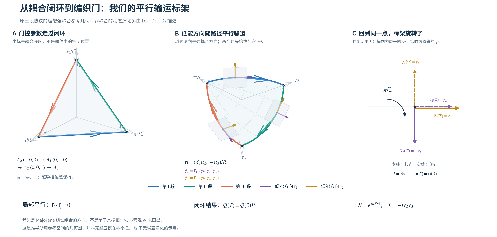
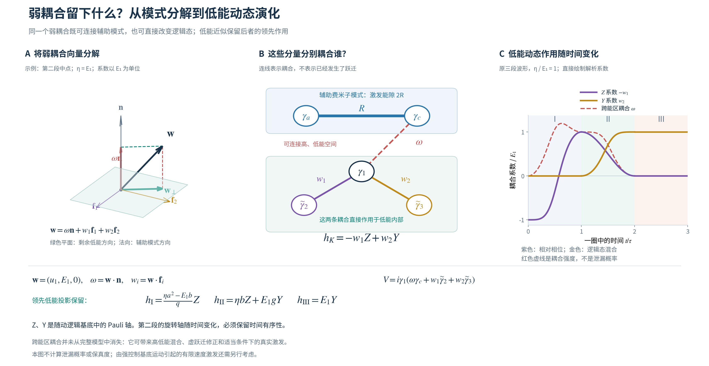

# 平行输运标架图：读图与符号



[汇报用 PDF](parallel_transport_frame.pdf) · [矢量 SVG](parallel_transport_frame.svg) · [绘图代码](../../code/plot_parallel_transport_frame.py)

这张图根据当前 PRB 111 三段协议的显式几何公式绘制，不是动力学模拟。它展示的是我们低能约化采用的理想强耦合参考空间；非零 $E_1,t_1$ 在该空间内的领先动态演化另由 $D_1,D_2,D_3$ 描述，完整五模的投影修正和泄漏没有在图中画出。

## 三个面板分别表示什么？

**A：实际控制路径。** 坐标是 $(d,u_2,u_3)/C$，按 $A_0\to A_1\to A_2\to A_0$ 变化。因为原余弦脉冲满足 $a+b=1$，每段在这三个控制坐标中是直线；沿线的速度随时间变化。$u_1=(\eta/C)u_2$ 始终联动，两根纳米线的超导相位差保持 $\pi$。它不是 Majorana 在器件中的实空间轨迹。

**B：归一化后的方向与标架。** 在 $(\gamma_b,\gamma_2,\gamma_3)$ 的系数空间中，定义

$$
\boldsymbol n=(d,u_2,-u_3)/R,\qquad
R=\sqrt{d^2+u_2^2+u_3^2},\qquad
\gamma_c=\boldsymbol n\cdot(\gamma_b,\gamma_2,\gamma_3).
$$

强耦合为 $H_0=iR\gamma_a\gamma_c$。与 $\boldsymbol n$ 正交的平面表示其余两个低能 Majorana 方向。紫色、金色箭头分别是平行输运的单位方向 $\boldsymbol f_1,\boldsymbol f_2$，对应

$$
\widetilde\gamma_2=\boldsymbol f_1\cdot(\gamma_b,\gamma_2,\gamma_3),\qquad
\widetilde\gamma_3=\boldsymbol f_2\cdot(\gamma_b,\gamma_2,\gamma_3).
$$

它们满足 $\boldsymbol f_i\cdot\boldsymbol n=0$、$\boldsymbol f_i\cdot\boldsymbol f_j=\delta_{ij}$，沿每段还满足 $\boldsymbol f_i\cdot\dot{\boldsymbol f}_j=0$。这表示局部没有额外的切平面内旋转，而不要求三维空间中的箭头方向保持不变。

当前波形下的显式标架为：

| 段 | $\boldsymbol n$ | 紫色 $\boldsymbol f_1$ | 金色 $\boldsymbol f_2$ |
|---|---|---|---|
| I | $(b,a,0)/q$ | $(-a,b,0)/q$ | $(0,0,1)$ |
| II | $(0,b,-a)/q$ | $(-1,0,0)$ | $(0,a,b)/q$ |
| III | $(a,0,-b)/q$ | $(-b,0,-a)/q$ | $(0,1,0)$ |

这里 $a=(1-\cos\pi s)/2,b=1-a,q=\sqrt{a^2+b^2}$，各段 $s\in[0,1]$。各段端点处标架连续。球面路径包围有向立体角 $-\pi/2$。

**C：在同一个起终点平面上比较。** $T=3\tau$ 时，强耦合方向回到原来的 $\gamma_b$，但两个随动方向为

$$
\widetilde\gamma_2(0)=\gamma_2,\quad
\widetilde\gamma_3(0)=\gamma_3;\qquad
\widetilde\gamma_2(T)=-\gamma_3,\quad
\widetilde\gamma_3(T)=\gamma_2.
$$

图中横轴取原来的 $+\gamma_2$，纵轴取原来的 $+\gamma_3$，所以标架净转动为 $-\pi/2$。虚线是起点，实线是终点。

## 怎样对应到两列逻辑基底 $\mathcal Q(t)$？

图中的两根箭头是 Majorana 算符的系数方向，不是两列多体波函数。加入未画出的 $\gamma_1$ 和旁观 $\gamma_4$，并固定辅助模式低能占据和总宇称后，这些方向可以构造两列逻辑基底 $\mathcal Q(t)$。其闭环关系为

$$
\mathcal Q(T)=\mathcal Q(0)B,\qquad
B=e^{i\pi X/4},\quad X=-i\gamma_2\gamma_3.
$$

箭头画的是主动输运的模式，即 $B\gamma_2B^\dagger=-\gamma_3$、$B\gamma_3B^\dagger=\gamma_2$；若写 Heisenberg 算符演化 $B^\dagger\gamma B$，则是逆变换，得到通常的 $\gamma_2\to\gamma_3,\gamma_3\to-\gamma_2$。这是同一门的两种约定。

2008.pdf 同样通过控制参数闭环研究几何输运。这里的具体三段路径和箭头由我们当前模型推导，并非直接复制其路径或基底；其理想方案的计算空间保持简并，我们则还需保留非平凡动态因子 $D_3D_2D_1$。

从项目根目录重新生成：

```bash
.venv/bin/python read/code/plot_parallel_transport_frame.py
```

## 弱耦合怎样作用于剩余自由度？



[汇报用 PDF](weak_coupling_projection.pdf) · [矢量 SVG](weak_coupling_projection.svg) · [绘图代码](../../code/plot_weak_coupling_projection.py)

这张配套图解释前一张几何图没有画出的弱耦合。取 $e=E_1$、$\eta=|t_1|_{\max}$，原弱项为

$$
V=i\gamma_1(u_1\gamma_b+e\gamma_2)
  =i\gamma_1\boldsymbol w\cdot\boldsymbol\Gamma,
\qquad \boldsymbol w=(u_1,e,0),\quad
\boldsymbol\Gamma=(\gamma_b,\gamma_2,\gamma_3).
$$

**A：把同一个弱耦合分解到三个随动方向。** 由正交标架 $\{\boldsymbol f_1,\boldsymbol f_2,\boldsymbol n\}$ 得到

$$
\boldsymbol w=\omega\boldsymbol n+w_1\boldsymbol f_1+w_2\boldsymbol f_2,
\qquad \omega=\boldsymbol w\cdot\boldsymbol n,\quad
w_i=\boldsymbol w\cdot\boldsymbol f_i.
$$

绿色平面内的 $\boldsymbol w_\perp=w_1\boldsymbol f_1+w_2\boldsymbol f_2$ 对应剩余低能方向，红色法向分量对应 $\gamma_c$。图示为第二段中点，$\eta=e$，此时 $(w_1,w_2,\omega)/e=(-1/2,1/\sqrt2,1/\sqrt2)$。平面是 Majorana 算符的系数空间，不直接是两个逻辑态的波函数空间。

**B：这些分量分别连接哪些模式。** 将上述分解代回，得到精确的瞬时恒等式

$$
\boxed{V=
\underbrace{i\omega\gamma_1\gamma_c}_{V_{\rm off}}
+\underbrace{i\gamma_1(w_1\widetilde\gamma_2+w_2\widetilde\gamma_3)}_{V_{\rm in}}.}
$$

蓝色粗线 $iR\gamma_a\gamma_c$ 确定辅助模式的能隙 $2R$。红色虚线 $V_{\rm off}$ 改变该辅助模式的占据，连接高、低能空间。紫色、金色连线 $V_{\rm in}$ 保持辅助占据，直接作用于剩余模式。旁观的 $\gamma_4$ 未画出；固定总宇称和辅助低能占据后，剩余模式构成二维逻辑空间。

令 $P_0=(1-i\gamma_a\gamma_c)/2$ 是强耦合参考模型的低能投影。由于 $V_{\rm off}$ 与 $i\gamma_a\gamma_c$ 反对易，而 $V_{\rm in}$ 与之对易，

$$
P_0V_{\rm off}P_0=0,\qquad
P_0VP_0=P_0V_{\rm in}P_0.
$$

在平行输运的逻辑基底中，取 $Z\leftrightarrow-i\gamma_1\widetilde\gamma_2$、$Y\leftrightarrow-i\widetilde\gamma_3\gamma_1$，去掉共同能量便得到

$$
\boxed{h_K=-w_1Z+w_2Y.}
$$

$Z$ 项单独作用会使两个逻辑基态积累不同相位；$Y$ 项单独作用会混合这两个态。两种作用都不要求激发辅助模式。投影将跨能区项的直接作用排除在领先模型外，并不声称该项在完整模型中消失；它还可产生高低能混合、虚跃迁修正，以及适当条件下的真实激发。

**C：三段中各作用怎样变化。** 原联动控制为 $u_1=(\eta/C)u_2$。利用上文的标架，直接得到

| 段 | 跨能区系数 $\omega$ | 低能 $Z$ 系数 $-w_1$ | 低能 $Y$ 系数 $w_2$ |
|---|---|---|---|
| I | $(\eta ab+ea)/q$ | $(\eta a^2-eb)/q$ | $0$ |
| II | $eb/q$ | $\eta b$ | $ea/q$ |
| III | $0$ | $0$ | $e$ |

曲线使用 $\eta/e=1$，以 $e$ 归一化，仅绘制这张表中的显式函数。其中 $g=a/q$，因此立刻还原汇报中的

$$
h_{\rm I}=\frac{\eta a^2-eb}{q}Z,\qquad
h_{\rm II}=\eta bZ+egY,\qquad
h_{\rm III}=eY.
$$

第一段只绕逻辑 $Z$ 轴旋转，第三段只绕 $Y$ 轴旋转；第二段同时有两个方向，且它们的比例随时间改变，所以不同时刻的哈密顿量一般不对易。这正是解析延拓级数所求解的第二段动态传播。

起点的低能项为 $-eZ$，终点为 $eY$，并不表示物理控制没有闭合：这是在发生了 holonomy 的移动标架中写出的分量。将终点标架换回起点，才得到共同基底中的 $U_{\rm cyc}=BD_3D_2D_1$。

本图没有计算保真度或泄漏概率。尤其 $\omega=0$ 只表示这一弱耦合通道为零，不能排除强控制基底运动引起的有限速度激发。低能动力学的近似有效性仍需弱耦合相对能隙足够小、控制相对辅助能隙足够慢。

从项目根目录重新生成：

```bash
PYTHONDONTWRITEBYTECODE=1 .venv/bin/python read/code/plot_weak_coupling_projection.py
```
