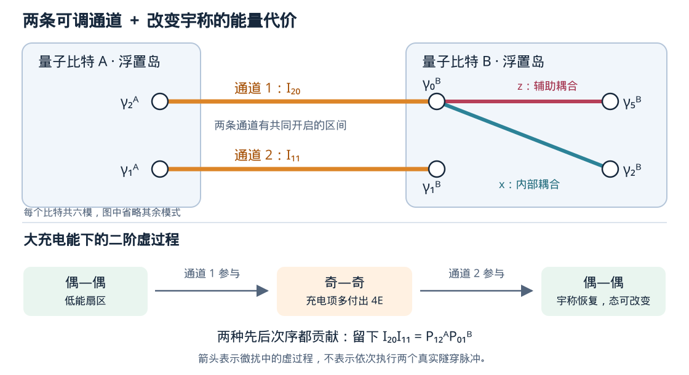

# Majorana 量子比特 CNOT 门的几何实现

A. Calzona, N. P. Bauer, B. Trauzettel, *Holonomic implementation of CNOT gate on topological Majorana qubits*, SciPost Physics Core **3**, 014 (2020)。

[论文原文](../../arts/2008.pdf) · [期刊 DOI](https://doi.org/10.21468/SciPostPhysCore.3.2.014)

[Beamer 幻灯片源文件](2008/slides/main.tex) · [Overleaf 上传包](2008/2008_cnot_overleaf.zip) · [编译说明](2008/slides/README.md)

## 一、研究背景与动机

Majorana 拓扑量子计算利用空间分离的零模编码信息，希望降低局域扰动对量子态的影响。交换同一个量子比特内部的 Majorana，可以实现一部分受保护的单比特门。但量子计算还需要不同量子比特之间的纠缠操作，例如 CNOT。

这一要求在 Majorana 系统中并不容易满足。本文采用每个量子比特分别固定费米子宇称的编码，直接跨比特交换 Majorana，可能改变各自的宇称，使系统离开原来的计算空间。因此，能够实现单比特编织，并不意味着能够直接实现保持编码的两比特纠缠门。

已有方案通过联合宇称测量完成两比特门，但需要可靠的多 Majorana 宇称读出。本文提出另一条路线：**通过连续调节耦合，使系统沿闭合参数路径绝热演化，利用几何相位产生纠缠，避免在门执行过程中进行联合宇称投影测量。**

这是一项理论与数值模拟研究，研究对象是有效模型中的门操作方案，尚未涉及实际器件中的 CNOT 实验。

## 二、研究创新

通过调节耦合实现 Majorana 编织，已有 van Heck 等人的研究作为基础；利用测量实现量子门，也已有相应的浮置岛架构。本文进一步研究了两个独立编码量子比特之间的几何纠缠操作。

作者提出两个相互关联的方案。第一个方案直接引入四 Majorana 相互作用，让控制比特的状态决定目标比特获得的几何相位。第二个方案利用**两条可调隧穿通道与有限充电能**实现相同的目标，降低了直接控制四模相互作用的要求。

本文的具体贡献是两比特操作协议及其鲁棒性分析。几何门本身，以及绝热相互作用与投影操作之间的联系，已有前期研究；这里的推进在于明确构造了纠缠门，并检查了有限操作时间、寄生耦合(parasitic couplings)和控制通道不对称的影响。

## 三、模型与两种操作方案

### 3.1 Majorana 编码与几何演化

每个量子比特包含六个 Majorana：四个用于编码，两个提供辅助耦合。四个编码模式组成两个普通费米子，在偶宇称扇区选取

$$
|0\rangle_{\rm L}=|00\rangle,\qquad
|1\rangle_{\rm L}=|11\rangle.
$$

两个逻辑态具有相同的总宇称，但内部占据不同。因此，固定偶宇称仍然保留一个二维逻辑空间。

一对 Majorana 的宇称算符为 $P_{jk}=i\gamma_j\gamma_k$。单比特操作使用三个可调耦合：

$$
H=-\chi_xP_{02}-\chi_yP_{01}-\chi_zP_{05}.
$$

空闲时只有辅助耦合 $\chi_z=\Theta>0$，使辅助对保持低能状态，其余四个模式用于编码。

红色连接表示辅助耦合，蓝色和黄色连接在操作过程中开启。右图中的闭环位于耦合参数空间，表示三个耦合的变化过程。

沿闭环演化后，哈密顿量回到起点，量子态却可以获得几何相位。由于逻辑态保持简并，它们的动力学相位相同，不影响相对逻辑操作；不同的几何相位则形成量子门。同时，基态与激发态之间需要保持能隙，演化速度也必须足够慢，以抑制非绝热跃迁。

### 3.2 从四 Majorana 相互作用构造 CNOT

构造分为两步：先用四模耦合与绝热闭环产生条件几何相位，再组合单比特门，将它转换成控制比特决定目标比特是否翻转的 CNOT。

设两个量子比特为 $A,B$。作者将目标比特 $B$ 的一条耦合乘上控制比特 $A$ 的宇称算符，得到

$$
H^{4\gamma}
=-\chi_xP_{02}^{B}
-\chi_yP_{12}^{A}P_{01}^{B}
-\chi_zP_{05}^{B}.
$$

其中 $P_{12}^{A}P_{01}^{B}$ 同时包含四个 Majorana，在每个比特中各有两个，因此保持两个比特各自的总宇称。

当 $A$ 为逻辑 $0$ 时，$P_{12}^{A}=+1$；当 $A$ 为逻辑 $1$ 时，$P_{12}^{A}=-1$。这使目标比特的一条有效耦合随控制态反号，从而改变有效路径的方向及几何相位。当控制比特处于叠加态时，这种条件相位就可以产生纠缠。

四模算符提供的是条件耦合，实际的门由整个绝热闭环产生：逐步将主导耦合从 $z$ 转移到 $y$、再到 $x$，最后返回 $z$，相邻耦合交叠开启以保持能隙。对逻辑分支 $|nm\rangle$，其中 $n,m\in\{0,1\}$，论文所选闭环围住的立体角大小为 $\pi/2$，基态获得的几何相位为

$$
\phi_{nm}=(-1)^{n+m}\frac{\pi}{4}.
$$

因此，$|00\rangle,|11\rangle$ 获得 $+\pi/4$，$|01\rangle,|10\rangle$ 获得 $-\pi/4$。若用 $Z_A,Z_B$ 表示逻辑 Pauli 算符，这个闭环的几何操作就可写为

$$
U_{\rm geo}=\exp\!\left(i\frac{\pi}{4}Z_AZ_B\right),
\qquad Z_AZ_B|nm\rangle=(-1)^{n+m}|nm\rangle.
$$

相位依赖于两个比特的联合状态，因此产生两比特纠缠。这里的 $Z_AZ_B$ 是**完成闭环后逻辑操作的生成元**；原始四模算符还涉及辅助模式，不能直接把它等同于计算空间中的 $Z_AZ_B$。

去掉共同相位 $+\pi/4$ 后，在基底 $\{|00\rangle,|01\rangle,|10\rangle,|11\rangle\}$ 中得到

$$
U_{\rm ent}=\operatorname{diag}(1,-i,-i,1).
$$

它将乘积态 $|++\rangle$ 变为

$$
|\psi_{\rm ent}\rangle
=\frac{|00\rangle-i|01\rangle-i|10\rangle+|11\rangle}{2},
$$

这是一个最大纠缠态。将这个几何纠缠门转换为 CNOT，只需要再组合单比特门。

首先，在两个比特上分别施加相位门 $S=\operatorname{diag}(1,i)$，有

$$
(S\otimes S)U_{\rm ent}
=\operatorname{diag}(1,i,i,-1)
\operatorname{diag}(1,-i,-i,1)
=\operatorname{diag}(1,1,1,-1)=CZ.
$$

单比特相位修正消去了 $|01\rangle,|10\rangle$ 上的 $-i$，仅在 $|11\rangle$ 上留下负号，这就是受控 $Z$ 门。

随后，在整个 $CZ$ 操作前后，分别对目标比特 $B$ 施加 Hadamard 门 $H_{\rm Had}$。因为 $H_{\rm Had}ZH_{\rm Had}=X$，条件相位翻转就变成条件比特翻转：

$$
\boxed{
CNOT_{A\to B}
=(I\otimes H_{\rm Had})(S\otimes S)
U_{\rm ent}(I\otimes H_{\rm Had}).
}
$$

右侧操作先执行，即先对 $B$ 做 Hadamard，再执行几何闭环，然后对两个比特做 $S$，最后对 $B$ 再做 Hadamard。最终实现 $|a,b\rangle\mapsto|a,b\oplus a\rangle$：控制比特 $A=0$ 时保持 $B$，$A=1$ 时翻转 $B$。上述单比特门属于 Majorana 编织可实现的 Clifford 操作。

该方案揭示了纠缠产生的机制，但直接调节四 Majorana 相互作用存在实现难度。因此，作者进一步提出双隧穿方案。

### 3.3 双隧穿方案

双隧穿方案用两条跨岛通道替代直接四模作用。两条通道分别为

$$
I_{20}=i\gamma_2^A\gamma_0^B,\qquad
I_{11}=i\gamma_1^A\gamma_1^B.
$$

第一条连接 $A$ 的模式 $\gamma_2$ 与 $B$ 的辅助模式 $\gamma_0$；第二条连接两个比特的模式 $\gamma_1$。同时，引入充电项

$$
H_E=-E(P^A+P^B),\qquad E>0,
$$

其中 $P^A,P^B$ 是各比特的总宇称。它使“奇—奇”扇区比“偶—偶”扇区高 $4E$。充电项的意义，是给“离开原来宇称扇区”设置能量代价，使两条普通隧穿通道能够产生所需的有效四模作用。这一能量代价可以由浮置超导岛的充电效应提供。

在充电能较大的极限，一次跨岛电子隧穿会同时翻转两个岛的宇称，使系统从“偶—偶”进入能量较高的“奇—奇”扇区，因此受到抑制。但高能扇区仍可作为虚中间态，参与低能演化的二阶过程。

如果另一次隧穿经过另一条通道，每个岛的宇称再次翻转，系统便返回“偶—偶”扇区。**宇称恢复并不意味着逻辑态完全不变。** 两条通道的组合在低能空间内留下的算符为

$$
\boxed{I_{20}I_{11}=P_{12}^{A}P_{01}^{B}.}
$$

它恰好就是第一个方案需要的四模相互作用。两种先后次序都会贡献；同一条通道往返则只给出共同能量修正。在大 $E$ 近似下，有效四模项为

$$
H_{\rm eff}^{(2)}
\supset-\frac{\chi_y^2}{2E}P_{12}^{A}P_{01}^{B}.
$$

这里的“两次隧穿”是二阶虚过程。控制操作让两条通道有共同开启的区间，使它们协同参与演化，而不是依次执行两个真实电子跳跃。

完整的双隧穿哈密顿量为

$$
H^{\rm dt}
=H_E-\chi_xP_{02}^{B}
-\chi_y(I_{20}+I_{11})
-\chi_zP_{05}^{B}.
$$

两条通道提供纠缠所需的作用，$\chi_x,\chi_z$ 则与它们共同构成几何闭环。因此，单纯打开隧穿并等待并不等于完成几何门；最终操作还取决于整个闭环过程。

大充电能下的微扰图像解释了两个方案的联系。作者进一步保留完整模型，证明在有限正 $E$ 下，沿指定路径绝热演化仍可得到同一纠缠门。此时各岛宇称在过程中并非严格不变，瞬时基态可以混入“奇—奇”成分；受到保护的是简并基态子空间，闭环结束、隧穿关闭后再回到原计算空间。

## 四、控制方法与数值验证

协议从仅开启辅助耦合开始。用 $z$ 表示辅助耦合，$x$ 表示目标比特内部耦合，$y$ 表示两条跨岛通道，开启组合依次变化为

$$
z\ \to\ z+y\ \to\ y\ \to\ y+x\ \to\ x\ \to\ x+z\ \to\ z.
$$

每次先开启新耦合，再关闭旧耦合，最终恢复初始设置。作者采用平滑余弦函数控制开关，一个闭环分为六段，总时长为 $T$。

作者通过瞬时能谱计算检查基态简并与能隙，通过几何相位计算确定门矩阵，并使用 QuTiP 求解有限时间演化。数值输入选为 $|++\rangle$，将演化终态与理想纠缠态比较，定义

$$
F_\psi(T)=|\langle\psi_{\rm ent}|\psi(T)\rangle|^2.
$$

这一指标衡量指定输入态的输出准确程度。原文展示的是有效模型的计算结果，并非器件实验或平均门保真度测量。

## 五、主要结果与物理解释

### 5.1 Fig. 3(b)：为什么可以在基态空间内完成绝热操作

右侧 Fig. 3(b) 是沿控制闭环逐时刻对角化哈密顿量得到的**瞬时能谱**。横轴 $t$ 从 $\tau_0$ 到 $\tau_6$，对应六段控制过程；纵轴是以耦合尺度为单位的能量。图中只画出了负能量部分，曲线表示能级随参数的变化，不表示电子的运动轨迹或某个态的占据概率。

最下面的蓝色曲线是基态能量，包含四个重合的逻辑分支。它们在整个闭环中保持简并，因此积累相同的动力学相位。其他曲线代表相对于基态的激发能级；即使其能量数值为负，也仍然可以是激发态。图注中的“四重简并”指一条能级分支背后有四个态，并非四个逻辑态分别对应四条不同颜色的曲线。

关键是最低曲线与最近激发能级之间始终有非零间隔，即

$$
\Delta(t)=E_{\rm first\ excited}(t)-E_{\rm ground}(t)>0.
$$

足够慢的控制因此可以使系统留在四维基态子空间。上方激发能级之间虽有交叉，但它们没有与最低基态曲线相交，所以不代表计算空间与激发态之间的能隙关闭。

**这张图检验的是“基态简并与有限能隙”。** 它支持绝热操作，却不能单独确定操作是否为 CNOT；具体的门矩阵还需要计算几何相位，再组合单比特门。

### 5.2 Fig. 4：有限时间误差与充电能的折中

**操作时间决定非绝热误差。** 左图横轴为总操作时长，纵轴为态保真度。短时间下，系统发生基态与激发态之间的跃迁，多个跃迁过程的干涉使保真度出现振荡。随着操作时间增加，非绝热影响减弱，保真度趋近于一。

**平滑脉冲加快误差下降。** 左图插图比较了余弦与线性开关。余弦脉冲的误差渐近约按 $T^{-4}$ 衰减，线性开关约按 $T^{-2}$ 衰减。原因是余弦脉冲在段端的变化速度为零，减少了切换产生的非绝热激发。

**充电能存在折中。** 右图纵轴表示将所考察误差压到 $10^{-3}$ 以下需要的操作时长。$E$ 太小时，相关能隙变小；$E$ 太大时，有效协同隧穿强度 $\chi_y^2/(2E)$ 又会减弱，使操作变慢。因此，充电能与控制耦合同量级时通常更有利，而不是充电能越大越好。

**协议允许一定控制偏差。** 左图橙线加入了原文指定的寄生耦合，绝热极限下仍趋近目标结果。作者还考察了两条通道幅度分别为 $1.2\Theta$ 和 $0.8\Theta$ 的不对称情况，仍能在足够慢的演化下完成目标操作。这说明两条控制通道不必严格匹配，但保护范围受路径、能隙和扰动类型限制，并不覆盖任意噪声。

本文把两比特纠缠门的构造转化为条件几何相位的控制，并用双隧穿与充电能提供了具体实现机制。解析推导确定了门的形式，数值结果说明了有限时间与控制误差的影响。这为 Majorana 两比特操作提供了一条无需途中联合宇称测量的路线，其器件实现仍需进一步验证。

## 六、附录 A、B 的作用

**附录 A：几何相位的解析依据。** 作者利用守恒宇称将大哈密顿量分块。四模协议的每个相关分支对应一个 $2\times2$ 矩阵，求出基态后即可计算 Berry 联络与曲率，再沿闭环积分得到几何相位。双隧穿协议允许偶—偶与奇—奇成分混合，因此每个相关块变为 $4\times4$。此时 Berry 曲率不再具有四模协议的完整球对称性，但沿指定闭环积分仍得到同一个 $U_{\rm ent}$。这部分给出有限充电能下两种方案产生相同门的解析依据，不仅依赖大 $E$ 的微扰解释。

**附录 B：放宽两条通道完全一致的假设。** 正文令两条隧穿通道共用 $\chi_y(t)$；附录改为独立的 $\chi_{y_1}(t)$、$\chi_{y_2}(t)$，允许幅度和开关时间不同，并设计八段闭合控制路径。Fig. 6 显示在所考察的不对称协议下，基态简并与能隙仍保持，足够慢时仍实现同一纠缠门。这说明两条通道不必严格匹配，但仍须满足协议的配合开启与闭环条件。

---

参考文献编号沿用原论文：

- [31] B. van Heck 等，[Coulomb-assisted braiding of Majorana fermions in a Josephson junction array](https://arxiv.org/abs/1111.6001)，New J. Phys. **14**, 035019 (2012)。
- [34] P. Bonderson，[Measurement-only topological quantum computation via tunable interactions](https://arxiv.org/abs/1210.7929)，Phys. Rev. B **87**, 035113 (2013)。
- [35] T. Karzig 等，[Scalable designs for quasiparticle-poisoning-protected topological quantum computation with Majorana zero modes](https://arxiv.org/abs/1610.05289)，Phys. Rev. B **95**, 235305 (2017)。
