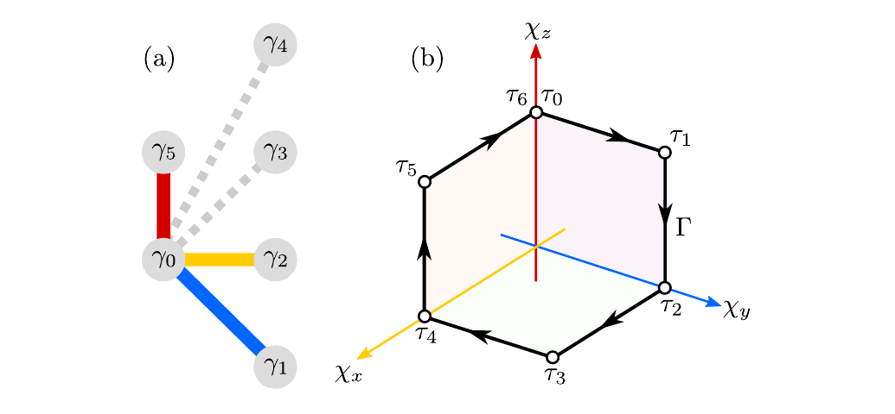
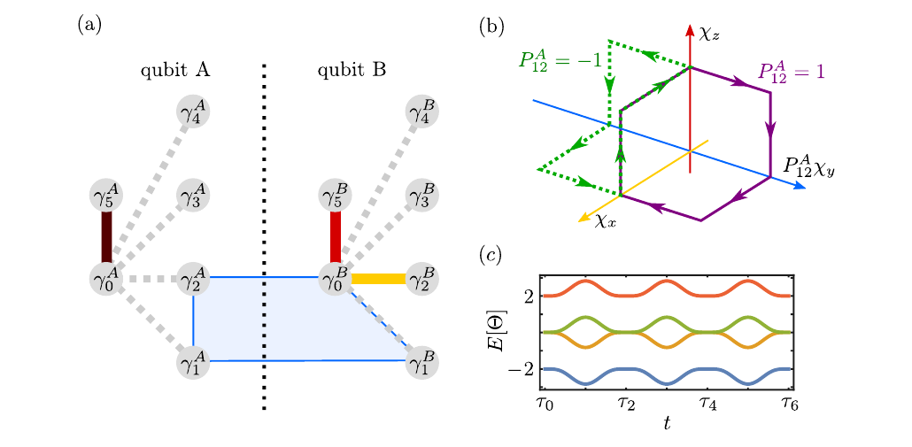
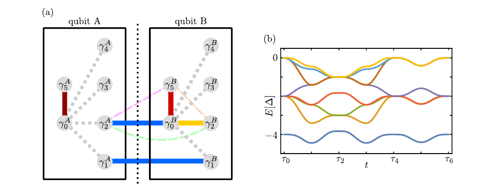
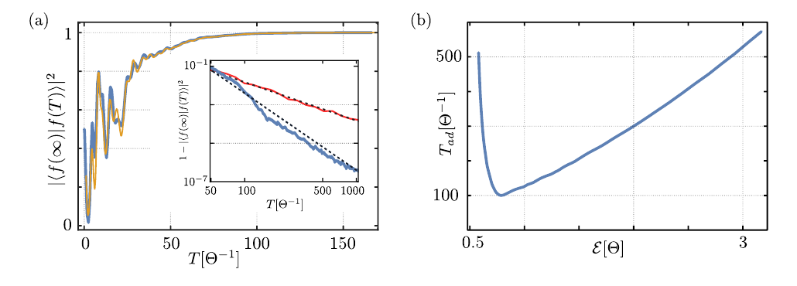
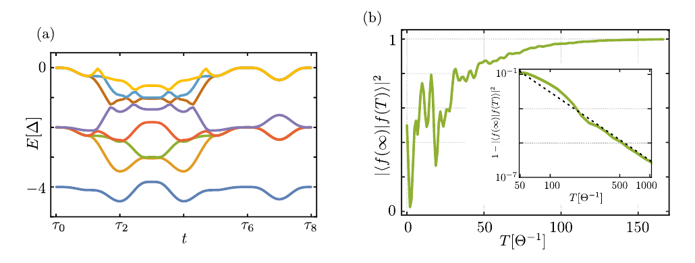

# 组会文献解读：拓扑 Majorana 量子比特上的 holonomic CNOT 门

论文：A. Calzona, N. P. Bauer, B. Trauzettel, **Holonomic implementation of CNOT gate on topological Majorana qubits**，arXiv:2008.05181v2；SciPost Phys. Core **3**, 014 (2020)。

阅读对象：[本地 PDF](../../arts/2008.pdf)。下文公式编号指本地 PDF 中的编号；文中另行展开的计算会标为“补充推导”。建议按 **35–45 分钟组会**准备：背景约 5 分钟，编码与几何门约 8 分钟，两种纠缠协议约 15 分钟，结果与讨论约 10 分钟。

## 1. 先用一分钟讲清楚这篇论文做了什么

Majorana 零模的编织可以实现受保护的单量子比特门，但在论文采用的、不同量子比特分别固定宇称的编码中，**仅靠编织不能实现保持计算空间的两比特纠缠门**。已有路线通常通过测量联合宇称实现 CNOT，实验上需要高保真测量。

本文提出另一条路线：缓慢调节几个 Majorana 耦合，让系统沿参数空间中的闭合路径演化，在四维简并基态空间中积累几何相位，直接得到纠缠门

$$
U_{\mathrm{ent}}=\operatorname{diag}(1,-i,-i,1).
$$

再配合单比特 Clifford 门，就得到 CNOT。作者先提出便于理解的四 Majorana 相互作用方案，再提出更接近器件实现的“双隧穿 + 充电能”方案。

**组会的核心问题可以表述为：怎样把一个单比特的几何编织，推广为由另一个量子比特控制的几何演化，同时避免破坏量子比特编码？**

## 2. 研究动机：困难究竟在哪里？

### 2.1 为什么要研究 Majorana 量子比特？

Majorana 零能模可以用空间分离的自由度共同编码信息。只要零模之间的非期望重叠足够小，局域扰动就不容易区分不同逻辑态；交换这些零模所产生的操作，还可以主要取决于交换路径的拓扑性质。

这是拓扑量子计算希望获得的硬件层面保护。这里讨论的是论文假设存在理想 Majorana 零模之后的门设计，不是在论证某一实验信号是否足以证明 Majorana 零模。

### 2.2 为什么单比特编织还不够？

量子计算需要能够纠缠不同量子比特的门。虽然 CNOT 本身是 Clifford 门，但“Majorana 编织能做单比特 Clifford 门”不意味着它也能在独立编码的量子比特之间实现 CNOT。

问题来自编码约束：每个量子比特都要求固定的总费米子宇称。把一个量子比特中的 Majorana 与另一个量子比特中的 Majorana 直接交换，通常会把态带出原来的编码空间。原文将这一限制联系到 Ising 任意子的 non-entangling rule。

### 2.3 为什么提出 holonomic 路线？

已有的联合宇称测量方案可以实现纠缠门，但需要可靠的测量和相应控制。本文希望用**连续调节耦合的绝热演化**完成纠缠操作，避免在门操作过程中执行投影宇称测量。

Holonomic quantum computation 的基本资源是：**简并子空间沿闭合参数路径演化后产生的几何幺正变换**。这使作者能沿用单比特编织的几何框架，同时引入超出简单编织的相互作用。

> 开场时可以这样说：“本文关心的缺口是，独立编码的 Majorana 量子比特之间缺少一个无需联合宇称测量、又具有参数鲁棒性的纠缠操作。”

## 3. 模型：从 Majorana 算符到六模量子比特

### 3.1 两个 Majorana 对应一个普通费米子

Majorana 算符满足原文式 (1)：

$$
\gamma_j^\dagger=\gamma_j,\qquad
\{\gamma_j,\gamma_k\}=2\delta_{jk}.
$$

按照本文的约定，定义

$$
f_{jk}=\frac{\gamma_j-i\gamma_k}{2},\qquad
P_{jk}=i\gamma_j\gamma_k=1-2f_{jk}^\dagger f_{jk}.
$$

所以空态 $|0_{jk}\rangle$ 的宇称为 $+1$，占据态 $|1_{jk}\rangle$ 的宇称为 $-1$。$P_{jk}$ 既是宇称算符，也是可出现在哈密顿量中的双 Majorana 耦合算符。

### 3.2 为什么一个逻辑比特需要四个零模？

两个 Majorana 虽然有两个占据态，但它们的总宇称不同。如果系统总宇称固定，不能直接把这两个态作为一个可任意叠加的量子比特。

四个 Majorana 可以组成两个费米子。在偶宇称扇区中，保留

$$
|\widetilde 0\rangle=|0_{12}0_{34}\rangle,\qquad
|\widetilde 1\rangle=|1_{12}1_{34}\rangle.
$$

两个逻辑态都具有偶总宇称，但内部的占据方式不同。这就是本文的基本编码。

### 3.3 为什么再加两个辅助 Majorana？

仅有四个完全解耦的零模时，没有可用来实施本文几何路径的耦合参数。作者增加 $\gamma_0,\gamma_5$，构成“五臂星形”结构：

$$
H=-\sum_{j=1}^{5}c_jP_{0j}. \tag{原文 5}
$$

在空闲态，仅有 $c_5=\Theta>0$：

$$
H_{\rm idle}=-\Theta P_{05}.
$$

辅助对选择 $P_{05}=+1$ 的低能态，留下 $\gamma_{1,2,3,4}$ 编码信息。因此

$$
\begin{aligned}
|0\rangle&=|0_{12}0_{34}0_{05}\rangle,\\
|1\rangle&=|1_{12}1_{34}0_{05}\rangle.
\end{aligned}
$$

它们的能量相同，与相应激发态相差 $2\Theta$。

**看图要点：**左图红色耦合把辅助对锁在低能态，蓝色、黄色耦合在操作时依次参与；右图画的是耦合参数的轨迹，不是 Majorana 在真实空间中的运动。

**补充推导：能隙从哪里来？** 不同的 $P_{0j}$ 反对易，且 $P_{0j}^2=1$，所以

$$
H^2=\left(\sum_jc_j^2\right)I.
$$

于是能量为 $\pm\sqrt{\sum_jc_j^2}$。只要耦合向量不经过原点，就保留有限能隙。论文采用的路径始终至多有两个耦合非零；这一设计还使几何路径被限制在坐标面上，为后面的鲁棒性提供条件。

## 4. 先理解单比特：耦合控制为什么等价于编织？

### 4.1 三个控制参数与六段闭环

要有效交换 $\gamma_1,\gamma_2$，作者考虑

$$
H_{1\leftrightarrow2}(t)
=-\chi_x(t)P_{02}-\chi_y(t)P_{01}-\chi_z(t)P_{05}.
\tag{原文 7}
$$

三个参数沿下表运动，最后回到初始哈密顿量：

| 时刻 | $\chi_x$ | $\chi_y$ | $\chi_z$ | 操作 |
|---|---:|---:|---:|---|
| $\tau_0$ | $0$ | $0$ | $\Theta$ | 从辅助对耦合出发 |
| $\tau_1$ | $0$ | $\Theta_y$ | $\Theta$ | 打开 $y$ 耦合 |
| $\tau_2$ | $0$ | $\Theta_y$ | $0$ | 关闭 $z$ 耦合 |
| $\tau_3$ | $\Theta_x$ | $\Theta_y$ | $0$ | 打开 $x$ 耦合 |
| $\tau_4$ | $\Theta_x$ | $0$ | $0$ | 关闭 $y$ 耦合 |
| $\tau_5$ | $\Theta_x$ | $0$ | $\Theta$ | 打开 $z$ 耦合 |
| $\tau_6=T$ | $0$ | $0$ | $\Theta$ | 关闭 $x$，回到空闲态 |

每段只改变一个参数，论文使用平滑插值

$$
g(l)=\frac{1-\cos(\pi l)}2,\qquad 0\leq l\leq1.
$$

将耦合向量归一化后，路径大致是球面上的 $+z\to+y\to+x\to+z$，围住第一卦限的一个球面三角形，立体角的大小为 $\pi/2$。

### 4.2 简并为什么重要？

对瞬时简并基态 $|\psi_a(\boldsymbol\chi)\rangle$，绝热演化可写成

$$
U(T)=e^{-\frac{i}{\hbar}\int_0^T E_g(t)\,dt}
\mathcal P\exp\left(i\oint_\Gamma\mathcal A\cdot d\boldsymbol\chi\right),
$$

其中

$$
\mathcal A_{ab}=i\langle\psi_a|\nabla_{\boldsymbol\chi}\psi_b\rangle.
$$

因为不同逻辑态的能量始终相同，动力学相位是共同的整体相位。实际的逻辑操作由后面的几何矩阵决定。

如果简并被破坏，不同逻辑态会积累不同的动力学相位，门就会依赖演化时长和能量漂移。因此，后面每个方案都必须同时回答两个问题：**计算态是否保持简并？闭环产生什么几何相位？**

### 4.3 单比特门的结果与保护来源

在本文选定的方向下，闭环给出

$$
U_\Gamma\sim
\begin{pmatrix}1&0\\0&-i\end{pmatrix},
\tag{原文 9}
$$

这里 $\sim$ 表示忽略整体相位。它等价于一次 Majorana 编织产生的相位门；反向走闭环得到逆门。

**注意半角：**有效自旋 $1/2$ 的单个本征态获得的 Berry 相位大小是立体角的一半；两条逻辑分支的相对相位为 $\pi/2$。汇报时用相对相位解释式 (9)，可以避免原文正文关于“立体角”的简略表述造成混淆。

保护来自路径的特殊结构：若某个耦合可以被指数压低，路径就被高精度限制在坐标面上；在这些面内改变耦合幅度和路径形状，不改变所围的球面卦限。**一般的几何门仍会依赖路径形状，本文的鲁棒性还依赖坐标面约束。**

## 5. 两比特模型：直接跨比特编织为什么不行？

取两份上述结构，分别记为 $A,B$，共有十二个 Majorana。每个比特的总宇称为

$$
P^\alpha=P_{12}^\alpha P_{34}^\alpha P_{05}^\alpha,
\qquad \alpha=A,B.
$$

空闲时选择 $P^A=P^B=+1$，逻辑基底为

$$
\{|0_A0_B\rangle,|0_A1_B\rangle,
|1_A0_B\rangle,|1_A1_B\rangle\}.
$$

跨比特的单电子隧穿写成

$$
I_{jk}=i\gamma_j^A\gamma_k^B.
$$

它同时翻转两个比特各自的宇称：

$$
\{P^A,I_{jk}\}=\{P^B,I_{jk}\}=0,
\qquad [P^AP^B,I_{jk}]=0.
$$

因此它保持整体宇称，却可以把偶–偶态带到奇–奇态：

$$
(P^A,P^B)=(+,+)\longleftrightarrow(-,-).
$$

这正是“整体物理上允许，但离开原来逻辑编码”的泄漏。

**两条解决路线：**一种是直接构造分别保持两个局域宇称的四 Majorana 算符；另一种是用充电能惩罚单次隧穿，让双隧穿产生所需的有效相互作用。后文的两个协议分别对应这两条路线。

## 6. 第一种方案：四 Majorana 相互作用产生受控编织

### 6.1 哈密顿量及其物理意义

作者定义

$$
O^{4\gamma}=P_{12}^A P_{01}^B
=-\gamma_1^A\gamma_2^A\gamma_0^B\gamma_1^B
=I_{20}I_{11}.
\tag{原文 11}
$$

每个比特中都包含偶数个 Majorana，所以

$$
[O^{4\gamma},P^A]=[O^{4\gamma},P^B]=0.
$$

在单比特编织哈密顿量中，用这个算符替换 $P_{01}^B$：

$$
H^{4\gamma}(t)
=-\chi_xP_{02}^B-\chi_yP_{12}^AP_{01}^B-\chi_zP_{05}^B.
\tag{原文 12}
$$

$A$ 比特的辅助对保持在初始扇区，其不参与控制的能量项可作为共同常数省略。

在 $P_{12}^A=p_A=\pm1$ 的分支中，$B$ 看到的有效参数是

$$
(\chi_x,\chi_y,\chi_z)\mapsto
(\chi_x,p_A\chi_y,\chi_z).
$$

因此 $A$ 的逻辑态决定 $B$ 的有效编织方向：$p_A=+1$ 时沿一个方向，$p_A=-1$ 时方向相反。控制比特为叠加态时，两种相反方向的演化相干叠加，产生纠缠。

**讲图时先看 (b)：**两条路径的差别是控制比特把 $y$ 方向的符号翻转。再看 (a) 中需要实现的四模相互作用，最后用 (c) 说明演化过程中保留简并与能隙。

### 6.2 守恒量把问题化成四个二能级问题

整个过程中 $P_{34}^A,P_{34}^B$ 守恒，可以给态加上不变标签：

$$
\begin{aligned}
P_{34}^A|\psi_{nm}\rangle&=(-1)^n|\psi_{nm}\rangle,\\
P_{34}^B|\psi_{nm}\rangle&=(-1)^m|\psi_{nm}\rangle.
\end{aligned}
$$

不同标签之间不会发生跃迁。在相应固定宇称扇区中，哈密顿量化为原文附录 A.1 的式 (32)：

$$
H_{nm}^{4\gamma}
=\chi_x\sigma_y-(-1)^{n+m}\chi_y\sigma_x-\chi_z\sigma_z.
$$

这里的 $\sigma$ 是每个二能级块中的辅助 Pauli 矩阵，不应直接认作某个逻辑比特的 Pauli 矩阵。

令 $s=(-1)^{n+m}$，则有效磁场为

$$
\boldsymbol d_s=(-s\chi_y,\chi_x,-\chi_z).
$$

四个块的能量全部是

$$
E_\pm=\pm\sqrt{\chi_x^2+\chi_y^2+\chi_z^2},
$$

所以四个计算分支的基态始终简并，并与块内激发态隔开有限能隙。这也解释了为什么相对动力学相位不会污染门操作。

### 6.3 从 Berry 曲率推到纠缠门

对 $H=\boldsymbol d\cdot\boldsymbol\sigma$ 的基态，Berry 曲率具有自旋 $1/2$ 的单极子形式。将上面的 $\boldsymbol d_s$ 代入，得到

$$
\boldsymbol F_{nm}(\boldsymbol\chi)
=(-1)^{n+m+1}\frac{\boldsymbol\chi}{2|\boldsymbol\chi|^3}.
\tag{原文 16}
$$

**补充推导的关键一步：**从 $\boldsymbol\chi$ 到 $\boldsymbol d_s$ 的正交变换行列式是 $-s$，因此相同的径向单极子场在不同逻辑扇区中带相反符号。

几何相位为曲率通量：

$$
\phi_{nm}=\int_\Sigma\boldsymbol F_{nm}\cdot d\boldsymbol S.
$$

按照表中的走向 $+z\to+y\to+x\to+z$，相对于标准 $(x,y,z)$ 取向的有向立体角是 $-\pi/2$。因此

$$
\phi_{nm}=(-1)^{n+m}\frac\pi4.
$$

四个逻辑态获得的相位依次为

$$
\left(+\frac\pi4,-\frac\pi4,-\frac\pi4,+\frac\pi4\right).
$$

忽略共同相位 $e^{i\pi/4}$，最终得到

$$
\boxed{U_{\rm ent}=\operatorname{diag}(1,-i,-i,1).}
\tag{原文 18}
$$

用逻辑 Pauli 矩阵表示，这个结果也可以写为

$$
U_{\rm ent}\sim e^{i\frac\pi4Z_AZ_B}.
$$

这一步建立了全文最重要的链条：**控制比特翻转有效路径方向 → 不同联合宇称分支获得相反几何相位 → 得到 $ZZ$ 型纠缠门。**

### 6.4 怎么判断它确实产生最大纠缠？

让输入为 $|+\rangle_A|+\rangle_B$，得到

$$
|\Psi_f\rangle
=\frac{|00\rangle-i|01\rangle-i|10\rangle+|11\rangle}{2}.
\tag{原文 19}
$$

对 $B$ 求偏迹，有 $\rho_A=I/2$，所以这是最大纠缠纯态。注意：最大纠缠态不一定在当前计算基底中呈现为仅含两项的 Bell 态。

也可检查一个对角门的非局域相位：

$$
\phi_{00}-\phi_{01}-\phi_{10}+\phi_{11}=\pi\pmod{2\pi}.
$$

单比特相位的乘积无法产生这个组合，所以该门不能分解为两个单比特相位门。

原文还给出 entangling power 为 $2/9$。这是对输入乘积态平均后的纠缠能力指标，不是门保真度或成功概率。

### 6.5 如何得到 CNOT？注意相位门约定

如果采用常用约定

$$
S=\operatorname{diag}(1,i),
$$

直接相乘可得

$$
CZ=(S\otimes S)U_{\rm ent},
$$

进而

$$
\boxed{\mathrm{CNOT}=(I\otimes H)(S\otimes S)U_{\rm ent}(I\otimes H).}
$$

矩阵乘法中最右边的门最先执行，$A$ 为控制比特、$B$ 为目标比特。

原文式 (20) 写成 $CZ=U_{\rm ent}^\dagger(S\otimes S)$；要使该式成立，相位门方向应取 $S=\operatorname{diag}(1,-i)$。汇报时明确自己的 $S$ 定义即可，避免混用两个约定。

### 6.6 第一种方案留下的问题

第一，四 Majorana 相互作用 $O^{4\gamma}$ 比普通双模耦合难以直接调节。第二，器件实现这一耦合时，可能同时产生额外隧穿或杂化项；这些项可能破坏局域宇称约束或劈裂计算态。

因此，这个方案建立了清楚的机制，但还需要一个更便于实现的物理版本。

## 7. 第二种方案：充电能辅助的双隧穿

### 7.1 引入充电能，惩罚局域宇称翻转

作者加入

$$
H_E=-E(P^A+P^B),\qquad E>0.
\tag{原文 23}
$$

在这一有效模型中，偶–偶扇区的充电能为 $-2E$，奇–奇扇区为 $+2E$，单次跨岛隧穿的中间态需要付出 $4E$ 的能量代价。

这种宇称能量代价可以由浮置超导岛的有限充电能提供。本文使用的是有效宇称模型，并未进一步建立某个具体器件的完整电路与电荷态模型。

现在把难以直接实现的乘积算符 $I_{20}I_{11}$ 换成两个普通隧穿通道的和：

$$
O^{2\gamma+2\gamma}=I_{20}+I_{11}.
$$

相应哈密顿量为

$$
\boxed{
H^{\rm dt}(t)=H_E-\chi_xP_{02}^B
-\chi_y(I_{20}+I_{11})-\chi_zP_{05}^B.
}
\tag{原文 26}
$$

仍让 $(\chi_x,\chi_y,\chi_z)$ 沿同一个六段闭环运动。

**讲图要点：**黑框表示每个岛的宇称能量约束；两条蓝线表示两条独立的隧穿通道。右图的基态分支沿路径保持简并，并与其他能级分离。

### 7.2 关键机制：两个单次隧穿组合成四模相互作用

因为 $I_{20}$ 与 $I_{11}$ 涉及四个不同的 Majorana，二者对易，且分别平方为单位算符。因此

$$
\begin{aligned}
(I_{20}+I_{11})^2
&=I_{20}^2+I_{11}^2+I_{20}I_{11}+I_{11}I_{20}\\
&=2+2I_{20}I_{11}\\
&=2+2O^{4\gamma}.
\end{aligned}
\tag{原文 25}
$$

物理图像是

$$
\text{偶–偶}\ \xrightarrow{\text{一次隧穿}}\
\text{奇–奇虚态}\ \xrightarrow{\text{另一次隧穿}}\
\text{偶–偶}.
$$

两次隧穿后，各个岛恢复原来的宇称，但留下一个取决于两比特状态的联合操作。

### 7.3 补充推导：二阶微扰给出有效四模耦合

在 $E$ 远大于其他能标时，令 $\Pi$ 投影到偶–偶子空间。考虑两条通道分别为 $\chi_{y1},\chi_{y2}$：

$$
V=-\chi_{y1}I_{11}-\chi_{y2}I_{20}.
$$

一次隧穿离开低能空间，所以 $\Pi V\Pi=0$；二阶有效项为

$$
H_{\rm eff}^{(2)}\simeq-\frac{1}{4E}\Pi V^2\Pi.
$$

于是

$$
H_{\rm eff}^{(2)}
=-\frac{\chi_{y1}^2+\chi_{y2}^2}{4E}\Pi
-\frac{\chi_{y1}\chi_{y2}}{2E}\Pi O^{4\gamma}\Pi.
$$

第一项是共同能量位移，第二项正是第一种方案需要的四模相互作用。两条通道相等时，有效耦合强度为

$$
\chi_y^{\rm eff}\simeq\frac{\chi_y^2}{2E}.
$$

这个计算解释了“双隧穿”的名称，也提前说明充电能不能无限增大：$E$ 太大时，有效纠缠耦合反而变弱，操作会变慢。

### 7.4 论文真正进一步得到的结论：有限 $E$ 也可以工作

二阶微扰只能解释大 $E$ 极限。原文进一步分析完整哈密顿量的四维块，计算沿闭环的 Berry 相位，发现只要 $E>0$、路径有隙并且演化足够绝热，最终仍然得到

$$
U_{\rm ent}=\operatorname{diag}(1,-i,-i,1).
$$

因此 $E\sim\Theta$ 时也能工作，不需要把充电能做得远大于所有耦合。有限 $E$ 下的 Berry 曲率不再是式 (16) 那样球对称的径向场，但这个特定闭环的 holonomy 保持相同。

**这里必须区分“宇称能量约束”和“局域宇称严格守恒”：**

$$
[H^{\rm dt},P^A]\ne0,\qquad [H^{\rm dt},P^B]\ne0.
$$

所以有限 $E$ 并未使两个岛的宇称成为严格守恒量。演化中的瞬时基态可以包含奇–奇扇区成分；系统绝热地跟随这个混合后的基态子空间，最后关闭跨岛耦合时回到初始逻辑编码。

因此不能把方案描述成“充电能让全过程完全没有局域宇称变化”。真正保护的是**有隙的四维简并基态空间及其闭环几何操作**。

### 7.5 可选补充：用一个等价四能级模型理解有限 $E$

这一小节是为了讲解而补充的重写，不是原文直接列出的表达式。组会时间有限时，可以放在备用页。

固定 $P_{34}^A=(-1)^n$、$P_{34}^B=(-1)^m$、$P_{05}^A=+1$，并限制整体宇称 $P^AP^B=+1$。每个 $(n,m)$ 扇区是四维的。定义两组相互对易的辅助 Pauli 算符：

$$
\begin{aligned}
\sigma_x&=P_{25}^B,&\sigma_y&=-P_{02}^B,&\sigma_z&=P_{05}^B,\\
\tau_z&=P^A,&\tau_x&=I_{11}.&&
\end{aligned}
$$

它们是四维块内的辅助自由度，不是两个逻辑比特本身。记 $s=(-1)^{n+m}$，由宇称关系可得

$$
O^{4\gamma}=s\sigma_x,\qquad
I_{20}=s\sigma_x\tau_x,\qquad P^B=P^A.
$$

所以完整双隧穿哈密顿量等价于

$$
H_s=-2E\tau_z+\chi_x\sigma_y-\chi_z\sigma_z
-\chi_y\tau_x(1+s\sigma_x).
$$

这给出一个直观解释：在 $+y$ 轴上，基态选择 $\sigma_x=s$，另一个辅助自旋的哈密顿量为

$$
-2E\tau_z-2\chi_y\tau_x.
$$

充电能控制的是这个辅助自旋的混合程度，而不同逻辑分支仍然选择相反的 $\sigma_x$ 方向。比如此处的奇–奇权重为

$$
p_{--}=\frac12\left(1-\frac{E}{\sqrt{E^2+\chi_y^2}}\right),
$$

它在有限 $E$ 下可以非零；这并不妨碍闭环结束后恢复逻辑态。

还可以用这一表示理解几何相位：在每个坐标面上，经与参数无关的基变换，哈密顿量都可写成实矩阵，因此面内可选连续的实基态规范。三段路径的接缝相位由三个轴上基态的重叠决定。相应的 $\sigma$ 态分别为

$$
|z+\rangle,\quad |x_s\rangle,\quad |y-\rangle.
$$

$\tau$ 部分的相关重叠可选为正实数，不贡献相位。由

$$
\langle z+|x_s\rangle\langle x_s|y-\rangle
\langle y-|z+\rangle=\frac{1-is}{4},
$$

按本文闭环方向得到 $\phi_s=s\pi/4$，从而理解为什么相位不依赖 $E$ 的具体大小。该讨论要求路径中基态不发生能隙闭合，也不跨越改变相位分支的奇点。

### 7.6 为什么这不违反“仅靠编织不能纠缠”？

第一种方案明确加入了四 Majorana 相互作用，已经超出简单编织。第二种方案虽然只需调节双 Majorana 耦合，却依赖充电能 $H_E$，并由它产生有效多体过程。

因此，“只需调节成对耦合”不意味着“整个系统完全没有相互作用”。第二种方案也不是把独立零模做一次普通空间交换。

## 8. 论文的主要结果：按图应该怎样讲？

### 8.1 Fig. 2 和 Fig. 3：首先确认简并与能隙

这两幅图回答：设计路径是否允许定义一个稳定的几何门？

四个逻辑分支沿路径保持同能，避免相对动力学相位；基态与激发态保持间隔，允许绝热跟随。图中整条能级的简并度还涉及被保留的其他守恒扇区，不应直接把图注中的全部简并度都解释成逻辑空间维数。

### 8.2 Fig. 4(a)：有限时间演化能否接近理想结果？

作者选择输入态

$$
|i\rangle=|+\rangle_A|+\rangle_B,
$$

用时间演化得到 $|f(T)\rangle$，再与理想输出 $|f(\infty)\rangle=U_{\rm ent}|i\rangle$ 比较：

$$
F_\psi(T)=|\langle f(\infty)|f(T)\rangle|^2.
$$

图中随着总时长 $T$ 增大，重叠趋近于 1。短时间的振荡可以理解为多个非绝热跃迁过程之间的干涉，类似 Landau–Zener–Stückelberg 干涉。

**读图边界：**这里直接画出的是一个指定输入态的态保真度，不是完整过程层析得到的平均门保真度。完整门矩阵的结论来自前面的简并与 Berry 相位分析。

### 8.3 插图：为什么平滑脉冲的误差下降更快？

原文比较两种插值：

| 插值 | 分段连接处的性质 | 数值误差的渐近趋势 |
|---|---|---|
| $g(l)=[1-\cos(\pi l)]/2$ | 首导数在端点为零，连接更平滑 | $1-F_\psi\sim T^{-4}$ |
| $\widetilde g(l)=l$ | 参数连续，但分段处速度突变 | $1-F_\psi\sim T^{-2}$ |

可以用绝热微扰的振荡积分解释：当端点速度不为零时，跃迁振幅通常有 $T^{-1}$ 的边界项，概率因而为 $T^{-2}$；把这类边界项消去后，振幅可降到 $T^{-2}$，概率相应为 $T^{-4}$。

这些是该路径和脉冲的渐近标度，有限时间还存在振荡，不能把每一个采样点都理解成严格的幂律。

### 8.4 Fig. 4(b)：充电能不是越大越好

作者定义绝热阈值 $T_{\rm ad}$：当 $T\geq T_{\rm ad}$ 时，要求所考察的误差始终低于 $10^{-3}$。图中阈值在中等充电能处较低，大、小 $E$ 都不理想。

原文在给定的参数条件下，给出锚点 $\tau_2$ 的全谱能隙：

$$
\Delta E(\tau_2)
=2\left(\sqrt{E^2+\Theta_y^2}-\max\{E,\Theta_y\}\right).
\tag{原文 27}
$$

原文将其用于解释 $E,\Theta_y<(1+\sqrt2)\Theta$ 范围内的最小能隙趋势。这个表达式在 $E=\Theta_y$ 时最大，但实际绝热阈值取决于整条路径的能谱和跃迁矩阵元，因此不能只靠一个锚点的能隙精确预测最优时长。

两个极限的物理解释是：

- $E$ 太小：难以用充电能稳定地区分所需宇称结构，相关能隙变小；$E=0$ 不能直接作为协议的正常工作点。
- $E$ 太大：有效双隧穿强度约为 $\chi_y^2/(2E)$，低能动力学变慢。

所以较好的选择是 $E$ 与隧穿尺度同量级，而不是无限大的宇称惩罚。

论文给出代表性的 $T_{\rm ad}\sim100$–$200\,\Theta^{-1}$，并按假设的 $\Theta\sim10\,\mathrm{GHz}$ 估计约十纳秒量级。这是模型参数下的时间尺度估计，换算时还应统一能量、普通频率与角频率的约定；它不是实验测得的 CNOT 时间。

### 8.5 参数控制误差：为什么在坐标面内变形不改变门？

考虑理想路径与受扰路径之间扫过的窄曲面。几何相位变化为

$$
\delta\phi=\int_{\delta\Sigma}\boldsymbol F\cdot d\boldsymbol S.
$$

对于四模方案，$\boldsymbol F\propto\boldsymbol\chi$；例如在 $\chi_x=0$ 的面上，$F_x=0$，所以曲率没有穿过该平面的分量。两条路径只要都留在这个面内、且不改变绕奇点的类别，二者之间就没有额外曲率通量。

双隧穿方案虽然曲率不再球对称，原文附录 A.2 仍得到各坐标面上法向曲率为零的性质。因此，有限的幅度误差和面内路径变形不改变该闭环的门。

这项保护的条件是：应关闭的耦合仍被足够强地抑制、路径保持相应约束、能隙不闭合。若误差把路径推离坐标面，几何相位一般可以改变。

### 8.6 寄生耦合：论文具体考察了什么？

双隧穿结构在三个阶段可能分别出现

$$
I_{25},\qquad I_{22},\qquad P_{25}^B.
$$

原文式 (28) 将它们写为

$$
H^{\rm pc}=H^{\rm dt}+v_1(t)I_{25}+v_2(t)I_{22}+v_3(t)P_{25}^B,
$$

并让这些项在相应操作阶段出现和消失。对所考察的项，作者说明简并结构得以保留，并通过时间演化计算发现绝热极限下仍得到目标操作。Fig. 4(a) 的橙线对应代表性的寄生耦合强度 $V=\Theta/2$。

应把这项结果表述为：**该方案对论文几何结构中分析的几类寄生耦合具有鲁棒性。**它没有证明对任意额外耦合、任意噪声谱都免疫。例如，直接劈裂逻辑态的杂化项会带来相对动力学相位，仍然可能损坏门。

原文 Fig. 3 图注把第三种寄生耦合写为 $P_{02}^B$，但正文第 4.2 节、式 (28) 以及图中连接 $2,5$ 的虚线对应的是 $P_{25}^B$；这里按正文和算符结构讲解。

### 8.7 Fig. 6：两条隧穿通道不完全同步，仍能实现门

更一般的哈密顿量为

$$
H^{\rm dt}_{\rm As}=H_E-\chi_xP_{02}^B
-\chi_{y1}I_{11}-\chi_{y2}I_{20}-\chi_zP_{05}^B.
$$

附录 B 把路径推广为四维参数空间中的八段闭环，允许两条通道先后开启、先后关闭，最大强度也不同。代表参数为

$$
\Theta_{y1}=1.2\Theta,\qquad\Theta_{y2}=0.8\Theta.
$$

结果是简并保持，足够慢时输出仍趋近目标纠缠态。这缓解了实验上必须让两条独立通道幅度完全相等、脉冲完全同步的要求。

这里允许的是符合设计顺序并保持能隙的非对称协议，不应理解为任意错序或完全不重叠的隧穿脉冲都有效。二阶图像中的关键量是 $\chi_{y1}\chi_{y2}$，两条通道共同参与才能产生联合四模作用。

## 9. 如何评价这篇论文？

### 9.1 主要贡献

1. 将单比特编织的 holonomic 描述推广为两比特几何纠缠操作，给出清楚的受控路径图像和门矩阵。
2. 用充电能辅助的双隧穿替代直接调节四模相互作用，并说明协议在有限充电能下也能工作。
3. 讨论有限时间、参数精度、特定寄生耦合和通道不对称，为器件实现给出比理想绝热结果更具体的依据。

### 9.2 适用范围与未解决的问题

这是一个低能有效模型下的理论门方案。论文没有给出特定器件的完整微观实现，也没有建立涵盖所有噪声通道的门误差预算。

实际器件还需要考虑零模残余杂化、准粒子中毒、充电噪声、控制串扰和退相干等。若存在逻辑劈裂 $\delta$，除了足够慢以抑制非绝热跃迁，还要避免操作过慢积累未知相对相位。由此可以提出一个超出本文具体计算、但有用的实验判据：

$$
T\text{ 应大于绝热所需时标，同时小于残余劈裂与退相干限制的时标。}
$$

因此，不能把“受保护”讲成“只要做得慢就不会有任何错误”。本文的保护针对指定编码、参数路径和扰动结构。

另外，单比特 Clifford 门加 CNOT 仍然属于 Clifford 操作集。要实现通用量子计算，还需非 Clifford 资源，例如 $T$ 门与相应误差处理；论文解决的是两比特纠缠门这一环节。

### 9.3 可以用于结束汇报的评价

“这篇工作的价值，是把 Majorana 两比特纠缠门转化为一个受约束参数闭环上的几何操作，并用充电能与双隧穿提供了物理实现思路。它的鲁棒性有明确的结构来源，同时仍要求有限能隙、足够绝热和对非期望耦合的控制。”

## 10. 建议的组会幻灯片顺序

| 页 | 核心问题 | 建议内容 |
|---|---|---|
| 1 | 本文要解决什么？ | 题目、一个纠缠门矩阵、动机一句话 |
| 2 | 为什么需要另一种 CNOT 路线？ | 独立编码下的编织限制与联合宇称测量 |
| 3 | Majorana 如何编码比特？ | $P_{jk}$、四模偶宇称编码 |
| 4 | 为什么是六模星形结构？ | Fig. 1(a)、辅助对、空闲态与能隙 |
| 5 | 什么是 holonomic 门？ | 简并、共同动力学相位、Berry 矩阵 |
| 6 | 单比特编织的参数路径是什么？ | Fig. 1(b)、六段闭环、相对相位 |
| 7 | 跨比特直接编织哪里出错？ | $I_{jk}$ 翻转两个局域宇称 |
| 8 | 四模相互作用如何产生控制？ | $P_{12}^AP_{01}^B$ 与 Fig. 2(b) |
| 9 | 怎样推导门矩阵？ | 二能级块、Berry 曲率、$\phi_{nm}$ |
| 10 | 为什么纠缠、如何转成 CNOT？ | $U_{\rm ent}$、输出态、局域门补偿 |
| 11 | 如何避免直接控制四模项？ | $H_E$、双隧穿、$(I_{20}+I_{11})^2$ |
| 12 | 有限充电能下为什么仍能工作？ | 完整四维块、混合基态、相同 holonomy |
| 13 | 门要做多慢？ | Fig. 4(a)、$T^{-4}$ 与 $T^{-2}$ |
| 14 | 充电能如何选择？ | Fig. 4(b)、中等 $E$ 较优 |
| 15 | 哪些误差受到保护？ | 坐标面变形、特定寄生耦合、Fig. 6 |
| 16 | 贡献与局限是什么？ | 理论方案、保护条件、器件实现问题 |

备用页可以放第 7.5 节的等价四能级模型、二阶微扰的系数推导，以及相位门约定。主讲时不要一开始就堆叠完整十二 Majorana 矩阵；先让听众理解局域宇称约束和“控制编织方向”。

## 11. 组会可能被问到的问题

**问：明明说编织不能纠缠，为什么这里又能受控编织？**

答：这里引入了四模相互作用，或由充电能辅助的有效四模过程。它们超出了独立零模简单编织的操作集合，没有违反 non-entangling rule。

**问：为什么称为非阿贝尔 holonomy，最后却是对角矩阵？**

答：演化发生在简并子空间中，整体框架是 Wilczek–Zee 几何演化。本协议恰好有 $P_{34}^A,P_{34}^B$ 等守恒量，所以可选择固定标签的基底，使这一个闭环的 holonomy 对角化。对角并不意味着它只能产生单比特操作，联合相位仍然可以纠缠。

**问：几何相位为什么能鲁棒？几何量不也依赖路径吗？**

答：一般几何相位确实依赖路径。这里还要求路径被限制在特定坐标面上，而曲率在这些面上的法向分量为零，所以不改变路径类别的面内变形不产生额外几何相位。

**问：充电能是否严格固定了两个岛的宇称？**

答：有限 $E$ 下并没有。跨岛隧穿仍不与局域宇称对易，瞬时基态可以混入奇–奇成分；绝热跟随与闭环结束时的恢复共同保证目标门。严格投影只是大 $E$ 极限的近似图像。

**问：为什么不能把 $E$ 选得越大越好？**

答：因为有效四模耦合随 $1/E$ 减小，相关低能隙变小，绝热操作需要更长时间。论文发现 $E$ 与耦合能标同量级较合适。

**问：能否完全不用测量？**

答：本文门协议不需要在操作过程中执行联合宇称投影测量。这不等于完整量子计算机不需要初始化和最终读出。

**问：Fig. 4 中保真度接近 1，就代表实验 CNOT 门保真度已经达到这个值吗？**

答：不是。那是指定有效模型和初态下的数值态重叠，且噪声处理有限。实验门性能还需器件模型、更多输入态或过程评估，以及实际噪声分析。

**问：这套操作已经实现通用量子计算了吗？**

答：没有。Clifford 操作加 CNOT 仍缺少非 Clifford 资源。本文补上的是 Majorana 编码中的两比特纠缠操作。

## 12. 阅读与引用位置

| 要查的内容 | 本地 PDF 位置 |
|---|---|
| 动机与已有路线 | 第 2–3 页，第 1 节 |
| Majorana 编码、星形结构 | 第 3–4 页，第 2 节 |
| 单比特闭环、控制表 | 第 4–6 页，第 2.1 节与 Table 1 |
| 四模纠缠协议与门矩阵 | 第 7–10 页，第 3.1 节 |
| 双隧穿与充电能 | 第 10–12 页，第 3.2 节 |
| 非绝热误差、参数与寄生项 | 第 12–14 页，第 4 节 |
| 二能级/四能级块与 Berry 曲率 | 第 15–17 页，附录 A |
| 不对称隧穿 | 第 17–19 页，附录 B |

文献链接：[arXiv:2008.05181v2](https://arxiv.org/abs/2008.05181v2)；[期刊 DOI](https://doi.org/10.21468/SciPostPhysCore.3.2.014)。图 1、2、3、4、6 均裁自用户提供的本地论文，以上解读以该版本为准。
